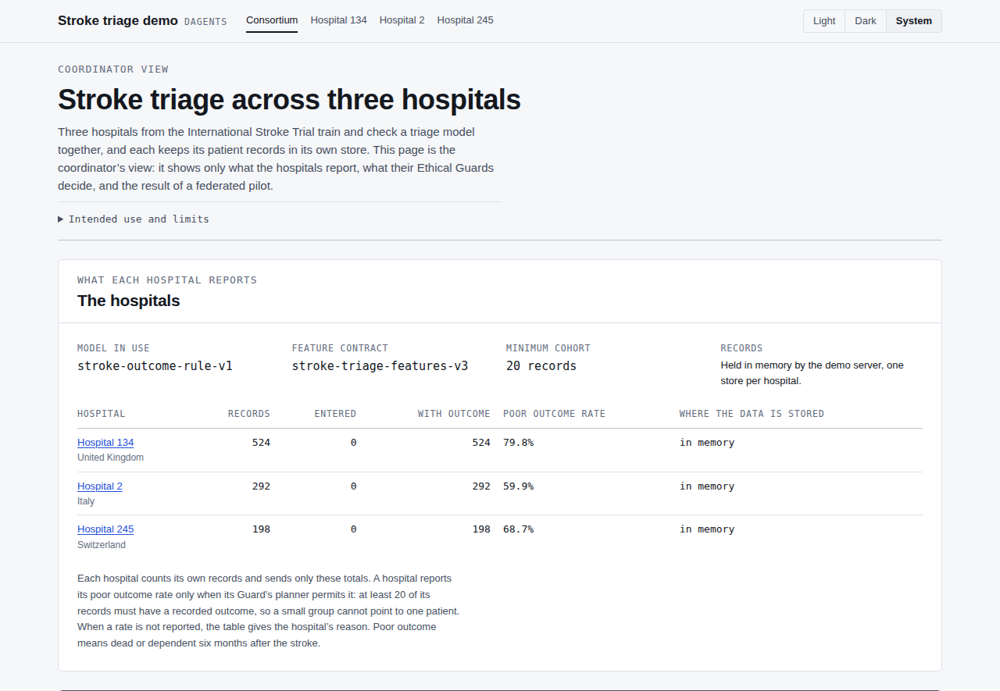
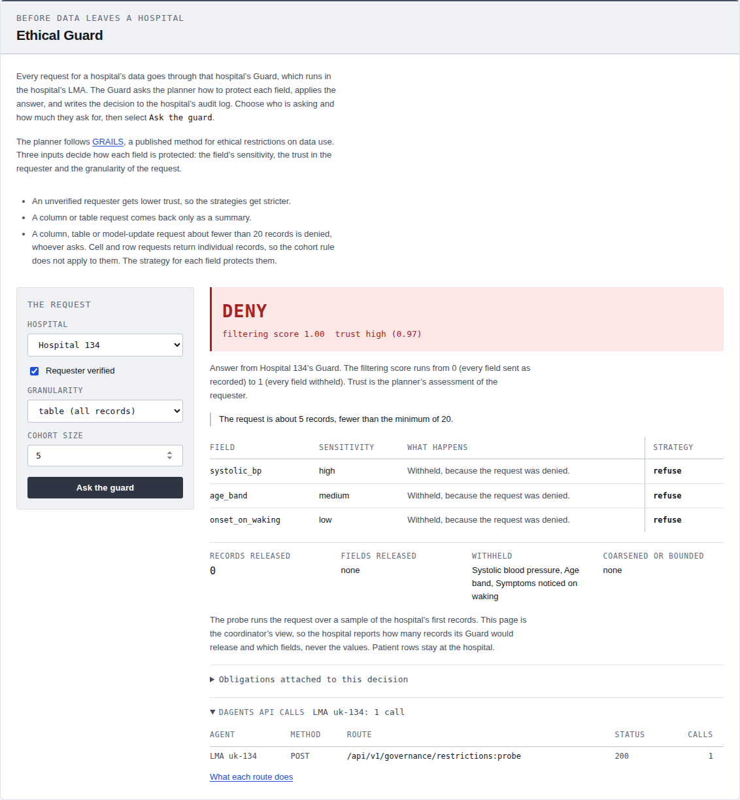
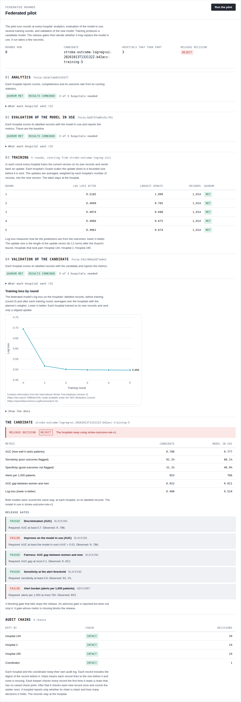
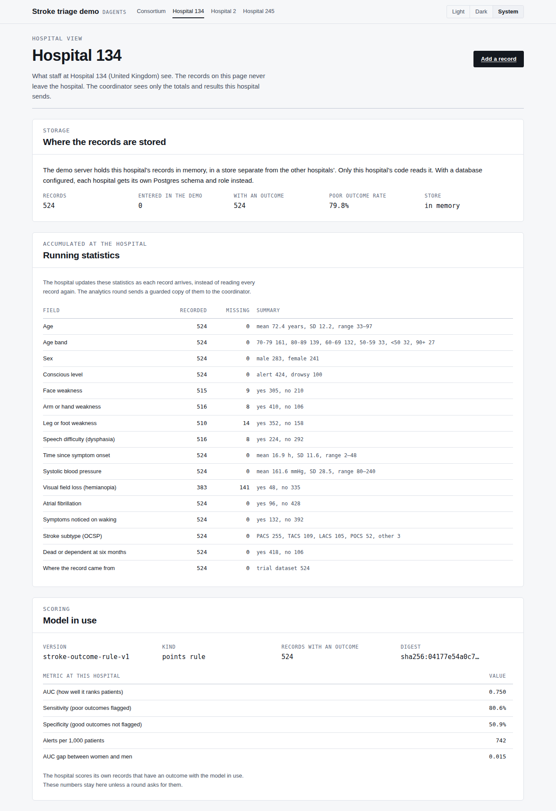
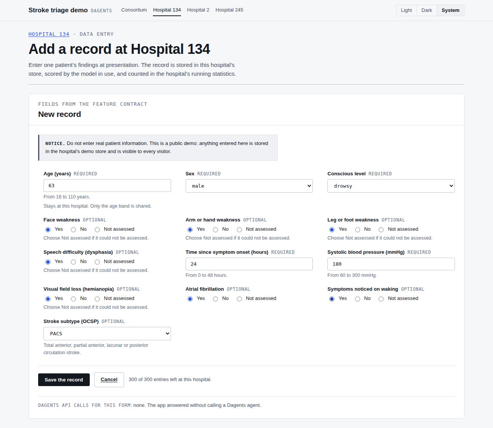
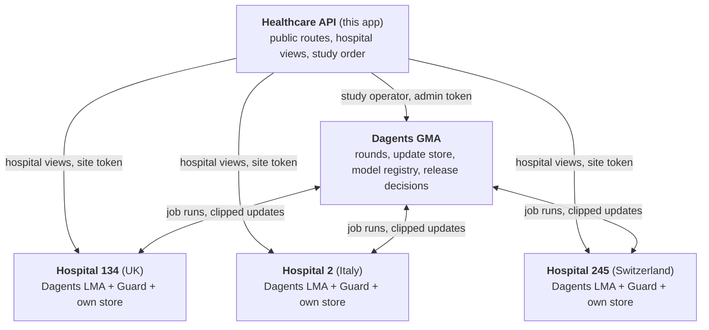

# Dagents healthcare demo: stroke triage across three hospitals

A demo application built on the [Dagents](../../README.md) framework. Three
hospitals each keep their patient records in their own store. Together they
evaluate a triage rule, train a model in federated rounds and decide whether to
release it, without sending patient records to each other or to the
coordinator.

Each hospital is served by a Dagents LMA (local monitoring agent), and the
study by a Dagents GMA (global monitoring agent). The app calls them only
through their HTTP APIs. Every successful answer whose body is a JSON object
lists the agent calls behind it; errors, the hospital list and the SVG charts
do not. The app keeps the stroke domain: the data, the models, the order of the
study, the hospitals' own views and the public API.

> **The records are real, de-identified records from the International Stroke
> Trial (1991-1996).** They show how the framework works. The scoring rule and
> the federated model are demonstrations, not validated clinical models. Nothing
> this app produces is medical advice, and it is not a medical device. See
> [Limits](#limits).

**Live:** <https://pradyunuydarp.github.io/Dagents/healthcare-demo/>

The published page calls this app's deployed API. The API keeps each hospital's
records in its own Postgres schema. The three LMAs and the GMA run inside the
API's process, and the API calls their routes without a socket. The agents run
the OCaml planner in the API's image for every governance and federation
decision. So the strategies, denials and gate results on screen come from the
planner. The page shows the data source the API reports. The API sleeps after
about 15 minutes without traffic, so the first request takes about 20 seconds,
and the page shows a banner while it waits.

The Pages build checks the API first. If the API does not answer, is not reading
Postgres, has a hospital store without records, or refuses requests from the
page's origin, the page is published as a replay of a recorded run instead. It
then says so, names the commit it was recorded from and disables data entry.

A local run needs no database and no account: each hospital keeps its records in
memory, loaded from the committed extract. See [Quick start](#quick-start), and
[`docs/deployment.md`](docs/deployment.md) for the deployed parts.

## The data

The records come from the **International Stroke Trial database, version 2**
(IST-1). The trial randomised 19,435 patients with acute ischaemic stroke in
1991-1996, and the database records each patient's hospital. The demo uses the
largest hospital in each of the three countries with the most patients:

| Site | Hospital | Country | Records | Poor outcome at six months |
|---|---|---|---|---|
| `uk-134` | Hospital 134 | United Kingdom | 524 | 79.8% |
| `it-002` | Hospital 2 | Italy | 292 | 59.9% |
| `ch-245` | Hospital 245 | Switzerland | 198 | 68.7% |

A poor outcome is death or dependency at six months (the trial's `OCCODE`). Every
record in the extract has one.

`data/ist/ist_three_hospitals.csv` holds the 1,014 records, mapped to the demo's
feature contract. `scripts/extract_ist.py` regenerates it from a pinned copy of
the source file and checks its SHA-256. The extract leaves out the trial's own
outcome predictions, free-text fields, dates and the treatment allocation;
[`data/ist/NOTICE.md`](data/ist/NOTICE.md) lists each dropped column and why.

**Licence and credit.** The database is available under the
[ODC Attribution License (ODC-By) 1.0](https://opendatacommons.org/licenses/by/1-0/);
the full text is in [`data/ist/LICENSE`](data/ist/LICENSE). Every page and chart
built from the records carries this notice:

> Contains information from the International Stroke Trial database (version 2)
> (https://doi.org/10.7488/ds/104), made available under the ODC Attribution
> License (https://opendatacommons.org/licenses/by/1-0/).

The International Stroke Trial Collaborative Group collected the data. Cite:
Sandercock PAG, Niewada M, Członkowska A; International Stroke Trial
Collaborative Group. The International Stroke Trial database. *Trials*
2011;12:101 (erratum *Trials* 2012;13:24). Dataset:
<https://doi.org/10.7488/ds/104>.

**Why not a Kaggle dataset.** The well-known Kaggle stroke datasets were checked
and rejected for two reasons:

- Their licences do not allow a public demo to serve their rows. The most used
  one is marked "Data files © Original Authors" and "use only for educational
  purposes", with a confidential source; another is listed as non-commercial
  only (CC BY-NC 3.0).
- They predict a person's risk of ever having a stroke, from fields such as
  marital status and work type. They have no examination findings, blood
  pressure, onset time or hospital, so they cannot support triage of a patient
  who has arrived with a suspected stroke.

## What this demonstrates

The hard parts of a federated study are deciding what may leave a hospital,
letting a site refuse, and holding a new model back until it passes its safety
checks. This demo shows that those parts can live in a reusable framework
instead of being rebuilt for each project.

The app reaches those parts only through the agents' APIs: the LMA's site and
job routes, and the GMA's round, update, model-version and release routes.
[The API reference](../../docs/reference/api/demo-apps.md#which-agent-calls-each-endpoint-makes)
lists the agent calls behind each endpoint of this app.

Run the pilot (`scripts/run_pilot.sh`). Five training rounds lower the
candidate's loss from 0.693 to 0.496, and the release gates then reject it:

```text
Release gates
  [PASS] discrimination                   auc=0.785902 required >= 0.7
  [FAIL] improves_on_current_release      auc=0.785902 required >= baseline 0.776916 + margin 0.02
  [PASS] subgroup_fairness                subgroup_auc_gap=0.0223969 required <= 0.1
  [PASS] sensitivity_at_alert_threshold   sensitivity=0.92237 required >= 0.8
  [FAIL] alert_burden                     alerts_per_1000=853.057 required <= 750

Decision   : REJECT
  blocking : improves_on_current_release: auc=0.785902 required >= baseline 0.776916 + margin 0.02
  the hospitals keep using stroke-outcome-rule-v1
```

The candidate's AUC (0.786) is higher than the current rule's (0.777), but not
by the 0.02 margin the consortium asks for, so it is not released. The comments
next to each gate in `backend/app/domain/conditions.py` give the reason for its
threshold. The run has no randomness, so it repeats exactly on the committed
extract. Records entered in the demo change the numbers.

### The cost of privacy, measured

`hours_since_onset` and `systolic_bp` are classified as high sensitivity. When a
site reads its records for a round, the Guard generalizes both to the nearest
10, so the round's code never sees the exact values. Measured on the committed
extract:

| Effect | Exact values | Guarded values |
|---|---|---|
| Candidate AUC at each site | 0.7594 / 0.8117 / 0.8185 | 0.7593 / 0.8115 / 0.8184 |
| Size-weighted AUC of a candidate trained on them | 0.7864 | 0.7860 |

If a consortium finds the cost too high, it changes the classification, not the
code. Lower `systolic_bp`'s sensitivity to medium and the planner returns it in
full to a trusted requester; no code path changes.

## Quick start

The only hard dependency is the OCaml planner. Build it once:

```bash
cd ../../bindings/ocaml && opam exec -- dune build ./bin/dagentsc.exe
```

Then, from this directory:

```bash
scripts/run_frontend_demo.sh           # the whole demo: API, UI and a guided tour
scripts/run_frontend_demo.sh --check   # start it, run the UI smoke test, exit
scripts/run_pilot.sh                   # no UI: run one pilot and print the results
scripts/run_local_demo.sh              # the API alone, on port 8080
```

`run_frontend_demo.sh` starts the backend and the frontend, waits until both
answer, and prints what to try. Press Ctrl-C to stop both.

A local run needs no Docker, database or model download. The three LMAs and
the GMA run inside the API's process. Records you enter are kept in memory and
are gone when the API stops. With `HEALTHCARE_DEMO_DATABASE_URL` set, the API
uses one Postgres schema per hospital instead; `/api/v1/framework/status`
reports which (`cohort_source: postgres` or `in-memory`). See
[`docs/deployment.md`](docs/deployment.md).

### Run the agents as separate processes

The same client code calls the agents over HTTP when they run as their own
processes. This needs a PostgreSQL database with the migrations applied and the
records loaded, because separate processes cannot share an in-memory store:

```bash
export HEALTHCARE_DEMO_DATABASE_URL=postgresql://user:pw@127.0.0.1:5432/healthcare_demo
SUPABASE_DB_URL=$HEALTHCARE_DEMO_DATABASE_URL ../../.venv/bin/python scripts/apply_migrations.py
SUPABASE_DB_URL=$HEALTHCARE_DEMO_DATABASE_URL ../../.venv/bin/python scripts/seed_supabase.py
```

Then:

```bash
scripts/run_local_demo.sh --agents network      # GMA, three LMAs, then the API
scripts/run_frontend_demo.sh --agents network   # the same, with the UI and the tour
```

The script starts the GMA and each hospital's LMA with uvicorn on 127.0.0.1, on
the ports in `env/.env.healthcare-demo` (`HEALTHCARE_DEMO_GMA_PORT` and
`HEALTHCARE_DEMO_LMA_<SITE>_PORT`). It makes new tokens for each run and hands
each process only its own, in its environment; it never prints them. Ctrl-C, or
any process that exits, stops all of them. `python -m app.services.agents lma
uk-134 --database` (or `gma --database`) prints the settings an agent runs
with, without secrets or addresses.

Docker Compose runs the same layout on a local PostgreSQL 16, with the GMA and
each LMA in its own container:

```bash
docker compose -f docker-compose.yml --env-file env/.env.healthcare-demo up --build
```

Its `setup` job applies the migrations, loads the records and makes the
agents' tokens once per volume. The tokens and the data stay until
`docker compose down -v`. Only the API and the UI are published on the host.

### Why the planner is required

The Ethical Guard **fails closed**. Without `dagentsc` it cannot ask what
protection a request needs, so it denies every request. That is correct, but it
means nothing useful runs, so the scripts check for the binary first.

## The UI

The page has two kinds of view. The **consortium view** is what the coordinator
sees: the numbers each hospital reports, the Ethical Guard, the federated pilot
and charts of released aggregates. It shows no patient rows. Each **hospital
view** is what that hospital's staff see: its own records and the form to add
one.



Two parts of the page show the framework at work:

- **Dagents API calls.** Under each panel, a table lists the LMA and GMA calls
  behind its data: the agent, the method, the route, the status and how many
  times it was called. It comes from the `framework_calls` field of each
  answer. It names routes, never a host or a token, and links to the agents'
  API reference on the framework site. On a hospital's pages the strip lists
  that hospital's LMA only; a call to another agent, such as the app
  registering its model versions with the GMA after the server starts, gets a
  strip of its own. `VITE_DAGENTS_SITE_URL` sets that
  site's address at build time; the default is the published site.
- **Who does what.** A panel on the consortium page lists the demo app, the
  GMA and each hospital's LMA. It says where the agents run (inside the demo
  server, or as their own processes), the GMA's round engine, whether each LMA
  answered the GMA, and which store each LMA reads. The values come from
  `GET /api/v1/framework/status`.

### Ethical Guard

The fastest way to see the governance layer. Choose a hospital, change a
control, select **Ask the guard**, and compare the strategy for `systolic_bp`:

| Change | `systolic_bp` strategy | What it shows |
|---|---|---|
| verified, row | `generalize:1` | a trusted requester still gets a rounded value |
| **untick Requester verified**, row | `redact` | lower trust gives a stricter strategy |
| verified, **table** | `aggregate_only:20` | a table comes back only as a group summary |
| verified, **model update** | `clip_contribution:1` | an update is bounded, never raw |
| verified, table, **Cohort size 5** | `refuse` → **deny** | below the minimum of 20, nobody gets it |



The model update row is this project's addition to the published GRAILS
framework. A model update is not a row, but it still carries information about
patients, so it is governed as a fifth granularity and is never released
unchanged.

The app has no rules of its own here. The hospital's LMA runs the Guard
(`POST /api/v1/governance/restrictions:probe`), every decision comes from the
OCaml planner, and changing the policy means editing a classification. Each
probe is written to that hospital's audit chain. Every visitor can read that
chain, so a probe takes no free text: the requester and the purpose are fixed
by the server, and a probe may ask only for the contract's fields other than
the outcome label.

The panel is on the coordinator's page, so it shows how many records the Guard
would release and which fields it would release, withhold or coarsen. The
API's answer holds the same: `released_count` and `released_fields`, with
`withheld_fields` and `transformed_fields`, and no record. So the probe's answer
carries no patient value, live or in the published replay.
[The APIs page of the learning guide](../../docs/learn/04-apis.md#ask-the-governance-planner)
shows an answer.

### Federated pilot



Select **Run the pilot** and eight rounds run: analytics, evaluation of the model
in use, five training rounds and validation of the candidate. The GMA runs each
round: it sends the round's job to each hospital's LMA in one call, and the
LMA runs it when it accepts. The analytics, evaluation and validation rounds each show their
manifest digest, whether they reached quorum, what each hospital sent, and how
the GMA dispatched the job to each hospital (accepted, or refused with the
LMA's reason). The five training rounds appear as
one table with the log loss, the largest update, the records used and quorum
for each round. Any excluded site is listed with the reason. Then come the
training curve, the candidate's metrics next to the current model's, and the
release gates. When every gate passes, a person must still approve the
release.

For each hospital's audit chain, and for its own release chain, the pilot
report tells the coordinator only whether the chain verifies and how many
decisions it holds. Each decision stays in the chain it was written to.

### Hospital view



A hospital's view has two groups. **Dagents LMA** shows what the hospital's
LMA keeps and reports:

- its running statistics: counts, missing values, means and category counts.
  The LMA rebuilds them when the store changes, for example after an entry;
- the model in use, with its version, digest and metrics at this hospital;
- its audit log, and what it sent in each round.

**App at the hospital** shows what the app builds from the hospital's own
records, read in its store as the hospital's role:

- where its records are stored (its schema and role, or memory);
- its worklist, ranked by the model in use, with the basis for each score;
- the records entered at this hospital, with an action to record the six-month
  outcome. An outcome is recorded once: sending the same value again changes
  nothing, and a different value returns `409`;
- charts of its own records.

### Data entry



Open a hospital's view and select **Add a record**. The form is built from
`GET /api/v1/hospitals/{site_id}/entry-form`, so the browser repeats no rule. It has choices, numbers with ranges and yes/no findings,
and no free-text field. Do not enter real patient information: the public demo
has no accounts, and every visitor can see what is entered. A new record flows
through the framework like this:

1. The API validates it and writes it to that hospital's store, acting as that
   hospital's role.
2. When the write has finished, the API asks the hospital's LMA to read the
   store again (`POST /api/v1/site/source:refresh`). The LMA rebuilds its
   running statistics from the records.
3. The hospital's worklist, its entered records and its charts include it at once.
4. Once its outcome is recorded, the next pilot uses it for training and
   evaluation. The hospital's LMA runs its Guard on every read, and the
   decisions go to that hospital's audit chain.

The form is disabled in the published replay, because a recording holds no
answers to new entries.

### Charts

The backend draws every chart as SVG with matplotlib, in the page's light or
dark theme, and serves it with a table of the same numbers. Hospital charts
(outcome by age band, findings at presentation, systolic blood pressure, risk
scores by outcome) appear only in that hospital's view. Consortium charts use
only what each hospital's LMA reports through the GMA, or what a pilot
released: records and outcome rate per hospital, AUC per hospital for the model
in use and the candidate, the training curve and the release gates. The
release-gate chart draws each gate's threshold as the planner reported it with
the gate result. Each chart carries the IST licence notice, and says who drew
it (`drawn_by`) and where its numbers come from (`data_from`).

With a database, the coordinator store keeps the newest 20 pilot reports, so
the charts of the last pilot still draw after the API restarts. A chart of a
hospital whose store holds no records is listed with `available: false` and the
reason "This hospital's store holds no records yet." The two consortium charts
of records and outcome rates are listed the same way, with the reason "No
hospital's store holds records yet.", when every store is empty.

## How it works



The app calls the agents through their HTTP APIs with the framework's agent
client (`agents/common/infrastructure/agent_client.py`). Each token has one
scope:

| Caller | Calls | Token |
|---|---|---|
| A hospital view in the app | that hospital's LMA only | the LMA's `site` token |
| The study operator in the app | the GMA only | the GMA's `admin` token |
| The GMA | each LMA's site, summary, audit summary, registration and job routes | that LMA's `coordinator` token |
| An LMA | the GMA's update upload and released model | a GMA `site` token bound to that hospital |

In process, the app makes every token when it first builds the agents (on the
first request that needs them) and logs none. Over the network,
the tokens come from the environment.

Records stay in each hospital's store. The GMA sends each round job with its
manifest, which names the model version, the digest of the model's parameters
and the digest of the training code. Before it runs the job, each hospital's
LMA loads the model and checks both digests, and it refuses the job on a
mismatch. It returns only counts, aggregate metrics, the size of its update and
the update's digest, and only when its `before_send` Guard permits the round's
contribution for the number of records it used.

A pilot runs these rounds, in the order a real study would:

1. **Analytics**: every site reports its record count, completeness and outcome
   rate, so the consortium can check the data before anything is trained. A
   site reports its outcome rate only when its planner permits a table request
   for the outcome at that many labelled records; below the minimum cohort of
   20 it reports none.
2. **Evaluation**: each site measures the model in use (the seed rule,
   `stroke-outcome-rule-v1`) on its own labelled records. The size-weighted
   result is the baseline the gates compare against.
3. **Training, five rounds**: each site trains a logistic regression for 30
   epochs on the Guard's `before_read` payload, starting from the previous
   round's model. Its update is the change in parameters. The `before_send`
   Guard clips the update to an L2 norm of 1.0, and the LMA uploads it to the
   GMA's update store. The GMA combines the clipped updates with the planner's
   FedAvg weights (each site's share of the records), using the app's model
   kind (`LogisticRegressionKind.combine`), then deletes them. Each round's
   manifest names the model version it starts from and that version's digest.
4. **Candidate validation**: each site measures the candidate on its own
   records. Its metrics come from this round, not from the round that produced
   it.

Then the GMA runs the release Guard and the release gates on the validation
and evaluation rounds, and after that a person approves or not. The GMA
collected the round results itself, and the app names the evaluation round as
the baseline (`baseline_from_round`), so the decision records
`metrics_source: rounds`. The GMA refuses to approve a candidate whose metrics
did not come from the rounds.

The seed rule is a points score chosen by hand from clinical knowledge (older
age, reduced consciousness, more deficits, visual field loss, atrial
fibrillation and a total anterior circulation stroke raise the risk). It was not
fitted to these records. Both models are measured by the same function, with the
same alert threshold (an estimated risk of 0.5).

### Where each hospital's records are kept

| | With a database | Without one |
|---|---|---|
| Store | one schema per hospital (`site_uk_134`, `site_it_002`, `site_ch_245`) | one in-memory store per hospital |
| Who reads it | that hospital's `NOLOGIN` role, which owns the schema; the app and the hospital's LMA both act as it | the app's view of that hospital and its LMA only |
| Job log | the hospital's LMA writes what it sent in each round to `coordinator.site_contributions`, as the hospital's role; row-level security keeps each hospital to its own rows | in memory, in each LMA |
| Coordinator | role `dagents_coordinator`, schema `coordinator`: the GMA's model registry (`models`) and release Guard audit chain, and the app's pilot reports; no access to any site schema | in memory, in the GMA and the app |
| Audit chain | `<schema>.guard_audit`, one chain per hospital, and `coordinator.guard_audit` for releases; each with a `guard_audit_anchor` table where its last check ended | in memory, one chain per hospital and one for releases |

Every database operation runs in one transaction that starts with `SET LOCAL
ROLE` and checks `current_user`. Row-level security is on for every table, and
the migrations revoke all access from Supabase's data API roles
(`supabase/migrations/0002_site_isolation.sql` and
`0003_coordinator_records.sql`).

**One limit on Supabase.** The API connects with one credential, and on Supabase
that role also holds `pg_read_all_data`. So the isolation binds the code paths
(every query runs as a site role), not the credential. A real deployment gives
each site's LMA its own login and database. The store reads an optional
connection string per site for that case, for example
`HEALTHCARE_DEMO_SITE_UK_134_DATABASE_URL`.

### What leaves a site

A site returns these fields and nothing else:

| Field | Why it is allowed |
|---|---|
| `round_id`, `site_id` | which round and which site the result is for |
| `job_digest` | the round digest the site computed and checked before it ran the job |
| `contributed_examples` | a count, not a list of patients |
| `update_norm` | the size of the update, after the Guard clipped it |
| `update_digest` | the digest of the clipped update; the update itself goes to the GMA's update store, never into the result |
| `metrics` | aggregate measures the site computes (counts, outcome rate, AUC, sensitivity, losses); a result leaves only when the site's `before_send` Guard permits the round's contribution for its cohort size, and the Guard does not inspect each metric |
| `participation`, `code_verified`, `privacy_checks_passed` | round status |
| `local_evidence_pointer` | an address at the site, readable only there |
| `refusal_reason` | why the site refused or could not run the job, from its own checks or its Guard; empty when it ran. When an LMA's call fails, the GMA keeps only the status and error code |

A test checks that no record field, such as an encounter id, an age band, a
blood pressure or an outcome label, appears in a site result.

## What the framework owns and what the app owns

`backend/app/extension.py` is the whole integration with the extension
registry: one declarative file that imports no framework internals. It
contributes the feature contract, the classification, the condition pack, two
model kinds, a site source and two pipeline steps. `backend/app/services/agents.py`
is the only module that builds or connects to the agents.

| The framework owns | Through which API | This app owns |
|---|---|---|
| Guard enforcement and the hospital's audit chain | LMA `POST /api/v1/governance/restrictions:probe`, `GET /api/v1/governance/audit` | Which fields are sensitive, under which regulations, and the approved purposes |
| Running statistics and the outcome-rate decision | LMA `GET /api/v1/site/profile`, `GET /api/v1/site/summary` | The per-hospital stores, their schema, data entry and the entry form |
| The model in use at the hospital, and its local metrics | LMA `GET /api/v1/site/model`, `POST /api/v1/site/model:evaluate` | The worklist, the threshold sweep and the scoring of each record |
| Each hospital's part of a round, and its job log | LMA `POST /api/v1/federation/jobs:run` (called by the GMA: the offer and the execution in one call), `GET /api/v1/federation/jobs` | The seed rule and the logistic regression, contributed as model kinds, including how an update is checked and combined |
| Enrolment, round planning, quorum, job dispatch and aggregation readiness | GMA `POST /api/v1/federation/sites:refresh`, `POST /api/v1/federation/rounds` (its answer carries the readiness), `POST .../rounds/{round_id}:aggregate` | The order of the pilot's rounds, the manifest values and the training settings |
| The update store | GMA `PUT /api/v1/federation/rounds/{round_id}/updates/{site_id}` (called by each LMA), `POST .../rounds/{round_id}:discard` | Which hospitals take part, and which condition |
| The model registry, the release Guard, the release gates and approval | GMA `GET`, `PUT` and `:approve` on `/api/v1/model-versions`, `POST .../rounds/{round_id}:evaluate-release` | Which gates this condition needs and their thresholds, and the pilot report |
| What the hospitals report to the coordinator | GMA `GET /api/v1/federation/sites/summaries` | The IST extract and the hospitals chosen from it |
| Role-scoped Postgres access (`postgres_roles.py`) | a library call | FHIR mapping into the contract |
| The SVG chart renderer | a library call | Which charts each view shows, and their text |

Nothing in `agents/` knows what a stroke is, and nothing here implements a quorum
rule. A second condition needs another `ConditionPack`, not a framework change.

`GET /api/v1/extension` returns this split from the running app, with the
extension registry as the GMA describes it.

### One platform, separate clinical applications

The platform can be reused across conditions; the clinical application cannot.
`GET /api/v1/conditions` lists one implemented condition and four planned ones.
Each planned one is marked `not implemented` and lists what it still needs: its
own cohort definition, feature contract, model or rules, thresholds, workflow,
owner and safety evidence.

## API

| Endpoint | What it does |
|---|---|
| `GET /api/v1/overview` | the consortium, the numbers each hospital reports, and the release gates |
| `GET /api/v1/hospitals/{id}` | one hospital's own view: store, running statistics, local metrics, contributions |
| `GET /api/v1/hospitals/{id}/worklist` | that hospital's records, ranked by the model in use |
| `GET /api/v1/hospitals/{id}/entry-form` | the data-entry form, built from the field domains |
| `POST /api/v1/hospitals/{id}/encounters` | store a new record at that hospital (`Idempotency-Key` header) |
| `POST /api/v1/hospitals/{id}/encounters/{encounter_id}/outcome` | record the six-month outcome of an entered record, once; a different value later returns `409` |
| `GET /api/v1/hospitals/{id}/encounters?origin=entered` | the records entered at that hospital |
| `GET /api/v1/hospitals/{id}/audit` | that hospital's Guard decisions and chain state |
| `GET /api/v1/hospitals/{id}/charts` | that hospital's charts, with table views |
| `GET /api/v1/charts` | the consortium charts, with table views |
| `POST /api/v1/governance:probe` | send one request through a hospital's Guard and see the decision; no free text, and no outcome label |
| `POST /api/v1/pilot:run` | run the pilot (`round_prefix` is `ui` or `api`) and return every round and gate, and each audit chain's state and length |
| `GET /api/v1/models` | the model in use and the 20 newest registered versions |
| `POST /api/v1/models/{version}:approve` | release a candidate whose gates all passed |
| `GET /api/v1/framework/status` | where the records are stored, whether every store is ready, each hospital's record counts, how the agents run (`agents`) and which agents answer |

Every successful answer whose body is a JSON object also has
`framework_calls`: the LMA and GMA calls behind it, by route, with no host and
no token. Errors, the hospital list (a JSON list) and SVG charts have none.

A store or database failure, a missing planner or an agent that does not answer
returns a JSON `503` with a plain message, and any other error a JSON `500`;
[`docs/deployment.md`](docs/deployment.md#what-the-api-returns-when-something-fails)
lists them. The full list of endpoints, generated from the code, is in
[`docs/reference/service-inventory.md`](../../docs/reference/service-inventory.md).
[Step 4 of the learning guide](../../docs/learn/04-apis.md) walks through these
calls against the API run locally.

### Limits on the public demo

The public demo has no accounts, so the API limits what one visitor can do:

| Limit | Default | Setting |
|---|---|---|
| Records each hospital's form may add | 300, then 409 | `HEALTHCARE_DEMO_MAX_ENTERED_PER_SITE` |
| Entries per client per minute | 30, then 429 | `HEALTHCARE_DEMO_RATE_LIMIT_ENTRIES` |
| Guard probes per client per minute | 60 | `HEALTHCARE_DEMO_RATE_LIMIT_PROBES` |
| Pilots per client per minute | 3 | `HEALTHCARE_DEMO_RATE_LIMIT_PILOTS` |
| Approvals per client per minute | 10 | `HEALTHCARE_DEMO_RATE_LIMIT_APPROVALS` |
| Guard probes at one hospital per hour, all visitors together | 600, then 429 | `HEALTHCARE_DEMO_PROBES_PER_SITE_PER_HOUR` |
| Pilots per hour, all visitors together | 20, then 429 | `HEALTHCARE_DEMO_PILOTS_PER_HOUR` |
| Largest request body | 64 KB, then 413 | `HEALTHCARE_DEMO_MAX_BODY_BYTES` |
| Public requests the API works on at once | 12 | `HEALTHCARE_DEMO_MAX_IN_FLIGHT` |
| How long a request waits for one of those slots | 20 seconds, then 503 with `Retry-After: 60` | `HEALTHCARE_DEMO_IN_FLIGHT_WAIT_SECONDS` |

`0` turns a rate limit or an hourly cap off. The health routes never wait for
a slot. The cap keeps the agents' threads free: each public request can make
nested calls to the agents, and in process the agents share
`HEALTHCARE_DEMO_AGENT_THREAD_TOKENS` threads (default 64). The API refuses to
start with fewer than 4 × the cap + 8. One pilot runs at a time. The
hourly caps count any 60 minutes. They bound how fast the stored audit chains
and the model registry grow, because each probe and pilot adds rows that stay
in the database. A 429 from a cap has `Retry-After` and says which limit was
reached.

The rate limits count requests per client. Locally the client is the TCP peer.
Behind proxies, set `HEALTHCARE_DEMO_TRUST_FORWARDED_FOR=true` and
`HEALTHCARE_DEMO_FORWARDED_FOR_HOPS` to the number of proxies that append to
`X-Forwarded-For`; the client is the entry that many places from the right. The
entries further left are whatever the client sent, so they are never used. When
`RENDER` is set, the defaults are on and 3. `/api/v1/framework/status` reports
how many entries each request arrives with, so the hop count can be checked. The
limits apply per process, so they slow casual misuse and are not a security
control.

## Tests

Inside the Dagents repository:

```bash
PYTHONPATH=../..:backend ../../.venv/bin/python -m unittest discover -s tests -t .
```

In its own repository, tell the suite where the framework is:

```bash
DAGENTS_HOME=~/src/Dagents PYTHONPATH=$DAGENTS_HOME:backend python -m unittest discover -s tests -t .
```

The governance tests run against the real `dagentsc` binary, not a stub, because
a stub would only prove that the app calls something. **Check the skip count.**
Without the planner, most of these tests skip and the suite still reports `OK`.

The Postgres tests (the stores, the isolation, the Postgres pilot, data entry,
the API, the status report and the upgrade from the synthetic-data version)
need a PostgreSQL 16 server, because they check the per-grant options that
PostgreSQL 16 added. The migrations also run on PostgreSQL 15; see
[`docs/deployment.md`](docs/deployment.md). Each test creates a scratch database, adds
Supabase's roles (`supabase/emulate_supabase_roles.sql`), applies the migrations
as a non-superuser, and drops everything afterwards:

```bash
HEALTHCARE_DEMO_TEST_DATABASE_URL=postgresql://admin:pw@127.0.0.1:5432/postgres \
  PYTHONPATH=../..:backend ../../.venv/bin/python -m unittest discover -s tests -t .
```

Without that variable they skip with a message that starts `database test
skipped`. The in-memory store runs the same assertions without a database. CI
runs a Postgres 16 service and fails if any database test skipped.

The frontend has a browser smoke test, because a typecheck and a bundle only
prove that the app compiles:

```bash
scripts/run_frontend_demo.sh --check     # starts the stack, runs the test, stops
cd frontend && npm run smoke             # against a running stack
```

It tries all three guard controls, runs a full pilot, opens a hospital view,
submits a data entry, checks that every "Dagents API calls" table names its
agent and route and holds no address, and fails on any console error or failed
request. Without a browser it exits 2 and prints `SKIP`.
`scripts/run_frontend_demo.sh --check --agents network` runs the same test
against agents in their own processes.

`tests/test_network_mode.py` starts the GMA, the three LMAs and the API as five
uvicorn processes on free loopback ports against a scratch PostgreSQL 16
database. It checks that a pilot over HTTP gives the same numbers as one in
process, that an approval releases a candidate at the GMA and at every LMA
process, and that no answer or log holds a token or an agent's address. It
needs the database URL above and the planner.

Good tests to read first:

- `tests/test_federated_pilot.py`: `test_no_patient_level_data_crosses_the_boundary`,
  `test_training_lowers_the_loss_and_every_update_is_clipped` and
  `test_the_release_decision_follows_from_the_gate_results`
- `tests/test_site_isolation.py`: `test_a_site_cannot_read_or_write_another_site`
  and `test_the_coordinator_cannot_read_any_site`
- `tests/test_data_entry_flow.py`: `test_labelled_entries_reach_the_next_round`
- `tests/test_boundary.py`: which framework modules each app file may import
- `tests/test_agents_wiring.py`: each LMA reads only its own hospital's store,
  and the GMA reads none
- `tests/test_pilot_parity.py`: a pilot through the agents gives the same
  numbers as the version before them

## Layout

```text
backend/app/
  extension.py           the whole Dagents integration
  domain/
    conditions.py        feature contract, classification, condition pack, release gates, field domains
    dataset.py           the three IST hospitals and the extract loader
    stroke_rule.py       the seed rule and the shared evaluation
    stroke_model.py      the logistic regression: encoding, local training, updates
    fhir.py              FHIR-shaped ingestion into the contract
    model_kinds.py       the seed rule and the logistic regression as model kinds the agents run
  services/
    agents.py            builds the LMAs and the GMA in process, or connects to them over HTTP
    site_store.py        the per-hospital stores and the coordinator store (memory and Postgres)
    site_source.py       a hospital's store as its LMA reads it
    hospital_views.py    each hospital's own views, through its LMA and its store
    overview.py          the coordinator's pages, the models and approval, through the GMA
    pilot.py             the study: the pilot's rounds as GMA calls
    charts_service.py    the charts each view shows
  main.py                FastAPI app: the public routes, their limits and framework_calls
data/ist/                the IST extract, its licence and notice
supabase/                migrations and the role emulation used by the tests
frontend/
  src/                   the UI (Vite + React): consortium view, hospital view, data entry
  public/                the link preview image, the icons and the web manifest, rendered from
                         Dagents' design/social/ and copied here so the app stays extractable;
                         the recording capture also writes recording.json here
  social-meta.mjs        writes the published address (PUBLIC_SITE_URL) into the link preview tags
  smoke.mjs              drives the UI against a live backend
docs/screenshots/        screenshots of the UI
scripts/                 run the demo, run the pilot, extract the data, seed a database, move into its own repository
tests/                   the test suite
```

## Moving it into its own repository

```bash
scripts/extract_repo.sh ~/src/dagents-healthcare-demo
```

`git subtree split` keeps this directory's history. The app still imports the
framework afterwards, so set `DAGENTS_HOME` to a Dagents checkout with the
planner built, or install Dagents as a dependency.

## Limits

- **The records are from 1991-1996.** Stroke care has changed since then, so
  outcomes today differ. The trial also enrolled a narrower group than everyone
  seen with a suspected stroke: patients with a clinical diagnosis of acute
  ischaemic stroke within 48 hours of onset.
- **No model here is validated.** The seed rule's points were chosen by hand. The
  candidate is trained and measured on the same three hospitals' records, which
  flatters it by about 0.02 AUC.
- **The published demo runs every agent in one process.** The app calls the
  agents' real routes, with their request checks and tokens, but without a
  socket. That tests the job logic, not production privacy, security,
  reliability or networking. Network mode runs the same code over HTTP on one
  machine. The GMA's HTTP engine, with the app's averaging in a model kind,
  stands in for a federated learning runtime such as Flower or NVIDIA FLARE.
- **A restart during a pilot fails that pilot.** The GMA keeps enrolments,
  rounds and pending updates in memory. Model versions, release decisions and
  audit chains survive with a database.
- **Digests are not signatures.** The round digest is a content hash that
  detects changes. It does not prove who sent the round; signing is separate work.
- **The audit chain is not an audit store.** Chaining makes tampering detectable
  in a test. Production needs append-only storage, retention rules and signing.
- **Clipping and noise are not differential privacy.** The Guard bounds each
  update and can add noise, which shows where a privacy mechanism belongs. A real
  deployment needs a privacy accountant and a tracked privacy budget.
- **The in-memory stores do not survive a restart.** Without a database, a
  restart reloads the committed extract and the seed model, so entered records,
  outcomes, model versions, pilot reports and release decisions are lost. With
  Postgres they are kept, and a candidate can be approved after the API
  restarts.
- **Architecture is not compliance.** HIPAA and SOC 2 also require
  administrative and physical safeguards, proof that controls work in practice,
  and independent audits. No codebase provides those.

## Reading

- [`docs/deployment.md`](docs/deployment.md): the per-hospital stores, the
  deployed API, where each credential is kept, and what the publish check
  refuses
- [`data/ist/NOTICE.md`](data/ist/NOTICE.md): the dataset's source, licence,
  credit, citation and column mapping
- [`docs/learn/`](../../docs/learn/README.md): the learning guide, from
  federated learning basics to the APIs
- [`docs/presentation/healthcare-case-study/`](../../docs/presentation/healthcare-case-study/):
  the case study and the federated use case this app implements
- [`bindings/ocaml/README.md`](../../bindings/ocaml/README.md): the planner
  modules, including `governance_compiler` and `federation_compiler`
- Kulkarni and Ramanathan, [GRAILS: A Framework for Embedding Ethical Safeguards
  in Software Applications for Responsible AI](https://ojs.aaai.org/index.php/AIES/article/view/36650),
  AIES 2025
- Sandercock et al., [The International Stroke Trial database](https://doi.org/10.1186/1745-6215-12-101),
  *Trials* 2011;12:101
