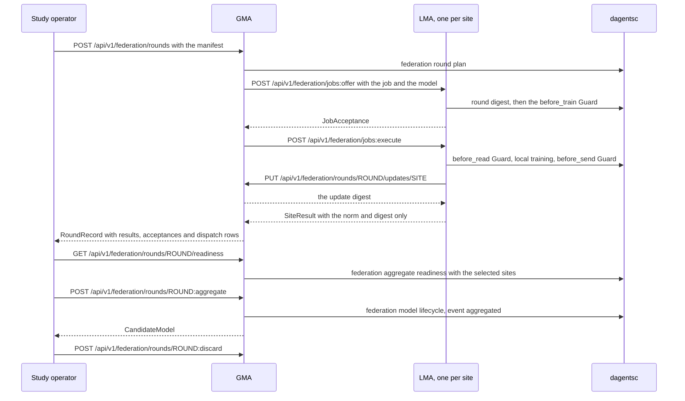

# LMA and GMA architecture

## Summary

Dagents runs two kinds of agent:

- **LMA** (local monitoring agent): one per data source, such as a tenant, a
  database, a service, an event stream or a hospital. It is the boundary of
  the source's data: records are read, profiled, governed and used for local
  model work inside it.
- **GMA** (global monitoring agent): one per study or fleet. It enrols the
  LMAs, plans and dispatches federated rounds, combines what the LMAs return,
  keeps the model versions, and decides on release with a person's approval.

Both agents ask the OCaml planner (`dagentsc`) for every deterministic
decision and apply the answer. They call each other only through their HTTP
APIs.

## Why this exists

Consumer products such as Watchdog and Datalytics need a framework that can:

- run models next to each data source, without moving the source's records;
- combine source-level results and run aggregate models across sources;
- govern every read, every training run and everything that leaves a source;
- generate the Kubernetes workloads for all of this.

The agents do not replace a product's own services. They wrap around them as
an execution and coordination layer.

## Two ways to start an LMA

| | Generic LMA | LMA for one site |
|---|---|---|
| Started with | No `LMA_SITE_ID` | `LMA_SITE_ID` and `LMA_CONDITION_ID`, or a `SiteConfig` in `LmaDeps` |
| Records | Sent in each request, or read from a registered source | Read from the site's own source (`SiteRecordSource`), as the site's database role |
| Guard | Plans against the classification in each request | Plans against the condition pack's classification, and refuses a request whose inline classification differs |
| Routes | Profiling, model runs, sources, bundles and runs, the Guard, the audit log | All of those, plus the site routes (`/site`, `/site/summary`, `/site/profile`, `/site/source:refresh`, `/site/model`, `/site/model:evaluate`, `/governance/restrictions:probe`, `/governance/audit:summary`) and the federated job routes (`/federation/registration`, `/federation/jobs:offer`, `/federation/jobs:execute`, `/federation/jobs`) |
| Lock-down | None | A request may not embed a source in `dataset` or register a source that names a database, a role, a credential or SQL |

A generic LMA answers `404` on the site and job routes. One process can serve
several LMAs, one per site: `create_app(settings, deps)` builds each one with
its own services and shares nothing between them.

The GMA works the same way. A GMA with nothing configured runs the in-process
simulator engine, keeps everything in memory and answers every caller, as it
did before sites existed. `GMA_ENGINE=http` and `GMA_SITE_ENDPOINTS` make it
dispatch rounds to the LMAs over HTTP.

## Responsibilities

| LMA | GMA |
|---|---|
| Read and profile the source's records; keep a running profile, rebuilt when the source's version changes | Enrol each configured LMA from its own registration (`POST /federation/sites:refresh`) |
| Apply the Guard at `before_read`, `before_train` and `before_send`, and keep the site's audit chain | Plan each round, check quorum, and keep round records |
| Report counts, and a label rate only when the site's planner permits it | Report what every site says about itself (`GET /federation/sites/summaries`), never a record |
| Check each offered job before reading any data, run accepted jobs on the Guard's payload, and log each job | Offer each selected site its job, ask it to run, and record the status of every call |
| Send a training job's clipped update to the GMA, never into a result | Hold training updates in a write-only store until aggregation, then delete them |
| | Combine updates with the model kind's `combine` and the planner's weights into a candidate |
| | Run the `before_release` Guard and the release gates, and approve a release only when the planner's lifecycle rule allows it |

## One training round, call by call



Before it reads any data, the LMA checks that the job is for its site, round
and condition; that the task matches the round's phase; that the job carries
the manifest's model with a matching digest; that a model kind of its
extensions runs the model and the code digest is the kind's; that a training
job's kind can be trained; the round digest, computed with its own planner;
and then the contract version, the approved fields and the `before_train`
Guard. A refusal is an answer with its reason. A planner failure refuses the
job.

The GMA's controller enforces the round rules: a round id is used once
(`409`), only sites the plan selected may report (`403`), an `aggregated` or
`closed` round takes no more results (`409`), and readiness counts only the
selected sites. With the HTTP engine every result comes from an LMA, so a
result posted to the results route answers `409`. A round is aggregated once
and takes one release decision (`409` for a second). A `GET` of readiness
stores nothing. The update upload runs on a small thread pool of the GMA's own,
so an upload never waits for the server threads that the dispatches hold.

## Calls between agents

`agents/common/infrastructure/agent_client.py` gives one client for both
transports:

| Transport | Built with | A call goes through |
|---|---|---|
| In process | `AgentNetwork.in_process()` and `add_app(...)` | The agent's real routes, request checks and token checks, through `httpx.ASGITransport`, on one event-loop thread, without a socket |
| Over HTTP | `AgentNetwork.over_http({name: base_url})` | HTTP, with one kept-alive client per agent |

The agents are named `gma` and `lma:<site_id>`. The typed clients
(`network.gma(token)`, `network.lma(site_id, token)`) have one method per
route and return the domain models.

- **Timeouts.** A call times out after 30 seconds, and after 120 seconds for
  a job's execution, a round's dispatch, a site refresh and the site
  summaries.
- **Errors.** A response that is not 2xx raises `AgentError` with `status`,
  `code` and `detail`. No answer, a timeout, or a `502`, `503` or `504` without
  a JSON `code` raises `AgentUnavailableError`. No error holds a host, a port or
  the body of an answer that is not JSON.
- **Repeat once.** Over HTTP, a call is sent once more when a kept-alive
  connection closed before the answer came. These routes refuse a repeat with
  `409`, so a repeat of them cannot act twice: a round dispatch with a used
  round id, a second update upload from a site, a second offer or execution of
  the same job at an LMA, a second aggregate of a round, a second release
  evaluation of a round, and an approval of a version that is no longer a
  candidate. The other routes that change state store the same thing again, or
  add one more record (a Guard enforcement or a probe adds an audit record).
- **Call log.** Inside `with CallLog() as log:`, each call is recorded as
  `{service, site_id, method, path, status, ms}`, where `path` is the route
  template, never a host.
- **In process, mind the threads.** The agents' sync handlers share one thread
  limiter (64 tokens by default). An application that hosts its agents caps
  the requests it lets in, and calls the clients from a thread, never from the
  network's event loop. `close()` stops the loop.

## Tokens and errors

An agent started with tokens needs `Authorization: Bearer <token>` on every
route except `/health`. Each token has one scope:

| Agent | Scope | Held by |
|---|---|---|
| LMA | `site` | The site's own staff and applications |
| LMA | `coordinator` | The GMA, for the registration and job routes |
| GMA | `admin` | The study operator |
| GMA | `site`, bound to one site | That site's LMA, for its own update upload, the released model, and the reports of an agent registered with its own site in `scope.site` |

A missing or unknown token answers `401`, a token of the wrong scope `403`.
Without tokens an agent answers every caller and logs a warning;
`LMA_REQUIRE_TOKENS=1` and `GMA_REQUIRE_TOKENS=1` make it refuse to start.

The agents answer their own errors as `{"detail": ..., "code": ...}` with the
codes `unauthorized`, `forbidden`, `not_found`, `conflict`,
`aggregation_refused`, `invalid_request`, `planner_unavailable`,
`store_unavailable`, `store_not_set_up`, `agent_unavailable` and `bad_gateway`
(LMA) or `agent_error` (GMA). No `detail` holds a host, a token or a connection
string. The full table is in the API reference, under
[Tokens, errors and calls between agents](../reference/api/agents.md#tokens-errors-and-calls-between-agents).

## What each agent stores

| Agent | In Postgres, when configured | Always in memory |
|---|---|---|
| LMA | The audit chain and the job log, written as the site's role | The records it read and the running profile |
| GMA | The model registry and the release Guard's audit chain, written as the coordinator's role | Enrolments, rounds and pending training updates |

A GMA restart during a round loses the round and its updates, so the round
cannot be aggregated. Model versions, release decisions and audit chains
survive.

## Repository shape

```text
agents/
├── common/
│   ├── domain/            federation.py, site.py, errors.py: the shared contracts
│   ├── application/       governance, the round controller, the worker, the ports
│   ├── extensions/        the extension registry: contracts, classifications, packs, model kinds, site sources
│   └── infrastructure/    agent_client.py, agent_auth.py, postgres_lease.py, dagents_runner.py, sources
├── gma/
│   ├── adapters/          http_federation_engine.py
│   ├── application/       model_registry.py, release_service.py, site_directory.py
│   ├── domain/
│   ├── infrastructure/    update_store.py, postgres_models.py
│   └── app_factory.py, routes.py, config.py, di.py, main.py
└── lma/
    ├── adapters/          gma_link.py, http_update_channel.py
    ├── application/       site_service.py, federation_jobs.py, monitoring_service.py
    ├── domain/            site_config.py
    ├── infrastructure/    job_log.py
    └── app_factory.py, routes.py, config.py, di.py, main.py
```

`domain/` stays pure. Storage and messaging sit behind interfaces, so in-memory
delivery can be replaced by a database or a message broker without changing
the layout.

## Contracts

The shared protobuf contract for profiling, model execution, deployment
planning, workload generation and source registration is in
`contracts/grpc/dagents/agents/v1/lma_gma.proto`. The HTTP contracts of the
site, job, round, update and model version routes are the Pydantic models in
`agents/common/domain/federation.py` and `agents/common/domain/site.py`, and
every endpoint is in the [API reference](../reference/api/agents.md).

## Current limits

- Messaging is in memory, and broker-backed delivery is later work.
- The GMA's enrolments and rounds are in memory.
- The in-process engine is a simulator. The HTTP engine moves jobs and
  updates; it is not a secure-aggregation protocol, and the GMA sees each
  site's clipped update.
- The agents have no body-size or rate limits of their own. Run them on a
  private network, behind the application that calls them.
