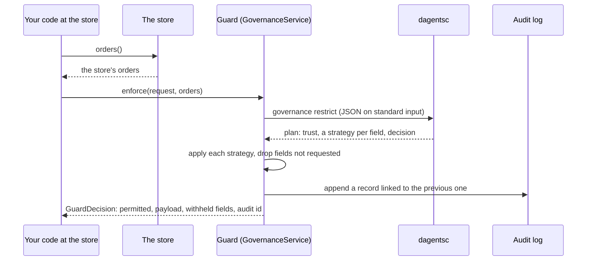

# Step 4: Govern every read

The **Ethical Guard** stands between your code and your records. For each
request it asks the planner what protection every field needs, applies that
protection to the records, drops every field the request did not ask for, and
writes an audit record. The planner makes the decision. The Guard applies it
and records it. The planner returns one of three decisions: `permit`, `narrow`
(some fields are protected or withheld) or `deny`. The design follows GRAILS
(Kulkarni and Ramanathan, AIES 2025), described in
[Privacy and data governance](../learn/02-privacy-and-governance.md).

## The four boundaries

A request carries the boundary it is checked at. The same Guard serves all four,
and the audit log records which one made each decision.

| Boundary | When | Who asks, usually | Granularity | Where in the example |
|---|---|---|---|---|
| `before_read` | Before records are read at a source | A person at the source, or the round's code | `row` | `StoreSite.read`, and the worker before it runs a job |
| `before_train` | Before training or evaluation uses the records | The coordinator | `table` | The worker, when it is offered a job |
| `before_send` | Before anything leaves the source | The coordinator | `table` or `model_update` | `StoreSite.summary`, and the worker before it returns a result |
| `before_release` | Before a candidate model or rule is released | The release committee | `model_update` | `Coordinator.release_check` |

## What happens in one guarded read



If the planner cannot be reached, the Guard skips the middle steps, denies the
request and still writes the audit record.

## 1. Build the request

A `RestrictionRequest` says who is asking, at which boundary, for which fields,
at which granularity and for which purpose. In the example, each store builds
one in `StoreSite`:

<!-- source: examples/getting-started/shop/store_site.py -->
```python
class StoreSite:
    """One store, acting as its own local agent."""

    def __init__(self, store: OrderStore) -> None:
        self.site_id = store.site_id
        self.store = store
        # Each store has its own Guard and its own audit log.
        self.governance = GovernanceService()

    def registration(self) -> SiteRegistration:
        """How this store enrols in the study."""
        return SiteRegistration(
            site_id=self.site_id,
            capabilities=["evaluate"],
            feature_contract_version=CONTRACT_VERSION,
            approved_conditions=["order_returns"],
            cohort_size=self.store.count(),
            enrolled=True,
        )

    def read(self, requester: Requester, fields: list[str], purpose: str) -> GuardDecision:
        """Read orders for someone at this store, through the Guard (before_read)."""
        request = RestrictionRequest(
            request_id=f"{self.site_id}:read:{requester.requester_id}",
            boundary="before_read",
            requester=requester,
            classification=self.governance.get_classification(CLASSIFICATION.classification_id),
            requested_fields=fields,
            granularity="row",
            cohort_size=self.store.count(),
            declared_purpose=purpose,
            approved_purposes=APPROVED_PURPOSES,
        )
        return self.governance.enforce(request, self.store.orders())
```

- `GovernanceService()` holds the Guard and an in-memory audit log. Each store
  creates its own, so each store has its own audit chain.
- `get_classification` returns the classification the extension registered in
  Step 2.
- `cohort_size` is the number of records the request concerns. The planner
  requires it at `column`, `table` and `model_update` granularity when the
  classification sets a minimum cohort.

## 2. Describe the requester

Trust comes from the requester's attributes. An attribute is something your
application has checked, such as a staff id. Mark it `verified=True` only when
your application has checked it.

<!-- source: examples/getting-started/step2_guard_check.py -->
```python
"""Step 2: read orders at one store through the Guard, as three different people."""

from agents.common.domain.governance import KyuAttribute, Requester

from shop.extension import install
from shop.store import load_store
from shop.store_site import StoreSite

install()
north = StoreSite(load_store("store-north"))

REQUESTERS = [
    # Staff whose identity and training the store has checked.
    Requester(
        requester_id="analyst-anna",
        requester_kind="human",
        attributes=[
            KyuAttribute(attribute_id="staff_id", verified=True),
            KyuAttribute(attribute_id="data_training", verified=True),
        ],
        compliance_history=0.9,
    ),
    # Staff with a checked identity but no data training on record.
    Requester(
        requester_id="new-hire-ben",
        requester_kind="human",
        attributes=[
            KyuAttribute(attribute_id="staff_id", verified=True),
            KyuAttribute(attribute_id="data_training", verified=False),
        ],
        compliance_history=0.5,
    ),
    # Someone whose identity nobody has checked.
    Requester(
        requester_id="contractor-cy",
        requester_kind="human",
        attributes=[KyuAttribute(attribute_id="staff_id", verified=False)],
        compliance_history=0.5,
    ),
]
FIELDS = ["order_value", "category", "customer_age_band", "returned"]

for requester in REQUESTERS:
    decision = north.read(requester, FIELDS, purpose="returns_quality_review")
    plan = decision.plan
    print(f"{requester.requester_id}: trust {plan.assessment.trust}, decision {plan.decision}, permitted {decision.permitted}")
    for restriction in plan.field_restrictions:
        print(f"  {restriction.field:<18} {restriction.sensitivity:<7} {restriction.strategy}")
    if decision.permitted:
        print("  first two rows:", decision.payload[:2])
    else:
        print("  reason:", decision.message)
    print()

audit = north.governance
print(f"Audit log at store-north: {audit.audit_record_count()} records, chain intact: {audit.audit_chain_intact()}")
```

The planner gives each requester a score from 0 to 1: 0.7 times the share of
attribute weight that is verified (an unverified attribute counts a quarter),
plus 0.3 times the compliance history. Below 0.4 the trust is `low`, below 0.75
it is `moderate`, and from 0.75 it is `high`. A requester with no attributes
always scores 0.

## 3. Run it

```bash
PYTHONPATH=. .venv/bin/python examples/getting-started/step2_guard_check.py
```

Expected output:

<!-- output: examples/getting-started/step2_guard_check.py -->
```text
analyst-anna: trust high, decision narrow, permitted True
  order_value        high    generalize:1
  category           low     allow_full
  customer_age_band  medium  allow_full
  returned           medium  allow_full
  first two rows: [{'order_value': 50.0, 'category': 'shoes', 'customer_age_band': '18-24', 'returned': False}, {'order_value': 60.0, 'category': 'electronics', 'customer_age_band': '18-24', 'returned': False}]

new-hire-ben: trust moderate, decision narrow, permitted True
  order_value        high    redact
  category           low     allow_full
  customer_age_band  medium  generalize:1
  returned           medium  generalize:1
  first two rows: [{'category': 'shoes', 'customer_age_band': '18-*', 'returned': False}, {'category': 'electronics', 'customer_age_band': '18-*', 'returned': False}]

contractor-cy: trust low, decision deny, permitted False
  order_value        high    refuse
  category           low     allow_full
  customer_age_band  medium  redact
  returned           medium  redact
  reason: the restriction planner denied this request

Audit log at store-north: 3 records, chain intact: True
```

How to read it:

- **analyst-anna** has two verified attributes (score 0.97, trust `high`).
  `order_value` is high sensitivity, so it is generalized: 53.57 becomes 50.0.
  The other fields come back unchanged. The decision is `narrow`: permitted,
  with changes.
- **new-hire-ben** has one unverified attribute (score 0.59, trust
  `moderate`). `order_value` is redacted and does not appear in the rows. The
  medium fields are generalized: `18-24` becomes `18-*`. A yes/no value is not
  changed by generalizing.
- **contractor-cy** has nothing verified (score 0.33, trust `low`).
  `order_value` is refused, and one refused field denies the whole request.
- The rows never contain `order_id` or `customer_postcode`, because nobody
  asked for them.
- Three requests wrote three audit records, and the chain verifies.

| Strategy | What the Guard does |
|---|---|
| `allow_full` | Returns the value unchanged |
| `generalize:1` | Rounds a number to the nearest 10; keeps the first 3 characters of a text and adds `*` |
| `redact` | Leaves the field out |
| `aggregate_only:N` | Returns one summary row (a count and means) instead of the records, and nothing for fewer than N records |
| `clip_contribution:B` | Scales a number or vector down so its size is at most B |
| `add_noise:S` | Adds random noise of scale S, seeded by the request so an audit can repeat it |
| `refuse` | Leaves the field out and denies the whole request |

## 4. Change the policy, not the code

Open `examples/getting-started/shop/contract.py` and change
`"order_value": "high"` to `"order_value": "medium"`. Run `step2_guard_check.py` again.
Expected changes:

- analyst-anna gets `order_value` in full (`allow_full`, decision `permit`).
- new-hire-ben gets it generalized (`generalize:1`) instead of redacted.
- contractor-cy is now permitted: `order_value`, `customer_age_band` and
  `returned` are redacted and only `category` comes back.

No code changed. Undo the change before you go on, because Step 6 depends on
the original classification.

## 5. The Guard over HTTP

The LMA exposes the same Guard. Send the request and the records together.
The request has the same fields as above, with the classification from Step 2
written out in full. Save this as `enforce.json`:

```json
{
  "request": {
    "request_id": "store-north:read:analyst-anna",
    "boundary": "before_read",
    "requester": {
      "requester_id": "analyst-anna",
      "requester_kind": "human",
      "attributes": [
        {"attribute_id": "staff_id", "verified": true},
        {"attribute_id": "data_training", "verified": true}
      ],
      "compliance_history": 0.9
    },
    "classification": {
      "classification_id": "retail-orders",
      "field_sensitivity": {
        "order_value": "high", "customer_age_band": "medium", "loyalty_member": "medium",
        "returned": "medium", "items": "low", "category": "low", "model_update": "high"
      },
      "default_sensitivity": "high",
      "regulations": ["GDPR"],
      "minimum_cohort": 20
    },
    "requested_fields": ["order_value", "category"],
    "granularity": "row",
    "cohort_size": 2,
    "declared_purpose": "returns_quality_review",
    "approved_purposes": ["order_returns", "returns_quality_review"]
  },
  "payload": [
    {"order_id": "N-001", "customer_postcode": "10115", "order_value": 53.57, "category": "shoes"},
    {"order_id": "N-002", "customer_postcode": "10179", "order_value": 56.57, "category": "electronics"}
  ]
}
```

```bash
curl -s -X POST http://127.0.0.1:8010/api/v1/governance/restrictions:enforce \
  -H 'Content-Type: application/json' -d @enforce.json
```

The answer, shortened:

```json
{
    "request_id": "store-north:read:analyst-anna",
    "boundary": "before_read",
    "permitted": true,
    "payload": [
        {"order_value": 50.0, "category": "shoes"},
        {"order_value": 60.0, "category": "electronics"}
    ],
    "withheld_fields": [],
    "transformed_fields": ["order_value"],
    "message": "permitted with restrictions"
}
```

The full answer also holds the plan, with the reason for each strategy, such as
`sensitivity=high trust=high granularity=row -> generalize:1`. Read the audit
log with `GET /api/v1/governance/audit?limit=1`. It returns `chain_intact` and
the newest records. Use `POST /api/v1/governance/restrictions:plan` to see a
decision without enforcing it. That call writes no audit record. The LMA runs
inside the source's boundary, because the records travel to it. The endpoints
are in the API reference, under [LMA governance](../reference/api/agents.md#lma-governance).

## 6. The Guard fails closed

Run `step2_guard_check.py` with a planner path that does not exist:

```bash
DAGENTSC_BIN=/no/such/dagentsc PYTHONPATH=. .venv/bin/python examples/getting-started/step2_guard_check.py
```

Expected output (the lines that start with `restriction planner failed` are the
log, on standard error):

```text
restriction planner failed for store-north:read:analyst-anna: dagentsc could not be started: [Errno 2] No such file or directory: '/no/such/dagentsc'
analyst-anna: trust low, decision deny, permitted False
  reason: The planner could not be reached, so the Guard denied the request.

restriction planner failed for store-north:read:new-hire-ben: dagentsc could not be started: [Errno 2] No such file or directory: '/no/such/dagentsc'
new-hire-ben: trust low, decision deny, permitted False
  reason: The planner could not be reached, so the Guard denied the request.

restriction planner failed for store-north:read:contractor-cy: dagentsc could not be started: [Errno 2] No such file or directory: '/no/such/dagentsc'
contractor-cy: trust low, decision deny, permitted False
  reason: The planner could not be reached, so the Guard denied the request.

Audit log at store-north: 3 records, chain intact: True
```

The Guard denies every request and records every denial. Never add a fallback
that permits a request when the planner fails.

## 7. Choose where the audit log is kept

`GovernanceService()` keeps its audit log in memory. Pass your own sink to keep
it elsewhere:

| Sink | Where | Use it for |
|---|---|---|
| `InMemoryAuditLog` | This process | Tests and examples |
| `PostgresAuditSink` | A table in the source's own schema, written as the source's role | A deployment with Postgres (Step 3) |
| Your own class | Anywhere | Implement `append`, `list_recent`, `count` and `verify_chain` from the `AuditSink` protocol in `ethical_guard.py` |

Each record's digest covers every field and the previous record's digest, so
removing or editing a record breaks every digest after it. `verify_chain()`
recomputes the chain. The chain shows tampering. It is not a signature. A
production audit store also needs append-only storage and retention rules.

## What can go wrong

| What you see | Why | What to do |
|---|---|---|
| `declared_purpose marketing is not an approved purpose`, every field `refuse` | The purpose is not in the `approved_purposes` list your code put on the request | Declare an approved purpose, or add the purpose to your list (`APPROVED_PURPOSES` in the example) after review |
| `cohort_size is required at table granularity when minimum_cohort is 20` | A table, column or model update request did not say how many records it concerns | Set `cohort_size` to the real number of records |
| `cohort_size 12 is below minimum_cohort 20` | The group is too small to describe | This is the policy working. Ask for a larger group or a row request with more protection |
| A field you expected comes back redacted for everyone | The field is not in the classification, so it is `high` by default | Add it to `field_sensitivity` with the sensitivity you have decided |
| Every decision is `deny` with "The planner could not be reached" | The planner is missing in this process | Set `DAGENTSC_BIN` or put `dagentsc` on `PATH` |

Next: [Step 5: Compute at each source and combine](05-compute-and-combine.md).
