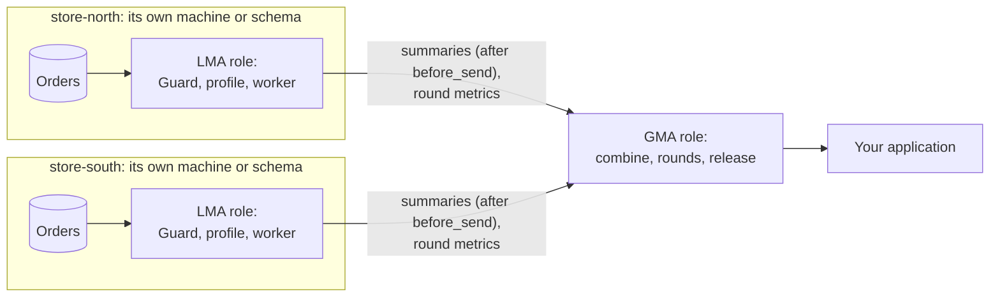

# Step 5: Compute at each source and combine

Work that reads records runs at the source. A summary leaves the source only
if the source's own Guard permits it. A round's metrics are the exception: they
leave as the source's runner computed them ([Step 6](06-federated-rounds.md)).
The coordinator combines what arrives and never sees a record.

## How data flows in path B



Every LMA and the GMA ask `dagentsc` for each decision. The diagram leaves those
calls out. An **LMA** (local agent) runs at each source. A **GMA** (global agent) runs at
the coordinator. In the worked example, `StoreSite` plays the LMA role and
`Coordinator` plays the GMA role, as Python objects in one process. In a
deployment they run on different machines, and the arrows are network calls.

## 1. Profile each source locally

A `RunningProfile` keeps per-field statistics: how many records hold each
field, and for numbers the count, mean, variance, minimum and maximum. It
updates by one record at a time, so a store never reads every record again to
describe them. The store in Step 3 adds each order to its profile.

The profile holds the values of single records (the minimum and maximum), so
it stays at the source. What leaves goes through the Guard.

| Method | What it does |
|---|---|
| `add(record)` | Adds one record |
| `add_many(records)` | Adds records in order |
| `merge(other)` | Adds another profile's records, for example a second batch at the same source |
| `snapshot()` | Returns the state as JSON |
| `RunningProfile.from_snapshot(data)` | Restores the exact state, so a source can store its profile and continue later |

## 2. Report what the Guard permits

Each store reports a summary of all its orders, at `table` granularity, through
its own Guard:

<!-- source: examples/getting-started/shop/store_site.py -->
```python
    def summary(self, requester: Requester, fields: list[str], purpose: str) -> GuardDecision:
        """What this store may report about all its orders (table granularity)."""
        request = RestrictionRequest(
            request_id=f"{self.site_id}:summary:{requester.requester_id}",
            boundary="before_send",
            requester=requester,
            classification=self.governance.get_classification(CLASSIFICATION.classification_id),
            requested_fields=fields,
            granularity="table",
            cohort_size=self.store.count(),
            declared_purpose=purpose,
            approved_purposes=APPROVED_PURPOSES,
        )
        return self.governance.enforce(request, self.store.orders())
```

The script below profiles each store, asks each store's Guard for a summary as
the coordinator, and combines the summaries:

<!-- source: examples/getting-started/step3_profile.py -->
```python
"""Step 3: describe each store's orders locally, then combine what each store may report."""

from agents.common.domain.governance import KyuAttribute, Requester

from shop.extension import install
from shop.store import SITE_IDS, load_store
from shop.store_site import StoreSite

install()
sites = [StoreSite(load_store(site_id)) for site_id in SITE_IDS]

# 1. At each store: the running profile. It holds single orders' values
#    (min and max), so it stays at the store.
for site in sites:
    fields = site.store.profile()["fields"]
    value = fields["order_value"]["numeric"]
    print(
        f"{site.site_id}: {site.store.count()} orders, order_value mean {value['mean']:.2f} "
        f"(min {value['min']}, max {value['max']}), categories {fields['category']['categories']}"
    )
print()

# 2. What each store reports to the coordinator, decided by its own Guard at
#    table granularity: a count and means, and only for 20 orders or more.
coordinator = Requester(
    requester_id="returns-coordinator",
    requester_kind="coordinator",
    attributes=[
        KyuAttribute(attribute_id="signed_study_protocol", verified=True),
        KyuAttribute(attribute_id="service_identity", verified=True),
    ],
    compliance_history=1.0,
)
reports = []
for site in sites:
    decision = site.summary(coordinator, ["order_value", "items", "category"], purpose="order_returns")
    report = {key: round(value, 2) for key, value in decision.payload[0].items()} if decision.payload else {}
    print(f"{site.site_id} reports {report}")
    print("  strategies:", ", ".join(f"{r.field} {r.strategy}" for r in decision.plan.field_restrictions))
    reports.extend(decision.payload)
print()

# 3. The coordinator combines the reports. It never saw an order.
total = sum(report["record_count"] for report in reports)
mean = sum(report["order_value_mean"] * report["record_count"] for report in reports) / total
print(f"Combined: {total} orders, order_value mean {mean:.2f}")
```

Run it:

```bash
PYTHONPATH=. .venv/bin/python examples/getting-started/step3_profile.py
```

Expected output:

<!-- output: examples/getting-started/step3_profile.py -->
```text
store-north: 60 orders, order_value mean 114.19 (min 11.53, max 310.94), categories {'clothing': 16, 'electronics': 12, 'home': 11, 'shoes': 21}
store-south: 45 orders, order_value mean 148.04 (min 9.03, max 524.71), categories {'clothing': 12, 'electronics': 11, 'home': 14, 'shoes': 8}

store-north reports {'record_count': 60, 'order_value_mean': 114.19, 'items_mean': 2.73, 'items_min': 1.0, 'items_max': 5.0, 'category_distinct': 4}
  strategies: order_value aggregate_only:20, items allow_full, category allow_full
store-south reports {'record_count': 45, 'order_value_mean': 148.04, 'items_mean': 3.16, 'items_min': 1.0, 'items_max': 5.0, 'category_distinct': 4}
  strategies: order_value aggregate_only:20, items allow_full, category allow_full

Combined: 105 orders, order_value mean 128.70
```

How to read it:

- The first two lines stay at each store. They include single orders' values,
  such as the largest order at store-south (524.71).
- `order_value` is high sensitivity and the request is a table request, so the
  planner chose `aggregate_only:20`. The Guard returned one summary row per
  store instead of 60 and 45 orders. A store with fewer than 20 orders would
  have returned nothing.
- `items` is low sensitivity, so its minimum and maximum may leave. The Guard
  never publishes the minimum or maximum of a protected field, because each is
  one order's value.
- The coordinator weights each store's mean by its count:
  (60 × 114.19 + 45 × 148.04) / 105 = 128.70.

## 3. Profile over HTTP with the LMA

The LMA profiles records sent to it and suggests model families for them:

```bash
curl -s -X POST http://127.0.0.1:8010/api/v1/datasets:profile \
  -H 'Content-Type: application/json' -d '{
    "scope_id": "store-north",
    "scope_kind": "source",
    "extraction_strategy": "tabular",
    "feature_fields": ["order_value", "items", "category"],
    "records": [
      {"order_value": 53.57, "items": 1, "category": "shoes"},
      {"order_value": 56.57, "items": 1, "category": "electronics"},
      {"order_value": 95.84, "items": 2, "category": "clothing"}
    ]
  }'
```

Expected output, formatted:

```json
{
    "scope_id": "store-north",
    "scope_kind": "source",
    "extraction_strategy": "tabular",
    "record_count": 3,
    "feature_fields": ["order_value", "items", "category"],
    "label_field": null,
    "numeric_fields": ["order_value", "items"],
    "categorical_fields": ["category"],
    "partition_count": 1,
    "suggested_models": ["autoencoder", "variational_autoencoder", "random_forest"]
}
```

The profiling endpoint does not run the Guard. It receives the records you
send. Call it only from inside the source's boundary. The GMA has the same
endpoint (`POST /api/v1/datasets:profile` on port 8020) for data that has
already been combined. Send it only what a source's Guard permitted.

The main agent endpoints:

| Agent | Endpoint | What it does |
|---|---|---|
| LMA | [`POST /api/v1/datasets:profile`](../reference/api/agents.md#lma-post-api-v1-datasets-profile) | Profile records at the source |
| LMA | [`POST /api/v1/model-jobs`](../reference/api/agents.md#lma-post-api-v1-model-jobs) | Run a model job on records at the source |
| LMA | [`POST /api/v1/governance/restrictions:enforce`](../reference/api/agents.md#lma-post-api-v1-governance-restrictions-enforce) | The Guard (Step 4) |
| LMA, GMA | [`GET /api/v1/governance/audit`](../reference/api/agents.md#lma-get-api-v1-governance-audit) | The audit log and whether its chain verifies |
| GMA | [`PUT /api/v1/federation/sites/{site_id}`](../reference/api/agents.md#gma-put-api-v1-federation-sites-site-id) | Enrol a source in a study (Step 6) |
| GMA | [`POST /api/v1/federation/rounds:plan`](../reference/api/agents.md#gma-post-api-v1-federation-rounds-plan) | Select the sources for a round (Step 6) |
| LMA, GMA | [`GET /api/v1/extensions`](../reference/api/agents.md#lma-get-api-v1-extensions) | What the registered extensions contribute |

Each agent also keeps a short path for most endpoints, such as `/health` for
`/api/v1/health`. Both call the same code. Every endpoint is in the
[API reference for the agents](../reference/api/agents.md).

## 4. Draw charts from the numbers

`agents/common/infrastructure/charts.py` draws SVG charts from lists of numbers,
never from records: `bar_chart`, `grouped_bar_chart`, `stacked_bar_chart`,
`histogram`, `histogram_panels`, `line_chart` and `dot_threshold_chart`. Each
has a twin ending in `_table` that returns the same numbers as table rows, so a
page can show the values next to the picture. The colours come from the design
system: series colours mark which source a value belongs to, never a decision.
Drawing needs matplotlib. The `_table` functions do not. The stroke demo's
hospital pages use it.

## What can go wrong

| What you see | Why | What to do |
|---|---|---|
| A store reports `{}` | It holds fewer records than the minimum cohort, so `aggregate_only` returned nothing | This is the policy working. Combine without that store, or wait until it has more records |
| The coordinator's numbers include single records' values | A profile snapshot was sent without the Guard | Send only a Guard decision's payload. A snapshot is for the source itself |
| A combined mean is wrong | Means were averaged without weighting by count | Weight each source's mean by its `record_count`, as the script does |

Next: [Step 6: Run a federated round](06-federated-rounds.md).
