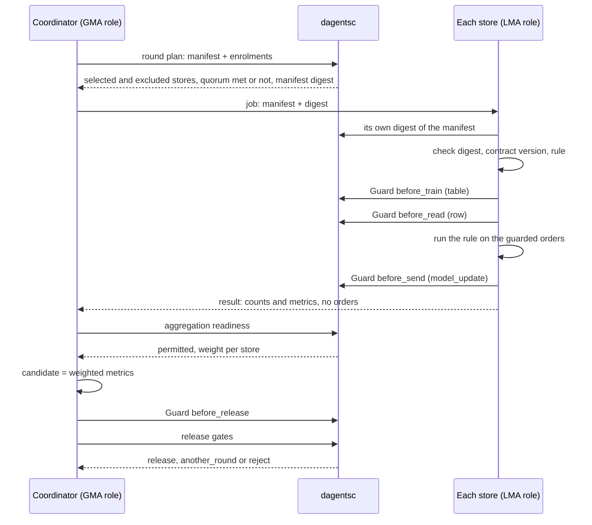

# Step 6: Run a federated round

A **round** is one cycle of federated work. The coordinator writes a round
contract, the planner selects the sources that may take part, each source
checks the contract and computes locally, and the coordinator combines the
results into a **candidate**. A candidate is not a release: it must pass the
Guard at the release boundary and the release gates, and then a person approves
it.

In the worked example the round is an evaluation round: each store measures the
returns rule on its own orders, and the coordinator combines the measurements.
A training round follows the same steps and adds a model update (section 6).

## The round from your application's point of view



## 1. Write the round contract

The **manifest** is the contract every source checks before it accepts a job:

<!-- source: examples/getting-started/shop/coordinator.py -->
```python
    def manifest(self, round_id: str) -> RoundManifest:
        """The round contract every store checks before it accepts."""
        return RoundManifest(
            round_id=round_id,
            study_id=STUDY_ID,
            condition_id="order_returns",
            phase="evaluation",
            model_version=rule.RULE_VERSION,
            model_artifact_digest=rule.RULE_DIGEST,
            training_code_digest=rule.RULE_DIGEST,
            feature_contract_version=CONTRACT_VERSION,
            privacy_profile="guarded-rows",
            aggregation=AggregationMethod(kind="fedavg"),
            minimum_participants=2,
            minimum_cohort_per_site=CLASSIFICATION.minimum_cohort,
            required_capabilities=["evaluate"],
            stop_conditions=["schema_failure", "quorum_not_met"],
            invited_sites=sorted(self.sites),
        )
```

| Field | Meaning |
|---|---|
| `phase` | `analytics`, `evaluation` or `training`. Run them in that order, so the sources show they compute the same measures before any model update moves |
| `model_version`, `model_artifact_digest` | Which model or rule the round uses, and the digest of its parameters, so a source can check it has the same one |
| `training_code_digest` | The digest of the code that runs it |
| `feature_contract_version` | The contract every source must produce |
| `minimum_participants` | Quorum: how many sources must take part |
| `minimum_cohort_per_site` | The smallest number of records a source may contribute |
| `required_capabilities` | What a source must be able to do, for example `evaluate` |
| `invited_sites` | The sources asked to take part |
| `aggregation` | How the federated runtime combines the results. `fedavg`: an average weighted by each source's example count. `fedprox` and `fedopt`: variants of it for training, with a term that keeps each source near the shared model, or an optimizer at the coordinator. `secure_aggregation`: the coordinator sees only the sum of the updates. Only `secure_aggregation` changes a planner decision: its threshold raises the quorum if it is higher |

The planner turns the manifest into a **digest**, a short fingerprint of every
field. Each store computes the digest itself and refuses a job whose digest
differs, so a manifest changed on the way is not run:

<!-- source: examples/getting-started/shop/store_site.py -->
```python
    def worker(self, manifest: RoundManifest) -> StoreWorker:
        """This store's worker for one round.

        The store computes the manifest digest itself, so a job whose manifest
        was changed on the way does not match and is refused.
        """
        expected = round_digest(manifest.model_dump(mode="json"))["round_digest"]
        inner = LocalFederatedWorker(
            site_id=self.site_id,
            governance=self.governance,
            data_source=StoreDataSource(self.store),
            runner=RuleRunner(),
            classification_id=CLASSIFICATION.classification_id,
            feature_contract_version=CONTRACT_VERSION,
            approved_fields=FEATURE_CONTRACT.field_names(),
            approved_purposes=APPROVED_PURPOSES,
            expected_digest=expected,
        )
        return StoreWorker(self.site_id, inner)
```

The digest is FNV-1a over the manifest's fields. It detects an accidental or
careless change. It is not a cryptographic signature and does not detect a
deliberate forgery. A deployment signs manifests separately.

## 2. Enrol the sources

Each source states once that it takes part, with what it can produce:

<!-- source: examples/getting-started/shop/store_site.py -->
```python
    def registration(self) -> SiteRegistration:
        """How this store enrols in the study."""
        return SiteRegistration(
            site_id=self.site_id,
            capabilities=["evaluate"],
            feature_contract_version=CONTRACT_VERSION,
            approved_conditions=["order_returns"],
            cohort_size=self.store.count(),
            enrolled=True,
        )
```

`enrolled` is `False` by default: taking part is stated, never assumed. For each
round the planner checks every enrolment against the manifest and excludes a
source, with a reason, when:

| Reason the planner gives | What it means |
|---|---|
| `site is not enrolled in the study` | `enrolled` is false |
| `site was not invited to this round` | The source is not in `invited_sites` |
| `site has not approved condition order_returns` | The source has not agreed to this study |
| `site feature contract retail-orders-v0 does not match round contract retail-orders-v1` | The source produces another contract version |
| `site lacks required capability evaluate` | The source cannot do what the round needs |
| `site cohort 12 is below the per-site minimum 20` | The source has too few records |
| `invited site has no registration` | An invited source never enrolled |

If fewer sources remain than the quorum, the round is recorded and closed
without being dispatched, with the stop reason `quorum_not_met`.

## 3. The source's side: the worker

The framework's `LocalFederatedWorker` runs a source's side of a round, with the
Guard at three boundaries. You supply two small objects: where the records come
from, and what to compute.

<!-- source: examples/getting-started/shop/store_site.py -->
```python
class StoreDataSource:
    """The orders a round may read at this store."""

    def __init__(self, store: OrderStore) -> None:
        self._store = store

    def records(self, job: FederatedJob) -> list[dict[str, Any]]:
        return self._store.orders()

    def cohort_size(self, job: FederatedJob) -> int:
        return self._store.count()


class RuleRunner:
    """What a store computes in a round: the rule's metrics on the Guard's payload."""

    def run(self, job: FederatedJob, records: list[dict[str, Any]]) -> LocalRunOutcome:
        labelled = [record for record in records if isinstance(record.get("returned"), bool)]
        return LocalRunOutcome(metrics=rule.evaluate(labelled), examples=len(labelled))
```

The runner calls the rule, which is application code. Dagents never sees how
the rule works. It sees the metrics the rule returns and the rule's digest in
the manifest:

<!-- source: examples/getting-started/shop/rule.py -->
```python
"""The rule the stores evaluate, and how it is measured. Application code."""

from __future__ import annotations

import hashlib
import json
from typing import Any, Mapping

#: The rule the stores evaluate in this example.
RULE_VERSION = "return-check-rule-v2"

#: The rule the stores use today. If the new rule is not released, they keep it.
IN_USE_VERSION = "return-check-rule-v1"

#: The rule's settings. Its digest goes into the round manifest, so a store can
#: check that the round runs the rule it has.
RULE_PARAMETERS: dict[str, Any] = {
    "risky_categories": ["clothing", "shoes"],
    "min_items": 3,
    "high_value": 150,
}

RULE_DIGEST = "sha256:" + hashlib.sha256(
    json.dumps(RULE_PARAMETERS, sort_keys=True, separators=(",", ":")).encode("utf-8")
).hexdigest()


def flag(order: Mapping[str, Any]) -> bool:
    """Whether staff should check this order before it is sent."""
    many_items = order.get("category") in RULE_PARAMETERS["risky_categories"] and (
        order.get("items", 0) >= RULE_PARAMETERS["min_items"]
    )
    expensive = order.get("order_value", 0) >= RULE_PARAMETERS["high_value"] and not order.get("loyalty_member")
    return bool(many_items or expensive)


def evaluate(orders: list[Mapping[str, Any]]) -> dict[str, float]:
    """Precision, recall and flag rate of the rule on orders with a known outcome."""
    labelled = [order for order in orders if isinstance(order.get("returned"), bool)]
    flagged = [order for order in labelled if flag(order)]
    hits = sum(1 for order in flagged if order["returned"])
    returned = sum(1 for order in labelled if order["returned"])
    return {
        "precision": hits / len(flagged) if flagged else 0.0,
        "recall": hits / returned if returned else 0.0,
        "flag_rate": len(flagged) / len(labelled) if labelled else 0.0,
    }
```

When the coordinator offers a job, the worker checks, in order:

1. that the round asks for at least one field the source approved;
2. that the job's digest matches the digest the source computed;
3. that the round's contract version is the one the source produces;
4. the Guard at `before_train`, at `table` granularity, with the source's
   record count as the cohort.

When it runs the job, the worker:

1. reads the records and sends them through the Guard at `before_read`;
2. hands the **guarded** records to your runner, never the raw ones, because the
   round's code comes from the coordinator;
3. sends the model update (or, for a round without one, the update's norm)
   through the Guard at `before_send`, at `model_update` granularity. If the
   Guard denies it or withholds the value, the worker refuses the job and
   nothing leaves. If it permits it, the result carries the value the Guard
   returned, clipped or noised.

The Guard does not see the round's `metrics` or its example count. They leave
the source as your runner wrote them, in `SiteResult.metrics` and
`contributed_examples`. Your runner computes them from Guard-protected rows,
but nothing checks what it puts in them, so put only aggregate numbers there,
such as a precision or a count, never a value from one record.

Any failure is a refusal, recorded in the result with its reason. The example
adds one check of its own in front of the framework's worker: the round must
name the rule the store runs.

<!-- source: examples/getting-started/shop/store_site.py -->
```python
class StoreWorker:
    """The framework's worker, plus one check this application adds.

    Before it accepts a job, the store checks that the round names the rule it
    runs. The framework's worker then checks the manifest digest, the contract
    version and the before_train Guard.
    """

    def __init__(self, site_id: str, inner: LocalFederatedWorker) -> None:
        self.site_id = site_id
        self._inner = inner

    def offer(self, job: FederatedJob) -> JobAcceptance:
        if job.manifest.model_artifact_digest != rule.RULE_DIGEST:
            return JobAcceptance(
                round_id=job.round_id,
                site_id=self.site_id,
                accepted=False,
                reason="the round names a rule this store does not run",
            )
        return self._inner.offer(job)

    def execute(self, job: FederatedJob) -> SiteResult:
        return self._inner.execute(job)
```

## 4. The coordinator's side: the engine

The coordinator uses `FederatedRoundController`. It holds enrolments and round
records, asks the planner for every decision, and passes jobs to a
**federation engine**:

<!-- source: examples/getting-started/shop/coordinator.py -->
```python
class Coordinator:
    def __init__(self, sites: list[StoreSite]) -> None:
        self.sites = {site.site_id: site for site in sites}
        # The in-process engine runs every store's worker in this process. It is
        # a simulator for tests and examples; a deployment plugs in a federated
        # runtime behind the same FederationEngine interface.
        self.engine = InProcessFederationEngine()
        self.controller = FederatedRoundController(engine=self.engine)
        # The coordinator's own Guard, for the before_release boundary.
        self.governance = GovernanceService()
        for site in sites:
            self.controller.register_site(site.registration())

    def manifest(self, round_id: str) -> RoundManifest:
        """The round contract every store checks before it accepts."""
        return RoundManifest(
            round_id=round_id,
            study_id=STUDY_ID,
            condition_id="order_returns",
            phase="evaluation",
            model_version=rule.RULE_VERSION,
            model_artifact_digest=rule.RULE_DIGEST,
            training_code_digest=rule.RULE_DIGEST,
            feature_contract_version=CONTRACT_VERSION,
            privacy_profile="guarded-rows",
            aggregation=AggregationMethod(kind="fedavg"),
            minimum_participants=2,
            minimum_cohort_per_site=CLASSIFICATION.minimum_cohort,
            required_capabilities=["evaluate"],
            stop_conditions=["schema_failure", "quorum_not_met"],
            invited_sites=sorted(self.sites),
        )

    def run_round(self, manifest: RoundManifest) -> RoundRecord:
        """Give each store a worker for this round, then plan and dispatch it."""
        for site in self.sites.values():
            self.engine.register_worker(site.worker(manifest))
        return self.controller.dispatch_round(manifest)
```

The engine is the part that moves jobs and results between machines. Dagents
defines it as an interface:

<!-- source: agents/common/application/federation.py -->
```python
class FederationEngine(Protocol):
    """The federated runtime, as the control plane sees it.

    Implement this against NVIDIA FLARE, another approved runtime, or the
    in-process simulator below. Nothing above this interface should know which.
    """

    name: str

    def submit_round(self, manifest: RoundManifest, plan: RoundPlan) -> RoundSubmission:
        """Offer the round to every selected site and collect acceptances."""

    def collect_results(self, round_id: str) -> list[SiteResult]:
        """Return what the accepting sites produced."""

    def aggregate(
        self, manifest: RoundManifest, readiness: AggregationReadiness, results: list[SiteResult]
    ) -> CandidateModel:
        """Combine permitted contributions into a candidate model."""
```

`InProcessFederationEngine` runs every source's worker in the same process. It
is a simulator for tests and examples: it proves the job logic, not network
behaviour, security or privacy in production. A deployment writes an adapter
for its federated learning runtime (for example NVIDIA FLARE or Flower) that
implements these three methods. Nothing above the interface changes.

When each source runs in its own process, Dagents has an HTTP transport for the
same contracts, in `agents/common/infrastructure/federation_http.py`:

| Class | Runs at | What it does |
|---|---|---|
| `HttpSiteWorker` | the coordinator | A worker that sends the job to `POST {source}/api/v1/federation/jobs:offer` and then `POST {source}/api/v1/federation/jobs:execute`, and returns the source's `JobAcceptance` and `SiteResult`. A source that does not answer the offer is recorded as a refusal, a `rejected` result. A source that accepts and then does not answer the execution gets a `failed` result. |
| `HttpFederationEngine` | the coordinator | `InProcessFederationEngine` with one `HttpSiteWorker` per source, built from a map of source ids to addresses. The GMA uses it when `GMA_FEDERATION_SITES` is set. |
| `HttpUpdateChannel` | the source | An update channel (section 6) that sends the bounded update to `POST {coordinator}/api/v1/federation/rounds/{round_id}/updates` and returns the digest the coordinator stored. |

The source's service answers the two job paths by calling its worker's `offer`
and `execute`. `HttpFederationEngine` is still a simulator: it calls one source
at a time, does not retry and sends no credentials, so run it on a private
network. The stroke demo's split mode uses this transport to run each hospital,
the Dagents GMA and the demo's backend as separate processes.

## 5. Run the round

<!-- source: examples/getting-started/step4_federated_round.py -->
```python
"""Step 4: run one federated evaluation round and decide whether to release the rule."""

from shop.coordinator import Coordinator
from shop.extension import install
from shop.store import SITE_IDS, load_store
from shop.store_site import StoreSite

install()
coordinator = Coordinator([StoreSite(load_store(site_id)) for site_id in SITE_IDS])

# 1. Plan and dispatch. The planner selects the eligible stores and checks quorum.
manifest = coordinator.manifest("returns-eval-1")
record = coordinator.run_round(manifest)
plan = record.plan
print(f"Round {plan.round_id}, digest {plan.round_digest}")
print(f"  selected: {', '.join(plan.selected_sites)}")
print(f"  excluded: {', '.join(f'{e.site_id} ({e.reason})' for e in plan.excluded_sites) or 'none'}")
print(f"  quorum met: {plan.quorum_met} ({len(plan.selected_sites)} of {plan.required_participants} required)")

# 2. What each store sent back: counts and metrics, never orders.
for result in record.results:
    metrics = ", ".join(f"{name} {value:.3f}" for name, value in sorted(result.metrics.items()))
    print(f"  {result.site_id}: {result.participation}, {result.contributed_examples} examples, {metrics}")

# 3. May the results be combined? The planner decides and gives each store a weight.
readiness = coordinator.controller.evaluate_readiness(plan.round_id)
weights = ", ".join(f"{site} {weight:.3f}" for site, weight in readiness.site_weights.items())
print(f"Aggregation permitted: {readiness.aggregation_permitted} (weights: {weights})")

# 4. The candidate: the weighted metrics. A candidate is not a release.
candidate = coordinator.controller.aggregate(plan.round_id)
metrics = ", ".join(f"{name} {value:.3f}" for name, value in sorted(candidate.metrics.items()))
print(f"Candidate {candidate.candidate_version}: {metrics}")

# 5. The Guard at the release boundary, then the release gates.
guard = coordinator.release_check(plan.round_id, candidate)
strategies = ", ".join(f"{r.field} {r.strategy}" for r in guard.plan.field_restrictions)
print(f"Release Guard: {guard.plan.decision} ({strategies}), permitted {guard.permitted}")
decision = coordinator.decide(plan.round_id, candidate)
for gate in decision.gate_results:
    print(f"  {gate.gate_id:<10} {gate.outcome:<7} {gate.detail}")
print(f"Decision: {decision.action}")
if decision.action == "release" and guard.permitted:
    print("A person on the release committee approves it before the stores use it.")
else:
    print(f"The stores keep using {decision.rollback_version}.")
```

```bash
PYTHONPATH=. .venv/bin/python examples/getting-started/step4_federated_round.py
```

Expected output:

<!-- output: examples/getting-started/step4_federated_round.py -->
```text
Round returns-eval-1, digest fnv1a:45279496fde370c7
  selected: store-north, store-south
  excluded: none
  quorum met: True (2 of 2 required)
  store-north: completed, 60 examples, flag_rate 0.400, precision 0.750, recall 0.692
  store-south: completed, 45 examples, flag_rate 0.422, precision 0.737, recall 0.824
Aggregation permitted: True (weights: store-north 0.571, store-south 0.429)
Candidate return-check-rule-v2+returns-eval-1: flag_rate 0.410, precision 0.744, recall 0.749
Release Guard: narrow (model_update clip_contribution:1), permitted True
  precision  passed  precision=0.744361 required >= 0.6
  recall     passed  recall=0.748546 required >= 0.7
  flag_rate  passed  flag_rate=0.409524 required <= 0.45
Decision: release
A person on the release committee approves it before the stores use it.
```

How to read it:

- Both stores were eligible, and 2 of the 2 required took part.
- Each store returned counts and metrics. No order left a store.
- store-south's flag rate is 0.422 (19 of 45 orders), not the 0.400 (18 of 45)
  you get from the raw orders. Its Guard rounded `order_value` to the nearest
  10 before the rule saw it, so order S-004 (146.82) became 150 and crossed the
  rule's threshold of 150. This is the cost of protecting the field, and you can
  measure it. To remove it, change the field's sensitivity, not the code.
- The planner weighted each store by its number of orders: 60/105 and 45/105.
- The release Guard permitted the committee's request. Its plan for
  `model_update` is `clip_contribution:1`: any update released would be limited
  to size 1.
- All three gates passed, so the decision is `release`.

## 6. Training rounds and model updates

In a training round, your runner returns a parameter update:
`LocalRunOutcome(metrics=..., examples=..., update={"w1": 0.2, ...})`. The
worker then sends the update through the `before_send` Guard, which clips it,
and hands the clipped vector to an **update channel**:

<!-- source: agents/common/application/federation_worker.py -->
```python
class UpdateChannel(Protocol):
    """Where a site sends a model update after the Guard has bounded it.

    The channel stands for the federated runtime's transport. It receives the
    vector the ``before_send`` Guard returned, never the runner's raw output,
    and returns a digest of what it stored. The site computes its own digest of
    the vector it sent and refuses the job when the two differ. The site's
    digest goes into its :class:`SiteResult`, so the runtime can check that the
    update it aggregates is the one the site sent, even if the transport
    changed it. The channel and the site must use the same digest rule (see
    ``LocalFederatedWorker``'s ``update_digest``).
    """

    def submit(self, job: FederatedJob, update: dict[str, float]) -> str:
        """Store one site's bounded update for this job and return its digest."""
```

The result the coordinator sees carries only the update's size
(`update_norm`) and its digest (`update_digest`), never the vector. The runtime
that averages the updates checks each one against its digest. A worker whose
runner returns an update and that has no channel refuses the job.

The stroke demo's `ParameterAveragingRuntime`, in
[`apps/healthcare-demo/backend/app/services/runtime.py`](../../apps/healthcare-demo/backend/app/services/runtime.py),
implements both `FederationEngine` and `UpdateChannel`. It wraps the in-process
engine and adds the averaging of the clipped updates, weighted by the planner's
weights. Use it as the reference for a training round.

## 7. Decide on release

The coordinator asks its own Guard at the release boundary, then evaluates the
condition pack's gates:

<!-- source: examples/getting-started/shop/coordinator.py -->
```python
    def release_check(self, round_id: str, candidate: CandidateModel) -> GuardDecision:
        """Ask the Guard whether the committee may release this candidate (before_release)."""
        request = RestrictionRequest(
            request_id=f"{round_id}:release",
            boundary="before_release",
            requester=RELEASE_COMMITTEE,
            classification=self.governance.get_classification(CLASSIFICATION.classification_id),
            requested_fields=["model_update"],
            granularity="model_update",
            cohort_size=candidate.contributed_examples,
            declared_purpose="order_returns",
            approved_purposes=APPROVED_PURPOSES,
        )
        return self.governance.enforce(request, correlation_id=round_id)

    def decide(self, round_id: str, candidate: CandidateModel) -> ReleaseDecision:
        """Evaluate the condition pack's release gates against the candidate."""
        gates = default_registry.condition_pack("order_returns").release_gates
        # If the candidate is not released, the stores keep the rule they use now.
        return self.controller.evaluate_release(
            round_id, gates, candidate, rollback_version=rule.IN_USE_VERSION
        )
```

The planner returns one of three decisions:

| Decision | When |
|---|---|
| `reject` | A blocking gate failed, or its metric is missing |
| `another_round` | No blocking gate failed, but an advisory gate failed or was not evaluated |
| `release` | Every gate passed |

`release` is a recommendation to a person, never a deployment. Your
application records who approved the candidate and when, and refuses an
approval when the decision was not `release` or the release Guard did not
permit it. The stroke demo's `Consortium.approve`, in
[`consortium.py`](../../apps/healthcare-demo/backend/app/services/consortium.py),
also refuses a candidate that was compared with a model that is no longer the
one in use.

## What the GMA does over HTTP

The GMA exposes the same controller. Its default engine is the in-process one
with no workers attached, so over HTTP the sources run their own work and post
their results. If each store runs a service that answers the two job paths, set
`GMA_FEDERATION_SITES` and the GMA sends the job to each store instead
([section 4](#4-the-coordinators-side-the-engine)). The commands below use the
GMA from Step 1, with the default engine.

Enrol three stores. store-east still produces the old contract version:

```bash
GMA=http://127.0.0.1:8020
for site in store-north:60 store-south:45; do
  curl -s -X PUT $GMA/api/v1/federation/sites/${site%%:*} -H 'Content-Type: application/json' \
    -d "{\"site_id\":\"${site%%:*}\",\"capabilities\":[\"evaluate\"],\"feature_contract_version\":\"retail-orders-v1\",\"approved_conditions\":[\"order_returns\"],\"cohort_size\":${site##*:},\"enrolled\":true}"
done
curl -s -X PUT $GMA/api/v1/federation/sites/store-east -H 'Content-Type: application/json' \
  -d '{"site_id":"store-east","capabilities":["evaluate"],"feature_contract_version":"retail-orders-v0","approved_conditions":["order_returns"],"cohort_size":80,"enrolled":true}'
```

Plan a round with all three stores invited. Save this as `manifest.json`:

```json
{
  "round_id": "returns-eval-http-1",
  "study_id": "returns-pilot",
  "condition_id": "order_returns",
  "phase": "evaluation",
  "model_version": "return-check-rule-v2",
  "feature_contract_version": "retail-orders-v1",
  "aggregation": {"kind": "fedavg"},
  "minimum_participants": 2,
  "minimum_cohort_per_site": 20,
  "required_capabilities": ["evaluate"],
  "invited_sites": ["store-east", "store-north", "store-south"]
}
```

```bash
curl -s -X POST $GMA/api/v1/federation/rounds:plan -H 'Content-Type: application/json' -d @manifest.json
```

Expected output, formatted and shortened:

```json
{
    "round_id": "returns-eval-http-1",
    "selected_sites": ["store-north", "store-south"],
    "excluded_sites": [
        {
            "site_id": "store-east",
            "reason": "site feature contract retail-orders-v0 does not match round contract retail-orders-v1"
        }
    ],
    "quorum_met": true,
    "required_participants": 2,
    "stop_reason": null,
    "round_digest": "fnv1a:b6a0c9588facd868"
}
```

Dispatch it with `POST $GMA/api/v1/federation/rounds` (answer `202`). Each
selected store's result reads `"participation": "failed"` with the evidence
pointer `unreachable://store-north#no worker is attached for this site`, because
no worker runs inside the GMA. Each store then posts its own result. For
store-north:

```bash
curl -s -X POST $GMA/api/v1/federation/rounds/returns-eval-http-1/results -H 'Content-Type: application/json' \
  -d '{"round_id":"returns-eval-http-1","site_id":"store-north","job_digest":"fnv1a:b6a0c9588facd868","participation":"completed","code_verified":true,"privacy_checks_passed":true,"contributed_examples":60,"metrics":{"precision":0.75,"recall":0.692,"flag_rate":0.4}}'
```

store-south posts the same with `"site_id":"store-south"`,
`"contributed_examples":45` and its own metrics (`0.737`, `0.824`, `0.422`).
Each post answers `202`. After both stores have posted,
`GET .../rounds/returns-eval-http-1/readiness`
answers `"aggregation_permitted": true` with the weights `0.571` and `0.429`,
and `POST .../rounds/returns-eval-http-1:aggregate` returns the candidate
`return-check-rule-v2+returns-eval-http-1` with the weighted metrics.

Evaluate the release with the gates and the candidate's metrics in the body.
This `release.json` adds a fourth gate on a metric the candidate never
reported:

```json
{
  "candidate_version": "return-check-rule-v2+returns-eval-http-1",
  "candidate_metrics": {"precision": 0.744, "recall": 0.749, "flag_rate": 0.409},
  "rollback_version": "return-check-rule-v1",
  "gates": [
    {"gate_id": "precision", "metric": "precision", "comparison": {"kind": "at_least", "value": 0.60}},
    {"gate_id": "recall", "metric": "recall", "comparison": {"kind": "at_least", "value": 0.70}},
    {"gate_id": "flag_rate", "metric": "flag_rate", "comparison": {"kind": "at_most", "value": 0.45}, "blocking": false},
    {"gate_id": "returns_caught", "metric": "returns_caught", "comparison": {"kind": "at_least", "value": 10}}
  ]
}
```

```bash
curl -s -X POST "$GMA/api/v1/federation/rounds/returns-eval-http-1:evaluate-release" \
  -H 'Content-Type: application/json' -d @release.json
```

Expected output, shortened:

```json
{
    "gate_results": [
        {"gate_id": "precision", "outcome": "passed", "detail": "precision=0.744 required >= 0.6"},
        {"gate_id": "recall", "outcome": "passed", "detail": "recall=0.749 required >= 0.7"},
        {"gate_id": "flag_rate", "outcome": "passed", "detail": "flag_rate=0.409 required <= 0.45"},
        {"gate_id": "returns_caught", "outcome": "not_evaluated", "detail": "candidate reported no metric named returns_caught"}
    ],
    "action": "reject",
    "blocking_failures": ["returns_caught: candidate reported no metric named returns_caught"],
    "rollback_version": "return-check-rule-v1"
}
```

A gate whose metric is missing blocks the release. The round endpoints are in
the API reference, under [Federated sites](../reference/api/agents.md#federated-sites) and
[Federated rounds](../reference/api/agents.md#federated-rounds).

## What can go wrong

| What you see | Why | What to do |
|---|---|---|
| `quorum met: False`, round status `closed` | Too few sources were eligible | Read `excluded_sites` for each reason and fix the enrolment or the manifest |
| A store's result is `rejected` | The store refused the job when it was offered: a digest mismatch, another contract version, another rule, or a `before_train` denial | Call the store's `worker(manifest).offer(job)` to read its `reason`, for example `job digest does not match the manifest this site computed` |
| `PermissionError: aggregation is not permitted for ...` from `aggregate` | Too few contributions were accepted | Read `readiness.rejected_contributions` for each reason |
| A gate is `not_evaluated` and the decision is `reject` | The candidate has no metric with the gate's name | Report every metric the gates name, under the same name |
| `PlannerUnavailableError` | The coordinator cannot reach the planner | Set `DAGENTSC_BIN`. Round control never continues without the planner |
| A store's result is `rejected` and its `local_evidence_pointer` ends with `refused:the runner produced a model update but this site has no update channel` | A training runner returned an update and the worker has no channel | Pass `update_channel=` to the worker (section 6) |

Next: [Step 7: Call the framework services](07-framework-services.md).
