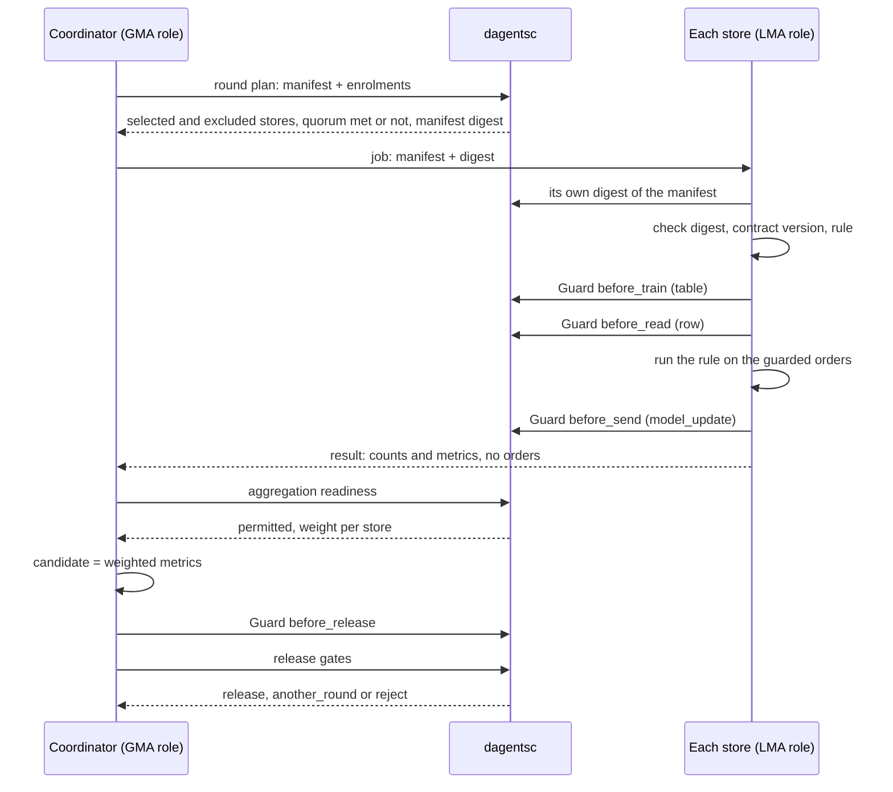
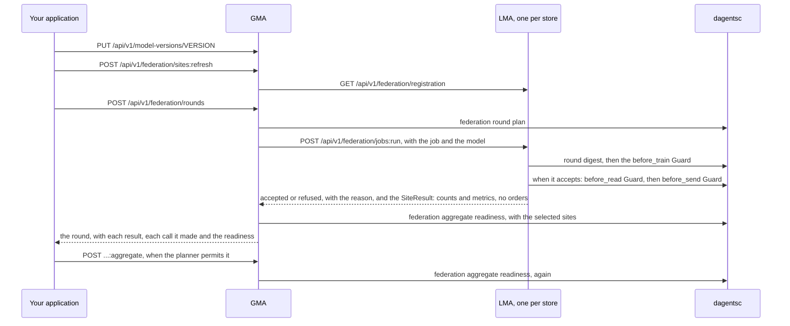

# Step 6: Run a federated round

A **round** is one cycle of federated work. The coordinator writes a round
contract, the planner selects the sources that may take part, each source
checks the contract and computes locally, and the coordinator combines the
results into a **candidate**. A candidate is not a release: it must pass the
Guard at the release boundary and the release gates, and then a person approves
it.

In the worked example the round is an evaluation round: each store measures the
returns rule on its own orders, and the coordinator combines the measurements.
A training round follows the same steps and adds a model update (section 7).

The page runs the round twice. Sections 1 to 5 build it from framework classes
in your own process (`step4_federated_round.py`), so you see each part.
Section 6 runs the same round through the Dagents agents: one LMA per store
and one GMA, called through their HTTP APIs (`step5_agents_over_http.py`).

## The round from your application's point of view



## 1. Write the round contract

The **manifest** is the contract every source checks before it accepts a job:

<!-- source: examples/getting-started/shop/coordinator.py -->
```python
    def manifest(self, round_id: str) -> RoundManifest:
        """The round contract every store checks before it accepts."""
        return RoundManifest(
            round_id=round_id,
            study_id=STUDY_ID,
            condition_id="order_returns",
            phase="evaluation",
            model_version=rule.RULE_VERSION,
            model_artifact_digest=rule.RULE_DIGEST,
            training_code_digest=rule.RULE_DIGEST,
            feature_contract_version=CONTRACT_VERSION,
            privacy_profile="guarded-rows",
            aggregation=AggregationMethod(kind="fedavg"),
            minimum_participants=2,
            minimum_cohort_per_site=CLASSIFICATION.minimum_cohort,
            required_capabilities=["evaluate"],
            stop_conditions=["schema_failure", "quorum_not_met"],
            invited_sites=sorted(self.sites),
        )
```

| Field | Meaning |
|---|---|
| `phase` | `analytics`, `evaluation` or `training`. Run them in that order, so the sources show they compute the same measures before any model update moves |
| `model_version`, `model_artifact_digest` | Which model or rule the round uses, and the digest of its parameters, so a source can check it has the same one |
| `training_code_digest` | The digest of the code that runs it |
| `feature_contract_version` | The contract every source must produce |
| `minimum_participants` | Quorum: how many sources must take part |
| `minimum_cohort_per_site` | The smallest number of records a source may contribute |
| `required_capabilities` | What a source must be able to do, for example `evaluate` |
| `invited_sites` | The sources asked to take part |
| `aggregation` | How the federated runtime combines the results. `fedavg`: an average weighted by each source's example count. `fedprox` and `fedopt`: variants of it for training, with a term that keeps each source near the shared model, or an optimizer at the coordinator. `secure_aggregation`: the coordinator sees only the sum of the updates. Only `secure_aggregation` changes a planner decision: its threshold raises the quorum if it is higher |

The planner turns the manifest into a **digest**, a short fingerprint of every
field. Each store computes the digest itself and refuses a job whose digest
differs, so a manifest changed on the way is not run:

<!-- source: examples/getting-started/shop/store_site.py -->
```python
    def worker(self, manifest: RoundManifest) -> StoreWorker:
        """This store's worker for one round.

        The store computes the manifest digest itself, so a job whose manifest
        was changed on the way does not match and is refused.
        """
        expected = round_digest(manifest.model_dump(mode="json"))["round_digest"]
        inner = LocalFederatedWorker(
            site_id=self.site_id,
            governance=self.governance,
            data_source=StoreDataSource(self.store),
            runner=RuleRunner(),
            classification_id=CLASSIFICATION.classification_id,
            feature_contract_version=CONTRACT_VERSION,
            approved_fields=FEATURE_CONTRACT.field_names(),
            approved_purposes=APPROVED_PURPOSES,
            expected_digest=expected,
        )
        return StoreWorker(self.site_id, inner)
```

The digest is FNV-1a over the manifest's fields. It detects an accidental or
careless change. It is not a cryptographic signature and does not detect a
deliberate forgery. A deployment signs manifests separately.

## 2. Enrol the sources

Each source states once that it takes part, with what it can produce:

<!-- source: examples/getting-started/shop/store_site.py -->
```python
    def registration(self) -> SiteRegistration:
        """How this store enrols in the study."""
        return SiteRegistration(
            site_id=self.site_id,
            capabilities=["evaluate"],
            feature_contract_version=CONTRACT_VERSION,
            approved_conditions=["order_returns"],
            cohort_size=self.store.count(),
            enrolled=True,
        )
```

`enrolled` is `False` by default: taking part is stated, never assumed. For each
round the planner checks every enrolment against the manifest and excludes a
source, with a reason, when:

| Reason the planner gives | What it means |
|---|---|
| `site is not enrolled in the study` | `enrolled` is false |
| `site was not invited to this round` | The source is not in `invited_sites` |
| `site has not approved condition order_returns` | The source has not agreed to this study |
| `site feature contract retail-orders-v0 does not match round contract retail-orders-v1` | The source produces another contract version |
| `site lacks required capability evaluate` | The source cannot do what the round needs |
| `site cohort 12 is below the per-site minimum 20` | The source has too few records |
| `invited site has no registration` | An invited source never enrolled |

If fewer sources remain than the quorum, the round is recorded and closed
without being dispatched, with the stop reason `quorum_not_met`.

A GMA that knows its LMAs' addresses can enrol them for you:
`POST /api/v1/federation/sites:refresh` asks each LMA for its registration
(`GET /api/v1/federation/registration`), with its current record count as the
cohort size, and stores it. Section 6 does this. A source that starts after
the GMA joins the same way once the GMA has its address: list the source in
`GMA_JOINABLE_SITE_ENDPOINTS` with the one address it will use, send that
address to `PUT /api/v1/federation/sites/{site_id}/address`, then refresh
([Step 8](08-deploy.md#3-configure-from-the-environment) has the setting).

## 3. The source's side: the worker

The framework's `LocalFederatedWorker` runs a source's side of a round, with the
Guard at three boundaries. You supply two small objects: where the records come
from, and what to compute.

<!-- source: examples/getting-started/shop/store_site.py -->
```python
class StoreDataSource:
    """The orders a round may read at this store."""

    def __init__(self, store: OrderStore) -> None:
        self._store = store

    def records(self, job: FederatedJob) -> list[dict[str, Any]]:
        return self._store.orders()

    def cohort_size(self, job: FederatedJob) -> int:
        return self._store.count()


class RuleRunner:
    """What a store computes in a round: the rule's metrics on the Guard's payload."""

    def run(self, job: FederatedJob, records: list[dict[str, Any]]) -> LocalRunOutcome:
        labelled = [record for record in records if isinstance(record.get("returned"), bool)]
        return LocalRunOutcome(metrics=rule.evaluate(labelled), examples=len(labelled))
```

The runner calls the rule, which is application code. Dagents never sees how
the rule works. It sees the metrics the rule returns and the rule's digest in
the manifest. The same file holds `RuleKind`, the rule as a model kind
([Step 2](02-describe-your-data.md#5-contribute-a-model-kind)), which the LMA
uses in section 6:

<!-- source: examples/getting-started/shop/rule.py -->
```python
"""The rule the stores evaluate, and how it is measured. Application code."""

from __future__ import annotations

import hashlib
import json
from typing import Any, Mapping

from agents.common.domain.errors import ModelVerificationError

#: The rule the stores evaluate in this example.
RULE_VERSION = "return-check-rule-v2"

#: The rule the stores use today. If the new rule is not released, they keep it.
IN_USE_VERSION = "return-check-rule-v1"

#: The rule's settings. Its digest goes into the round manifest, so a store can
#: check that the round runs the rule it has.
RULE_PARAMETERS: dict[str, Any] = {
    "risky_categories": ["clothing", "shoes"],
    "min_items": 3,
    "high_value": 150,
}

RULE_DIGEST = "sha256:" + hashlib.sha256(
    json.dumps(RULE_PARAMETERS, sort_keys=True, separators=(",", ":")).encode("utf-8")
).hexdigest()


def flag(order: Mapping[str, Any]) -> bool:
    """Whether staff should check this order before it is sent."""
    many_items = order.get("category") in RULE_PARAMETERS["risky_categories"] and (
        order.get("items", 0) >= RULE_PARAMETERS["min_items"]
    )
    expensive = order.get("order_value", 0) >= RULE_PARAMETERS["high_value"] and not order.get("loyalty_member")
    return bool(many_items or expensive)


def evaluate(orders: list[Mapping[str, Any]]) -> dict[str, float]:
    """Precision, recall and flag rate of the rule on orders with a known outcome."""
    labelled = [order for order in orders if isinstance(order.get("returned"), bool)]
    flagged = [order for order in labelled if flag(order)]
    hits = sum(1 for order in flagged if order["returned"])
    returned = sum(1 for order in labelled if order["returned"])
    return {
        "precision": hits / len(flagged) if flagged else 0.0,
        "recall": hits / returned if returned else 0.0,
        "flag_rate": len(flagged) / len(labelled) if labelled else 0.0,
    }
```

When the coordinator offers a job, the worker checks, in order:

1. that the round asks for at least one field the source approved;
2. that the job's digest matches the digest the source computed;
3. that the round's contract version is the one the source produces;
4. the Guard at `before_train`, at `table` granularity, with the source's
   record count as the cohort.

When it runs the job, the worker:

1. reads the records and sends them through the Guard at `before_read`;
2. hands the **guarded** records to your runner, never the raw ones, because the
   round's code comes from the coordinator;
3. sends the model update (or, for a round without one, the update's norm)
   through the Guard at `before_send`, at `model_update` granularity. If the
   Guard denies it or withholds the value, the worker refuses the job and
   nothing leaves. If it permits it, the result carries the value the Guard
   returned, clipped or noised.

The Guard does not see the round's `metrics` or its example count. They leave
the source as your runner wrote them, in `SiteResult.metrics` and
`contributed_examples`. Your runner computes them from Guard-protected rows,
but nothing checks what it puts in them, so put only aggregate numbers there,
such as a precision or a count, never a value from one record.

Any failure is a refusal, recorded in the result with its reason. The example
adds one check of its own in front of the framework's worker: the round must
name the rule the store runs.

<!-- source: examples/getting-started/shop/store_site.py -->
```python
class StoreWorker:
    """The framework's worker, plus one check this application adds.

    Before it accepts a job, the store checks that the round names the rule it
    runs. The framework's worker then checks the manifest digest, the contract
    version and the before_train Guard.
    """

    def __init__(self, site_id: str, inner: LocalFederatedWorker) -> None:
        self.site_id = site_id
        self._inner = inner

    def offer(self, job: FederatedJob) -> JobAcceptance:
        if job.manifest.model_artifact_digest != rule.RULE_DIGEST:
            return JobAcceptance(
                round_id=job.round_id,
                site_id=self.site_id,
                accepted=False,
                reason="the round names a rule this store does not run",
            )
        return self._inner.offer(job)

    def execute(self, job: FederatedJob) -> SiteResult:
        return self._inner.execute(job)
```

## 4. The coordinator's side: the engine

The coordinator uses `FederatedRoundController`. It holds enrolments and round
records, asks the planner for every decision, and passes jobs to a
**federation engine**:

<!-- source: examples/getting-started/shop/coordinator.py -->
```python
class Coordinator:
    def __init__(self, sites: list[StoreSite]) -> None:
        self.sites = {site.site_id: site for site in sites}
        # The in-process engine runs every store's worker in this process. It is
        # a simulator for tests and examples; a deployment plugs in a federated
        # runtime behind the same FederationEngine interface.
        self.engine = InProcessFederationEngine()
        self.controller = FederatedRoundController(engine=self.engine)
        # The coordinator's own Guard, for the before_release boundary.
        self.governance = GovernanceService()
        for site in sites:
            self.controller.register_site(site.registration())

    def manifest(self, round_id: str) -> RoundManifest:
        """The round contract every store checks before it accepts."""
        return RoundManifest(
            round_id=round_id,
            study_id=STUDY_ID,
            condition_id="order_returns",
            phase="evaluation",
            model_version=rule.RULE_VERSION,
            model_artifact_digest=rule.RULE_DIGEST,
            training_code_digest=rule.RULE_DIGEST,
            feature_contract_version=CONTRACT_VERSION,
            privacy_profile="guarded-rows",
            aggregation=AggregationMethod(kind="fedavg"),
            minimum_participants=2,
            minimum_cohort_per_site=CLASSIFICATION.minimum_cohort,
            required_capabilities=["evaluate"],
            stop_conditions=["schema_failure", "quorum_not_met"],
            invited_sites=sorted(self.sites),
        )

    def run_round(self, manifest: RoundManifest) -> RoundRecord:
        """Give each store a worker for this round, then plan and dispatch it."""
        for site in self.sites.values():
            self.engine.register_worker(site.worker(manifest))
        return self.controller.dispatch_round(manifest)
```

The engine is the part that moves jobs and results between machines. Dagents
defines it as an interface:

<!-- source: agents/common/application/federation.py -->
```python
class FederationEngine(Protocol):
    """The federated runtime, as the control plane sees it.

    Implement this against the GMA's HTTP engine, NVIDIA FLARE, another
    approved runtime, or the in-process simulator below. Nothing above this
    interface should know which.

    Three members are optional. The controller uses them only when the engine
    has them:

    - ``dispatch_calls(round_id) -> list[DispatchCall]``: the calls the engine
      made to the sites for the round. The controller stores them in the
      round's ``dispatch`` field.
    - ``discard(round_id)``: delete what the engine still holds for the round,
      such as stored model updates. The controller calls it from
      :meth:`FederatedRoundController.discard`, and when ``submit_round`` or
      ``collect_results`` raises.
    - ``collects_results: bool``: true when the engine collects every result
      from the sites itself, as the GMA's HTTP engine does. The controller
      then refuses results posted through
      :meth:`FederatedRoundController.submit_result`, so a caller cannot
      replace a site's result, its metrics or its example count.
    """

    name: str

    def submit_round(self, manifest: RoundManifest, plan: RoundPlan) -> RoundSubmission:
        """Offer the round to every selected site and collect acceptances."""

    def collect_results(self, round_id: str) -> list[SiteResult]:
        """Return what the accepting sites produced."""

    def aggregate(
        self, manifest: RoundManifest, readiness: AggregationReadiness, results: list[SiteResult]
    ) -> CandidateModel:
        """Combine permitted contributions into a candidate model."""
```

Dagents has two engines:

| Engine | Where | What it does |
|---|---|---|
| `InProcessFederationEngine` | `agents/common/application/federation.py` | Runs every source's worker in the same process. A simulator for tests and examples: it proves the job logic, not network behaviour, security or privacy in production |
| `HttpFederationEngine` | `agents/gma/adapters/http_federation_engine.py` | The GMA's engine with `GMA_ENGINE=http`. It sends each selected source's job to that source's LMA over its HTTP API and holds training updates until aggregation (section 6) |

A deployment that uses another federated learning runtime (for example NVIDIA
FLARE or Flower) writes an adapter that implements the three methods. Nothing
above the interface changes.

## 5. Run the round

<!-- source: examples/getting-started/step4_federated_round.py -->
```python
"""Step 4: run one federated evaluation round and decide whether to release the rule."""

from shop.coordinator import Coordinator
from shop.extension import install
from shop.store import SITE_IDS, load_store
from shop.store_site import StoreSite

install()
coordinator = Coordinator([StoreSite(load_store(site_id)) for site_id in SITE_IDS])

# 1. Plan and dispatch. The planner selects the eligible stores and checks quorum.
manifest = coordinator.manifest("returns-eval-1")
record = coordinator.run_round(manifest)
plan = record.plan
print(f"Round {plan.round_id}, digest {plan.round_digest}")
print(f"  selected: {', '.join(plan.selected_sites)}")
print(f"  excluded: {', '.join(f'{e.site_id} ({e.reason})' for e in plan.excluded_sites) or 'none'}")
print(f"  quorum met: {plan.quorum_met} ({len(plan.selected_sites)} of {plan.required_participants} required)")

# 2. What each store sent back: counts and metrics, never orders.
for result in record.results:
    metrics = ", ".join(f"{name} {value:.3f}" for name, value in sorted(result.metrics.items()))
    print(f"  {result.site_id}: {result.participation}, {result.contributed_examples} examples, {metrics}")

# 3. May the results be combined? The planner decides and gives each store a weight.
readiness = coordinator.controller.evaluate_readiness(plan.round_id)
weights = ", ".join(f"{site} {weight:.3f}" for site, weight in readiness.site_weights.items())
print(f"Aggregation permitted: {readiness.aggregation_permitted} (weights: {weights})")

# 4. The candidate: the weighted metrics. A candidate is not a release.
candidate = coordinator.controller.aggregate(plan.round_id)
metrics = ", ".join(f"{name} {value:.3f}" for name, value in sorted(candidate.metrics.items()))
print(f"Candidate {candidate.candidate_version}: {metrics}")

# 5. The Guard at the release boundary, then the release gates.
guard = coordinator.release_check(plan.round_id, candidate)
strategies = ", ".join(f"{r.field} {r.strategy}" for r in guard.plan.field_restrictions)
print(f"Release Guard: {guard.plan.decision} ({strategies}), permitted {guard.permitted}")
decision = coordinator.decide(plan.round_id, candidate)
for gate in decision.gate_results:
    print(f"  {gate.gate_id:<10} {gate.outcome:<7} {gate.detail}")
print(f"Decision: {decision.action}")
if decision.action == "release" and guard.permitted:
    print("A person on the release committee approves it before the stores use it.")
else:
    print(f"The stores keep using {decision.rollback_version}.")
```

```bash
PYTHONPATH=. .venv/bin/python examples/getting-started/step4_federated_round.py
```

Expected output:

<!-- output: examples/getting-started/step4_federated_round.py -->
```text
Round returns-eval-1, digest fnv1a:45279496fde370c7
  selected: store-north, store-south
  excluded: none
  quorum met: True (2 of 2 required)
  store-north: completed, 60 examples, flag_rate 0.400, precision 0.750, recall 0.692
  store-south: completed, 45 examples, flag_rate 0.422, precision 0.737, recall 0.824
Aggregation permitted: True (weights: store-north 0.571, store-south 0.429)
Candidate return-check-rule-v2+returns-eval-1: flag_rate 0.410, precision 0.744, recall 0.749
Release Guard: narrow (model_update clip_contribution:1), permitted True
  precision  passed  precision=0.744361 required >= 0.6
  recall     passed  recall=0.748546 required >= 0.7
  flag_rate  passed  flag_rate=0.409524 required <= 0.45
Decision: release
A person on the release committee approves it before the stores use it.
```

How to read it:

- Both stores were eligible, and 2 of the 2 required took part.
- Each store returned counts and metrics. No order left a store.
- store-south's flag rate is 0.422 (19 of 45 orders), not the 0.400 (18 of 45)
  you get from the raw orders. Its Guard rounded `order_value` to the nearest
  10 before the rule saw it, so order S-004 (146.82) became 150 and crossed the
  rule's threshold of 150. This is the cost of protecting the field, and you can
  measure it. To remove it, change the field's sensitivity, not the code.
- The planner weighted each store by its number of orders: 60/105 and 45/105.
- The release Guard permitted the committee's request. Its plan for
  `model_update` is `clip_contribution:1`: any update released would be limited
  to size 1.
- All three gates passed, so the decision is `release`.

### Which results count

The planner decides which results enter the aggregate. A result is rejected,
with its reason in `readiness.rejected_contributions`, when:

| Reason the planner gives | What it means |
|---|---|
| `site was not selected for this round` | The result comes from a site the round's plan did not select. It counts toward neither the quorum nor the weights |
| `site rejected the job`, `site reported a failed run`, `site dropped out of the round` | The site did not complete the job |
| `site accepted the job but has not completed it` | The result is not final yet |
| `result belongs to a different round` | The result's `round_id` is not the round's |
| `returned job digest does not match the round manifest` | The site ran a job for another manifest |
| `site did not verify the training code digest`, `site privacy checks did not pass` | The site reports that a check failed |
| `contributed 12 examples, below the per-site minimum 20` | The site used too few records |
| `update norm 12.5 exceeds the permitted bound 10` | Under a `secure_aggregation` profile, the update's norm is above 10 |
| `update norm is required under a secure-aggregation profile` | Under a `secure_aggregation` profile, the result has no update norm |

The controller (`FederatedRoundController`) adds rules of its own, the same in
your process and at the GMA:

- **A round id is used once.** Dispatching a round whose id is stored raises
  `RoundConflict`; the GMA answers `409`. A new round needs a new id.
- **Only selected sites report.** A result from a site the plan did not select
  raises `NotSelected`; the GMA answers `403`.
- **A finished round takes no more results.** A result for an `aggregated` or
  `closed` round raises `RoundConflict` (`409`).
- **An engine that collects results takes no posted result.** The GMA's HTTP
  engine gets every result from the site's LMA, so a result posted to the
  results route raises `RoundConflict` (`409`). A caller cannot replace a
  site's metrics or its example count, which set the weights and the release
  Guard's cohort.
- **A round is aggregated once and takes one release decision.** A second
  `aggregate`, an `aggregate` of a `closed` round, and a second release
  decision raise `RoundConflict` (`409`). The stored candidate and decision
  stay as they were.
- **Readiness can be checked without saving it.**
  `evaluate_readiness(round_id, save=False)` asks the planner without storing
  the answer. The GMA's readiness `GET` works this way;
  `aggregate` stores the readiness and the candidate on the round. With an
  engine that collects every result itself, such as the GMA's HTTP engine,
  `dispatch_round` stores the readiness too and returns it with the round.
- **A round can be given up.** `discard(round_id, reason)` closes a round that
  is still running, keeps the first reason in `abandoned_reason`, and tells the
  engine to delete what it holds for the round, such as stored updates. An
  aggregated round keeps its candidate. At the GMA, call
  `POST /api/v1/federation/rounds/{round_id}:discard` for a training round
  that was not aggregated; aggregating a round deletes its updates itself.

## 6. Run the round through the LMA and GMA

In sections 1 to 5 your own code played both roles. In a deployment the Dagents
agents do that work, and your application calls their APIs:

- one **LMA** per store holds the store's Guard, its audit chain and its job
  log, reads the store's orders, and runs the store's part of a round;
- one **GMA** enrols the stores, plans each round, sends each selected store
  its job over the LMA's API, and combines the results.



### Build the agents

An LMA reads its site's records through a **site source**: an object with
`records()`, `count()`, `version()`, `location()` and `close()` (the
`SiteRecordSource` protocol in `agents/common/application/ports.py`). The LMA
keeps the records it read until `version()` changes. The example wraps each
store:

<!-- source: examples/getting-started/shop/agents.py -->
```python
class OrderStoreSource:
    """One store's orders, in the form an LMA reads them (a ``SiteRecordSource``)."""

    def __init__(self, store: OrderStore) -> None:
        self._store = store

    def records(self) -> list[dict[str, Any]]:
        return self._store.orders()

    def count(self) -> int:
        return self._store.count()

    def version(self) -> str:
        # Orders are only added, so the count changes whenever the orders do.
        # The LMA reads the orders again when the version changes.
        return str(self._store.count())

    def location(self) -> dict[str, str]:
        # The LMA shows this to its callers, so it names the store, never a host.
        return {"store": self._store.site_id}

    def close(self) -> None:
        pass
```

`build_agents` builds one GMA and one LMA per store with `create_app`, and adds
each to one agent network. It gives every caller its own token:

<!-- source: examples/getting-started/shop/agents.py -->
```python
def build_agents() -> Agents:
    """Build one LMA per store and one GMA, with a token for each caller.

    Each agent checks a bearer token on every route except its health check:

    | Caller | Calls | Token |
    |---|---|---|
    | The study operator | the GMA | the GMA's admin token |
    | The GMA | each store's LMA, to offer and run jobs | that LMA's coordinator token |
    | Each LMA | the GMA, for training updates and the released model | a GMA token bound to that store |
    | A store's staff | their own LMA | that LMA's site token |

    The tokens are new for each run and are never printed.
    """
    registry = ExtensionRegistry()
    install(registry)
    admin_token = _token()
    coordinator_tokens = {site_id: _token() for site_id in SITE_IDS}
    upload_tokens = {site_id: _token() for site_id in SITE_IDS}
    store_tokens = {site_id: _token() for site_id in SITE_IDS}

    network = AgentNetwork.in_process()
    try:
        gma = create_gma(
            GmaSettings(
                # The GMA sends each job to the store's LMA over its API.
                engine="http",
                admin_token=admin_token,
                lma_tokens=coordinator_tokens,
                site_tokens=upload_tokens,
                # The coordinator never reads orders, so its source routes are off.
                allow_source_reads=False,
            ),
            GmaDeps(registry=registry, network=network),
        )
        network.add_app(GMA_AGENT, gma)
        for site_id in SITE_IDS:
            lma = create_lma(
                LmaSettings(
                    site_token=store_tokens[site_id],
                    coordinator_token=coordinator_tokens[site_id],
                    gma_token=upload_tokens[site_id],
                ),
                LmaDeps(
                    registry=registry,
                    site=SiteConfig(
                        site_id=site_id,
                        condition_id=CONDITION.condition_id,
                        study_id=STUDY_ID,
                        capabilities=("evaluate",),
                    ),
                    source=OrderStoreSource(load_store(site_id)),
                    network=network,
                ),
            )
            network.add_app(lma_agent(site_id), lma)
    except Exception:
        network.close()
        raise
    return Agents(network=network, admin_token=admin_token, store_tokens=store_tokens)
```

- `GmaSettings(engine="http", ...)` makes the GMA send jobs to the LMAs through
  the network. `allow_source_reads=False` turns off its source, dataset profile
  and model job endpoints, because the coordinator never reads orders.
- `LmaDeps(site=SiteConfig(...), source=...)` starts the LMA for one store. It
  reads the condition pack (label field, purposes, classification) and the
  model kinds from the registry, and runs its Guard strict about
  classifications ([Step 4](04-govern-every-read.md#5-the-guard-over-http)).
- `AgentNetwork.in_process()` runs every agent in this process. Each call
  still goes through the agent's routes, request checks and token checks.

### Run it

The script registers the rule with the GMA, enrols the stores, runs the round
of section 5 under a new round id, and reads what the stores report:

<!-- source: examples/getting-started/step5_agents_over_http.py -->
```python
"""Step 5: run the round of step 4 again, this time through the LMA and GMA APIs."""

from agents.common.domain.federation import AggregationMethod, ModelVersionRegistration, RoundManifest, SiteResult
from agents.common.infrastructure.agent_client import AgentError, CallLog

from shop import rule
from shop.agents import build_agents
from shop.contract import CLASSIFICATION, CONDITION, CONTRACT_VERSION
from shop.coordinator import STUDY_ID
from shop.store import SITE_IDS

agents = build_agents()
print(f"Agents: {', '.join(agents.network.agents)}, called {agents.network.mode}")
gma = agents.gma()
with CallLog() as calls:
    # 1. Register the rule with the GMA. The GMA sends it with every job, and
    #    each LMA checks its digest before it reads an order.
    version = gma.register_model_version(
        rule.RULE_VERSION, ModelVersionRegistration(kind=rule.RuleKind.kind, params=rule.RULE_PARAMETERS)
    )
    print(f"Registered {version.version} as a {version.status}, digest matches the rule: {version.digest == rule.RULE_DIGEST}")

    # 2. The GMA asks each store's LMA for its enrolment, with its current order count.
    for registration in gma.refresh_sites():
        print(f"  enrolled {registration.site_id}: {registration.cohort_size} orders, {registration.feature_contract_version}")

    # 3. The same round contract as step 4, under a new round id. The GMA plans
    #    the round, then sends each selected store its job in one call: the
    #    store checks the job and runs it when it accepts.
    manifest = RoundManifest(
        round_id="returns-eval-http-1",
        study_id=STUDY_ID,
        condition_id=CONDITION.condition_id,
        phase="evaluation",
        model_version=rule.RULE_VERSION,
        model_artifact_digest=rule.RULE_DIGEST,
        training_code_digest=rule.RULE_DIGEST,
        feature_contract_version=CONTRACT_VERSION,
        privacy_profile="guarded-rows",
        aggregation=AggregationMethod(kind="fedavg"),
        minimum_participants=2,
        minimum_cohort_per_site=CLASSIFICATION.minimum_cohort,
        required_capabilities=["evaluate"],
        stop_conditions=["schema_failure", "quorum_not_met"],
        invited_sites=list(SITE_IDS),
    )
    record = gma.dispatch_round(manifest)
    print(f"Round {record.manifest.round_id}: {record.status}, selected {', '.join(record.plan.selected_sites)}")
    for call in sorted(record.dispatch, key=lambda item: item.site_id):
        print(f"  {call.site_id} {call.step} {call.status_code} {call.outcome}")

    # 4. What each store's LMA sent back: counts and metrics, never orders.
    for result in record.results:
        metrics = ", ".join(f"{name} {value:.3f}" for name, value in sorted(result.metrics.items()))
        print(f"  {result.site_id}: {result.participation}, {result.contributed_examples} examples, {metrics}")

    # 5. The GMA takes results only from the stores the round selected.
    try:
        gma.submit_result(
            manifest.round_id,
            SiteResult(
                round_id=manifest.round_id,
                site_id="store-east",
                job_digest=record.plan.round_digest,
                participation="completed",
                code_verified=True,
                privacy_checks_passed=True,
                contributed_examples=500,
                metrics={"precision": 1.0, "recall": 1.0, "flag_rate": 0.1},
            ),
        )
    except AgentError as error:
        print(f"A result from store-east, which the round did not select: {error.status} {error.code}")

    # 6. The planner decides whether the results may be combined; the GMA
    #    makes the candidate. A candidate is not a release.
    readiness = gma.readiness(manifest.round_id)
    weights = ", ".join(f"{site} {weight:.3f}" for site, weight in readiness.site_weights.items())
    print(f"Aggregation permitted: {readiness.aggregation_permitted} (weights: {weights})")
    candidate = gma.aggregate(manifest.round_id)
    metrics = ", ".join(f"{name} {value:.3f}" for name, value in sorted(candidate.metrics.items()))
    print(f"Candidate {candidate.candidate_version}: {metrics}")

    # 7. What each store reports to the GMA about itself: counts, the return
    #    rate only when the store's own Guard permits it, and its audit chain.
    print("What the stores report to the GMA:")
    for entry in gma.site_summaries(include_audit=True):
        summary, audit = entry.summary, entry.audit
        rate = f"{summary.label_rate:.3f}" if summary.label_rate is not None else "withheld"
        print(
            f"  {entry.site_id}: {summary.record_count} orders, {summary.labelled_count} with a known outcome, "
            f"return rate {rate} ({summary.label_rate_status}), "
            f"audit chain intact {audit.chain_intact} with {audit.record_count} records"
        )

    # 8. Each store reads its own job log from its own LMA, with its own token.
    print("What each store's job log holds:")
    for site_id in SITE_IDS:
        for job in agents.lma(site_id).job_log():
            print(f"  {site_id}: {job.round_id} {job.phase}, {job.participation}, {job.contributed_examples} examples")

# Every call this script made: the agent, the method, the route and the status.
# The calls the GMA made to the LMAs are the dispatch rows of step 3.
print(f"API calls ({len(calls.calls)}):")
for call in calls.calls:
    agent = "GMA" if call.service == "gma" else f"LMA {call.site_id}"
    print(f"  {agent} {call.method} {call.path} {call.status}")
agents.close()
```

```bash
PYTHONPATH=. .venv/bin/python examples/getting-started/step5_agents_over_http.py
```

Expected output:

<!-- output: examples/getting-started/step5_agents_over_http.py -->
```text
Agents: gma, lma:store-north, lma:store-south, called in-process
Registered return-check-rule-v2 as a candidate, digest matches the rule: True
  enrolled store-north: 60 orders, retail-orders-v1
  enrolled store-south: 45 orders, retail-orders-v1
Round returns-eval-http-1: collecting, selected store-north, store-south
  store-north run 200 completed
  store-south run 200 completed
  store-north: completed, 60 examples, flag_rate 0.400, precision 0.750, recall 0.692
  store-south: completed, 45 examples, flag_rate 0.422, precision 0.737, recall 0.824
A result from store-east, which the round did not select: 403 forbidden
Aggregation permitted: True (weights: store-north 0.571, store-south 0.429)
Candidate return-check-rule-v2+returns-eval-http-1: flag_rate 0.410, precision 0.744, recall 0.749
What the stores report to the GMA:
  store-north: 60 orders, 60 with a known outcome, return rate 0.433 (released), audit chain intact True with 3 records
  store-south: 45 orders, 45 with a known outcome, return rate 0.378 (released), audit chain intact True with 3 records
What each store's job log holds:
  store-north: returns-eval-http-1 evaluation, completed, 60 examples
  store-south: returns-eval-http-1 evaluation, completed, 45 examples
API calls (9):
  GMA PUT /api/v1/model-versions/{version} 201
  GMA POST /api/v1/federation/sites:refresh 200
  GMA POST /api/v1/federation/rounds 202
  GMA POST /api/v1/federation/rounds/{round_id}/results 403
  GMA GET /api/v1/federation/rounds/{round_id}/readiness 200
  GMA POST /api/v1/federation/rounds/{round_id}:aggregate 200
  GMA GET /api/v1/federation/sites/summaries 200
  LMA store-north GET /api/v1/federation/jobs 200
  LMA store-south GET /api/v1/federation/jobs 200
```

How to read it:

- Each store's result is the same as in section 5: the LMA ran the same rule on
  the same guarded orders.
- `run 200 completed` is the GMA's dispatch row for each store: one
  `jobs:run` call, in which the store checked the job and then ran it, with the
  status of the call and its outcome.
- The GMA refused store-east's result with `403`, because the round did not
  select store-east.
- Each store reported a return rate because its own planner permitted a table
  request about 60 and 45 labelled orders, more than the minimum cohort of 20.
  Each audit chain holds 3 decisions: `before_train`, `before_read` and
  `before_send`.
- The call log lists the 9 calls the script made, by route, never by address.
  The GMA's calls to the LMAs are not in it; they are the dispatch rows.

### What an LMA checks before it reads an order

When the GMA offers a job, the LMA checks, in this order
(`agents/lma/application/federation_jobs.py`):

1. the job is for this site and for the round its manifest names, and the
   manifest is for this site's condition;
2. the job's task is the task of the round's phase: `profile` for analytics,
   `evaluate` for evaluation, `train` for training;
3. the job carries a model (`parameters["model"]`) for the manifest's model
   version and model digest;
4. a model kind from the site's extensions runs the model, the parameters match
   their digest, and the manifest's code digest is the kind's;
5. a training job's kind can be trained;
6. it computes the round digest with its own planner;
7. then the framework's worker checks the digest, the contract version, the
   approved fields and the `before_train` Guard, as in section 3.

A refusal is an answer, with its reason, and goes into the site's job log. A
second offer for the same round answers `409`. The LMA executes only a job it
accepted, once, and only the same job it accepted.

### Run the agents as separate processes

Start each agent with uvicorn and its settings, and build the network with
`AgentNetwork.over_http({name: base_url, ...})` instead. The calls stay the
same. An LMA started from settings needs an extension that contributes a site
source (`LMA_SITE_SOURCE`), because it cannot be handed a Python object.
[Step 8](08-deploy.md#7-run-the-agents-in-your-process-or-as-separate-processes)
compares the two ways, and the settings are in
[`agents/lma/README.md`](../../agents/lma/README.md) and
[`agents/gma/README.md`](../../agents/gma/README.md).

## 7. Training rounds and model updates

In a training round, your runner returns a parameter update:
`LocalRunOutcome(metrics=..., examples=..., update={"w1": 0.2, ...})`. The
worker then sends the update through the `before_send` Guard, which clips it,
and hands the clipped vector to an **update channel**:

<!-- source: agents/common/application/federation_worker.py -->
```python
class UpdateChannel(Protocol):
    """Where a site sends a model update after the Guard has bounded it.

    The channel stands for the federated runtime's transport. It receives the
    vector the ``before_send`` Guard returned, never the runner's raw output,
    and returns a digest of what it stored. The site computes its own digest of
    the vector it sent and refuses the job when the two differ. The site's
    digest goes into its :class:`SiteResult`, so the runtime can check that the
    update it aggregates is the one the site sent, even if the transport
    changed it. The channel and the site must use the same digest rule (see
    ``LocalFederatedWorker``'s ``update_digest``).
    """

    def submit(self, job: FederatedJob, update: dict[str, float]) -> str:
        """Store one site's bounded update for this job and return its digest."""
```

The result the coordinator sees carries only the update's size
(`update_norm`) and its digest (`update_digest`), never the vector. The runtime
that averages the updates checks each one against its digest. A worker whose
runner returns an update and that has no channel refuses the job.

### A training round through the LMA and GMA

With the agents of section 6, a training round needs a trainable model kind
([Step 2](02-describe-your-data.md#5-contribute-a-model-kind)) and runs like
this:

1. The GMA sends each selected LMA the round's starting model, read from its
   model registry with its digest checked.
2. The LMA trains on the Guard's `before_read` payload, in its own process,
   with the kind's `train`. The labels never leave the site.
3. The LMA's channel, `HttpUpdateChannel`, sends the clipped update to the
   GMA's update store: `PUT /api/v1/federation/rounds/{round_id}/updates/{site_id}`,
   with the LMA's `site` token, which is bound to that site. The store checks
   that the round is a running training round that selected the site, that the
   job digest is the round's, that the site has not sent an update already,
   and that the kind's `check_update` accepts the update. It answers with the
   update's digest, and the LMA refuses the job if that digest is not its own.
   No route reads an update back.
4. `POST /api/v1/federation/rounds/{round_id}:aggregate` checks, for each site
   the planner accepted, that its update is stored and matches the digest the
   site reported. It calls the kind's `combine` with the planner's weights,
   registers the result as a candidate named `<version_prefix>+<round_id>`,
   and deletes the round's updates whether or not it succeeded. Any failed
   check answers `409` with the code `aggregation_refused`, and no candidate is
   made.
5. End a training round that was not aggregated with
   `POST .../rounds/{round_id}:discard`, so no update stays in the GMA's
   memory.

The update store is in memory. A GMA restart loses the pending updates, so the
round cannot be aggregated.

The stroke demo runs its training rounds this way. Its study operator,
[`apps/healthcare-demo/backend/app/services/pilot.py`](../../apps/healthcare-demo/backend/app/services/pilot.py),
calls only the GMA. It enrols the hospitals once per pilot, then sends each
round as one dispatch, whose answer carries the readiness. It aggregates the
evaluation, training and validation rounds, and discards a training round that
was not aggregated.
Last, it asks for the release evaluation, with the evaluation round as the
baseline (`baseline_from_round`). The averaging
itself is the app's model kind, `LogisticRegressionKind.combine` in
[`app/domain/model_kinds.py`](../../apps/healthcare-demo/backend/app/domain/model_kinds.py),
which the GMA calls. [Demo apps](../reference/api/demo-apps.md#the-federated-pilot-and-model-releases)
lists every call of a pilot.

## 8. Decide on release

The coordinator asks its own Guard at the release boundary, then evaluates the
condition pack's gates:

<!-- source: examples/getting-started/shop/coordinator.py -->
```python
    def release_check(self, round_id: str, candidate: CandidateModel) -> GuardDecision:
        """Ask the Guard whether the committee may release this candidate (before_release)."""
        request = RestrictionRequest(
            request_id=f"{round_id}:release",
            boundary="before_release",
            requester=RELEASE_COMMITTEE,
            classification=self.governance.get_classification(CLASSIFICATION.classification_id),
            requested_fields=["model_update"],
            granularity="model_update",
            cohort_size=candidate.contributed_examples,
            declared_purpose="order_returns",
            approved_purposes=APPROVED_PURPOSES,
        )
        return self.governance.enforce(request, correlation_id=round_id)

    def decide(self, round_id: str, candidate: CandidateModel) -> ReleaseDecision:
        """Evaluate the condition pack's release gates against the candidate."""
        gates = default_registry.condition_pack("order_returns").release_gates
        # If the candidate is not released, the stores keep the rule they use now.
        return self.controller.evaluate_release(
            round_id, gates, candidate, rollback_version=rule.IN_USE_VERSION
        )
```

The planner returns one of three decisions:

| Decision | When |
|---|---|
| `reject` | A blocking gate failed, or its metric is missing |
| `another_round` | No blocking gate failed, but an advisory gate failed or was not evaluated |
| `release` | Every gate passed |

`release` is a recommendation to a person, never a deployment. A person
approves the candidate, and the approval is refused when the decision was not
`release` or the release Guard did not permit it.

### Release and approval at the GMA

The GMA does both steps for a candidate in its model registry.

**Evaluate the release.** `POST /api/v1/federation/rounds/{round_id}:evaluate-release`
with a `condition_id` runs the round flow:

| Request field | What the GMA does with it |
|---|---|
| `candidate_version` | Must be the candidate the round produced (`409` otherwise) |
| `condition_id` | The condition pack whose gates, classification and approved purposes apply |
| `metrics_from_round` | The round whose stored aggregate holds the candidate's metrics, usually a validation round. A round that was not aggregated gives no metrics, so every gate is `not_evaluated` and the release is blocked |
| `baseline_from_round` | The round whose stored aggregate holds the metrics of the model in use, for `improves_on_baseline` gates |
| `change_from_version` | The version the release Guard measures the candidate's change from, with the kind's `parameter_change` |
| `release_requester`, `declared_purpose` | Who asks and why, for the `before_release` Guard |
| `rollback_version` | The version to keep using if the candidate is not released |

The GMA runs the `before_release` Guard (its decision joins the GMA's audit
chain), then the planner's gates, then the planner's model lifecycle rule. The
candidate stays a `candidate` when the gates decided `release` and the Guard
permitted it, and becomes `rejected` otherwise. The decision is stored with
the version, with its `metrics_source` and the version the baseline round
measured, and then on the round. The body may not carry gates or metrics in
this flow, and with the HTTP engine no result can be posted, so a caller cannot
choose the numbers a release is decided on. `metrics_source` is `rounds` only
on a GMA with the HTTP engine; on the simulator every result was posted by a
caller, so it is `request`, and an approval is refused.

A round takes one release decision. A second evaluation of the same round
answers `409` before the Guard runs. When the lifecycle rule refuses the
decision (`409`, `not_candidate`), neither the round nor the version stores
anything; only the Guard's audit record stays.

**Approve.** `POST /api/v1/model-versions/{version}:approve` asks the planner
(`dagentsc federation model lifecycle`) and refuses, with `409` and the
refusal's kind, at the first check that fails:

| Refusal | When |
|---|---|
| `no_decision` | The version has no stored release decision |
| `gates_decided` | The gates decided something other than `release` |
| `guard_denied` | The release Guard did not permit the release |
| `metrics_not_from_rounds` | The gates read metrics a caller sent, not the study's rounds |
| `not_candidate` | The version is not a candidate |
| `baseline_changed` | The version released now is not the one the gates compared the candidate with |

A version is `candidate`, `released`, `rejected` or `superseded`, and at most
one version is released. An approval makes the version `released` and the
version released before it `superseded`, in one step. The model registry
endpoints are in the API reference, under
[Model versions](../reference/api/agents.md#model-versions).

## Post results to the GMA yourself

A GMA started with nothing configured uses the in-process engine with no
workers attached. The sources run their own work and post their results, and
the release is evaluated with the gates and metrics in the request: the bare
flow. The bare flow changes no model version, so its decision can never lead to
an approval. The commands below use the GMA from Step 1.

Enrol three stores. store-east still produces the old contract version:

```bash
GMA=http://127.0.0.1:8020
for site in store-north:60 store-south:45; do
  curl -s -X PUT $GMA/api/v1/federation/sites/${site%%:*} -H 'Content-Type: application/json' \
    -d "{\"site_id\":\"${site%%:*}\",\"capabilities\":[\"evaluate\"],\"feature_contract_version\":\"retail-orders-v1\",\"approved_conditions\":[\"order_returns\"],\"cohort_size\":${site##*:},\"enrolled\":true}"
done
curl -s -X PUT $GMA/api/v1/federation/sites/store-east -H 'Content-Type: application/json' \
  -d '{"site_id":"store-east","capabilities":["evaluate"],"feature_contract_version":"retail-orders-v0","approved_conditions":["order_returns"],"cohort_size":80,"enrolled":true}'
```

Plan a round with all three stores invited. Save this as `manifest.json`:

```json
{
  "round_id": "returns-eval-http-1",
  "study_id": "returns-pilot",
  "condition_id": "order_returns",
  "phase": "evaluation",
  "model_version": "return-check-rule-v2",
  "feature_contract_version": "retail-orders-v1",
  "aggregation": {"kind": "fedavg"},
  "minimum_participants": 2,
  "minimum_cohort_per_site": 20,
  "required_capabilities": ["evaluate"],
  "invited_sites": ["store-east", "store-north", "store-south"]
}
```

```bash
curl -s -X POST $GMA/api/v1/federation/rounds:plan -H 'Content-Type: application/json' -d @manifest.json
```

Expected output, formatted and shortened:

```json
{
    "round_id": "returns-eval-http-1",
    "selected_sites": ["store-north", "store-south"],
    "excluded_sites": [
        {
            "site_id": "store-east",
            "reason": "site feature contract retail-orders-v0 does not match round contract retail-orders-v1"
        }
    ],
    "quorum_met": true,
    "required_participants": 2,
    "stop_reason": null,
    "round_digest": "fnv1a:b6a0c9588facd868"
}
```

Dispatch it with `POST $GMA/api/v1/federation/rounds` (answer `202`). Each
selected store's result reads `"participation": "failed"` with
`"refusal_reason": "no worker is attached for this site"`, because no worker
runs inside the GMA. The round's status is `collecting`. Sending the same
manifest again answers `409`:

```json
{"detail":"round returns-eval-http-1 already exists; a new round needs a new round id","code":"conflict"}
```

Each store then posts its own result, which replaces its `failed` one. For
store-north:

```bash
curl -s -X POST $GMA/api/v1/federation/rounds/returns-eval-http-1/results -H 'Content-Type: application/json' \
  -d '{"round_id":"returns-eval-http-1","site_id":"store-north","job_digest":"fnv1a:b6a0c9588facd868","participation":"completed","code_verified":true,"privacy_checks_passed":true,"contributed_examples":60,"metrics":{"precision":0.75,"recall":0.692,"flag_rate":0.4}}'
```

store-south posts the same with `"site_id":"store-south"`,
`"contributed_examples":45` and its own metrics (`0.737`, `0.824`, `0.422`).
Each post answers `202`. A post for store-east, which the round did not
select, answers `403`:

```json
{"detail":"site store-east was not selected for round returns-eval-http-1","code":"forbidden"}
```

After both stores have posted, `GET .../rounds/returns-eval-http-1/readiness`
answers `"aggregation_permitted": true` with the weights `0.571` and `0.429`.
It stores nothing; the round's `readiness` stays `null`.
`POST .../rounds/returns-eval-http-1:aggregate` returns the candidate
`return-check-rule-v2+returns-eval-http-1` with the weighted metrics, and the
round becomes `aggregated`.

Evaluate the release with the gates and the candidate's metrics in the body.
This `release.json` adds a fourth gate on a metric the candidate never
reported:

```json
{
  "candidate_version": "return-check-rule-v2+returns-eval-http-1",
  "candidate_metrics": {"precision": 0.744, "recall": 0.749, "flag_rate": 0.409},
  "rollback_version": "return-check-rule-v1",
  "gates": [
    {"gate_id": "precision", "metric": "precision", "comparison": {"kind": "at_least", "value": 0.60}},
    {"gate_id": "recall", "metric": "recall", "comparison": {"kind": "at_least", "value": 0.70}},
    {"gate_id": "flag_rate", "metric": "flag_rate", "comparison": {"kind": "at_most", "value": 0.45}, "blocking": false},
    {"gate_id": "returns_caught", "metric": "returns_caught", "comparison": {"kind": "at_least", "value": 10}}
  ]
}
```

```bash
curl -s -X POST "$GMA/api/v1/federation/rounds/returns-eval-http-1:evaluate-release" \
  -H 'Content-Type: application/json' -d @release.json
```

Expected output, shortened (each gate result also has `observed` and
`threshold`):

```json
{
    "decision": {
        "round_id": "returns-eval-http-1",
        "candidate_version": "return-check-rule-v2+returns-eval-http-1",
        "gate_results": [
            {"gate_id": "precision", "outcome": "passed", "detail": "precision=0.744 required >= 0.6"},
            {"gate_id": "recall", "outcome": "passed", "detail": "recall=0.749 required >= 0.7"},
            {"gate_id": "flag_rate", "outcome": "passed", "detail": "flag_rate=0.409 required <= 0.45"},
            {"gate_id": "returns_caught", "outcome": "not_evaluated", "detail": "candidate reported no metric named returns_caught"}
        ],
        "action": "reject",
        "blocking_failures": ["returns_caught: candidate reported no metric named returns_caught"],
        "rollback_version": "return-check-rule-v1"
    },
    "guard": null,
    "candidate_status": null,
    "metrics_source": "request",
    "baseline_version": null
}
```

A gate whose metric is missing blocks the release. `guard` is `null` because
the bare flow runs no Guard, and `metrics_source` is `request` because the
metrics came from the body. The round is now `closed`: a late result and a
second evaluation of the round both answer `409`. The round endpoints are in the API reference, under
[Federated sites](../reference/api/agents.md#federated-sites) and
[Federated rounds](../reference/api/agents.md#federated-rounds).

## What can go wrong

| What you see | Why | What to do |
|---|---|---|
| `quorum met: False`, round status `closed` | Too few sources were eligible | Read `excluded_sites` for each reason and fix the enrolment or the manifest |
| A store's result is `rejected` | The store refused the job when it was offered: a digest mismatch, another contract version, another rule, or a `before_train` denial | Call the store's `worker(manifest).offer(job)` to read its `reason`, for example `job digest does not match the manifest this site computed` |
| `AggregationRefused: aggregation is not permitted for ...` from `aggregate`, or `409` with the code `aggregation_refused` from the GMA | Too few contributions were accepted, or a stored update is missing or does not match its digest | Read `readiness.rejected_contributions` for each reason. `AggregationRefused` is a `PermissionError`, so older code that catches that still works |
| A gate is `not_evaluated` and the decision is `reject` | The candidate has no metric with the gate's name, or `metrics_from_round` names a round that was not aggregated | Report every metric the gates name, under the same name, and aggregate the validation round |
| `PlannerUnavailableError`, or `503` with the code `planner_unavailable` | The coordinator cannot reach the planner | Set `DAGENTSC_BIN`. Round control never continues without the planner |
| `RoundConflict: round X already exists`, or `409` from the GMA | The round id was used before | Use a new round id for every round |
| `409` "the results of round X come from the sites through the http engine" | A result was posted to a GMA whose HTTP engine collects the results itself | Let the LMAs return their results through the job; post results only to a GMA on the simulator |
| `409` "round X is aggregated; it cannot be aggregated again", or "already holds a release decision" | The round was aggregated, or its release was decided, before | Read the stored `candidate` and `decision` with `GET /api/v1/federation/rounds/{round_id}`. A new attempt needs a new round |
| `NotSelected`, or `403` "site X was not selected for round Y" | A result came from a site the plan did not select | Only the selected sites report. Read `plan.selected_sites` |
| A store's result is `rejected` and its `refusal_reason` is `the runner produced a model update but this site has no update channel` | A training runner returned an update and the worker has no channel | Pass `update_channel=` to the worker (section 7) |
| A result is `rejected` with a `refusal_reason` from the LMA, such as a digest that does not match | The LMA refused the job when it was offered (section 6) | Read the reason in the result, or in the LMA's job log (`GET /api/v1/federation/jobs`) |
| `409` with the refusal `baseline_changed` on an approval | Another version was released after the gates compared the candidate | Run the evaluation and validation rounds again, then evaluate the release again |

Next: [Step 7: Call the framework services](07-framework-services.md).
