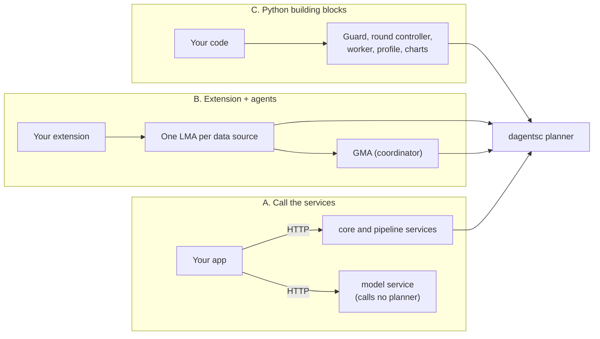

# Build an application on Dagents

This guide shows how to use Dagents in your own application, step by step. Each
step has the code, the command to run, the output you should see and the
mistakes to avoid. It is for developers who want to analyse data that sits in
several places, such as stores, hospitals or customer accounts, without
copying it into one place.

The [learning guide](../learn/README.md) explains the ideas behind Dagents:
federated learning, data governance and how the parts fit together. Read it
first if the terms below are new. The [API reference](../reference/api/overview.md)
lists every endpoint and its fields.

## What Dagents gives your application

- **A Guard for every read.** You declare how sensitive each field is. Dagents
  decides what each requester may see and records every decision in an audit
  log. If the planner cannot make the decision, the Guard denies the request.
- **Federated rounds.** A coordinator sends the same job to every data source.
  Each source computes locally and returns only summaries. Dagents decides which
  sources may join, whether enough of them answered, and whether the result may
  be released.
- **Planning services.** HTTP services that validate pipelines, choose a model
  family for a dataset and render Kubernetes manifests and Docker Compose files.

Your application keeps what only it can know: its fields, its records, its
models and its user interface.

## Three ways to build on Dagents

Path B uses the framework's two agents. An **LMA** (local monitoring agent)
runs at each data source: it holds the source's Guard and does the work that
reads records. A **GMA** (global monitoring agent) runs at the coordinator: it
plans rounds, combines what the sources send and decides on release.

All three paths reach the same planner, `dagentsc`. The planner is a program
written in OCaml that makes every decision: what protection a request needs,
which sources may join a round, and whether a release gate passes.

| | A. Call the services | B. Extension and agents | C. Python building blocks |
|---|---|---|---|
| **You write** | HTTP calls from any language | An extension (fields, sensitivity, release gates), your list of approved purposes, and one data store per source | Python code that calls the framework's classes |
| **Dagents gives you** | Pipeline validation and runs, model routing, workload plans, Kubernetes manifests and Docker Compose files | The Guard at four boundaries, federated rounds, release decisions, audit logs | The same parts as B, wired the way your application needs |
| **What it costs** | No Guard on your data: the services see what you send them | You run an LMA per source and a GMA, as separate processes or inside your own, and keep the planner on each machine | You own the wiring; the framework's HTTP agents are not used |
| **Example in this repository** | NL2SQL demo: [`dagents_orchestrator.py`](../../services/nl2sql-demo/backend/app/services/dagents_orchestrator.py) | Stroke demo: [`extension.py`](../../apps/healthcare-demo/backend/app/extension.py) and [`agents.py`](../../apps/healthcare-demo/backend/app/services/agents.py) | The [worked example](../../examples/getting-started/) used in this guide |

How to choose:

- Choose **A** if you need planning and manifests, and your data is not
  sensitive or never leaves your own service.
- Choose **B** if your data sits in several places and must stay there. This is
  the main use of Dagents. The stroke demo follows it: it registers an
  extension and calls one LMA per hospital and a GMA only through their HTTP
  APIs. On the published demo the agents run inside the demo's own process and
  are called without a socket; locally they can run as separate processes, and
  the same client code calls them.
- Choose **C** if you want to wire the framework's classes yourself, for
  example inside an existing service that cannot call the agents.

Most of this guide follows paths B and C. The worked example starts with the
building blocks (path C) and runs its round through the agents in
[Step 6](06-federated-rounds.md#6-run-the-round-through-the-lma-and-gma).
[Step 7](07-framework-services.md) covers path A.

## The worked example

Every code block in this guide comes from a small application in
[`examples/getting-started/`](../../examples/getting-started/). Two stores,
`store-north` and `store-south`, each keep their own orders. Together they
check how well a rule finds orders that are likely to be returned. No order
leaves a store. The orders are made up.

| Term in the example | General term | Dagents part |
|---|---|---|
| A store | A data source, also called a site | Runs the LMA role: its own store, Guard and worker |
| The returns team | The coordinator | Runs the GMA role: plans rounds and decides on release |
| The returns rule | A model | Evaluated at each store in a federated round |

A test, `tests/test_getting_started_example.py`, checks that each code block
here matches its file and that each output block matches what the script
prints with the real planner. If you change the example, the test tells you
which block to update.

## The method

There are two ways to get Dagents. Install the package from PyPI to use it in
your own application, or clone the repository to also run the framework
services, the demos and the tests. The worked example runs either way.

| Step | Page | What you have at the end |
|---|---|---|
| | [Install the package](00-install.md) | `dagents` installed from PyPI, its planner found, and an LMA and a GMA running |
| 1 | [Set up](01-setup.md) | A clone with the planner built, a Python environment and the services running |
| 2 | [Describe your data](02-describe-your-data.md) | A feature contract, a classification and a condition pack, registered as an extension |
| 3 | [Give each source its own store](03-store-per-source.md) | One store per source, in memory or in Postgres |
| 4 | [Govern every read](04-govern-every-read.md) | Every read goes through the Guard and is recorded |
| 5 | [Compute at each source and combine](05-compute-and-combine.md) | Local profiles and summaries that may leave a source |
| 6 | [Run a federated round](06-federated-rounds.md) | One round from plan to release decision |
| 7 | [Call the framework services](07-framework-services.md) | Workload plans, pipelines and model routes over HTTP |
| 8 | [Deploy](08-deploy.md) | Containers, configuration and manifests |
| 9 | [Test your integration](09-test-your-integration.md) | Tests that use the real planner and fail on a skip |
| 10 | [Checklist and common mistakes](10-checklist.md) | A list to check before you ship |

## Limits that apply to every step

- The package is an alpha. Before 1.0.0, a release can change the Python APIs,
  settings, routes and package layout. This guide follows the repository's
  `main` branch, which can be newer than the newest release
  ([Install the package](00-install.md#versions)).
- The LMA and GMA keep site enrolments, rounds and pending model updates in
  memory, so a restart loses them. Their audit chains, the LMA's job log and
  the GMA's model registry can be kept in Postgres
  ([Step 8, section 9](08-deploy.md#9-state-that-survives-a-restart)). The Python building blocks accept your
  own stores and audit sinks (Step 3 and Step 4).
- The in-process federation engine is a simulator for tests and examples. The
  GMA's HTTP engine sends each round's jobs to the LMAs over their APIs; a
  deployment can connect another federated learning runtime through the
  `FederationEngine` interface (Step 6).
