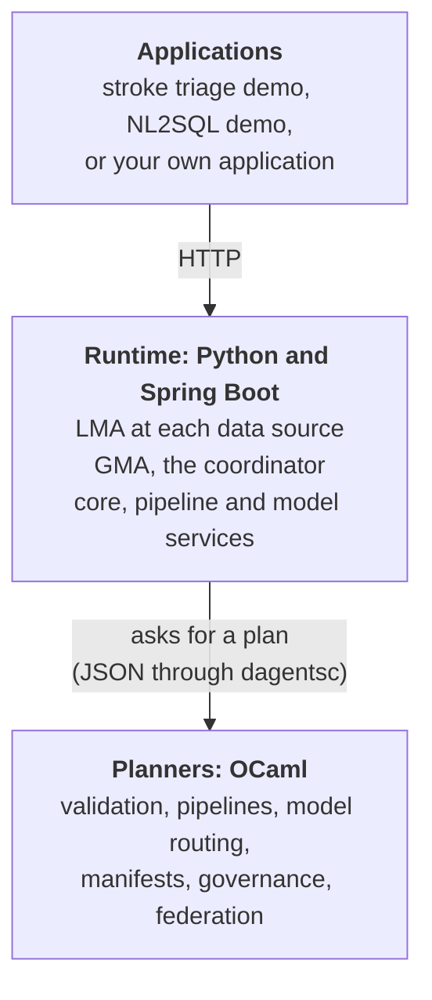
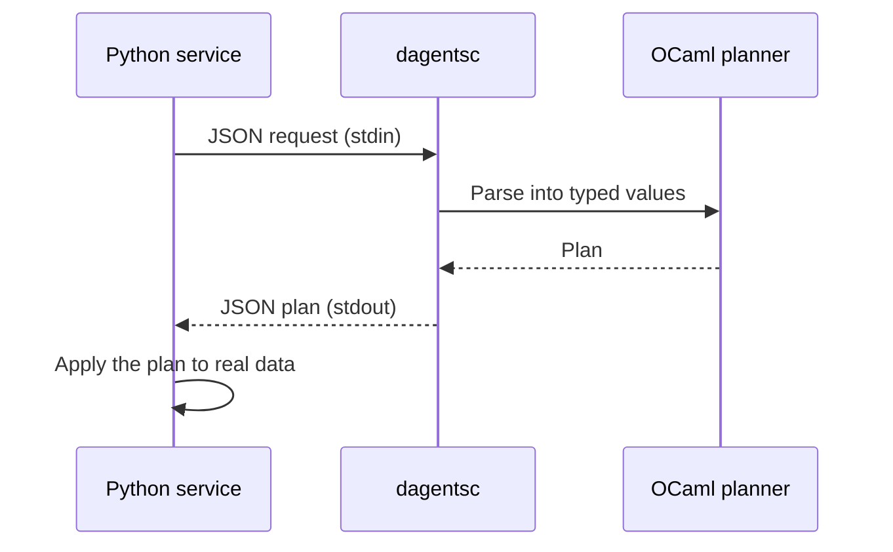
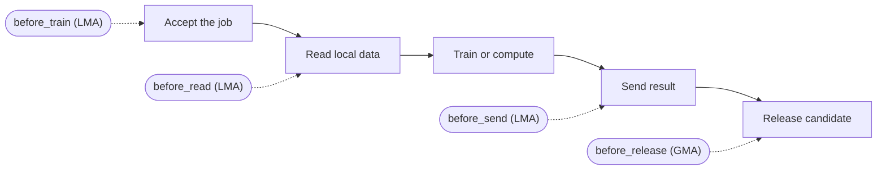
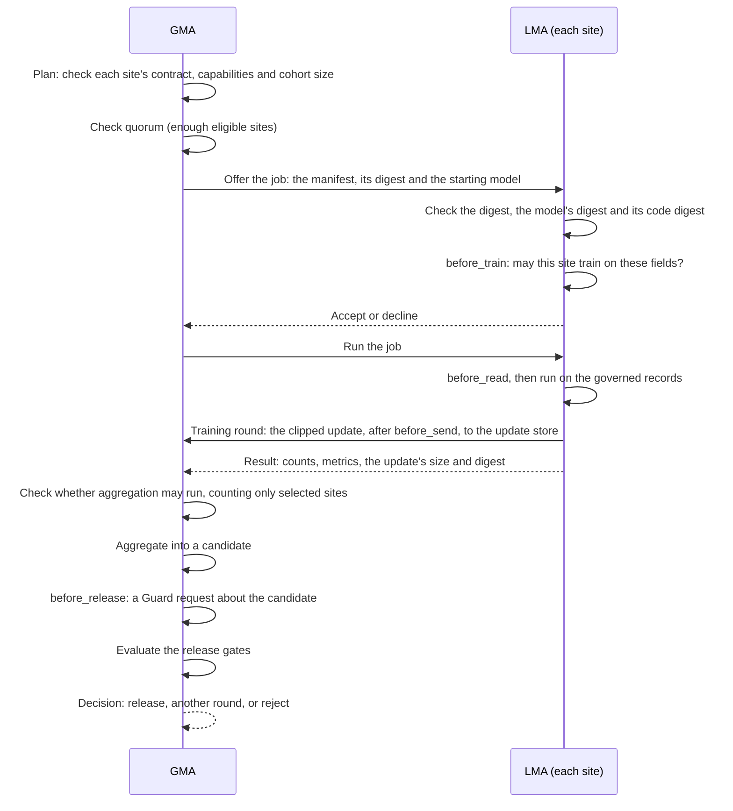
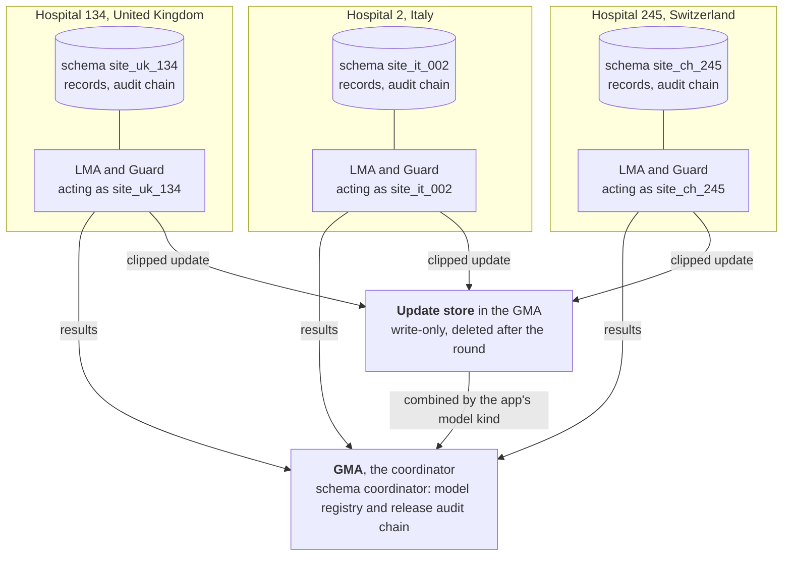
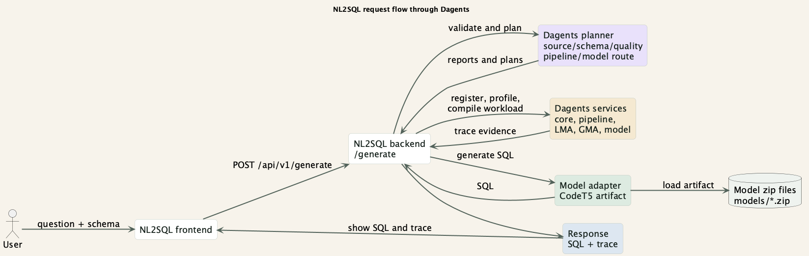

# Step 3: How Dagents is built

Dagents is a framework that other applications use. An application such as the
stroke triage demo supplies its domain knowledge (which fields exist, how
sensitive they are, which conditions it handles). Dagents supplies the rest:
profiling, planning, governance, federated rounds and deployment manifests.

## The layers

What each layer does:

| Layer | Language | Does | Does not |
|---|---|---|---|
| Planners | OCaml | Make decisions from typed inputs: validate, plan, route, render | Open database connections, train models, serve HTTP |
| Runtime | Python | Serve the APIs, read data, train and run models, keep state | Contain the decision rules |
| Orchestration | Java (Spring Boot) | Offer the same control and core APIs to JVM consumers | Run machine learning |

## Why the planners are in OCaml

A planner is a pure function: the same input always gives the same plan, and it
has no side effects. OCaml suits this for two reasons:

- **Algebraic data types.** A choice such as trust level (`LowTrust | ModerateTrust | HighTrust`)
  is a type, not a string. A typo is a compile error.
- **Exhaustive pattern matching.** The compiler checks that every combination is
  handled. Adding a new granularity fails to compile until every rule covers it.

The runtime calls the planners through a command-line program, `dagentsc`. It
sends JSON on standard input and reads a plan from standard output. Using a
separate process, rather than linking the two languages together, keeps failures
isolated and lets each side be upgraded and deployed on its own.

The planner modules:

| Module | Decides |
|---|---|
| `common_ir` | The shared types and their JSON format |
| `dataset_compiler` | Source validation, profiling, schema contracts, quality rules, transforms |
| `pipeline_compiler` | Whether a pipeline is a valid DAG, and the order to run its steps |
| `model_router` | Which model family suits a dataset and task |
| `manifest_compiler` | Kubernetes YAML for a workload |
| `governance_compiler` | What protection a request needs (Step 2) |
| `federation_compiler` | Which sites may join a round, whether quorum is met, whether aggregation may run, and whether a candidate passes its release gates |

## The two agents

**LMA (local monitoring agent).** One runs at each data source: a hospital, a
database, a service. It profiles the local data, runs local work, and applies
governance before data is read, before training, and before anything leaves the
site. An LMA started for one site reads that site's records from its own
source, keeps a running profile of them, reports counts and the rates its
planner permits, and runs the site's part of each federated round. It keeps a
log of every job it refused or ran.

**GMA (global monitoring agent).** It registers the LMAs, plans federated rounds,
sends each site its job over the LMA's API, combines results, and decides
whether a candidate model may be released. It keeps a registry of model
versions and their status.

The agents call each other only through their HTTP APIs, with bearer tokens of
fixed scopes. An application can run them as separate processes, or inside its
own process, where each call still goes through the agent's routes and checks
without a socket.

Both agents use the same code layout:

| Folder | Contains |
|---|---|
| `domain/` | Typed models with no I/O |
| `application/` | Use cases |
| `adapters/` | Code that talks to specific technologies |
| `infrastructure/` | Messaging and storage, behind interfaces |

Messaging is in memory today, and so are the GMA's enrolments and rounds. With
a database, an LMA keeps its audit chain and job log in Postgres, and the GMA
keeps its model registry and its own audit chain there. Each runs every query
as one database role. The stroke demo runs one LMA per hospital and a GMA, and
calls them only through their APIs. It keeps each site's records and audit
chain in Postgres, as described below.

## Four guard boundaries

Governance is checked at four points in a round:

| Boundary | Agent | Checks |
|---|---|---|
| `before_train` | LMA | Whether the site may train on the requested fields for this round. Checked when the job is offered. |
| `before_read` | LMA | Which records and fields the job may read. The job runs on this governed data, not the raw records. |
| `before_send` | LMA | What may leave the site: a round's result, with its counts, metrics and bounded model update, leaves only when this boundary permits the contribution for the number of records the round used. It bounds the update; it does not inspect each metric. |
| `before_release` | GMA | Whether a candidate model may be released. The GMA's release evaluation runs this Guard request before the gates when the request names a condition pack. A coordinator that runs the round in its own code sends the request itself. |

## A federated round in Dagents

The GMA sends each call to the LMA over its HTTP API
(`POST /api/v1/federation/jobs:run`, in which the LMA checks the job and runs
it when it accepts), and records the status of each call with the round. A result counts only when it comes from a
site the round's plan selected. The planner rejects any other result with the
reason "site was not selected for this round", and the GMA refuses it with
`403` when it is posted. A round id can be used once.

Two rules always hold, and both have tests:

1. Aggregation produces a **candidate**, never a release. Release needs the gates to pass.
2. A release gate whose metric is missing **blocks** the release. It never passes by default.

The planner also decides every change of a model version's status
(`dagentsc federation model lifecycle`). A version is a `candidate`,
`released`, `rejected` or `superseded`, and at most one version is released.
A candidate becomes `rejected` when the gates or the release Guard say no. A
person's approval releases a candidate only when the stored decision says
`release`, the Guard permitted it, its metrics came from the study's rounds,
and the model it was compared with is still the one in use. The GMA's model
registry applies the planner's answer and keeps no status rule of its own.

The stroke demo runs eight rounds in order: analytics, evaluation of the model in
use, five training rounds, and validation of the candidate at each hospital.
Then it asks the GMA to evaluate the release gates. The demo sends each round to
the GMA, and the GMA sends each hospital's job to that hospital's LMA.

## Where each site's data is kept

In the stroke demo, each hospital keeps its records in a store of its own. With
a database, that is one Postgres schema and one role per hospital; the role owns
the schema and cannot log in. Without a database, each hospital has its own
in-memory store. The hospital's LMA reads the store as the hospital's role. The
coordinator has a separate schema for the GMA's model registry and release
audit chain, each hospital's job log and the demo's pilot reports. The GMA has
no access to any hospital's schema.

The GMA sends each hospital's LMA the round manifest. The arrows show what a
hospital sends back. Its **results** (counts, aggregate metrics, and the
update's size and digest) go to the GMA, and only when the hospital's
`before_send` Guard permits the round's contribution. Its **clipped update**
goes only to the GMA's update store, which no route reads back.

Every database operation runs in one transaction that first switches to the
hospital's role (`SET LOCAL ROLE`) and checks that the switch happened. So a
query for one hospital cannot read another hospital's rows, and a coordinator
query cannot read any hospital's rows.

What crosses from a hospital, and what stays:

| Crosses to the coordinator | Stays at the hospital |
|---|---|
| Record counts, and an outcome rate when the hospital's planner permits a table request for the outcome at that many labelled records (at least 20) | The records, including every outcome label |
| Each round's aggregate metrics, such as AUC and sensitivity, when the `before_send` Guard permits the round's contribution | The guarded records the round's code trains on |
| The size of its model update after the Guard clipped it, and the update's digest | The audit chain of its Guard decisions |
| Whether its audit chain verifies, and how many decisions it holds | The decisions in that chain |

The model update itself goes from the hospital's `before_send` Guard, which
clips it to a norm of 1.0, to the GMA's update store. When the round is
aggregated, the GMA checks each update against the digest the hospital
reported, combines the updates with the weights the planner chose (each
hospital's share of the records) using the demo's model kind, registers the
new model version as a candidate and deletes the updates. The GMA's HTTP
engine stands in for a federated learning runtime such as Flower. The update
never appears in a round result, because results are shown to the coordinator.

When a hospital's staff enter a new record, it is written to that hospital's
store as that hospital's role. Then the demo asks the hospital's LMA to read the
store again, and the LMA rebuilds its running statistics (counts, means and
category counts). Once the record has an outcome, the next round trains and
evaluates on it.

One limit applies to the published demo. Supabase gives the API one database
login, and that login can read every schema. The isolation therefore holds
because every query the code runs switches to a hospital's role, not because the
login is restricted. A real deployment gives each hospital's LMA its own login
and database.

## How applications extend Dagents

An application registers an **extension**. It can contribute:

- feature contracts: the fields each site must provide,
- data classifications: how sensitive each field is,
- condition packs: one studied condition with its cohort, its label field, its
  approved purposes, thresholds and release gates,
- model kinds: the code that runs a model, so the LMA can train and evaluate
  it and the GMA can check and combine its updates without importing the
  application,
- site sources: how an LMA started from settings reads a site's records,
- named pipeline steps,
- named model adapters.

Two extensions cannot register the same id; that is an error. The stroke demo's
extension is in
[`apps/healthcare-demo/backend/app/extension.py`](../../apps/healthcare-demo/backend/app/extension.py).

A simple test for whether code belongs in the framework: if it needs a
domain-specific word, such as "stroke", it belongs in the application.

### Example: the NL2SQL demo

The NL2SQL demo turns a question into SQL. The app owns its interface and its SQL
model. For each request it asks the planners to validate the source and schema
and to plan the work, and it asks the services to profile the source and compile
the workload. The response shows the SQL and a trace of each framework step.

This diagram is written in PlantUML. Its source is
[`dagents_request_flow.puml`](../presentation/puml/dagents_request_flow.puml).

## Watch

- [Open-Source Systems for Federated Learning](https://www.youtube.com/watch?v=TcbOMbg4F9g) — Mosharaf Chowdhury, Stanford MLSys Seminar. How federated learning systems are built.
- [Federated AI Simulations with Flower (2025)](https://www.youtube.com/playlist?list=PLNG4feLHqCWkdlSrEL2xbCtGa6QBxlUZb) — a playlist on strategies and simulation in a production framework.

## Read

- [A Tour of OCaml](https://ocaml.org/docs/tour-of-ocaml) — values, functions and pattern matching. No setup needed for the first pages.
- [Real World OCaml](https://dev.realworldocaml.org/) — free online book. The chapters on variants and pattern matching explain the planner style.
- [FastAPI tutorial](https://fastapi.tiangolo.com/tutorial/) — the Python web framework the services use.
- [Kubernetes basics](https://kubernetes.io/docs/tutorials/kubernetes-basics/) — background for the manifests the core service generates.
- In this repository:
  - [`AGENTS.md`](../../AGENTS.md) — the full contributor guide.
  - [`docs/agents/lma-gma-architecture.md`](../agents/lma-gma-architecture.md) — agent responsibilities and run flow.
  - [`bindings/ocaml/README.md`](../../bindings/ocaml/README.md) — the planner modules and the `dagentsc` commands.
  - [`docs/presentation/puml/`](../presentation/puml/) — PlantUML sources for the diagrams in the project presentation.

Next: [Step 4 — Using the APIs](04-apis.md)
