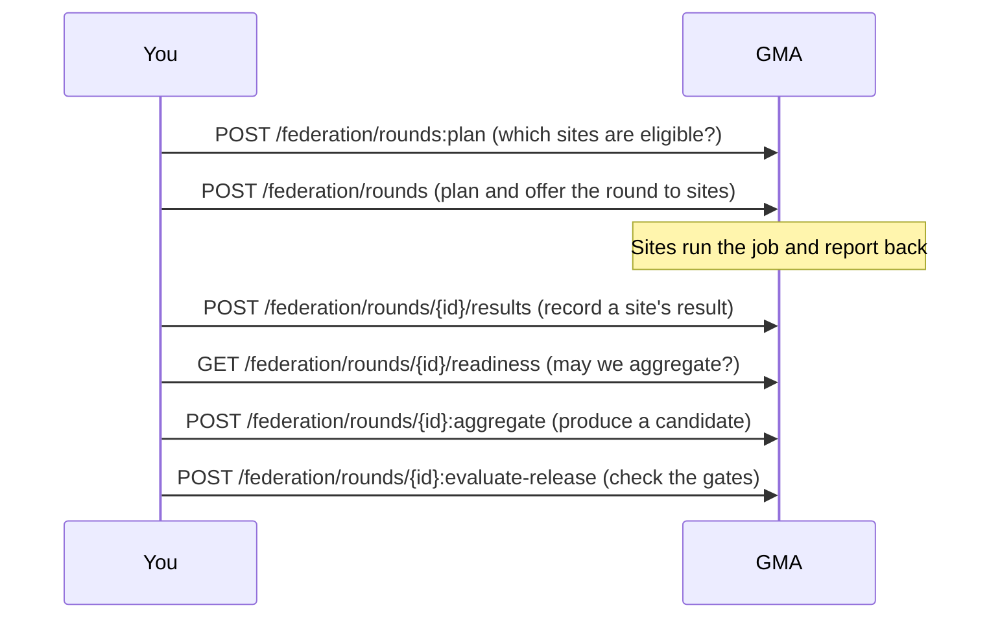

# Step 4: Using the APIs

## Where the APIs are

| Service | Port | Main endpoints |
|---|---|---|
| LMA | 8010 | Governance at one site, dataset profiling, local model runs; for a site: its summary, profile, Guard probe and federated jobs |
| GMA | 8020 | Governance, site enrolment, federated rounds, model versions and approval |
| model-service | 8000 | Model training, checks and jobs |
| pipeline-service | 8030 | Pipeline registry, validation and runs |
| core-service | 8040 | Catalog, topology, workload compilation, Kubernetes manifests and Docker Compose files |
| Spring control and core | 8050, 8060 | The same control and core APIs for JVM consumers |
| Stroke demo backend | 8080 | The demo's own API: hospitals, data entry, the Guard probe, the pilot, charts. It calls an LMA per hospital and a GMA through their APIs |

The [API reference](../reference/api/overview.md) describes every endpoint: its
parameters, its request and response fields, its errors, and examples captured
from real calls. It is generated from the code, grouped by module:
[Agents](../reference/api/agents.md),
[Framework services](../reference/api/framework-services.md),
[Spring Boot services](../reference/api/spring-services.md),
[Demo apps](../reference/api/demo-apps.md) and the planner,
[dagentsc](../reference/api/dagentsc.md). The plain list of endpoints is
[`docs/reference/service-inventory.md`](../reference/service-inventory.md).

## Conventions

- Framework services use versioned paths: `/api/v1/...`.
- The agents also keep short paths such as `/health`. Each one calls the same
  handler as its `/api/v1/...` version.
- An action on a resource uses a colon: `rounds:plan`, `rounds/{id}:aggregate`.
- Every Python service serves interactive documentation at `/docs` and its
  OpenAPI schema at `/openapi.json`. Once the stroke demo API is running (below),
  open <http://127.0.0.1:8080/docs>.
- The LMA and the GMA accept bearer tokens, each with one scope, when they are
  started with tokens: `Authorization: Bearer <token>`. Started without
  tokens, as in the walkthroughs below, they answer every caller and log a
  warning. The framework services and the demos check no token. The scopes are
  in [Tokens, errors and calls between agents](../reference/api/agents.md#tokens-errors-and-calls-between-agents),
  and the [API reference overview](../reference/api/overview.md) lists the
  error shapes, status codes and the stroke demo's rate limits.
- The agents answer their own errors as `{"detail": "...", "code": "..."}`,
  for example `{"detail": "site store-east was not selected for round returns-eval-http-1", "code": "forbidden"}`.
  No `detail` holds a host, a token or a connection string.

## Walkthrough 1: the stroke demo API on your machine

Build the planner first (see [Step 5](05-hands-on.md)). Then start the API from
the repository root. It needs no database: each hospital keeps its records in
memory, loaded from the committed International Stroke Trial extract. The API
runs one LMA per hospital and a GMA inside its own process, and calls them
through their HTTP routes without a socket.

```bash
export DAGENTSC_BIN=$PWD/bindings/ocaml/_build/default/bin/dagentsc.exe
apps/healthcare-demo/scripts/run_local_demo.sh
```

The API listens on port 8080. Set `HEALTHCARE_DEMO_API_PORT` to use another
port. In a second terminal:

```bash
API=http://127.0.0.1:8080

# Is it running?
curl -s $API/api/v1/health

# Where are the records stored? Locally: "cohort_source": "in-memory",
# "ready": true, each hospital's record_count and labelled_count, and
# "agents": {"mode": "in-process", "engine": "http", ...}.
curl -s $API/api/v1/framework/status

# The three hospitals, what each reports, and the release gates
curl -s $API/api/v1/overview

# One hospital's ranked worklist
curl -s "$API/api/v1/hospitals/uk-134/worklist?limit=3"
```

Every successful answer whose body is a JSON object ends with
`framework_calls`: the LMA and GMA calls the demo made to build it. Each entry
names the agent, the method, the route template, the status and the time it
took, never a host or a token. The overview's calls go to the GMA, which asks
each hospital's LMA for its summary (`GET /api/v1/federation/sites/summaries`).

The overview lists what each hospital reports about its records, never the
records themselves:

| `site_id` | Hospital | Country | `record_count` | `labelled_count` | `outcome_rate` |
|---|---|---|---|---|---|
| `uk-134` | Hospital 134 | United Kingdom | 524 | 524 | 0.798 |
| `it-002` | Hospital 2 | Italy | 292 | 292 | 0.599 |
| `ch-245` | Hospital 245 | Switzerland | 198 | 198 | 0.687 |

A worklist stays at its hospital. Each row has the record's fields and an
`assessment` from the model in use, with a score, a priority and the reasons.
The top row at `uk-134`, shortened:

```json
{
  "encounter_id": "uk-134-16099",
  "origin": "dataset",
  "age_band": "90+",
  "conscious_level": "drowsy",
  "systolic_bp": 123.0,
  "stroke_subtype": "TACS",
  "assessment": {
    "model_version": "stroke-outcome-rule-v1",
    "score": 0.989,
    "priority": "urgent",
    "points": 14,
    "max_points": 17,
    "basis": [
      "age band 90+: 5 points",
      "conscious level drowsy: 2 points",
      "face weakness, arm weakness, leg weakness, speech difficulty: 4 points",
      "atrial fibrillation: 1 point",
      "stroke subtype TACS: 2 points"
    ]
  }
}
```

### Ask the governance planner

`governance:probe` runs one request through a hospital's Guard and returns the
plan. `site_id` picks the hospital; the default is the first one. The demo
sends the request to that hospital's LMA, and `framework_calls` names the call:
`POST /api/v1/governance/restrictions:probe`.

```bash
curl -s -X POST $API/api/v1/governance:probe \
  -H "Content-Type: application/json" \
  -d '{"site_id": "uk-134", "verified": true, "granularity": "row", "cohort_size": 25}'
```

The response includes `permitted`, the `plan` (trust assessment, one strategy per
field, the decision), and the id of the audit record the Guard wrote to that
hospital's chain. It also says what the Guard would release, without the
records: `released_count` (how many records or summary rows) and
`released_fields` (their field names), with `withheld_fields` and
`transformed_fields`. The consortium page calls the probe, and no patient record
reaches the coordinator, so the values stay at the hospital. The default fields
are `systolic_bp` (high sensitivity), `age_band` (medium) and `onset_on_waking`
(low). Change the inputs and compare:

| Body (with `"site_id": "uk-134"`) | `systolic_bp` | Decision |
|---|---|---|
| `{"verified": true, "granularity": "row", "cohort_size": 25}` | `generalize:1` | narrow |
| `{"verified": false, "granularity": "row", "cohort_size": 25}` | `redact` | narrow |
| `{"verified": true, "granularity": "table", "cohort_size": 25}` | `aggregate_only:20` | narrow |
| `{"verified": true, "granularity": "table", "cohort_size": 5}` | `refuse` | deny: `cohort_size 5 is below minimum_cohort 20` |
| `{"verified": true, "granularity": "model_update", "cohort_size": 25}` | `clip_contribution:1` | narrow |
| `{"verified": true, "granularity": "aggregate", "cohort_size": 25}` | — | HTTP 422: `granularity` must be one of cell, row, column, table, model_update |
| `{"requested_fields": ["poor_outcome_6m"]}` | — | HTTP 422: `requested_fields`: poor_outcome_6m cannot be requested, followed by the fields that can |
| `{"requester_id": "me"}` | — | HTTP 422: `requester_id` is not a field of this request; the server sets the requester and the purpose |

Every visitor can read a hospital's audit chain, and nobody can edit a chain
without breaking it, so a probe body takes no free text. `requested_fields` may
name only the contract's fields other than the outcome label.

The verified row request releases 5 records with the fields `systolic_bp`,
`age_band` and `onset_on_waking`, and lists `systolic_bp` as transformed. The
table request with a cohort of 25 is permitted, but it releases nothing
(`"released_count": 0`). The probe passes the Guard 5 records by default, which
is fewer than the 20 an aggregate needs. Add `"record_limit": 20` and the Guard
releases one summary row (`"released_count": 1`) with the fields
`record_count`, `systolic_bp_mean`, `age_band_distinct` and
`onset_on_waking_distinct`.

### Enter a record at a hospital

A hospital's staff add records through its data-entry form. The form comes from
the backend, so a client repeats no rule:

```bash
curl -s $API/api/v1/hospitals/it-002/entry-form
```

It lists 13 fields: `age`, `sex`, `conscious_level`, `hours_since_onset` and
`systolic_bp` are required, and the yes/no findings may be left empty when they
could not be assessed. There is no free-text field. The age stays at the
hospital; only its band is shared.

Send a record with an `Idempotency-Key`, so that sending it twice stores it once:

```bash
curl -s -X POST $API/api/v1/hospitals/it-002/encounters \
  -H "Content-Type: application/json" \
  -H "Idempotency-Key: walkthrough-0001" \
  -d '{"age": 78, "sex": "female", "conscious_level": "drowsy",
       "face_weakness": true, "arm_weakness": true, "leg_weakness": false,
       "speech_difficulty": true, "hours_since_onset": 3.5, "systolic_bp": 170,
       "atrial_fibrillation": true, "stroke_subtype": "TACS"}'
```

The answer is `201` with four parts, followed by `framework_calls`:

- `record`: the stored row, with the id `it-002-e1`, `origin: "entered"` and the
  age band `70-79` filled in from the age;
- `assessment`: score 0.9526, priority `urgent`, 11 points;
- `counts`: `{"total": 293, "entered": 1, "labelled": 292}`;
- `profile`: the hospital's running statistics. The demo asked the hospital's
  LMA to read the store again (`POST /api/v1/site/source:refresh`), and the LMA
  rebuilt them. For example, `systolic_bp` now has 293 values with a mean of
  160.27.

What else to try:

| Request | Result |
|---|---|
| The same body with the same key | `201` and the same record, `it-002-e1`; nothing new is stored |
| A different body with the same key | `409`: the key was already used for a different record |
| `"age": 12`, or an extra field such as `"notes"` | `422` with `errors`: `age` must be between 16 and 110; `notes` is not a field of the record |

The record has no outcome yet, so no round trains on it. Record the six-month
outcome:

```bash
curl -s -X POST $API/api/v1/hospitals/it-002/encounters/it-002-e1/outcome \
  -H "Content-Type: application/json" \
  -d '{"poor_outcome_6m": true}'
```

`counts` becomes `{"total": 293, "entered": 1, "labelled": 293}`. Only entered
records take an outcome; a dataset record returns `422`. An outcome is recorded
once: the same value again returns `200` and changes nothing, and a different
value returns `409` with "This record already has an outcome. It cannot be
changed." The next pilot uses the record: in its rounds `it-002` contributes
293 examples instead of 292. Each hospital's form may add 300 records; after
that the API returns `409`.

### Run a full pilot

```bash
curl -s -X POST $API/api/v1/pilot:run \
  -H "Content-Type: application/json" \
  -d '{"round_prefix": "api"}'
```

`round_prefix` starts each round's id and must be `ui` or `api`. This runs
eight federated rounds (analytics, evaluation of the model in use, five training
rounds and validation of the candidate) and then the release gates. The demo
calls only the GMA. The GMA sends each round's job to the three LMAs, and
`framework_calls` lists those calls too, with `"via": "gma"`: one
`jobs:run` call per hospital and round, in which the hospital's LMA checks the
job and runs it when it accepts. It takes about a second. On the
committed records, before any entry:

- the model in use, `stroke-outcome-rule-v1`, scores a size-weighted AUC of
  0.7769 at the three hospitals;
- the five training rounds lower the log loss from 0.6931 to 0.4962. In round 1
  every hospital's update is clipped to the norm bound of 1.0;
- the candidate, a logistic regression, scores an AUC of 0.7859.

| Gate | Rule | Observed | Result |
|---|---|---|---|
| `discrimination` | AUC ≥ 0.70 | 0.786 | passed |
| `improves_on_current_release` | AUC ≥ baseline 0.777 + 0.02 | 0.786 | **failed** |
| `subgroup_fairness` | AUC gap between female and male patients ≤ 0.10 | 0.022 | passed |
| `sensitivity_at_alert_threshold` | sensitivity ≥ 0.80 | 0.922 | passed |
| `alert_burden` | alerts per 1,000 ≤ 750 (advisory, not blocking) | 853 | failed |

Each gate result in the response carries the `threshold` the planner compared
the observed value with; for `improves_on_current_release` that is the baseline
plus the margin. The decision is `reject`, the candidate's status becomes
`rejected`, and the hospitals keep using `stroke-outcome-rule-v1`. The run has no randomness, so it
gives these numbers every time on the same records. A record you entered with an
outcome changes them slightly.

After a pilot, each hospital's view shows what it sent in each round:

```bash
curl -s $API/api/v1/hospitals/it-002
```

`contributions` lists each round with its phase, the number of examples, the
clipped update norm and the metrics. The update itself never appears there.
The pilot response itself tells the coordinator only whether each hospital's
audit chain verifies and how many decisions it holds (`site_audits`); the
decisions stay at the hospital, in `GET /api/v1/hospitals/{id}/audit`.

`GET /api/v1/models` lists the model in use and the 20 newest registered
versions. Every pilot registers several.

### Charts

The backend draws the charts as SVG and gives each one a table of the same
numbers:

```bash
curl -s $API/api/v1/hospitals/uk-134/charts     # this hospital's charts, from its own records
curl -s $API/api/v1/charts                      # consortium charts, from reported numbers and the last pilot
curl -s "$API/api/v1/hospitals/uk-134/charts/outcome-by-age-band.svg?theme=dark" -o chart.svg
```

Each list entry has `chart_id`, `title`, `available`, `svg_path` and `table`,
and says who drew the chart (`drawn_by`) and where its numbers come from
(`data_from`).
Before the first pilot, the training curve, AUC and gate charts are listed with
`available: false`. With a database, the coordinator keeps the pilot reports, so
after a restart these charts show the last pilot.

### When something fails

A store or database failure, a missing planner or an agent that does not
answer returns a JSON `503` with a plain message, and any other error a JSON
`500`. The message is the demo's own, never the agent's. Both carry the CORS
headers and the `X-Dagents-App` header, which tells a client the answer came
from the app and not from a proxy.
[The deployment notes](../../apps/healthcare-demo/docs/deployment.md#what-the-api-returns-when-something-fails)
list each message.

## Walkthrough 2: the framework APIs on your machine

This uses the GMA, the framework's coordinator. Build the planner first (see
[Step 5](05-hands-on.md)), then start the GMA from the repository root:

```bash
export DAGENTSC_BIN=$PWD/bindings/ocaml/_build/default/bin/dagentsc.exe
PYTHONPATH=. .venv/bin/uvicorn agents.gma.main:app --port 8020
```

The example request bodies are in [`docs/learn/examples/`](examples/).

### Plan a governed request

[`restriction-request.json`](examples/restriction-request.json) asks for three
fields of a "patients" classification, at row granularity, from a verified analyst:

```bash
curl -s -X POST http://localhost:8020/api/v1/governance/restrictions:plan \
  -H "Content-Type: application/json" \
  -d @docs/learn/examples/restriction-request.json
```

Result: trust is high (score 0.97), `diagnosis` (high sensitivity) is
generalized, and `age_band` and `region` are returned in full. Edit the file to
change the granularity, remove a verified attribute or lower the cohort size,
and run it again.

### Enforce it on data

`restrictions:enforce` takes the request and a payload, applies the plan, and
writes an audit record. [`enforce-request.json`](examples/enforce-request.json)
wraps the same request around two records:

```bash
curl -s -X POST http://localhost:8020/api/v1/governance/restrictions:enforce \
  -H "Content-Type: application/json" \
  -d @docs/learn/examples/enforce-request.json
```

The returned payload:

```json
[
  {"diagnosis": "I63*", "age_band": "70-79", "region": "north"},
  {"diagnosis": "I61*", "age_band": "50-59", "region": "south"}
]
```

The diagnosis codes are generalized (`I63.9` became `I63*`), and `patient_id` is
gone because the request did not ask for it. Then check the audit log:

```bash
curl -s http://localhost:8020/api/v1/governance/audit
```

It lists the decision and reports `"chain_intact": true`.

### Plan a federated round

Enrol the three hospitals, then ask which of them may join a round. The site
files use the stroke demo's hospital ids and record counts, and the manifest
names the demo's seed rule and its digest:

```bash
for site in uk-134 it-002 ch-245; do
  curl -s -X PUT http://localhost:8020/api/v1/federation/sites/$site \
    -H "Content-Type: application/json" \
    -d @docs/learn/examples/site-$site.json
done

curl -s -X POST http://localhost:8020/api/v1/federation/rounds:plan \
  -H "Content-Type: application/json" \
  -d @docs/learn/examples/round-manifest.json
```

Result: all three sites are selected and `quorum_met` is true. The manifest asks
for secure aggregation with a threshold of 3, so three sites are required.

Now make one site ineligible. In `site-ch-245.json`, change
`feature_contract_version` to `stroke-triage-features-v2`, enrol it again and plan
again. `ch-245` is excluded with the reason "site feature contract
stroke-triage-features-v2 does not match round contract
stroke-triage-features-v3", only two sites remain, and the plan stops with
`quorum_not_met`.

### The rest of a round



Each path also works under `/api/v1/`. A round id can be used once: sending
the same manifest again answers `409`. Only the sites the plan selected may
post a result; any other site gets `403`. The readiness `GET` asks the planner
and stores nothing. With the HTTP engine the GMA collects the results itself,
and the dispatch answer already carries the readiness. A round is aggregated once and takes one release decision;
a second attempt answers `409`. The request schemas are on the GMA's `/docs` page and in
the [federated rounds](../reference/api/agents.md#federated-rounds) section of
the API reference.

Started with nothing configured, as here, the GMA runs no site's work: each
site posts its own result. Started with `GMA_ENGINE=http` and the addresses of
its LMAs, the GMA offers each site its job over the LMA's API, collects the
results, combines training updates and keeps the model versions. It then takes
results only from the LMAs: a posted result answers `409`. Step 6 of the
[guide to building an application](../guide/06-federated-rounds.md) runs a
round that way, with one LMA per store, and shows every call.

## Read

- [The API reference](../reference/api/overview.md) — every endpoint, its fields, errors and examples, generated from the code.
- [`docs/reference/service-inventory.md`](../reference/service-inventory.md) — the plain list of endpoints.
- [FastAPI tutorial](https://fastapi.tiangolo.com/tutorial/) — how the Python services define their endpoints and the `/docs` page.

Next: [Step 5 — Run it yourself](05-hands-on.md)
