# Agents

Dagents runs two kinds of agent. Both are FastAPI apps.

| Agent | Code | Port | What it is for |
|---|---|---|---|
| LMA, the local monitoring agent | `dagents/lma/` | 8010 | One per data source (a tenant, database, service, event stream or environment). It profiles the source's data, runs local models and monitoring bundles, publishes telemetry, and applies the Guard at three of the four boundaries: before data is read, before training and before anything is sent. Started for a site, it also serves that site's records, summary and Guard probe, and runs the site's part of each federated round. |
| GMA, the global monitoring agent | `dagents/gma/` | 8020 | The coordinator. It registers LMAs, keeps their telemetry and desired deployments, runs aggregate models, plans federated rounds and sends their jobs to the LMAs, stores the sites' clipped updates until it combines them, keeps the model registry, and decides releases. Its Guard stands at the fourth boundary, before a release. |

Both agents use the same layout: `domain/` for typed models with no I/O,
`application/` for the use cases, `adapters/` and `infrastructure/` for the
storage and delivery behind interfaces, `routes.py` for the routes,
`app_factory.py` to build an app, and `main.py` for uvicorn. `create_app`
builds a complete agent from its settings without reading the environment, so
one process can run several agents, such as one LMA per site.
`Settings.from_env()` reads the `LMA_*` or `GMA_*` variables when it is called.

The agents keep their state in memory unless their settings name a database:
an LMA can keep its audit chain and its job log in Postgres, and a GMA its
model registry and its audit chain. Rounds, site enrolments and stored updates
are always in memory.

The governance and federation code is shared, in `dagents/common/`:
`GovernanceService` and the `EthicalGuard` behind the governance endpoints of
both agents, `FederatedRoundController` behind the GMA's round endpoints, and
`LocalFederatedWorker` behind the LMA's job endpoints. Each asks the planner,
`dagentsc`, for every decision ([dagentsc](dagentsc.md)), and the Guard denies a
request when the planner cannot be reached.

Each agent serves short paths (`/health`, `/models/run`) and versioned paths
(`/api/v1/health`, `/api/v1/model-jobs`). Most versioned paths run the same
handler as a short twin, and the page shows the pair on one card. Some paths
have no twin; the [overview](overview.md#versions-and-paths) lists them.

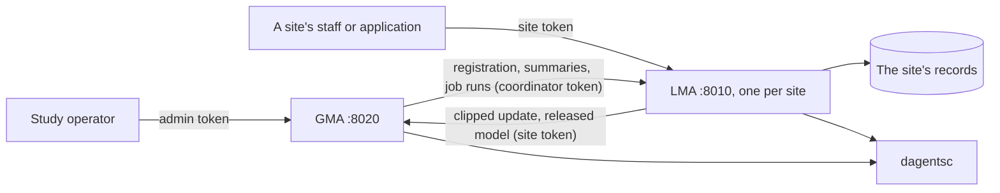

A GMA started with nothing configured runs its rounds with
`InProcessFederationEngine`, a simulator in the GMA's own process, and calls no
LMA. With `GMA_ENGINE=http` it sends each round's jobs to the LMAs over their
HTTP API ([Calls between agents](#tokens-errors-and-calls-between-agents)).

The [Spring control service](spring-services.md) serves the GMA's agent
registry paths again for JVM applications. The healthcare demo runs one LMA per
hospital and a GMA, and calls them only through these APIs: in its own process
on the published demo, or as separate processes in network mode
([Demo apps](demo-apps.md#which-agent-calls-each-endpoint-makes)). The
[getting-started example](../../guide/README.md) runs one LMA per store and a
GMA in one process and calls them through their APIs.

## Tokens, errors and calls between agents

This part applies to both agents.

**Calls between agents.** The GMA calls each LMA, and an LMA calls the GMA,
through `AgentNetwork` (`dagents/common/infrastructure/agent_client.py`). It
has two transports behind the same typed clients, `LmaClient` and `GmaClient`:

| Transport | Built with | Used when |
|---|---|---|
| In process | `AgentNetwork.in_process()` | An application runs the agents in its own process. Each call goes through the agent's real routes, request checks and token checks, through `httpx.ASGITransport`, without a socket. |
| Over HTTP | `AgentNetwork.over_http({...})` | The agents run as separate processes. The GMA reaches the LMAs at the addresses in `GMA_SITE_ENDPOINTS`, and an LMA reaches the GMA at `LMA_GMA_ENDPOINT`. Only configured addresses are called, so a request cannot point an agent at another host. |

A call that gets no answer, times out, or gets a `502`, `503` or `504` without
a JSON `code` is reported as unavailable. A call times out after 30 seconds,
and after 120 seconds when it waits on other work: a job's execution, a round's
dispatch, a site refresh and the site summaries. Over HTTP, a call is sent once more when a
kept-alive connection closed before the answer came. These routes refuse a
repeat with `409`, so a repeat of them cannot act twice: a round dispatch with
a used round id, a second update upload from a site, a second offer or
execution of the same job at an LMA, a second aggregate of a round, a second
release evaluation of a round, and an approval of a version that is no longer
a candidate. The other routes that change state either store the same thing
again (a registration, an enrolment, a heartbeat, a model version with the
same content) or add one more record (a Guard enforcement or a probe adds an
audit record, and telemetry adds an envelope).

**Tokens.** An agent with no token configured answers every caller, as before
tokens existed, and logs a warning when it starts. `LMA_REQUIRE_TOKENS=1` and
`GMA_REQUIRE_TOKENS=1` make it refuse to start without a token. With tokens,
every route except `/health` needs the header `Authorization: Bearer <token>`,
and each token has one scope:

| Agent | Scope | Setting | Who holds it | Routes it may call |
|---|---|---|---|---|
| LMA | `site` | `LMA_SITE_TOKEN` | The site's staff and the site's own applications | Every route except the three coordinator routes below |
| LMA | `coordinator` | `LMA_COORDINATOR_TOKEN` | The GMA, which reads it from `GMA_LMA_TOKENS` | `GET /federation/registration`, `POST /federation/jobs:offer`, `POST /federation/jobs:execute` and `POST /federation/jobs:run`; also `GET /site`, `GET /site/summary` and `GET /governance/audit:summary` |
| GMA | `admin` | `GMA_ADMIN_TOKEN` | The study operator | Every route except the update upload, which takes only the site's own token |
| GMA | `site`, bound to one site | `GMA_SITE_TOKENS` (`SITE=TOKEN,...`) | That site's LMA, which reads it from `LMA_GMA_TOKEN` | `PUT /federation/rounds/{round_id}/updates/{site_id}` for its own site only, `GET /model-versions:released`, and the LMA reports (registration, heartbeats, telemetry and deployment sync) for an agent registered with its own site in `scope.site` |

A token has at least 16 characters, and one token cannot have two scopes. The
agents compare tokens with `hmac.compare_digest`, and the settings leave tokens
out of their `repr`. A missing or unknown token answers `401` with
`WWW-Authenticate: Bearer`. A token of the wrong scope, or a site token used for
another site, answers `403`.

**Errors with a code.** The token checks, the routes for sites, jobs, updates,
model versions and releases, and the framework's typed errors answer
`{"detail": "...", "code": "..."}`. No `detail` holds a host, a token or a
connection string.

| `code` | Status | When |
|---|---|---|
| `unauthorized` | 401 | No token, or a token the agent does not accept |
| `forbidden` | 403 | A token of the wrong scope; a site the round did not select; a request that sends a site's LMA a source that only configuration may set; a GMA started with its source reads off |
| `not_found` | 404 | An LMA started without a site; no released model; an unknown model version, model kind or condition pack |
| `conflict` | 409 | A round id used twice, a late result, a second offer, update or approval, a model that does not match its digest, a classification that differs from the registered one. A refusal by the planner's model lifecycle rule adds `refusal` |
| `aggregation_refused` | 409 | The planner does not permit aggregation, or a stored update is missing or changed |
| `invalid_request` | 422 | A release evaluation the GMA cannot run as asked, or a model version whose name or parameters are not valid |
| `planner_unavailable` | 503 | `dagentsc` could not be run, or its answer could not be read |
| `store_unavailable`, `store_not_set_up` | 503 | The agent's database could not be reached, or is not set up for the agent's role |
| `agent_unavailable` | 503 | The other agent did not answer, or no address is configured for it |
| `bad_gateway` (LMA), `agent_error` (GMA) | 502 | The other agent answered with an error |

The routes that existed before keep FastAPI's `{"detail": ...}` for their own
`400`, `404` and `422` answers.

**Where the examples come from.** The examples with an `Authorization` header
were captured from configured agents: the getting-started example's two stores,
each with its own LMA, and the study's GMA, on one in-process agent network
(`scripts/api_example_agents.py`). That script adds one thing to the example: a
small logistic regression model kind, `return_score`, because the example's
rule cannot be trained. The tokens in these examples are example values. The
other examples come from agents started with nothing configured.

## The local monitoring agent

The local monitoring agent (LMA) runs next to one data source, such as one
store's order database. It reads that source's records, profiles them, records
model runs over them, runs monitoring bundles, and answers governance requests
through the Ethical Guard. A deployment runs one LMA per source.

An LMA **started for a site** serves one site of a study. It reads the site's
records through a site source, plans every Guard request against the
classification of the site's condition pack, and takes federated jobs from the
GMA ([LMA site](#lma-site) and [LMA federated jobs](#lma-federated-jobs)). An
LMA started without a site serves the other routes as before sites existed, and
its site and job routes answer `404`.

| | |
|---|---|
| Code | `dagents/lma/`: the routes in `routes.py`, the app built by `app_factory.py` from `config.py` and `di.py`, the use cases in `application/` (`monitoring_service.py`, `site_service.py`, `federation_jobs.py`), the GMA link and update channel in `adapters/`, and the stores and job log in `infrastructure/` |
| Shared code it serves | `dagents/common/`: sources (`infrastructure/sources.py`), profiles and model runs (`application/ml_orchestration.py`), governance (`application/governance_service.py`, `application/ethical_guard.py`), the site's part of a round (`application/federation_worker.py`), the running profile (`application/running_profile.py`), the agent client and tokens (`infrastructure/agent_client.py`, `infrastructure/agent_auth.py`) and extensions (`extensions/registry.py`) |
| Port | 8010 (`LMA_API_PORT` in `env/.env.lma`, read by uvicorn) |
| Settings | `env/.env.shared`, then `env/.env.lma`, read by `Settings.from_env()` in `dagents/lma/config.py`. A variable already set in the environment wins. |
| Planner | `dagentsc governance restrict` for the plan, enforce and probe endpoints, the site's label rate and the Guard of each job; `dagentsc federation round digest` when the LMA checks a job offer |
| Start it | `PYTHONPATH=. .venv/bin/uvicorn dagents.lma.main:app --port 8010`, from the repository root, with `DAGENTSC_BIN` set ([how](overview.md#run-a-service-to-try-the-examples)). The container image builds `dagentsc` and puts it on its `PATH`. |
| Its own docs | `http://127.0.0.1:8010/docs` and `/openapi.json` |

The settings that start an LMA for a site:

| Setting | Meaning |
|---|---|
| `LMA_SITE_ID`, `LMA_CONDITION_ID` | The site, and the condition pack it serves. A site needs both. |
| `LMA_EXTENSIONS` | `module:attribute,...`: the extensions loaded into the LMA's own registry. The condition pack, its feature contract and classification, the model kinds and the site sources come from them. Without it the LMA reads the process-wide registry. |
| `LMA_SITE_SOURCE` | The name of a site source an extension contributes. The LMA reads the site's records through it. |
| `LMA_DATABASE_URL`, `LMA_SITE_ROLE` | The site's database, and the role every database operation acts as, with `SET LOCAL ROLE` inside each transaction |
| `LMA_AUDIT_TABLE`, `LMA_AUDIT_ANCHOR_TABLE`, `LMA_JOB_LOG_TABLE` | Where the audit chain and the job log are kept in that database. Without them both are in memory. |
| `LMA_STUDY_ID`, `LMA_REPORTING_PURPOSE` | Who asks for the site's summary, and why. The defaults are the condition id and the pack's first approved purpose. |
| `LMA_PROFILE_FIELDS` | The fields the running profile tracks. The default is every field of the feature contract. |
| `LMA_CAPABILITIES`, `LMA_POLICY_VERSION` | What the site's registration says. A round selects only sites that have every capability in its `required_capabilities`. The default policy version is `site-policy-v1`. |
| `LMA_GMA_ENDPOINT`, `LMA_GMA_TOKEN` | The GMA's address, and the GMA token bound to this site |
| `LMA_SITE_TOKEN`, `LMA_COORDINATOR_TOKEN`, `LMA_REQUIRE_TOKENS` | The tokens this LMA accepts ([Tokens](#tokens-errors-and-calls-between-agents)) |
| `LMA_SOURCE_MAX_STALENESS_MS` | How long the LMA uses the records it read before it asks the source for its version again. Default 30000. |
| `LMA_STATEMENT_TIMEOUT_MS` | The statement timeout of each database operation. Default 15000. |

An application that runs LMAs in its own process passes the same settings to
`create_app(settings, LmaDeps(...))`, together with objects it owns: its own
site source, audit sink, job log or agent network.

How the LMA relates to the other modules:

- **Started for a site, it calls the GMA.** It reads the released model at
  [`GET /api/v1/model-versions:released`](#gma-get-api-v1-model-versions-released)
  and sends a training job's clipped update to
  [`PUT /api/v1/federation/rounds/{round_id}/updates/{site_id}`](#gma-put-api-v1-federation-rounds-round-id-updates-site-id).
  Without a GMA, its model routes answer `503` and it refuses training jobs.
  Started without a site, it calls no other service. To make the GMA's agent
  registry aware of an LMA, a caller registers it through the
  [agent registry](#agent-registry).
- **The GMA calls it.** A GMA with the HTTP engine enrols the site from its
  registration, offers it each round's job and asks it to run the job
  ([LMA federated jobs](#lma-federated-jobs)).
- **It calls the planner for every decision.** The plan, enforce and probe
  endpoints, the site's label rate and each job's Guard run
  [`dagentsc governance restrict`](dagentsc.md#dagentsc-governance-restrict), and
  a job offer runs [`dagentsc federation round digest`](dagentsc.md#dagentsc-federation-round-digest).
  The source, profile, model-run and bundle endpoints call no planner command.
- **The core service knows its address.** The core service lists the LMA in its
  [catalog](framework-services.md#core-service-get-api-v1-services), and its
  [workload compiler](framework-services.md#workload-compiler) can render the
  Kubernetes objects that run an LMA.
- **Applications can run it in process.** The getting-started example builds
  one LMA per store with `create_app` and calls it through `AgentNetwork`. The
  healthcare demo does the same for each hospital, with a site source over the
  hospital's store, and calls only that hospital's LMA from the hospital's views
  ([Demo apps](demo-apps.md#hospitals)).

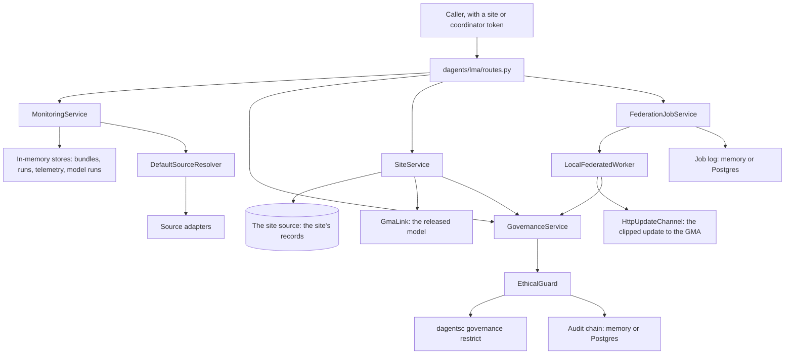

### What the LMA stores

The LMA keeps its state in memory, so a restart clears it. The two exceptions
are the audit chain and the job log of an LMA whose settings name a database
table for them.

| What | Class | Written by | Read by |
|---|---|---|---|
| Deployed bundles, one per id and version | `InMemoryBundleRepository` | `POST /bundles/deploy` | `GET /bundles`, `POST /run`, the health check |
| Monitoring runs | `InMemoryRunHistoryRepository` | `POST /run` | `GET /runs`, the health check |
| Telemetry, one envelope per run | `InMemoryTelemetryPublisher` | `POST /run` | `GET /telemetry` |
| Model runs | `InMemoryModelRunRepository` | `POST /api/v1/model-jobs` | `GET /api/v1/model-jobs`, the health check |
| Source definitions | `InMemorySourceCatalog`, inside `DefaultSourceResolver` | `POST /api/v1/sources` | The source endpoints, and profiles and model runs that name a `source_id` |
| Data classifications added at runtime | `GovernanceService` | `PUT /api/v1/governance/classifications/{classification_id}` | `GET /api/v1/governance/classifications` |
| Guard decisions | `InMemoryAuditLog`, or `PostgresAuditSink` with `LMA_AUDIT_TABLE` | Enforce, the probe, and the Guard of each job | `GET /api/v1/governance/audit`, `GET /api/v1/governance/audit:summary` |
| The site's records and their running profile, kept until the source's version changes | `SiteService` | The site source | The site routes and the jobs |
| The label-rate decision, one per labelled count | `SiteService` | The summary | The summary and profile jobs |
| Accepted job offers, so each runs once | `FederationJobService` | `POST /api/v1/federation/jobs:offer`, `POST /api/v1/federation/jobs:run` | `POST /api/v1/federation/jobs:execute`, `POST /api/v1/federation/jobs:run` |
| Job log: each refused offer and each result | `InMemoryJobLog` (the newest 1,000), or `PostgresJobLog` with `LMA_JOB_LOG_TABLE` | Offers and executions | `GET /api/v1/federation/jobs` |

### Limits of the LMA in this version

- The profile and model-run endpoints read records without the Guard. To give
  a reader only what the Guard permits, call
  [enforce](#lma-post-api-v1-governance-restrictions-enforce) first and send
  the `payload` it returns as `dataset.inline_records`.
- Model runs train no model. Their metrics are estimates computed from the
  record count and the model family.
- The monitoring runner is a stub. It does not fetch or run the bundle. It
  publishes two counts.
- An LMA remembers the last 1,024 rounds it was offered. A restart forgets the
  accepted offers, so a job accepted before a restart cannot be executed after
  it (`409`).
- Without tokens, any caller that can reach the LMA can call every route. Run it
  with tokens, or on a private network.

## LMA health

```api-interface
service: lma
status: complete
code: dagents/lma/routes.py
classes:
- MonitoringService (dagents/lma/application/monitoring_service.py)
endpoints:
- GET /health
- GET /api/v1/health
```

The liveness check. `MonitoringService.health_payload` counts what the LMA
holds in memory and names the bundle deployed last.

### Check the agent's health

```api-endpoint
GET /api/v1/health
```

Returns `ok` with counts of the deployed bundles, the monitoring runs and the
model runs, and the bundle deployed last as `active_bundle`. It reads memory
only. It calls no other service and no planner command, so it answers whenever
the process runs, even without `dagentsc`. The Docker health check of the LMA
container calls `GET /health` every 30 seconds. Nothing is stored.

`active_bundle` is only the newest deploy. Each run names its own bundle, so a
run can use an older one. Sources, classifications and audit records are not
counted here.

**Errors.** None of its own.

**Related.** [Deploy a bundle](#lma-post-bundles-deploy),
[run a bundle](#lma-post-run), [list the model runs](#lma-get-api-v1-model-jobs).

## LMA sources

```api-interface
service: lma
status: complete
code: dagents/lma/routes.py
classes:
- MonitoringService (dagents/lma/application/monitoring_service.py)
- DefaultSourceResolver (dagents/common/infrastructure/sources.py)
endpoints:
- GET /api/v1/sources
- POST /api/v1/sources
- GET /api/v1/sources/{source_id}
- POST /api/v1/sources/{source_id}:validate
```

A **source definition** says where a set of records lives and how to read it.
The LMA stores definitions in memory, keyed by `source_id`, and reads a source
when a profile or a model run names it in `dataset.source_id`
([profiling and model runs](#lma-dataset-profiling-and-model-runs)).
Registering a source does not read it, and neither does validating it.

`DefaultSourceResolver` picks the adapter by the definition's `kind`:

- **`inline`** reads `selection.records`, sent inside the definition.
- **`postgres`** reads a table, or the SQL in `selection.sql`, through psycopg,
  in one transaction on an autocommit connection. Each read has a statement
  timeout (`LMA_STATEMENT_TIMEOUT_MS`, default 15 seconds; a longer query is
  cancelled), and the connection a 10-second connect timeout unless the
  settings name one. `options.rows` returns fixed rows instead of querying.
  `connection_ref.options.role` runs each query as that role, with
  `SET LOCAL ROLE` in the same transaction.
- **`mongodb`** reads the documents in `options.documents`, or in the
  connection settings. There is no MongoDB client in this version: `filter`,
  `projection` and `sort` are stored but not applied.
- **`object_storage`** reads a local file: a path or a `file://` URI. `json`,
  `jsonl` and `csv` are read, and `parquet` fails. CSV values are strings, so a
  profile lists every CSV field as categorical.

Connection settings come from two places. The connection resolver
(`InMemoryConnectionResolver`) maps `connection_ref.connection_id` to settings,
and `connection_ref.options` is merged over them. The LMA's resolver starts
empty and no endpoint adds to it, so in practice a Postgres source's settings
come from `connection_ref.options`. Only `host`, `port`, `dbname` (or
`database`), `user` (or `username`), `password`, `sslmode` and
`connect_timeout` are passed to the driver. A setting left out falls back to
libpq's defaults and the `PG*` variables of the LMA's environment.

Every answer shows a source with its connection options redacted: the value of
each `connection_ref.options` key except `role`, `sslmode` and
`connect_timeout` is replaced with `[redacted]`. The keys stay, so a reader can
see which settings a source has.

**An LMA started for a site** takes its records from its configured site
source, and refuses to register a source that would let a request choose what
it reads. It answers `403` with the code `forbidden` for a source whose `kind`
is not `inline`, for connection options other than `rows` and `documents`, and
for embedded SQL: a Postgres source's query, table, columns, condition or
order. A role, a login and a database address come only from the site's
settings.

An LMA started without a site does not check these. A caller that can reach it
(with the `site` token, when tokens are set) can register a Postgres source
with its own host, login and SQL. A later profile or model run that names the
source makes the LMA connect and run that SQL. Run such an LMA with tokens, or
on a private network.

### List the registered sources

```api-endpoint
GET /api/v1/sources
```

Returns every stored source definition, sorted by `source_id`, with its
connection options redacted. It reads memory only and calls no adapter. With
nothing registered it returns `[]`.

**Errors.** None of its own.

**Related.** [Register a source](#lma-post-api-v1-sources),
[fetch one source](#lma-get-api-v1-sources-source-id).

### Register a source

```api-endpoint
POST /api/v1/sources
```

Checks that the body is one of the four source definitions, stores it under its
`source_id` and returns it with every default filled in and its connection
options redacted. A source with the same id is replaced. Registration reads no
records, opens no connection and calls no planner command. An LMA started for a
site accepts only an inline source, as the example "An LMA that serves a site
takes no Postgres source from a request" shows.

The handler takes the body as a plain JSON object and validates it itself, with
pydantic's `TypeAdapter`. So a JSON object that is not a valid definition, such
as one with an unknown `kind` or a Postgres source without `selection`, fails
with `500` and the plain-text body `Internal Server Error`, not with `422`.

**Errors.** `403` (`forbidden`) when the LMA serves a site and the definition
is not an inline source, sets a connection option other than `rows` or
`documents`, or embeds SQL. `422` when the body is not a JSON object, for
example a JSON list. `500` when the object is not a valid source definition, as
above. `401` and `403` for tokens, as on every route.

**Related.** [The InlineSourceSpec object](#the-inlinesourcespec-object),
[the PostgresSourceSpec object](#the-postgressourcespec-object),
[the MongoSourceSpec object](#the-mongosourcespec-object),
[the ObjectStorageSourceSpec object](#the-objectstoragesourcespec-object),
[validate the source](#lma-post-api-v1-sources-source-id-validate),
[profile it](#lma-post-api-v1-datasets-profile).

### Fetch one source

```api-endpoint
GET /api/v1/sources/{source_id}
```

Returns the stored definition with this `source_id`, with its connection
options redacted. It reads memory only. When no source has the id, the answer
is `200` with the body `null`, not `404`.

**Errors.** None of its own.

**Related.** [List the sources](#lma-get-api-v1-sources),
[register a source](#lma-post-api-v1-sources).

### Validate a source

```api-endpoint
POST /api/v1/sources/{source_id}:validate
```

Runs the check of the source's adapter on the stored definition and returns
what it found. Nothing is stored, no records are read, no database connection
is opened and no planner command runs. An error makes `valid` false. A
warning does not. Each kind checks different things:

- **`inline`**: a warning when `selection.records` is empty.
- **`postgres`**: an error when `connection_ref.connection_id` is empty. An
  error when the role in the connection settings is not 1 to 63 lower-case
  letters, digits or underscores starting with a letter, or is reserved (such
  as `postgres`, `anon` or a name starting with `pg_`). A warning when there
  are no connection settings and no `options.rows`.
- **`mongodb`**: a warning when there are no connection settings and no
  `options.documents`.
- **`object_storage`**: a warning when the path is not a `file://` URI and no
  file exists there.

Validation does not prove that a database answers or that a login works. A
valid Postgres source can still fail when a profile reads it.

**Errors.** `500` with the plain-text body `Internal Server Error` when no
source has this id.

**Related.** [The SourceValidationResult object](#the-sourcevalidationresult-object),
[register a source](#lma-post-api-v1-sources).

## LMA dataset profiling and model runs

```api-interface
service: lma
status: complete
code: dagents/lma/routes.py
classes:
- MonitoringService (dagents/lma/application/monitoring_service.py)
- DefaultSourceResolver (dagents/common/infrastructure/sources.py)
- InMemoryModelRunRepository (dagents/lma/infrastructure/state.py)
endpoints:
- POST /datasets/profile
- POST /api/v1/datasets:profile
- POST /models/run
- POST /api/v1/model-jobs
- GET /models/runs
- GET /api/v1/model-jobs
```

A **profile** counts a set of records, sorts their fields into numeric and
categorical, and suggests model families. A **model run** profiles the records
the same way, then records a run with estimated metrics. The functions are
`build_dataset_profile` and `execute_model_run` in
`dagents/common/application/ml_orchestration.py`. The GMA uses the same ones.

Where the records come from, in this order:

1. `dataset.inline_records`, when it is not empty.
2. `dataset.source`: a source definition sent with the request, read once and
   not stored.
3. `dataset.source_id`: a [registered source](#lma-sources).
4. The top-level `records`, when the request has no `dataset`.

The LMA always records `scope_kind` as `source`, whatever the request says.
These endpoints do not call the Guard and do not call the planner. An LMA
started for a site refuses a request that embeds a source in `dataset.source`
(`403`, `forbidden`); inline records and the `source_id` of a registered
source are accepted.

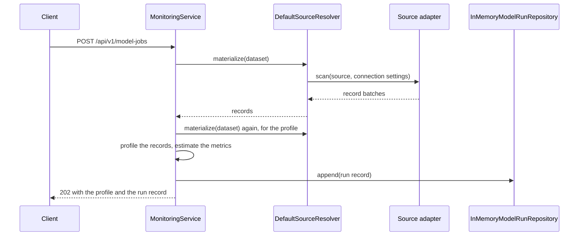

### Profile a dataset

```api-endpoint
POST /api/v1/datasets:profile
```

Reads the records and returns their count, the feature fields split into
numeric and categorical, the number of partitions and two or three suggested
model families. Nothing is stored. A field is numeric when its first non-null
value is a number; a boolean or a string makes it categorical.

The suggestions come from fixed rules in `suggest_models`, checked in this
order:

| Condition | Suggested families |
|---|---|
| `extraction_strategy` is `text` | naive_bayes, gru, transformer |
| `extraction_strategy` is `time_series` | gru, lstm, autoencoder |
| `label_field` is set | random_forest, xgboost, naive_bayes |
| At least one feature field is numeric | autoencoder, variational_autoencoder, random_forest |
| Otherwise | transformer, custom |

**Errors.** `403` (`forbidden`) when the LMA serves a site and the request
embeds a source in `dataset.source`. `422` when a field fails validation, for
example a `dataset` with none of its three fields set, or a `batch_size` below
1. `500` with the plain-text body `Internal Server Error` when the records
cannot be read: the `source_id` names no registered source, a file does not
exist, a MongoDB source has no documents, or a Postgres connection fails.

**Related.** [The DatasetProfile object](#the-datasetprofile-object),
[the DatasetInput object](#the-datasetinput-object),
[run a model](#lma-post-api-v1-model-jobs),
[register a source](#lma-post-api-v1-sources).

### Run a model on a dataset

```api-endpoint
POST /api/v1/model-jobs
```

Reads the records, profiles them and stores one model run. The versioned path
answers `202` and the short path `200`, but both finish the run before they
answer: there is no job to poll. No model is trained and no file is written.
`metrics` holds estimates, and `artifact_uri` is a name only (see
[the ModelRunRecord object](#the-modelrunrecord-object)).

The run id is `lma-<scope_id>-<start time in seconds>`, so two runs for one
scope in the same second get the same id. The two examples below show it. A
registered source is read twice, once for the run and once for its profile.
The `batch_size` hyperparameter (default 1000) sets both the run's
`batch_count` and the profile's `partition_count`.

**Errors.** `403` (`forbidden`) when the LMA serves a site and the request
embeds a source, as for a profile. `422` when a field fails validation, for
example a `model_family` or `task_type` that is not in the list. `500` with the
plain-text body `Internal Server Error` when the records cannot be read, as for
a profile.

**Related.** [The ModelRunRecord object](#the-modelrunrecord-object),
[the DatasetProfile object](#the-datasetprofile-object),
[list the model runs](#lma-get-api-v1-model-jobs).

### List the model runs

```api-endpoint
GET /api/v1/model-jobs
```

Returns the stored model runs, newest first, at most `limit` of them. It reads
memory only. `limit` has no lower bound: `0` returns every run, and a negative
number leaves out that many of the oldest runs.

**Errors.** `422` when `limit` is not an integer.

**Related.** [Run a model](#lma-post-api-v1-model-jobs),
[the ModelRunRecord object](#the-modelrunrecord-object).

## LMA monitoring bundles and runs

```api-interface
service: lma
status: complete
code: dagents/lma/routes.py
classes:
- MonitoringService (dagents/lma/application/monitoring_service.py)
- InMemoryBundleRepository (dagents/lma/infrastructure/state.py)
- InMemoryRunHistoryRepository (dagents/lma/infrastructure/state.py)
- InMemoryMonitoringRunner (dagents/lma/adapters/runner.py)
- InMemoryTelemetryPublisher (dagents/lma/infrastructure/messaging.py)
endpoints:
- GET /bundles
- POST /bundles/deploy
- POST /run
- GET /runs
- GET /telemetry
```

A **monitoring bundle** is a named, versioned set of checks for an LMA to run.
The LMA stores a bundle by reference (`bundle_uri`) and records each run of it.
A **telemetry envelope** is what one run publishes: the agent, the measured
values and pointers to the evidence. These are the agent's first endpoints and
have short paths only.

The runner is a stub in this version. `InMemoryMonitoringRunner` does not fetch
or run the bundle. Each run publishes two values: `local_checks_total`, the
number of `scope` entries with a minimum of 1, and `metadata_fields_total`, the
number of `metadata` entries. The telemetry always names the agent
`lma-dev-1`, with the workspace from `metadata.workspace_id` (default
`dagents-dev`).

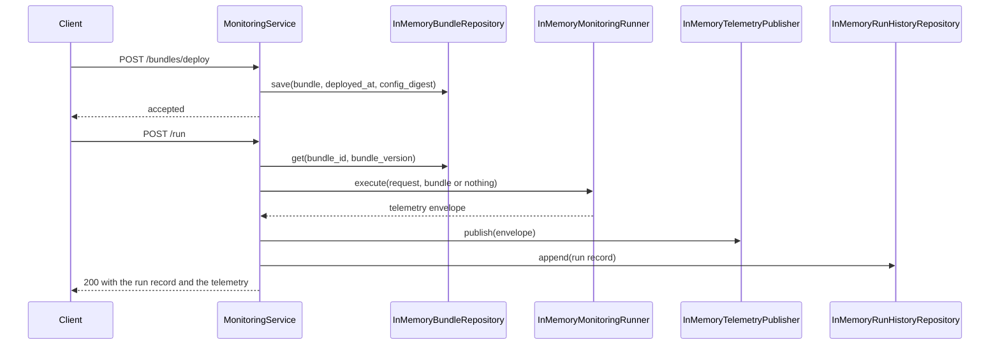

### List the deployed bundles

```api-endpoint
GET /bundles
```

Returns every stored bundle, the most recently deployed first. A bundle
deployed again moves to the front. It reads memory only and takes no `limit`.

**Errors.** None of its own.

**Related.** [Deploy a bundle](#lma-post-bundles-deploy),
[the BundleRecord object](#the-bundlerecord-object).

### Deploy a bundle

```api-endpoint
POST /bundles/deploy
```

Stores the bundle under its `bundle_id` and `bundle_version`, with the current
time as `deployed_at` and the SHA-256 of
`<bundle_id>:<bundle_version>:<bundle_uri>` as `config_digest`. Deploying the
same id and version again replaces the stored bundle and makes it the newest,
so it becomes `active_bundle` in the health check. The bundle is not fetched
and its signature is not checked. `agent` is required but not stored, and the
LMA does not compare it with itself. The answer is always `accepted: true`.

**Errors.** `422` when a field fails validation, for example a missing
`bundle_version`.

**Related.** [List the bundles](#lma-get-bundles),
[run the bundle](#lma-post-run),
[the BundleRecord object](#the-bundlerecord-object).

### Run a bundle

```api-endpoint
POST /run
```

Runs one bundle with the stub runner, stores the run and publishes its
telemetry. The run is stored as `run-<correlation_id>`. The same correlation id
sent twice stores two runs with the same `run_id`. Neither replaces the other.
The bundle does not have to be deployed: the run goes ahead, and its
`bundle_uri` pointer is empty. No planner command runs and no Guard boundary is
passed.

**Errors.** `422` when a field fails validation, for example a missing
`correlation_id`.

**Related.** [The RunRecord object](#the-runrecord-object),
[the TelemetryEnvelope object](#the-telemetryenvelope-object),
[list the runs](#lma-get-runs), [list the telemetry](#lma-get-telemetry).

### List the runs

```api-endpoint
GET /runs
```

Returns the stored monitoring runs, newest first, at most `limit` of them. It
reads memory only. `limit` has no lower bound: `0` returns every run, and a
negative number leaves out that many of the oldest runs.

**Errors.** `422` when `limit` is not an integer, as the example shows.

**Related.** [Run a bundle](#lma-post-run),
[the RunRecord object](#the-runrecord-object).

### List the telemetry

```api-endpoint
GET /telemetry
```

Returns the published telemetry envelopes, newest first, at most `limit` of
them. Each run publishes one. It reads memory only. `limit` works as it does
for `GET /runs`. Nothing is sent to the GMA: an LMA that should report its
telemetry has a caller post it to the
[GMA's telemetry endpoint](#agent-registry).

**Errors.** `422` when `limit` is not an integer.

**Related.** [The TelemetryEnvelope object](#the-telemetryenvelope-object),
[run a bundle](#lma-post-run).

## LMA governance

```api-interface
service: lma
status: complete
code: dagents/lma/routes.py
classes:
- GovernanceService (dagents/common/application/governance_service.py)
- EthicalGuard (dagents/common/application/ethical_guard.py)
- DagentscRestrictionPlanner (dagents/common/application/ethical_guard.py)
- InMemoryAuditLog (dagents/common/application/ethical_guard.py)
endpoints:
- GET /governance/classifications
- GET /api/v1/governance/classifications
- PUT /governance/classifications/{classification_id}
- PUT /api/v1/governance/classifications/{classification_id}
- POST /governance/restrictions:plan
- POST /api/v1/governance/restrictions:plan
- POST /governance/restrictions:enforce
- POST /api/v1/governance/restrictions:enforce
- GET /governance/audit
- GET /api/v1/governance/audit
```

Governance decides what each reader may see, applies that decision to real
records, and records it. Three terms:

- A **data classification** gives each field a sensitivity (`low`, `medium` or
  `high`) and lists the regulations that cover the data.
- A **restriction plan** is the planner's decision for one request: a strategy
  for each requested field, and `permit`, `narrow` or `deny` for the request.
- The **Ethical Guard** applies the plan to the records, drops every field the
  request did not ask for, and writes an audit record.

The decision is made in the OCaml planner, so the same request always gets the
same plan. The planner first scores how far it trusts the requester, then
checks the request as a whole (the purpose, and the minimum group size), then
picks a strategy for each field from its sensitivity, the trust level and the
granularity of the request. [Privacy and data governance](../../learn/02-privacy-and-governance.md#how-dagents-decides)
explains the rules, and
[`dagentsc governance restrict`](dagentsc.md#dagentsc-governance-restrict)
is the command.

Each plan or enforce request carries its classification in full. How the LMA
treats it depends on how the LMA was started:

- **Started without a site**, the LMA uses the classification as the request
  sends it. The classification endpoints keep a list an application can read
  back to build its requests.
- **Started for a site**, the LMA runs strict: the classification in the
  request must equal the one registered under its id, by an extension or with
  `PUT`. A request that differs, or names an id no classification has, is
  refused with `409` (`conflict`) before the planner runs, so it writes no audit
  record. A caller cannot bring a policy of its own.

What the Guard does with each strategy:

| Strategy | What happens to the field |
|---|---|
| `allow_full` | The value is returned unchanged. |
| `generalize:<level>` | A number is rounded to the nearest 10 to the power `level` (level 1: the nearest 10). A text value longer than 4 − `level` characters (at least 1) is cut to that length and followed by `*`. |
| `clip_contribution:<bound>` | A number is limited to between −bound and bound. A list or map of numbers is scaled so its L2 norm is at most bound, keeping its direction. |
| `add_noise:<scale>` | Gaussian noise with standard deviation `scale` is added, from a generator seeded by the request id, the field and the record's position, so an auditor can reproduce it. |
| `aggregate_only:<minimum>` | The records are replaced by one summary row: `record_count`, a `<field>_mean` for numeric fields and a `<field>_distinct` count for others. A field that is `allow_full` also gets `<field>_min` and `<field>_max`. With fewer records than the minimum, nothing is returned. |
| `redact`, `refuse` | The field is removed. |

A missing value (`null`) stays `null` under every strategy. A field the Guard
cannot protect in one record, such as text where
`clip_contribution` needs a number, is withheld from every record.

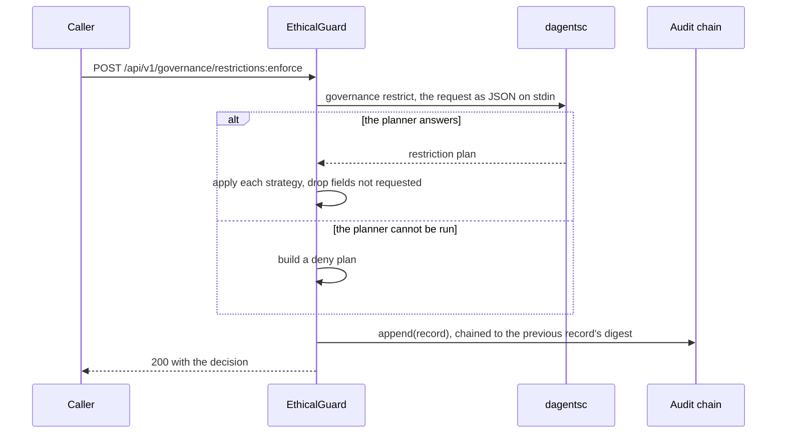

**The three boundaries at the LMA.** The Guard stands at four boundaries. The
first three are at the site. The boundary is a field of the request, chosen by
the caller. In a federated round, the LMA's job endpoints make these three
calls through `LocalFederatedWorker` (`dagents/common/application/federation_worker.py`):
the offer makes the first, the execution the other two
([LMA federated jobs](#lma-federated-jobs)). A caller of the LMA's HTTP API can
make the same calls through the enforce endpoint:

1. **`before_train`**, before a round's training is accepted. The `payload` is
   empty, because only a decision is asked for. The worker uses `table`
   granularity, with the site's cohort size.
2. **`before_read`**, before records reach the code that uses them. The
   `payload` is the records, and the worker uses `row` granularity.
3. **`before_send`**, before anything leaves the site. The `payload` is the
   model update, such as `[{"model_update": [0.6, 0.8, 1.2]}]`, at
   `model_update` granularity.

The fourth boundary, `before_release`, is at the GMA ([GMA governance](#gma-governance)).

### List the data classifications

```api-endpoint
GET /api/v1/governance/classifications
```

Returns every classification the LMA knows, sorted by id: those that registered
extensions contribute, and those added with `PUT`. An extension's
classification cannot be replaced with `PUT`, so for an id an extension
contributes the list shows the extension's. It reads memory only.

**Errors.** None of its own.

**Related.** [Register a classification](#lma-put-api-v1-governance-classifications-classification-id),
[the DataClassification object](#the-dataclassification-object),
[the extensions](#lma-get-api-v1-extensions).

### Register a data classification

```api-endpoint
PUT /api/v1/governance/classifications/{classification_id}
```

Stores the classification in memory under its id and returns it. A
classification added earlier with `PUT` under the same id is replaced. An
extension's classification is not: sending a different one under its id is
refused with `409`, and sending the same one changes nothing. It calls no
planner command and writes no audit record. Changing a field's sensitivity
this way changes what later requests get, without any code change. An LMA
started for a site plans with the registered classification, so the change
reaches every request; an LMA without a site uses what each request sends.

**Errors.** `400` when the id in the path differs from `classification_id` in
the body. `409` (`conflict`) when an extension contributes a different
classification with this id. `422` when a field fails validation, for example
a sensitivity other than `low`, `medium` or `high`, or a negative
`minimum_cohort`.

**Related.** [List the classifications](#lma-get-api-v1-governance-classifications),
[the DataClassification object](#the-dataclassification-object).

### Plan a restriction

```api-endpoint
POST /api/v1/governance/restrictions:plan
```

Sends the request to the planner (`dagentsc governance restrict`) and returns
its restriction plan. Nothing is applied to data and nothing is recorded: the
audit log does not change. Use it to show what a request would get before it is
made.

A request-level problem, such as a group smaller than the classification's
`minimum_cohort`, is not an error: the plan's `decision` is `deny`, its
`violations` say why, and every field gets `refuse`.

**Errors.** `409` (`conflict`) when the LMA serves a site and the request's
classification is not the registered one, as the example "A request that
brings its own policy under the site's classification id" shows. `422` when a
field fails validation, for example a `granularity` that is not in the list.
`503` (`planner_unavailable`) when the planner cannot be run or its answer
cannot be read. Planning does not fail closed the way enforcement does.

**Related.** [Enforce a restriction](#lma-post-api-v1-governance-restrictions-enforce),
[the RestrictionRequest object](#the-restrictionrequest-object),
[the RestrictionPlan object](#the-restrictionplan-object),
[`dagentsc governance restrict`](dagentsc.md#dagentsc-governance-restrict).

### Enforce a restriction

```api-endpoint
POST /api/v1/governance/restrictions:enforce
```

Plans the request with the planner (`dagentsc governance restrict`), applies
the plan to `payload`, writes one audit record and returns the Guard's
decision. The request's `boundary` says which boundary this call stands for.
The LMA serves `before_read`, `before_train` and `before_send` this way.

A denial is a normal answer: status `200` with `permitted: false`, an empty
`payload` and every requested field in `withheld_fields`. Check `permitted`,
not the status. When the planner cannot be run, the Guard fails closed: it
denies the request with the message "The planner could not be reached, so the
Guard denied the request.", records the denial, and still answers `200`.

**Errors.** `409` (`conflict`) when the LMA serves a site and the request's
classification is not the registered one. `422` when a field fails validation,
for example a body without `request`.

**Related.** [Plan without enforcing](#lma-post-api-v1-governance-restrictions-plan),
[the GuardDecision object](#the-guarddecision-object),
[the RestrictionRequest object](#the-restrictionrequest-object),
[read the audit log](#lma-get-api-v1-governance-audit).

### Read the audit log

```api-endpoint
GET /api/v1/governance/audit
```

Returns the newest audit records, newest first, and whether the digest chain
verifies. The Guard writes one record per enforcement, permitted or not: the
enforce endpoint, the [probe](#lma-post-api-v1-governance-restrictions-probe)
and the Guard of each federated job. Planning writes none. Each record's `digest` is a SHA-256 hash of its other
fields, including `previous_digest`, the digest of the record before it.
Editing or removing a record changes the hashes from that record on, and
`chain_intact` becomes false. The chain is not signed. In memory, it shows
changes inside one running process only. With `LMA_AUDIT_TABLE` it is kept in
Postgres, written as the site's role.

`limit` defaults to 50 and has no lower bound: `0` returns every record, and a
negative number leaves out that many of the oldest records.

**Errors.** `422` when `limit` is not an integer.

**Related.** [The AuditRecord object](#the-auditrecord-object),
[enforce a restriction](#lma-post-api-v1-governance-restrictions-enforce).

## LMA extensions

```api-interface
service: lma
status: complete
code: dagents/lma/routes.py
classes:
- ExtensionRegistry (dagents/common/extensions/registry.py)
endpoints:
- GET /extensions
- GET /api/v1/extensions
```

An **extension** is how an application adds what it knows about its domain,
such as its fields and their sensitivity, without changing the framework. An
LMA reads the registry an application hands it, or a registry of its own with
the extensions named in `LMA_EXTENSIONS`, or else the process-wide
`default_registry`.

### List what extensions contribute

```api-endpoint
GET /api/v1/extensions
```

Returns what the registered extensions contribute: the extensions, feature
contracts, data classifications, condition packs, pipeline steps, model
adapters, model kinds and site sources, each sorted. It reads memory only. The
LMA registers no extension on its own, so a plain LMA returns empty lists, as
in the example. An application that runs an LMA in its own process hands it a
registry (`LmaDeps(registry=...)`), or registers its extension in the default
registry with `register_extension` before the LMA serves requests.
Classifications added with
`PUT /api/v1/governance/classifications/{classification_id}` are not listed
here.

**Errors.** None of its own.

**Related.** [List the classifications](#lma-get-api-v1-governance-classifications),
[GMA extensions](#gma-extensions).

## LMA site

```api-interface
service: lma
status: complete
code: dagents/lma/routes.py
classes:
- SiteService (dagents/lma/application/site_service.py)
- RunningProfile (dagents/common/application/running_profile.py)
- GovernanceService (dagents/common/application/governance_service.py)
- GmaLink (dagents/lma/adapters/gma_link.py)
endpoints:
- GET /site
- GET /api/v1/site
- GET /site/summary
- GET /api/v1/site/summary
- GET /site/profile
- GET /api/v1/site/profile
- POST /site/source:refresh
- POST /api/v1/site/source:refresh
- GET /site/model
- GET /api/v1/site/model
- POST /site/model:evaluate
- POST /api/v1/site/model:evaluate
- POST /governance/restrictions:probe
- POST /api/v1/governance/restrictions:probe
- GET /governance/audit:summary
- GET /api/v1/governance/audit:summary
```

What an LMA started for a site serves about that site. A **site** is one data
source in a study, such as one store. Its records come from a **site source**:
an object with `records()`, `count()`, `version()`, `location()` and `close()`
(the `SiteRecordSource` port in `dagents/common/application/ports.py`). An
extension contributes the factory that builds it, named in `LMA_SITE_SOURCE`,
or an application hands the LMA its own source.

The LMA keeps the records it read, and a running profile built from them,
until the source's version changes. It asks the source for its version at most
once per `LMA_SOURCE_MAX_STALENESS_MS` (default 30 seconds), and at once for a
refresh, a registration or a federated job. Call
[refresh](#lma-post-api-v1-site-source-refresh) after writing to the site's
store, so the next answer includes the write.

What these endpoints let leave the site, and to whom:

| Endpoint | Scope | What it returns |
|---|---|---|
| Site description, summary, audit summary | `site`, `coordinator` | Counts, names and the audit chain's state. The label rate only when the site's planner permits it. |
| Profile, refresh, model in use, local evaluation, probe | `site` | The profile holds the smallest and largest value of each numeric field, which can describe one record, so only the site's own staff may read it. |

No endpoint returns a record. The condition pack names the site's
classification, its label field (the field a model is measured against) and
its approved purposes.

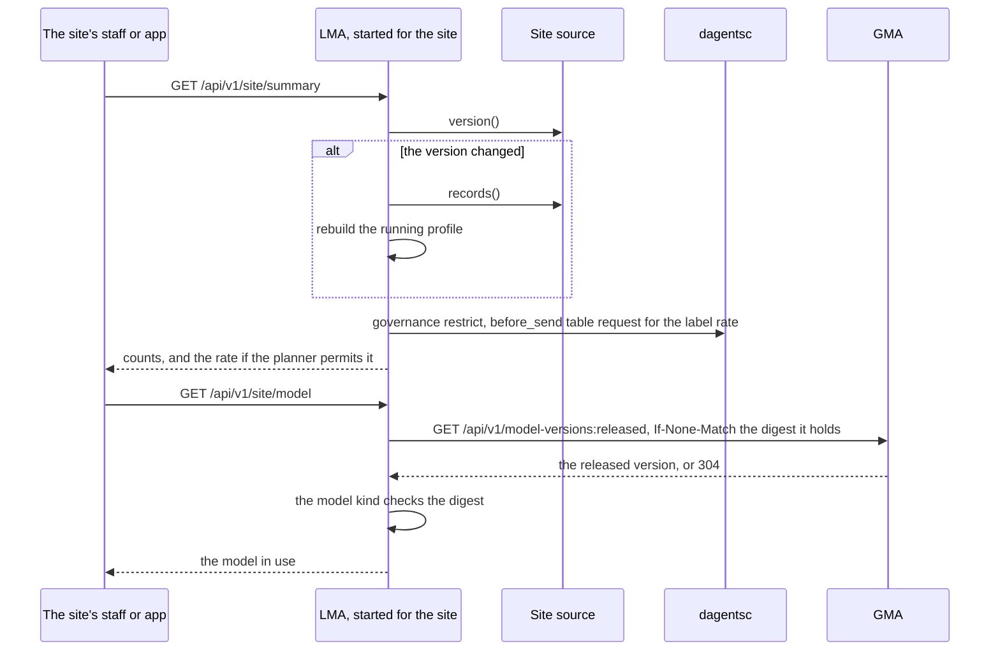

### Describe the site

```api-endpoint
GET /api/v1/site
```

Returns who the site is and what its LMA serves: the site and condition ids,
the classification, the feature contract version, the label field, the source,
the record count and the source's version, the capabilities, the policy
version and the classification's minimum cohort. The source is named by its
kind, its location and the role that reads it, never by a host or a connection
string: a location entry whose key or value looks like an address, a login or a
secret is left out. It calls no planner command and stores nothing.

**Errors.** `404` (`not_found`) when the LMA was started without a site, as the
first example shows. `503` (`store_unavailable` or `store_not_set_up`) when the
site's store cannot be read. `401` and `403` for tokens.

**Related.** [The SiteInfo object](#the-siteinfo-object),
[the site's summary](#lma-get-api-v1-site-summary).

### Report the site's summary

```api-endpoint
GET /api/v1/site/summary
```

Returns the record count, how many records carry a label, the label rate, the
minimum cohort and the label rate's status. A record carries a label when its
label field holds a yes/no value or a finite number. The rate is the share of
yes among the yes/no labels.

The rate leaves the site only when the site's planner permits it.
`GovernanceService.plan` asks [`dagentsc governance restrict`](dagentsc.md#dagentsc-governance-restrict)
about a `before_send` request for the label field at `table` granularity, with
the labelled count as the cohort, the study as the requester and
`LMA_REPORTING_PURPOSE` as the purpose. `label_rate_status` is:

| Status | When | `label_rate` |
|---|---|---|
| `released` | The planner permits or narrows the request | the rate |
| `no_labels` | The pack names no label field, or no record has a label | null |
| `below_minimum_cohort` | The planner denies the request because the labelled count is below the minimum cohort; `planner_reason` says so | null |
| `denied` | The planner denies it for another reason, given in `planner_reason` | null |
| `withheld` | The planner could not be run. The Guard fails closed. | null |

Planning writes no audit record, so reading the summary does not grow the
audit chain. The LMA keeps each decision per labelled count and asks again when
the count changes; a `withheld` answer is not kept. The GMA reads this summary
for its [site summaries](#gma-get-api-v1-federation-sites-summaries).

**Errors.** As for [the site description](#lma-get-api-v1-site).

**Related.** [The SiteSummary object](#the-sitesummary-object).

### Read the site's running profile

```api-endpoint
GET /api/v1/site/profile
```

Returns the running profile of the site's records, as `RunningProfile.snapshot()`:
the record count, the tracked fields (`LMA_PROFILE_FIELDS`, or every field of
the feature contract) and, for each field, how many records have it, its kind,
and its numeric statistics (count, mean, variance, smallest and largest value),
category counts or yes/no counts. The profile is rebuilt from the records when
the source's version changes. It calls no planner command and stores nothing.

The smallest and largest values can belong to one record, so only the `site`
scope may read the profile, as the example with the coordinator's token shows.

**Errors.** As for [the site description](#lma-get-api-v1-site). `403` for the
`coordinator` token.

**Related.** [Refresh the source](#lma-post-api-v1-site-source-refresh).

### Read the site's records again

```api-endpoint
POST /api/v1/site/source:refresh
```

Asks the site source for its version now, reads the records again if the
version changed, and returns the record count and the version. It does not
wait for `LMA_SOURCE_MAX_STALENESS_MS`. Call it after writing to the site's
store. It calls no planner command and stores nothing but the records it read.

**Errors.** As for [the site description](#lma-get-api-v1-site).

**Related.** [Describe the site](#lma-get-api-v1-site).

### Read the model in use

```api-endpoint
GET /api/v1/site/model
```

Returns the model the GMA has released, with its parameters, as this LMA reads
it from [`GET /api/v1/model-versions:released`](#gma-get-api-v1-model-versions-released)
with `LMA_GMA_TOKEN`. The LMA keeps the last version it checked and sends its
digest in `If-None-Match`, so the GMA answers `304` while the released version
is unchanged. The model kind that runs the version checks that the parameters
match the digest before the LMA answers. No lock is held while the GMA is
called.

**Errors.** `404` (`not_found`) when the LMA was started without a site, or the
GMA has no released version. `409` (`conflict`) when the parameters do not
match the digest, or no model kind of this site runs the version. `502`
(`bad_gateway`) when the GMA answers with an error. `503` (`agent_unavailable`)
when the GMA does not answer or no GMA is configured.

**Related.** [The ModelInUse object](#the-modelinuse-object),
[evaluate it on the site's records](#lma-post-api-v1-site-model-evaluate).

### Measure the model in use on the site's records

```api-endpoint
POST /api/v1/site/model:evaluate
```

Reads the released model as above, and runs its model kind's `evaluate` on the
site's labelled records, inside the LMA. Returns the version, the number of
labelled records and the metrics the kind reports. The records and the labels
stay at the site; only the metrics are returned. Nothing is stored and no
planner command runs. These metrics come from the site's records as they are,
not from the Guard's payload that a federated job uses, so they can differ from
the same model's metrics in a round.

**Errors.** As for [the model in use](#lma-get-api-v1-site-model). `409`
(`conflict`) when the condition pack names no label field.

**Related.** [The LocalEvaluation object](#the-localevaluation-object).

### Ask what the Guard would release

```api-endpoint
POST /api/v1/governance/restrictions:probe
```

Runs one request through the site's Guard over the site's first records and
reports what the Guard would release: the decision, the plan, how many rows
would leave, which field names they would hold, which fields were withheld or
transformed, the audit id and the message. It never returns a row.

The caller sends the boundary, the granularity, the requester, the purpose and
optionally the fields (default: every field of the feature contract), the
cohort size (default: the number of records read) and `record_limit` (0 to 20,
default 5). The LMA adds the site's classification and the pack's approved
purposes, so a caller cannot bring its own policy. The Guard calls
[`dagentsc governance restrict`](dagentsc.md#dagentsc-governance-restrict),
applies the plan and writes one record to the site's audit chain, as the
enforce endpoint does. A denial is a `200` with `permitted: false`, as the
example with an unapproved purpose shows.

**Errors.** As for [the site description](#lma-get-api-v1-site). `422` when a
field fails validation, for example a `record_limit` above 20 or a key the body
does not define.

**Related.** [The ProbeRequest object](#the-proberequest-object),
[the ProbeResponse object](#the-proberesponse-object),
[enforce a restriction](#lma-post-api-v1-governance-restrictions-enforce).

### Summarize the site's audit chain

```api-endpoint
GET /api/v1/governance/audit:summary
```

Returns whether the site's audit chain verifies and how many decisions it
holds, without any record. The GMA reads it for its
[site summaries](#gma-get-api-v1-federation-sites-summaries) with
`include=audit`, so the coordinator sees the chain's state, never its records.
It calls no planner command and stores nothing.

**Errors.** As for [the site description](#lma-get-api-v1-site).

**Related.** [The AuditSummary object](#the-auditsummary-object),
[read the audit log](#lma-get-api-v1-governance-audit).

## LMA federated jobs

```api-interface
service: lma
status: complete
code: dagents/lma/routes.py
classes:
- FederationJobService (dagents/lma/application/federation_jobs.py)
- LocalFederatedWorker (dagents/common/application/federation_worker.py)
- HttpUpdateChannel (dagents/lma/adapters/http_update_channel.py)
- InMemoryJobLog (dagents/lma/infrastructure/job_log.py)
- PostgresJobLog (dagents/lma/infrastructure/job_log.py)
endpoints:
- GET /federation/registration
- GET /api/v1/federation/registration
- POST /federation/jobs:offer
- POST /api/v1/federation/jobs:offer
- POST /federation/jobs:execute
- POST /api/v1/federation/jobs:execute
- POST /federation/jobs:run
- POST /api/v1/federation/jobs:run
- GET /federation/jobs
- GET /api/v1/federation/jobs
```

The site's part of a federated round. A GMA with the HTTP engine calls these
endpoints with the LMA's `coordinator` token: it enrols the site from its
registration, then, for each round that selects the site, sends the site its
job in one **run** call: the site checks the job (the **offer**) and, when it
accepts, runs it (the **execution**). `jobs:offer` and `jobs:execute` take the
same two steps in two calls, for a coordinator that sends them apart. A job carries the
round's manifest, its digest, the task of the round's phase (`profile` for
analytics, `evaluate` for evaluation, `train` for training) and the round's
starting model in `parameters.model` ([the JobModel object](#the-jobmodel-object)).

The site checks the job before it reads any data, in this order:

1. The job is addressed to this site, its round id is the manifest's, and the
   manifest is for this site's condition.
2. The task is the task of the round's phase.
3. The job carries a model, for the manifest's model version and model digest.
4. A model kind this site's extensions contribute runs the model, the
   parameters match their digest, and the manifest's training code digest is
   the code the kind runs.
5. A training job's kind can be trained, and an evaluation or training job's
   condition pack names a label field.
6. The site computes the manifest's round digest with its own planner
   ([`dagentsc federation round digest`](dagentsc.md#dagentsc-federation-round-digest)).
7. `LocalFederatedWorker` checks that digest, the feature contract version and
   the approved fields, and runs the `before_train` Guard at `table`
   granularity with the site's record count.

A refusal at any step is an answer, not an error, and the job log records it. A
planner failure refuses the job.

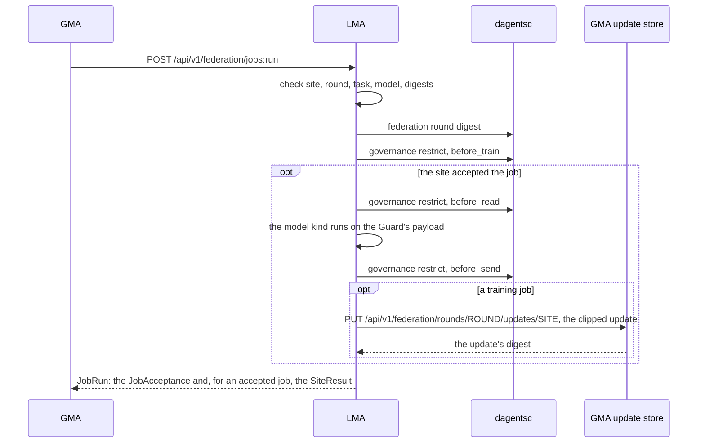

### Report the site's registration

```api-endpoint
GET /api/v1/federation/registration
```

Returns how the site enrols in a study: its id, capabilities, feature contract
version, its condition as the only approved condition, its policy version,
`enrolled: true`, and its current record count as the cohort size. The LMA asks
the source for its version first, so the count is current. The GMA calls it in
[a site refresh](#gma-post-api-v1-federation-sites-refresh). It calls no planner
command and stores nothing.

**Errors.** As for [the site description](#lma-get-api-v1-site). `403` for a
`site` token: only the `coordinator` scope may call it.

**Related.** [The SiteRegistration object](#the-siteregistration-object).

### Accept or refuse a job

```api-endpoint
POST /api/v1/federation/jobs:offer
```

Runs the checks above and returns a [JobAcceptance](#the-jobacceptance-object):
`accepted`, the reason, whether the digest was verified and the site's feature
contract version. A refusal answers `200` with `accepted: false`, as the
example of a training job for the rule shows. An accepted offer is kept, so the
site can execute that exact job once. The `before_train` decision is written to
the site's audit chain; a refusal is written to the job log.

**Errors.** `409` (`conflict`) when the site was already offered a job for this
round, accepted or not. `404` when the LMA was started without a site. `422`
when the body is not a valid job. `403` for a `site` token.

**Related.** [The FederatedJob object](#the-federatedjob-object),
[execute the job](#lma-post-api-v1-federation-jobs-execute).

### Run an accepted job

```api-endpoint
POST /api/v1/federation/jobs:execute
```

Runs the job the site accepted. The body must be the same job, as canonical
JSON, as the one accepted. `LocalFederatedWorker` reads the site's records, runs
the `before_read` Guard at `row` granularity, and hands the Guard's payload, not
the raw records, to the model kind. A profile job's records lose the label
field first. The runner computes:

| Task | What it computes |
|---|---|
| `profile` | `record_count` and `completeness` from the Guard's payload; `label_coverage` from the site's records; `label_rate` only when [the summary](#lma-get-api-v1-site-summary) would release it |
| `evaluate` | The model kind's `evaluate` on the labelled records of the payload |
| `train` | The model kind's `train` on the labelled records of the payload, which returns an update |

Then the `before_send` Guard bounds what leaves, at `model_update`
granularity. For a training job, the Guard clips the update, and
`HttpUpdateChannel` sends the clipped update to the GMA's
[update store](#gma-put-api-v1-federation-rounds-round-id-updates-site-id)
with `LMA_GMA_TOKEN`. The GMA answers with its digest of the stored update; the
site compares it with its own and refuses the job if they differ. The result
carries the update's norm and digest only, never the update.

A refusal, or a local failure such as an exception in the model kind, is a
result too: `rejected` or `failed`, with `refusal_reason`. Every result is
written to the job log, and each Guard decision to the audit chain.

**Errors.** `409` (`conflict`) when the site has no accepted offer for the
round, has run the job already, or is sent a job that differs from the one it
accepted. `404` when the LMA was started without a site. `403` for a `site`
token.

**Related.** [The SiteResult object](#the-siteresult-object),
[the job log](#lma-get-api-v1-federation-jobs).

### Offer and run a job in one call

```api-endpoint
POST /api/v1/federation/jobs:run
```

Takes the two steps of [the offer](#lma-post-api-v1-federation-jobs-offer) and
[the execution](#lma-post-api-v1-federation-jobs-execute) in one call, with the
same checks, Guard decisions, job log entries and update upload. The answer is
a [JobRun](#the-jobrun-object): the `acceptance` and, when the site accepted
the job, the `result`. A refused job has no result, and no data is read for
it. The GMA's HTTP engine sends each selected site one `jobs:run` call per
round, which saves a call and a second copy of the job.

**Errors.** `409` (`conflict`) when the site was already offered a job for this
round, by any of the three routes. `404` when the LMA was started without a
site. `422` when the body is not a valid job. `403` for a `site` token.

**Related.** [The FederatedJob object](#the-federatedjob-object),
[the JobRun object](#the-jobrun-object).

### Read the site's job log

```api-endpoint
GET /api/v1/federation/jobs
```

Returns the jobs the site refused or ran, newest first, at most `limit` (1 to
200, default 20). Each entry holds the round, the phase, the participation, the
examples contributed, the update's norm and digest, the job digest, the
metrics, the reason for a refusal and the time it was recorded. Accepted offers
are not logged; their results are. The log is `InMemoryJobLog`, which keeps the
newest 1,000 entries, or `PostgresJobLog` with `LMA_JOB_LOG_TABLE`, which
writes and reads as the site's role. It calls no planner command.

**Errors.** As for [the site description](#lma-get-api-v1-site). `422` when
`limit` is outside 1 to 200.

**Related.** [The JobLogEntry object](#the-joblogentry-object).

## The global monitoring agent

The global monitoring agent (GMA) is the coordinator. It keeps a registry of the
LMAs, the telemetry they send and the bundle each should run. It plans
federated rounds, sends each selected site its job, stores what each site
returns, combines the accepted results into a candidate model, keeps the model
registry and evaluates the release gates. Its Guard answers governance requests
like the LMA's, and stands at the fourth boundary, `before_release`. A
deployment runs one GMA.

Terms used in this part of the page:

- A **site** is one data source that takes part in a study, such as one store.
  Its LMA does the site's work.
- A **federated round** is one pass of a study: each selected site computes on
  its own records and returns a result, never the records.
- A **round manifest** is the round's contract: the study, the model version,
  the feature contract (the agreed list of fields) and the rules for who may
  join.
- A **model kind** is the code that runs one kind of model, such as a rule or a
  logistic regression. An application contributes it through an extension: how
  the model is evaluated, trained, checked and combined.
- A **candidate** is the model a round produces. It is not a release: a release
  needs the release gates to pass and a person to approve it.

| | |
|---|---|
| Code | `dagents/gma/`: the routes in `routes.py`, the app built by `app_factory.py` from `config.py`, the use cases in `application/` (`aggregation_service.py`, `model_registry.py`, `release_service.py`, `site_directory.py`, `site_addresses.py`), the HTTP engine in `adapters/http_federation_engine.py`, and the stores in `infrastructure/` (`persistence.py`, `update_store.py`, `postgres_models.py`) |
| Shared code it serves | `dagents/common/`: federated rounds (`application/federation.py`, `domain/federation.py`), governance (`application/governance_service.py`, `application/ethical_guard.py`), sources (`infrastructure/sources.py`), profiles and model runs (`application/ml_orchestration.py`), the agent client and tokens (`infrastructure/agent_client.py`, `infrastructure/agent_auth.py`) and extensions (`extensions/registry.py`) |
| Port | 8020 (`GMA_API_PORT` in `env/.env.gma`, read by uvicorn) |
| Settings | `env/.env.shared`, then `env/.env.gma`, read by `Settings.from_env()` in `dagents/gma/config.py`. A variable already set in the environment wins. |
| Planner | `dagentsc governance restrict` for governance and the release Guard; `dagentsc federation round plan`, `federation aggregate readiness`, `federation release evaluate` and `federation model lifecycle` for rounds and model versions |
| Start it | `PYTHONPATH=. .venv/bin/uvicorn dagents.gma.main:app --port 8020`, from the repository root, with `DAGENTSC_BIN` set ([how](overview.md#run-a-service-to-try-the-examples)). The container image builds `dagentsc` and puts it on its `PATH`. |
| Its own docs | `http://127.0.0.1:8020/docs` and `/openapi.json` |

The settings beyond the app name and log level. A GMA with none of them set
behaves as it did before they existed: the simulator engine, no tokens, the
process-wide extension registry, everything in memory and source reads on.

| Setting | Default | Meaning |
|---|---|---|
| `GMA_ENGINE` | `in-process` | `in-process`, the simulator, or `http`, which sends each round's jobs to the LMAs over their HTTP API |
| `GMA_SITE_ENDPOINTS` | none | `SITE=URL,...`: each LMA's address. Only these addresses are called, so an enrolment cannot point the GMA at another host. `GMA_ENGINE=http` needs them, joinable sites, or an agent network an application hands the GMA. |
| `GMA_JOINABLE_SITE_ENDPOINTS` | none | `SITE=URL,...`: sites that may join while the GMA runs, each with the one address the GMA accepts for it ([give the GMA a site's address](#gma-put-api-v1-federation-sites-site-id-address)). Needs `GMA_ENGINE=http`. With tokens, each site also needs entries in `GMA_LMA_TOKENS` and `GMA_SITE_TOKENS`. |
| `GMA_LMA_TOKENS` | none | `SITE=TOKEN,...`: the `coordinator` token the GMA sends to each LMA |
| `GMA_ADMIN_TOKEN`, `GMA_SITE_TOKENS`, `GMA_REQUIRE_TOKENS` | none, none, `0` | The tokens this GMA accepts ([Tokens](#tokens-errors-and-calls-between-agents)) |
| `GMA_DISPATCH_CONCURRENCY` | `3` | How many sites a round's jobs run at at once, 1 to 64 |
| `GMA_SUMMARY_TTL_SECONDS` | `2` | How long the site summaries are kept |
| `GMA_SUMMARY_TIMEOUT_SECONDS` | `30` | How long the GMA waits for each LMA's summary, audit state and site description. An LMA that takes longer is reported as not reachable. |
| `GMA_EXTENSIONS` | none | `module:attribute,...`: the extensions loaded into this GMA's own registry. The condition packs and model kinds come from them. |
| `GMA_DATABASE_URL`, `GMA_DATABASE_ROLE` | none | The coordinator's database, and the role every coordinator query acts as |
| `GMA_MODEL_TABLE` | none | `schema.table` for the model registry. In memory without it. |
| `GMA_AUDIT_TABLE`, `GMA_AUDIT_ANCHOR_TABLE` | none | `schema.table` for the release Guard's audit chain and its anchor. In memory without them. |
| `GMA_ALLOW_SOURCE_READS` | `1` | `0` makes the source, dataset profile and model job routes answer `403`, for a coordinator that must never read records |

An application that runs the GMA in its own process passes the same settings
to `create_app(settings, GmaDeps(...))`, together with objects it owns: its
extension registry, agent network, model store, coordinator database
connection or audit sink.

How the GMA relates to the other modules:

- **With the HTTP engine, it calls the LMAs.** It enrols each configured LMA
  from its [registration](#lma-get-api-v1-federation-registration), reads
  each LMA's [summary](#lma-get-api-v1-site-summary), and offers and runs each
  round's [jobs](#lma-federated-jobs). The LMAs call it back to store their
  clipped updates and to read the released model. A site in
  `GMA_JOINABLE_SITE_ENDPOINTS` is called the same way once the study operator
  has [sent its address](#gma-put-api-v1-federation-sites-site-id-address).
  With the simulator it calls no other service.
- **It calls the planner for every decision.** The governance plan and enforce
  endpoints and the release Guard run [`dagentsc governance restrict`](dagentsc.md#dagentsc-governance-restrict).
  Planning, dispatch, readiness, aggregation and release evaluation run
  [`dagentsc federation round plan`](dagentsc.md#dagentsc-federation-round-plan),
  [`federation aggregate readiness`](dagentsc.md#dagentsc-federation-aggregate-readiness)
  and [`federation release evaluate`](dagentsc.md#dagentsc-federation-release-evaluate).
  Every change to a model version's status runs
  [`federation model lifecycle`](dagentsc.md#dagentsc-federation-model-lifecycle).
- **Sites run their part through an engine.** `FederatedRoundController` hands
  a dispatched round to a `FederationEngine`. `HttpFederationEngine` sends the
  jobs to the LMAs and combines the stored updates with the model kind's
  `combine`. `InProcessFederationEngine` is a simulator that runs site workers
  inside the GMA's process; a plain GMA attaches no worker, so a dispatched
  round records a `failed` result for each selected site until the site sends
  its own.
- **The Spring control service serves the registry again.**
  [spring-control-service](spring-services.md) serves the versioned agent
  registry and deployment paths for JVM applications, with its own store.
- **The core service knows its address.** The core service lists the GMA in its
  [catalog](framework-services.md#core-service-get-api-v1-services).
- **Applications can run it in process.** The getting-started example builds
  the GMA with `create_app` next to one LMA per store. The healthcare demo does
  the same, with `GMA_ENGINE=http`, and runs its whole pilot as GMA calls
  ([Demo apps](demo-apps.md#the-federated-pilot-and-model-releases)). The
  [guide to federated rounds](../../guide/06-federated-rounds.md) shows both.

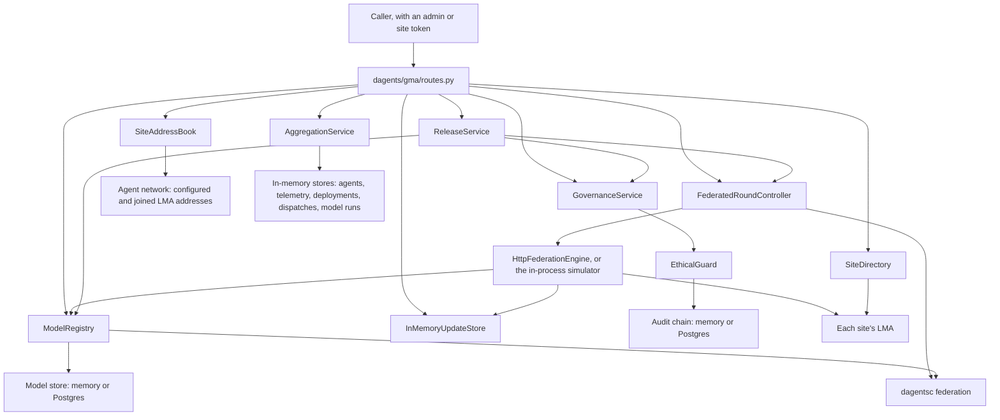

### What the GMA stores

The GMA keeps its state in memory, so a restart clears it. The two exceptions
are the model registry and the release Guard's audit chain of a GMA whose
settings name a database table for them. Nothing is removed while it runs,
except the stored updates.

| What | Class | Written by | Read by |
|---|---|---|---|
| Agents, one record per agent id | `InMemoryAgentRegistryRepository` | Registrations, heartbeats and deployment syncs; telemetry and desired deployments update a known agent's record | The agent list and lookup, heartbeat answers, the overview |
| Telemetry envelopes | `InMemoryTelemetryRepository` | `POST /api/v1/agents/{agent_id}/telemetry` | `GET /telemetry/recent`, `GET /telemetry/summary`, the overview |
| Desired deployments, one per agent | `InMemoryControlPlaneRepository` | `PUT /api/v1/agents/{agent_id}/desired-deployment` | Deployment syncs, registration answers, `GET /deployments` |
| Run dispatches | `InMemoryControlPlaneRepository` | `POST /runs/dispatch` | `GET /runs/dispatch`, the overview |
| Aggregate model runs | `InMemoryModelRunRepository` | `POST /api/v1/model-jobs` | `GET /api/v1/model-jobs`, the overview |
| Source definitions | `InMemorySourceCatalog`, inside `DefaultSourceResolver` | `POST /api/v1/sources` | The source endpoints, and profiles and model runs that name a `source_id` |
| Data classifications added at runtime | `GovernanceService` | `PUT /api/v1/governance/classifications/{classification_id}` | `GET /api/v1/governance/classifications` |
| Guard decisions | `InMemoryAuditLog`, or `PostgresAuditSink` with `GMA_AUDIT_TABLE` | Enforce, and the release Guard of each release evaluation | `GET /api/v1/governance/audit`, `GET /api/v1/governance/audit:summary` |
| Site enrolments, one per site id | `InMemorySiteRegistry` | `PUT /api/v1/federation/sites/{site_id}`, `POST /api/v1/federation/sites:refresh` | The site list, round planning and dispatch |
| Site summaries, for `GMA_SUMMARY_TTL_SECONDS` | `SiteDirectory` | `GET /api/v1/federation/sites/summaries` | The same endpoint |
| Addresses of sites that joined while the GMA runs | `SiteAddressBook`, in the agent network | `PUT /api/v1/federation/sites/{site_id}/address`, `DELETE` of the same path | The site address list, the site refresh, the summaries and round dispatch |
| Rounds, one per round id, with their plan, acceptances, results, dispatch calls, readiness, candidate and decision | `InMemoryRoundRepository` | Dispatch, results, aggregation, discard and release evaluation | The round list and lookup, and every round endpoint |
| The sites' clipped updates, until the round is aggregated or discarded | `InMemoryUpdateStore` | `PUT /api/v1/federation/rounds/{round_id}/updates/{site_id}` | The HTTP engine's aggregation only; no route reads an update |
| Model versions, with their parameters, status and latest release decision | `InMemoryModelStore`, or `PostgresModelStore` with `GMA_MODEL_TABLE` | Registration, aggregation, release evaluation and approval | The model version endpoints, dispatch and aggregation |

### Limits of the GMA in this version

- Rounds, site enrolments and stored updates are in memory. A restart loses a
  round in progress and its updates, so an aggregation that needs them is
  refused: the round fails closed.
- A run dispatch is recorded only. Nothing sends it to an LMA or runs it.
- Model runs train no model, and the simulator engine combines no model
  parameters. Their metrics are estimates or weighted means of what the sites
  reported. The HTTP engine combines the stored updates through the model
  kind's `combine`.
- Without tokens, any caller that can reach the GMA can call every route,
  including the result and update routes. Run it with tokens, or on a private
  network.
- A manifest that asks for `secure_aggregation` without a `threshold` makes the
  planner fail, so the round endpoints answer `503`. Always set the threshold.

## GMA health and overview

```api-interface
service: gma
status: complete
code: dagents/gma/routes.py
classes:
- AggregationService (dagents/gma/application/aggregation_service.py)
endpoints:
- GET /health
- GET /api/v1/health
- GET /overview
```

Two read-only endpoints. `AggregationService.health_payload` returns a fixed
answer with the name of the round engine, and `AggregationService.overview`
counts what the stores hold. The health check needs no token.

### Check the GMA's health

```api-endpoint
GET /api/v1/health
```

Returns `{"status": "ok", "agent_type": "GMA", "engine": ...}`, where `engine`
is `in-process-simulator` or `http`. It reads no stored state and calls no
other service and no planner command, so it answers whenever the process runs,
even without `dagentsc`, and it needs no token. The Docker health check of the GMA
container calls `GET /health` every 30 seconds, and Docker Compose starts the
LMA only after that check passes. Nothing is stored.

**Errors.** None of its own.

**Related.** [Count what the GMA holds](#gma-get-overview).

### Count what the GMA holds

```api-endpoint
GET /overview
```

Returns five counts: the agents in the registry, the agents whose status is
`ACTIVE` or `SYNC_REQUIRED`, the telemetry envelopes received, the agents with
a pending deployment, and the run dispatches plus aggregate model runs. It
reads memory only and has no versioned twin. The telemetry, dispatch and
model-run counts stop at 100,000 each, because the method reads at most that
many entries of each. Nothing is stored.

An agent's status is what its last heartbeat said. The GMA answers a heartbeat
with `SYNC_REQUIRED` but never stores that value itself, so `active_agents`
counts only what the agents reported. An agent has a pending deployment when
its record holds a desired bundle that differs from the bundle it last reported
([deployments](#deployments-and-dispatch)).

**Errors.** None of its own.

**Related.** [The FleetOverview object](#the-fleetoverview-object),
[list the agents](#gma-get-api-v1-agents).

## Agent registry

```api-interface
service: gma
status: complete
code: dagents/gma/routes.py
classes:
- AggregationService (dagents/gma/application/aggregation_service.py)
- InMemoryAgentRegistryRepository (dagents/gma/infrastructure/persistence.py)
- InMemoryTelemetryRepository (dagents/gma/infrastructure/persistence.py)
endpoints:
- POST /register
- PUT /api/v1/agents/{agent_id}/registration
- POST /heartbeat
- POST /api/v1/agents/{agent_id}/heartbeats
- POST /telemetry
- POST /api/v1/agents/{agent_id}/telemetry
- GET /agents
- GET /api/v1/agents
- GET /api/v1/agents/{agent_id}
- GET /telemetry/recent
- GET /telemetry/summary
```

An LMA tells the GMA that it exists by **registering**. It then sends
**heartbeats**, which say that it is alive and in what state, and **telemetry
envelopes**, which carry measured values. The GMA keeps one record per agent id,
an [AgentSnapshot](#the-agentsnapshot-object), and appends every envelope to
one list. In this version the LMA does not send these requests itself: a
caller, such as a deployment script or an application, sends them for it. With
tokens, the registration, heartbeat, telemetry and deployment-sync endpoints
take the `admin` token or a site's `site` token, and the other endpoints the
`admin` token only. A `site` token may register an agent only with its own
site in `scope.site`, and never over an agent of another site, and may send
heartbeats, telemetry and deployment syncs only for an agent registered that
way; anything else answers `403` (`forbidden`), so one LMA cannot rewrite
another's record. These records are separate from a study's
[site enrolments](#federated-sites).

On the versioned paths the agent id is in the path. When `agent.agent_id` in
the body differs, the path id replaces it and the request goes ahead, as the
registration example "A body id that differs from the path id" shows. The
[Spring control service](spring-services.md) answers `422` instead.

### Register an agent

```api-endpoint
PUT /api/v1/agents/{agent_id}/registration
```

Stores the agent's identity, scope, version and capabilities under its id and
returns `accepted: true`. A new agent starts with the status `REGISTERED`.
Registering an id again replaces those four fields and keeps the rest of the
record: its status, heartbeat, ingestion and bundle fields. When a desired
deployment is already stored for the agent, `deployment_plan_id` in the answer
is its `plan_token`. Nothing is checked beyond the schema and, for a `site`
token, the site binding above; `accepted` is always true, and no planner
command runs. The body holds no records from a data source, so no Guard
boundary is passed.

**Errors.** `403` (`forbidden`) when a `site` token registers an agent without
its own site in `scope.site`, or over an agent of another site. `422` when a
field fails validation, for example a body without `version`.

**Related.** [The RegisterRequest object](#the-registerrequest-object),
[the AgentSnapshot object](#the-agentsnapshot-object),
[send a heartbeat](#gma-post-api-v1-agents-agent-id-heartbeats),
[list the agents](#gma-get-api-v1-agents).

### Send a heartbeat

```api-endpoint
POST /api/v1/agents/{agent_id}/heartbeats
```

Stores the heartbeat's `status` as the agent's status and
`last_heartbeat_status`, and its `timestamp` as `last_seen_at`. The timestamp is
not compared with the clock. An agent that never registered is added, with
version `unknown` and an empty scope, as the example from store west shows.

The answer's `desired_state` is `SYNC_REQUIRED` when the agent's record holds a
desired bundle that differs from the bundle the agent last reported in a
[deployment sync](#gma-post-api-v1-agents-agent-id-deployment-sync), and
`ACTIVE` otherwise. The GMA answers with `SYNC_REQUIRED` but does not store it.
No planner command runs.

**Errors.** `403` (`forbidden`) when a `site` token sends a heartbeat for an agent that is not registered with its own site in `scope.site`. `422` when a field fails validation, for example a `timestamp` that
is not an integer.

**Related.** [Plan a deployment](#gma-put-api-v1-agents-agent-id-desired-deployment),
[the AgentSnapshot object](#the-agentsnapshot-object).

### Send telemetry

```api-endpoint
POST /api/v1/agents/{agent_id}/telemetry
```

Appends the envelope to the GMA's telemetry list and returns an ingestion id,
`telemetry-<n>`, where n counts the envelopes received since the GMA started.
When the agent is in the registry, its record keeps that id as
`last_ingestion_id`. An envelope from an unknown agent is still stored and
counted, but no agent record is created. The values are stored as sent: the
GMA does not check the keys, the units or `observed_at`. No planner command
runs.

**Errors.** `403` (`forbidden`) when a `site` token sends telemetry for an agent that is not registered with its own site in `scope.site`. `422` when a field fails validation, for example a metric `value`
that is not a number.

**Related.** [The TelemetryEnvelope object](#the-telemetryenvelope-object),
[list recent telemetry](#gma-get-telemetry-recent),
[add it up per agent](#gma-get-telemetry-summary).

### List the agents

```api-endpoint
GET /api/v1/agents
```

Returns every agent record, sorted by `agent_id`: registered agents, and agents
that a heartbeat or a deployment sync added. It reads memory only and takes no
`limit`.

**Errors.** None of its own.

**Related.** [The AgentSnapshot object](#the-agentsnapshot-object),
[fetch one agent](#gma-get-api-v1-agents-agent-id).

### Fetch one agent

```api-endpoint
GET /api/v1/agents/{agent_id}
```

Returns the record of one agent. It reads memory only. When no agent has the
id, the answer is `200` with the body `null`, not `404`. There is no short
path.

**Errors.** None of its own.

**Related.** [List the agents](#gma-get-api-v1-agents),
[the AgentSnapshot object](#the-agentsnapshot-object).

### List recent telemetry

```api-endpoint
GET /telemetry/recent
```

Returns the stored envelopes, newest first, at most `limit` of them. It reads
memory only. `limit` defaults to 20 and has no lower bound: `0` returns every
envelope, and a negative number leaves out that many of the oldest. There is no
versioned path.

**Errors.** `422` when `limit` is not an integer.

**Related.** [Send telemetry](#gma-post-api-v1-agents-agent-id-telemetry),
[the TelemetryEnvelope object](#the-telemetryenvelope-object).

### Add up the telemetry per agent

```api-endpoint
GET /telemetry/summary
```

Returns one summary per agent that sent telemetry, sorted by `agent_id`: how
many envelopes and values it sent, the latest `observed_at`, and the sum of the
values of each metric key. The sums are plain totals whatever the metric
means, so a rate or a gauge is added up too. It reads every stored envelope.
There is no versioned path.

**Errors.** None of its own.

**Related.** [The TelemetrySummary object](#the-telemetrysummary-object),
[list recent telemetry](#gma-get-telemetry-recent).

## Deployments and dispatch

```api-interface
service: gma
status: complete
code: dagents/gma/routes.py
classes:
- AggregationService (dagents/gma/application/aggregation_service.py)
- InMemoryControlPlaneRepository (dagents/gma/infrastructure/persistence.py)
- InMemoryAgentRegistryRepository (dagents/gma/infrastructure/persistence.py)
endpoints:
- POST /deployments/plan
- PUT /api/v1/agents/{agent_id}/desired-deployment
- POST /deployments/sync
- POST /api/v1/agents/{agent_id}/deployment-sync
- GET /deployments
- POST /runs/dispatch
- GET /runs/dispatch
```

A **desired deployment** names the monitoring bundle (a versioned set of
checks, see [LMA monitoring bundles](#lma-monitoring-bundles-and-runs)) that one
agent should run. The GMA keeps one per agent. An agent reports what it runs
with a **deployment sync**, and the GMA answers whether that matches. A **run
dispatch** records that an agent should run a bundle. Nothing in this version
delivers a bundle or a run to an LMA: these endpoints keep the state that a
deployment tool reads and acts on.

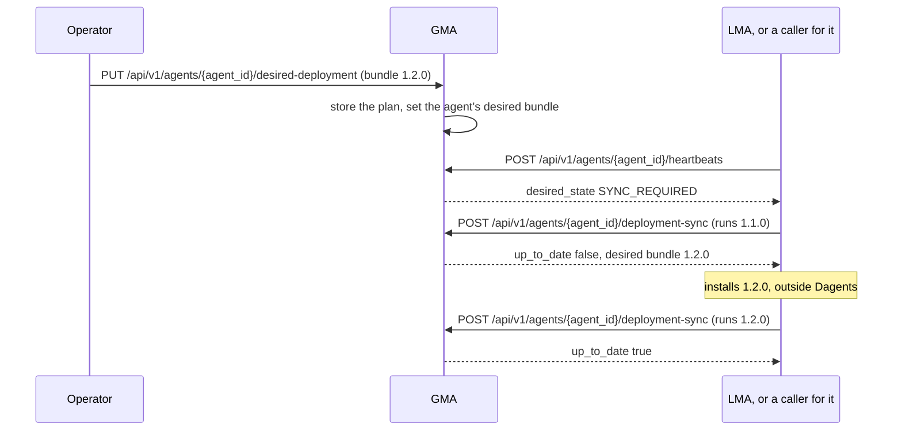

### Plan a deployment

```api-endpoint
PUT /api/v1/agents/{agent_id}/desired-deployment
```

Stores the bundle the agent should run, replacing any earlier plan for that
agent, and returns the plan. `config_digest` is the SHA-256 of the agent id,
bundle id, version, URI and config joined by colons, and `plan_token` is
`plan-` followed by the digest's first 12 hex digits, so the same request
always gives the same token. `created_at` is the current time.

When the agent is in the registry, its record's desired bundle is set too.
When it is not, only the plan is stored: a later registration reports the
plan's token, but the agent's heartbeats answer `ACTIVE` until the plan is sent
again. The bundle is not fetched, and no planner command runs. On the versioned
path, the id in the path replaces `agent_id` in the body.

**Errors.** `422` when a field fails validation, for example a body without
`bundle_version`.

**Related.** [The DeploymentPlan object](#the-deploymentplan-object),
[report the running bundle](#gma-post-api-v1-agents-agent-id-deployment-sync),
[list the desired deployments](#gma-get-deployments).

### Report the running bundle

```api-endpoint
POST /api/v1/agents/{agent_id}/deployment-sync
```

Stores the reported bundle and version as the agent's current bundle, then
compares them with the agent's desired deployment. `up_to_date` is true when
both match. It is also true when no deployment is planned for the agent. The
token and the digest are then empty strings and the desired fields `null`, as
the store east example shows. An agent that never registered is added, with
version `unknown`. No planner command runs.

**Errors.** `403` (`forbidden`) when a `site` token reports a bundle for an agent that is not registered with its own site in `scope.site`. `422` when a field fails validation, for example a body without
`bundle_id`.

**Related.** [The DeploymentSyncResponse object](#the-deploymentsyncresponse-object),
[plan a deployment](#gma-put-api-v1-agents-agent-id-desired-deployment).

### List the desired deployments

```api-endpoint
GET /deployments
```

Returns every stored desired deployment, sorted by `agent_id`. It reads memory
only and takes no `limit`. There is no versioned path.

**Errors.** None of its own.

**Related.** [The DeploymentPlan object](#the-deploymentplan-object),
[plan a deployment](#gma-put-api-v1-agents-agent-id-desired-deployment).

### Dispatch a run

```api-endpoint
POST /runs/dispatch
```

When the agent is in the registry, stores a dispatch with the status `QUEUED`
and the current time, and answers `accepted: true` with the message
`Queued run <correlation_id> for agent <agent_id>`. When it is not, nothing is
stored and the answer is `accepted: false`, still with status `200`. Nothing
runs a dispatch or sends it to the agent, and its status never changes. The
correlation id is not checked for repeats: dispatching the same id twice stores
two entries. There is no versioned path.

**Errors.** `422` when a field fails validation, for example a body without
`correlation_id`.

**Related.** [The DispatchedRun object](#the-dispatchedrun-object),
[list the dispatches](#gma-get-runs-dispatch).

### List the dispatches

```api-endpoint
GET /runs/dispatch
```

Returns the stored dispatches, newest first, at most `limit` of them. It reads
memory only. `limit` defaults to 20 and has no lower bound: `0` returns every
dispatch, and a negative number leaves out that many of the oldest.

**Errors.** `422` when `limit` is not an integer.

**Related.** [Dispatch a run](#gma-post-runs-dispatch),
[the DispatchedRun object](#the-dispatchedrun-object).

## GMA sources

```api-interface
service: gma
status: complete
code: dagents/gma/routes.py
classes:
- AggregationService (dagents/gma/application/aggregation_service.py)
- DefaultSourceResolver (dagents/common/infrastructure/sources.py)
endpoints:
- GET /api/v1/sources
- POST /api/v1/sources
- GET /api/v1/sources/{source_id}
- POST /api/v1/sources/{source_id}:validate
```

The same source catalog as the LMA's, with its own store: a source registered
at the GMA is not known to any LMA, and the other way round.
[LMA sources](#lma-sources) describes the four kinds of source, where their
connection settings come from, and what validation checks. The GMA reads a
registered source without the Guard, as the LMA does, so register only records
the GMA may see: records that are already combined, or records the sites'
Guards have released. The warning there applies here too: a caller with the
`admin` token (any caller, without tokens) can register a Postgres source that
makes the GMA connect to a host of the caller's choice. Every answer redacts the
connection options, as on the LMA.

A GMA started with `GMA_ALLOW_SOURCE_READS=0` reads no source: these endpoints,
the profile and the model-run endpoints answer `403` (`forbidden`). Start the
coordinator of a study this way, so it can never read a site's records.

### List the GMA's sources

```api-endpoint
GET /api/v1/sources
```

Returns every stored source definition, sorted by `source_id`, with its
connection options redacted. It reads memory only and calls no adapter. With
nothing registered it returns `[]`.

**Errors.** `403` when source reads are off.

**Related.** [Register a source](#gma-post-api-v1-sources),
[fetch one source](#gma-get-api-v1-sources-source-id).

### Register a source at the GMA

```api-endpoint
POST /api/v1/sources
```

Checks that the body is one of the four source definitions, stores it under its
`source_id` and returns it with every default filled in and its connection
options redacted. A source with the same id is replaced. Registration reads no
records, opens no connection and calls no planner command. As on the LMA, the
handler validates the body itself, so a JSON object that is not a valid
definition fails with `500`, not `422`.

**Errors.** `403` when source reads are off. `422` when the body is not a JSON
object, for example a JSON list.
`500` with the plain-text body `Internal Server Error` when the object is not a
valid source definition, for example one with an unknown `kind`.

**Related.** [The InlineSourceSpec object](#the-inlinesourcespec-object),
[the PostgresSourceSpec object](#the-postgressourcespec-object),
[profile the source](#gma-post-api-v1-datasets-profile).

### Fetch one source from the GMA

```api-endpoint
GET /api/v1/sources/{source_id}
```

Returns the stored definition with this `source_id`, with its connection
options redacted. It reads memory only. When no source has the id, the answer
is `200` with the body `null`, not `404`.

**Errors.** `403` when source reads are off.

**Related.** [List the sources](#gma-get-api-v1-sources),
[register a source](#gma-post-api-v1-sources).

### Validate a source at the GMA

```api-endpoint
POST /api/v1/sources/{source_id}:validate
```

Runs the check of the source's adapter on the stored definition and returns
what it found. Nothing is stored, no records are read, no database connection
is opened and no planner command runs. The table in
[the LMA's validate endpoint](#lma-post-api-v1-sources-source-id-validate)
lists what each kind checks.

**Errors.** `403` when source reads are off. `500` with the plain-text body
`Internal Server Error` when no source has this id.

**Related.** [The SourceValidationResult object](#the-sourcevalidationresult-object),
[register a source](#gma-post-api-v1-sources).

## Aggregate profiling and model runs

```api-interface
service: gma
status: complete
code: dagents/gma/routes.py
classes:
- AggregationService (dagents/gma/application/aggregation_service.py)
- DefaultSourceResolver (dagents/common/infrastructure/sources.py)
- InMemoryModelRunRepository (dagents/gma/infrastructure/persistence.py)
endpoints:
- POST /datasets/profile
- POST /api/v1/datasets:profile
- POST /models/run
- POST /api/v1/model-jobs
- GET /models/runs
- GET /api/v1/model-jobs
```

The GMA profiles and runs models on **assimilated** data: records combined from
several sources. It uses the same functions as the LMA, `build_dataset_profile`
and `execute_model_run` in `dagents/common/application/ml_orchestration.py`, so
[LMA dataset profiling and model runs](#lma-dataset-profiling-and-model-runs)
describes where the records come from and how models are suggested. Three
things differ:

| | LMA | GMA |
|---|---|---|
| `scope_kind` in the answer, whatever the request says | `source` | `assimilated` |
| Run id and artifact path | `lma-<scope_id>-<seconds>`, `<prefix>/lma/...` | `gma-<scope_id>-<seconds>`, `<prefix>/gma/...` |
| Estimated `quality_score` | the base for the model family, plus the size term | the same, plus 0.04 |

These endpoints do not call the Guard and do not call the planner. Records
reach the GMA as sent: a profile or a run here is only as private as the
records the caller chose to send or register. A GMA started with
`GMA_ALLOW_SOURCE_READS=0` answers all six with `403` (`forbidden`), as the
example "A GMA started with its source reads off" shows.

### Profile combined data

```api-endpoint
POST /api/v1/datasets:profile
```

Reads the records and returns their count, the feature fields split into
numeric and categorical, the number of partitions and two or three suggested
model families. `scope_kind` is always `assimilated`, as the example that asks
for `source` shows. Nothing is stored.

**Errors.** `403` when source reads are off. `422` when a field fails
validation, for example a `batch_size`
below 1. `500` with the plain-text body `Internal Server Error` when the records
cannot be read, for example when `dataset.source_id` names no registered
source.

**Related.** [The DatasetProfile object](#the-datasetprofile-object),
[the DatasetInput object](#the-datasetinput-object),
[run an aggregate model](#gma-post-api-v1-model-jobs).

### Run an aggregate model

```api-endpoint
POST /api/v1/model-jobs
```

Reads the records, profiles them and stores one model run in the GMA's run
history. The versioned path answers `202` and the short path `200`, but both
finish the run before they answer: there is no job to poll. No model is trained
and no file is written. `metrics` holds estimates, and `artifact_uri` is a name
only (see [the ModelRunRecord object](#the-modelrunrecord-object)). The run id
is made from the clock in seconds, so two runs for one scope in the same second
get the same id.

**Errors.** `403` when source reads are off. `422` when a field fails
validation, for example a `model_family`
that is not in the list. `500` with the plain-text body
`Internal Server Error` when the records cannot be read.

**Related.** [The ModelRunRecord object](#the-modelrunrecord-object),
[list the aggregate runs](#gma-get-api-v1-model-jobs).

### List the aggregate model runs

```api-endpoint
GET /api/v1/model-jobs
```

Returns the stored model runs, newest first, at most `limit` of them. It reads
memory only. `limit` defaults to 20 and has no lower bound: `0` returns every
run, and a negative number leaves out that many of the oldest.

**Errors.** `403` when source reads are off. `422` when `limit` is not an
integer.

**Related.** [Run an aggregate model](#gma-post-api-v1-model-jobs),
[the ModelRunRecord object](#the-modelrunrecord-object).

## GMA governance

```api-interface
service: gma
status: complete
code: dagents/gma/routes.py
classes:
- GovernanceService (dagents/common/application/governance_service.py)
- EthicalGuard (dagents/common/application/ethical_guard.py)
- DagentscRestrictionPlanner (dagents/common/application/ethical_guard.py)
- InMemoryAuditLog (dagents/common/application/ethical_guard.py)
endpoints:
- GET /governance/classifications
- GET /api/v1/governance/classifications
- PUT /governance/classifications/{classification_id}
- PUT /api/v1/governance/classifications/{classification_id}
- POST /governance/restrictions:plan
- POST /api/v1/governance/restrictions:plan
- POST /governance/restrictions:enforce
- POST /api/v1/governance/restrictions:enforce
- GET /governance/audit
- GET /api/v1/governance/audit
- GET /governance/audit:summary
- GET /api/v1/governance/audit:summary
```

The GMA has its own `GovernanceService`, `EthicalGuard` and audit log, built by
`build_governance_service` in `dagents/gma/di.py`. The endpoints, the planner
command and the Guard's behaviour are the same as the LMA's.
[LMA governance](#lma-governance) explains classifications, restriction plans,
the strategies and the audit chain. What differs at the GMA:

- **Its own state.** The GMA's classifications and audit log are separate from
  every LMA's. A classification registered at the GMA is not known to the LMAs.
  With `GMA_AUDIT_TABLE` the audit chain is kept in Postgres, written as
  `GMA_DATABASE_ROLE`.
- **When it runs strict.** A GMA whose own registry (handed to it, or loaded
  from `GMA_EXTENSIONS`) has condition packs plans every request against the
  registered classification, as an LMA started for a site does: a request whose
  classification differs is refused with `409`. A GMA that reads the
  process-wide registry uses the classification each request sends.
- **Its boundary.** The GMA's Guard is the one for `before_release`: may a
  candidate model be released. The boundary is a field of the request, so the
  GMA accepts and records the other three values too.
- **The release evaluation calls it.** In the round flow,
  [evaluate the release](#gma-post-api-v1-federation-rounds-round-id-evaluate-release)
  runs the `before_release` Guard itself, with the condition pack's
  classification and purposes, and the decision joins this audit chain. A
  coordinator that uses the bare flow sends the enforce request itself:
  `boundary: "before_release"`, `granularity: "model_update"`, the field
  `model_update` and the candidate's example count as `cohort_size`, before it
  evaluates the gates. The enforce examples below make that request for round 1,
  as the diagram shows.

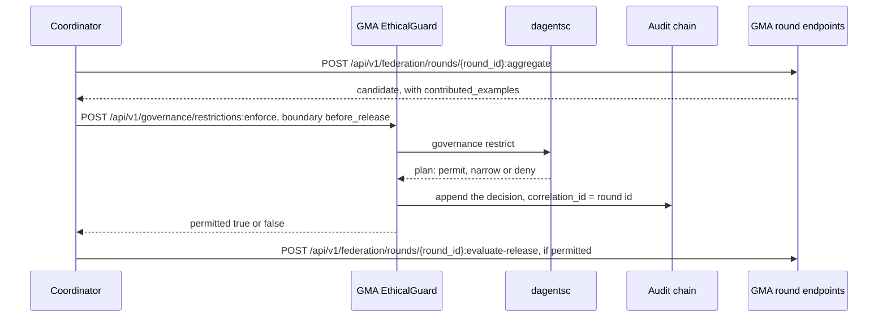

### List the GMA's data classifications

```api-endpoint
GET /api/v1/governance/classifications
```

Returns every classification the GMA knows, sorted by id: those that registered
extensions contribute, and those added with `PUT`. A plain GMA registers no
extension, so the list holds only what was added with `PUT`. It reads memory
only.

**Errors.** None of its own.

**Related.** [Register a classification](#gma-put-api-v1-governance-classifications-classification-id),
[the DataClassification object](#the-dataclassification-object).

### Register a classification at the GMA

```api-endpoint
PUT /api/v1/governance/classifications/{classification_id}
```

Stores the classification in the GMA's memory under its id and returns it. A
classification added earlier with `PUT` under the same id is replaced; an
extension's classification is not, as on the LMA. It calls no planner command
and writes no audit record. A GMA that does not run strict uses the
classification each request carries, not the stored list.

**Errors.** `400` when the id in the path differs from `classification_id` in
the body. `409` (`conflict`) when an extension contributes a different
classification with this id. `422` when a field fails validation, for example
a negative `minimum_cohort`.

**Related.** [List the classifications](#gma-get-api-v1-governance-classifications),
[the DataClassification object](#the-dataclassification-object).

### Plan a restriction at the GMA

```api-endpoint
POST /api/v1/governance/restrictions:plan
```

Sends the request to the planner (`dagentsc governance restrict`) and returns
its restriction plan. Nothing is applied and nothing is recorded. Use it to see
what a release check would decide before making it.

In the first example the release committee is trusted (score 0.97), and the
`model_update` field is highly sensitive, so the plan narrows it with
`clip_contribution:1`. In the second, the candidate rests on 12 examples, fewer
than the classification's minimum of 20, so the plan denies it and names the
violation.

**Errors.** `409` (`conflict`) when the GMA runs strict and the request's
classification is not the registered one, as the example "A request that brings
its own policy under the pack's classification id" shows. `422` when a field
fails validation, for example a `boundary` that is not one of the four. `503`
(`planner_unavailable`) when the planner cannot be run or its answer cannot be
read. Planning does not fail closed the way enforcement does.

**Related.** [Enforce a restriction](#gma-post-api-v1-governance-restrictions-enforce),
[the RestrictionRequest object](#the-restrictionrequest-object),
[the RestrictionPlan object](#the-restrictionplan-object).

### Enforce a restriction at the GMA

```api-endpoint
POST /api/v1/governance/restrictions:enforce
```

Plans the request with the planner (`dagentsc governance restrict`), applies
the plan to `payload`, writes one audit record and returns the Guard's
decision. For a release check, `payload` is empty: the call asks for a decision
only, and `correlation_id` ties the audit record to the round.

A denial is a normal answer: status `200` with `permitted: false` and every
requested field in `withheld_fields`, as the example with an unapproved purpose
shows. Check `permitted`, not the status. When the planner cannot be run, the
Guard fails closed: it denies the request, records the denial and still answers
`200`.

**Errors.** `409` (`conflict`) when the GMA runs strict and the request's
classification is not the registered one. `422` when a field fails validation,
for example a body without `request`.

**Related.** [The GuardDecision object](#the-guarddecision-object),
[read the audit log](#gma-get-api-v1-governance-audit),
[evaluate the release gates](#gma-post-api-v1-federation-rounds-round-id-evaluate-release).

### Read the GMA's audit log

```api-endpoint
GET /api/v1/governance/audit
```

Returns the GMA's newest audit records, newest first, and whether the digest
chain verifies. The Guard writes one record per enforcement, permitted or not,
and one for the release Guard of each release evaluation in the round flow.
Planning writes none. `limit` defaults to 50 and has no lower bound: `0`
returns every record, and a negative number leaves out that many of the oldest.
The chain is in memory, or in Postgres with `GMA_AUDIT_TABLE`, and not signed.

**Errors.** `422` when `limit` is not an integer.

**Related.** [The AuditRecord object](#the-auditrecord-object),
[enforce a restriction](#gma-post-api-v1-governance-restrictions-enforce).

### Summarize the GMA's audit chain

```api-endpoint
GET /api/v1/governance/audit:summary
```

Returns whether the GMA's audit chain verifies and how many decisions it holds,
without any record. In the example the chain holds one decision: the release
Guard's, from the release evaluation. A study's report can show this next to
each site's [audit summary](#gma-get-api-v1-federation-sites-summaries). It
calls no planner command and stores nothing.

**Errors.** `401` and `403` for tokens: it needs the `admin` token.

**Related.** [The AuditSummary object](#the-auditsummary-object),
[read the audit log](#gma-get-api-v1-governance-audit).

## Federated sites

```api-interface
service: gma
status: complete
code: dagents/gma/routes.py
classes:
- FederatedRoundController (dagents/common/application/federation.py)
- InMemorySiteRegistry (dagents/common/application/federation.py)
- SiteDirectory (dagents/gma/application/site_directory.py)
- SiteAddressBook (dagents/gma/application/site_addresses.py)
endpoints:
- PUT /federation/sites/{site_id}
- PUT /api/v1/federation/sites/{site_id}
- GET /federation/sites
- GET /api/v1/federation/sites
- POST /federation/sites:refresh
- POST /api/v1/federation/sites:refresh
- GET /federation/sites/summaries
- GET /api/v1/federation/sites/summaries
- PUT /federation/sites/{site_id}/address
- PUT /api/v1/federation/sites/{site_id}/address
- DELETE /federation/sites/{site_id}/address
- DELETE /api/v1/federation/sites/{site_id}/address
- GET /federation/site-addresses
- GET /api/v1/federation/site-addresses
```

A **site enrolment** says that a site takes part in studies and what it offers:
its capabilities, the feature contract it has signed, the conditions (study
topics) it has approved and its cohort size, the number of subjects it holds.
The GMA stores one enrolment per site id in `InMemorySiteRegistry`, and the
planner reads all of them each time it plans a round.

An enrolment comes from one of two places:

- **`PUT`** stores what the caller sends. The GMA does not ask the site or
  check the claims.
- **A refresh** asks each LMA in the GMA's agent network for its own
  [registration](#lma-get-api-v1-federation-registration), with its current
  record count as the cohort size. The LMAs in the network are the addresses in
  `GMA_SITE_ENDPOINTS`, the addresses of joinable sites the study operator
  sent, or the LMA apps an application added to an in-process network. An
  enrolment never adds an address, so a site cannot point the GMA at another
  host.

A **site address** is where the GMA calls a site's LMA. The GMA reads the
addresses in `GMA_SITE_ENDPOINTS` at start. A site listed in
`GMA_JOINABLE_SITE_ENDPOINTS` can join while the GMA runs: the study operator
[sends its address](#gma-put-api-v1-federation-sites-site-id-address), which
must be the one listed, and then [refreshes](#gma-post-api-v1-federation-sites-refresh)
the enrolments. An address and an enrolment are separate: the planner selects
a site only by its enrolment, and the GMA reaches a selected site only by its
address. No answer shows an address.

The GMA also reads what each configured LMA reports about its records, through
the [site summaries](#gma-get-api-v1-federation-sites-summaries). It never
reads a site's rows.

`enrolled` defaults to false, so a site has to say that it takes part. A site
stored with `enrolled: false` is listed and planned, but never selected, as
store west shows in the examples.

### Enrol a site

```api-endpoint
PUT /api/v1/federation/sites/{site_id}
```

Stores the enrolment under its `site_id` and returns it with the defaults
filled in: `policy_version` `unversioned`, `cohort_size` 0 and `enrolled` false.
Sending the same id again replaces the enrolment. A round already dispatched
keeps its stored plan. The change counts from the next plan. No planner command
runs and no Guard boundary is passed.

**Errors.** `400` when the id in the path differs from `site_id` in the body.
`422` when a field fails validation, for example a negative `cohort_size`.

**Related.** [The SiteRegistration object](#the-siteregistration-object),
[plan a round](#gma-post-api-v1-federation-rounds-plan).

### List the sites

```api-endpoint
GET /api/v1/federation/sites
```

Returns every stored enrolment, sorted by `site_id`, whether `enrolled` is true
or not. It reads memory only and takes no `limit`.

**Errors.** None of its own.

**Related.** [Enrol a site](#gma-put-api-v1-federation-sites-site-id),
[the SiteRegistration object](#the-siteregistration-object).

### Enrol each site from its LMA

```api-endpoint
POST /api/v1/federation/sites:refresh
```

Calls [`GET /api/v1/federation/registration`](#lma-get-api-v1-federation-registration)
on every LMA in the GMA's agent network, up to `GMA_DISPATCH_CONCURRENCY` at a
time, with each LMA's `coordinator` token from `GMA_LMA_TOKENS`, and stores each
answer as that site's enrolment. Returns the enrolments it stored, sorted by
`site_id`. An LMA that does not answer, answers with an error, or answers for
another site keeps its earlier enrolment, is left out of the answer and is
logged. A GMA with no LMA configured answers `[]`. It clears the cached site
summaries. No planner command runs.

**Errors.** `401` and `403` for tokens: it needs the `admin` token. A failed
LMA is not an error: it is left out.

**Related.** [The SiteRegistration object](#the-siteregistration-object),
[plan a round](#gma-post-api-v1-federation-rounds-plan).

### Report what each site says about its records

```api-endpoint
GET /api/v1/federation/sites/summaries
```

Returns one entry per LMA in the GMA's agent network, sorted by `site_id`: the
site's [summary](#lma-get-api-v1-site-summary) (counts, and the label rate
only when the site's own planner permits it), the kind of its source and, with
`include=audit`, its [audit chain's state and length](#lma-get-api-v1-governance-audit-summary).
The GMA calls the LMAs with their `coordinator` tokens, up to
`GMA_DISPATCH_CONCURRENCY` at a time. It keeps the answer for
`GMA_SUMMARY_TTL_SECONDS` (default 2), because one page can ask several times,
and reads each site's source kind once. It waits up to
`GMA_SUMMARY_TIMEOUT_SECONDS` (default 30) for each LMA. The GMA itself runs no planner
command; each LMA runs one for its label rate, as the example's planner calls
show.

An LMA that does not answer in time has `reachable: false` and no summary. An
LMA that answers with an error is reachable and has no summary. No entry holds a row.

**Errors.** `401` and `403` for tokens: it needs the `admin` token. `422` when
`include` is not `audit`.

**Related.** [The SiteDirectoryEntry object](#the-sitedirectoryentry-object),
[the SiteSummary object](#the-sitesummary-object).

### Give the GMA a site's address

```api-endpoint
PUT /api/v1/federation/sites/{site_id}/address
```

Adds the address of a joinable site's LMA to the GMA's agent network, in
memory, while the GMA runs. The GMA accepts only the address that
`GMA_JOINABLE_SITE_ENDPOINTS` lists for the site; a trailing `/` is ignored.
From then on the site refresh, the site summaries and round dispatch call that
LMA, with the site's `coordinator` token from `GMA_LMA_TOKENS`. It answers with
the site's id and `source: joined`. A site in `GMA_SITE_ENDPOINTS` sent with
its own address answers `source: configured` and changes nothing, and sending a
joined site again builds no second client. It does not enrol the site:
[refresh the enrolments](#gma-post-api-v1-federation-sites-refresh) next. No
planner command runs, no Guard boundary is passed, and no answer or log line
repeats the address. A restarted GMA forgets it.

**Errors.** `401` and `403` `forbidden` for tokens: it needs the `admin`
token. `403` `not_joinable` when the site is not in
`GMA_JOINABLE_SITE_ENDPOINTS`; a GMA with no HTTP network has no joinable site
(the first example). `403` `address_differs` when the address differs from the
listed one. `409` `configured_elsewhere` when the site is in
`GMA_SITE_ENDPOINTS` with another address. `422` when `url` is missing, empty,
longer than 2048 characters, or not an http or https base address with no user,
password, query or fragment (`invalid_request`).

**Related.** [Remove a joined site's address](#gma-delete-api-v1-federation-sites-site-id-address),
[list the site addresses](#gma-get-api-v1-federation-site-addresses),
[the SiteAddressState object](#the-siteaddressstate-object).

### Remove a joined site's address

```api-endpoint
DELETE /api/v1/federation/sites/{site_id}/address
```

Removes a joined site's address from the GMA's agent network and closes the
GMA's client for that LMA. The refresh and the summaries leave the site out
from then on. Its enrolment stays: withdraw it first, with
[enrol a site](#gma-put-api-v1-federation-sites-site-id) and `enrolled: false`,
because a round that still selects the site records a `failed` result for it
without calling it. A joinable site that has not joined answers `204` too. No
planner command runs.

**Errors.** `401` and `403` `forbidden` for tokens. `403` `not_joinable` for a
site that is not in `GMA_JOINABLE_SITE_ENDPOINTS` (the example). `409`
`configured` for a site in `GMA_SITE_ENDPOINTS`: its address stays while the
GMA runs.

**Related.** [Give the GMA a site's address](#gma-put-api-v1-federation-sites-site-id-address).

### List the site addresses

```api-endpoint
GET /api/v1/federation/site-addresses
```

Returns the sites in `GMA_JOINABLE_SITE_ENDPOINTS`, joined or not, and every
site whose LMA address the GMA holds, each with `source` `configured` or
`joined`, sorted by `site_id`. It lists no address. A GMA with no HTTP network
answers two empty lists (the first example). It reads memory only.

**Errors.** `401` and `403` `forbidden` for tokens.

**Related.** [The SiteAddressList object](#the-siteaddresslist-object).

## Federated rounds

```api-interface
service: gma
status: complete
code: dagents/gma/routes.py
classes:
- FederatedRoundController (dagents/common/application/federation.py)
- HttpFederationEngine (dagents/gma/adapters/http_federation_engine.py)
- InProcessFederationEngine (dagents/common/application/federation.py)
- InMemoryRoundRepository (dagents/common/application/federation.py)
- InMemorySiteRegistry (dagents/common/application/federation.py)
- ReleaseService (dagents/gma/application/release_service.py)
endpoints:
- POST /federation/rounds:plan
- POST /api/v1/federation/rounds:plan
- POST /federation/rounds
- POST /api/v1/federation/rounds
- GET /federation/rounds
- GET /api/v1/federation/rounds
- GET /federation/rounds/{round_id}
- GET /api/v1/federation/rounds/{round_id}
- POST /federation/rounds/{round_id}/results
- POST /api/v1/federation/rounds/{round_id}/results
- GET /federation/rounds/{round_id}/readiness
- GET /api/v1/federation/rounds/{round_id}/readiness
- POST /federation/rounds/{round_id}:aggregate
- POST /api/v1/federation/rounds/{round_id}:aggregate
- POST /federation/rounds/{round_id}:discard
- POST /api/v1/federation/rounds/{round_id}:discard
- POST /federation/rounds/{round_id}:evaluate-release
- POST /api/v1/federation/rounds/{round_id}:evaluate-release
```

A round goes through the steps below. The planner makes every decision.
`FederatedRoundController` stores the round and calls the engine. Aggregation
produces a candidate, never a release.

| Step | Endpoint | Planner command | What is stored |
|---|---|---|---|
| 1. See which sites may join | [Plan a round](#gma-post-api-v1-federation-rounds-plan) | `federation round plan` | Nothing |
| 2. Plan again and send the job to the selected sites | [Dispatch a round](#gma-post-api-v1-federation-rounds) | `federation round plan`, and with the HTTP engine `federation aggregate readiness` | The round, with each site's answer to the offer, its result and the calls made; with the HTTP engine, also the readiness |
| 3. A site sends a result itself (simulator, or a site outside the engine) | [Record a result](#gma-post-api-v1-federation-rounds-round-id-results) | none | The result, replacing that site's earlier one |
| 4. Check which results count | [Check readiness](#gma-get-api-v1-federation-rounds-round-id-readiness) | `federation aggregate readiness` | Nothing |
| 5. Combine the results that count | [Aggregate](#gma-post-api-v1-federation-rounds-round-id-aggregate) | `federation aggregate readiness`; for a training round, `federation model lifecycle` | The readiness, the candidate and the status `aggregated`; a training round's candidate goes into the [model registry](#model-versions) |
| 6. End a training round | [Discard](#gma-post-api-v1-federation-rounds-round-id-discard) | none | The reason; the stored updates are deleted |
| 7. Evaluate the release | [Evaluate the release](#gma-post-api-v1-federation-rounds-round-id-evaluate-release) | `governance restrict`, `federation release evaluate`, `federation model lifecycle` | The decision, on the round and with the model version; the round is `closed` |

The planner's rules, from `bindings/ocaml/lib/federation_compiler`:

- **Eligibility.** A stored site is selected when, checked in this order, it is
  enrolled, it is invited, it has approved the round's condition, its feature
  contract version equals the round's, it has every required capability, and
  its cohort size is at least `minimum_cohort_per_site`. The first failed check
  is the exclusion reason. An invited site with no enrolment is excluded with
  `invited site has no registration`.
- **Quorum.** The round needs `required_participants` selected sites:
  `minimum_participants`, or a `secure_aggregation` threshold when that is
  higher.
- **Which results count.** A result from a site the plan did not select is
  rejected first, with the reason `site was not selected for this round`, and
  counts toward neither quorum nor weights. Any other result counts only when
  its `participation` is `completed`, its `round_id` and `job_digest` match the
  round, `code_verified` and `privacy_checks_passed` are true, and
  `contributed_examples` is at least `minimum_cohort_per_site`. Under
  `secure_aggregation`, its `update_norm` must also be set and at most 10.
- **Aggregation.** It is permitted when at least `required_participants`
  results count. Each counted site's weight is its share of the counted
  examples.
- **Release.** Each gate passes, fails, or is not evaluated when its metric is
  missing. A blocking gate that does not pass rejects the candidate. Any other
  gate that does not pass asks for another round. The action is `release` only
  when every gate passes, and even then it is a recommendation: a person
  [approves](#gma-post-api-v1-model-versions-version-approve) the release.

The **round digest** ties results to the manifest. The planner computes it from
the manifest's fields with FNV-1a, a short non-cryptographic hash, and each
site returns it as `job_digest`. A result with another digest does not count.
The digest detects a changed manifest. It does not prove who sent a result.

**The two engines.** A GMA started with nothing configured uses
`InProcessFederationEngine`, a simulator for tests and examples that runs site
workers in the GMA's process. A plain GMA attaches no worker, so each selected
site gets a `failed` result until the site sends its own. With `GMA_ENGINE=http`
the GMA uses `HttpFederationEngine`:

1. For each selected site, up to `GMA_DISPATCH_CONCURRENCY` at a time, it reads
   the round's starting model from the [model registry](#model-versions),
   checks its digest against the manifest's `model_artifact_digest`, and puts
   it in the job's `parameters.model`. A model that is not registered or does
   not match stops the dispatch before any site is called (`409`).
2. It calls the LMA's [offer](#lma-post-api-v1-federation-jobs-offer). A
   refusal becomes a `rejected` result with the site's reason.
3. When the site accepted, it calls the LMA's
   [execute](#lma-post-api-v1-federation-jobs-execute). While a training job
   runs, the LMA sends its clipped update to the GMA's
   [update store](#gma-update-store).
4. A missing LMA, a timeout or an HTTP error becomes a `failed` result whose
   `refusal_reason` says which call failed, never a host. Each call is recorded
   in the round's `dispatch`: the site, the step, the status, the milliseconds
   and the outcome. Results are sorted by site.

For a training round, aggregation then checks, for each counted site, that an
update is stored, that the model kind's digest of it equals the digest stored
with it and the digest the site reported, and that the planner gave the site a
weight. It calls the model kind's `combine` with the planner's weights,
registers the result as the candidate `<version_prefix>+<round_id>` through the
planner's lifecycle rule, and always deletes the round's stored updates. Any
failed check refuses the aggregation (`409`, `aggregation_refused`). An
analytics or evaluation round produces metrics only: the weighted mean of each
metric that every counted site reported.

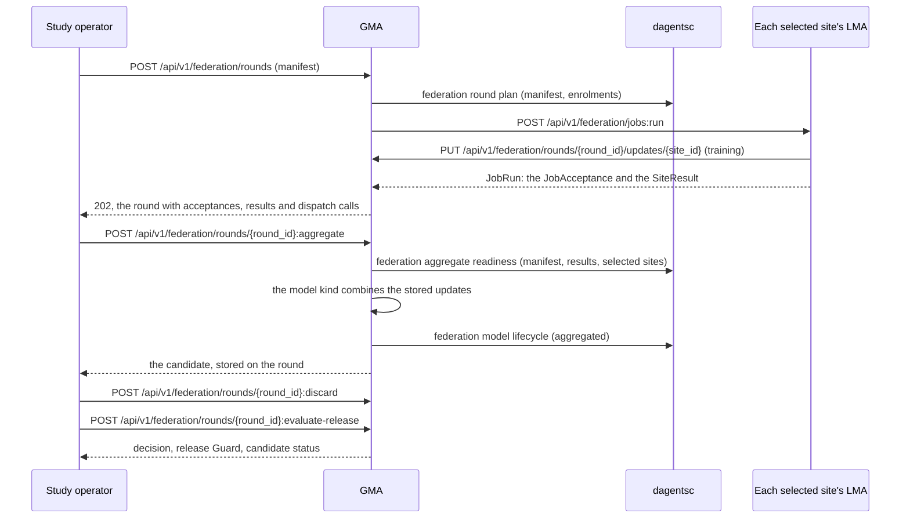

The status of a stored round, set by each endpoint:

| Endpoint | Status afterwards |
|---|---|
| Dispatch, quorum met | `dispatched` while the jobs run, then `collecting` |
| Dispatch, quorum not met | `closed` |
| Dispatch, the engine fails | `closed`, with the engine failure as `abandoned_reason` |
| Record a result | `collecting` (`dispatched` while the jobs run). Refused for `aggregated` and `closed` rounds |
| Check readiness | unchanged |
| Aggregate, when permitted | `aggregated` |
| Discard | `closed` when it was `dispatched` or `collecting`; otherwise unchanged |
| Evaluate the release | `closed` |

A round id can be used once. A result for a round that is `aggregated` or
`closed` is refused, so a late result cannot reopen a round, and a discarded
round cannot be aggregated.

### Plan a round

```api-endpoint
POST /api/v1/federation/rounds:plan
```

Sends the manifest and every stored enrolment to the planner
(`dagentsc federation round plan`) and returns the plan: the selected sites,
each excluded site with its reason, whether quorum is met, the participant
floor and the round digest. Nothing is stored and no site is contacted, so it
can be called any number of times. The planner reads no clock, so the same
manifest and enrolments always give the same plan, and the digest depends on
the manifest only.

In the first example five stores are invited and three are selected: store
west has not agreed to take part, and store central has no enrolment. The
second asks for five participants, so quorum is not met and `stop_reason` is
`quorum_not_met`.

**Errors.** `422` when a field fails validation, for example
`minimum_participants` below 1, or a `phase` or stop condition that is not in
the list. `503` (`planner_unavailable`) when the planner cannot be run or its
answer cannot be read, and when the manifest asks for `secure_aggregation`
without a `threshold`, because the planner then fails.

**Related.** [The RoundManifest object](#the-roundmanifest-object),
[the RoundPlan object](#the-roundplan-object),
[enrol a site](#gma-put-api-v1-federation-sites-site-id),
[dispatch the round](#gma-post-api-v1-federation-rounds),
[`dagentsc federation round plan`](dagentsc.md#dagentsc-federation-round-plan).

### Dispatch a round

```api-endpoint
POST /api/v1/federation/rounds
```

Plans the round as above, stores it under its `round_id` and, when quorum is
met, sends the job to the selected sites through the engine. The answer is the
stored [RoundRecord](#the-roundrecord-object). Without quorum the round is
stored as `closed`, offered to no site and has no results. With quorum the
round is stored as `dispatched` before the engine starts, so the update store
can check uploads against the plan while the jobs run. Then the sites' answers
to the offer (`acceptances`), their results and the engine's calls (`dispatch`)
are stored, sorted by site, and the round is `collecting`.

With the HTTP engine, as in the example "Dispatch an evaluation round to the
stores' LMAs", each selected store's LMA is offered the job and runs it, and
the planner calls listed with the example include the LMAs' own
(`federation round digest` and `governance restrict`). The HTTP engine collects
every result itself, so the GMA then asks the planner for the round's
[readiness](#the-aggregationreadiness-object) and stores it on the round: the
answer carries it, and a caller needs no
[readiness check](#gma-get-api-v1-federation-rounds-round-id-readiness) before
it aggregates. If that planner call fails, the round is closed and its updates
are deleted. The LMAs in one process that are offered the same round run the
planner once for its digest, and each compares the job's digest with it. In "Dispatch a training
round", store east has no LMA in the GMA's network: its offer fails, and its
result is `failed` with the reason.

A plain GMA's simulator has no site worker attached, so each selected site gets
a `failed` result with the evidence pointer
`unreachable://<site_id>#no worker is attached for this site`, as the example
"Dispatch round 1" shows. The sites then send their own results, which replace
these. An application that runs the controller in its own process attaches a
worker per site with `InProcessFederationEngine.register_worker`.

A round id can be used once: dispatching a manifest whose `round_id` is already
stored is refused with `409`, so the first round's results and decision stay.
When the engine fails, the round is closed with the failure as
`abandoned_reason`. The versioned path answers `202` and the short path `200`.
Both finish before they answer.

**Errors.** `409` (`conflict`) when the round id is already stored, or when the
HTTP engine finds that the round's model is not registered or does not match
`model_artifact_digest`. `422` when a field fails validation, for example a
stop condition that is not in the list. `503` as for planning.

**Related.** [Plan without dispatching](#gma-post-api-v1-federation-rounds-plan),
[record a result](#gma-post-api-v1-federation-rounds-round-id-results),
[the RoundRecord object](#the-roundrecord-object).

### List the rounds

```api-endpoint
GET /api/v1/federation/rounds
```

Returns the stored rounds, newest first by first dispatch, at most `limit` of
them. Each entry is a full round record, so the example is trimmed. `limit`
defaults to 20 and has no lower bound, but it counts differently from the other
lists on this page: `0` returns no rounds, and a negative number leaves out
that many of the oldest.

**Errors.** `422` when `limit` is not an integer.

**Related.** [Fetch a round](#gma-get-api-v1-federation-rounds-round-id),
[the RoundRecord object](#the-roundrecord-object).

### Fetch a round

```api-endpoint
GET /api/v1/federation/rounds/{round_id}
```

Returns the round's full record: the manifest, the plan, the sites' answers to
the offer, the results, the engine's calls, the readiness the aggregation
acted on, the candidate, the release decision, the reason a discard gave, the
times and the status. The record holds enough to trace a release back to the
round and the sites that took part, without any site's records or updates. It
reads memory only.

**Errors.** `404` with `unknown round: <round_id>` when no round has the id.

**Related.** [The RoundRecord object](#the-roundrecord-object),
[list the rounds](#gma-get-api-v1-federation-rounds).

### Record a site's result

```api-endpoint
POST /api/v1/federation/rounds/{round_id}/results
```

Stores the result in the round, replacing any earlier result from the same
`site_id`, sorts the results by site id, sets the status to `collecting` and
returns the round. The site must be one the plan selected, and the round must
not be `aggregated` or `closed`. Nothing else is checked here and no planner
command runs: a result with a wrong digest or a failed check is stored, and the
readiness check rejects it later, as the store east example shows. This
endpoint is for a GMA on the simulator, where the sites report outside the
engine. With the HTTP engine every result comes from the site's LMA during the
dispatch, so a posted result is refused: it could replace a site's metrics or
its example count, which set the planner's weights and the release Guard's
cohort.

A result carries no records and no model update: only counts, metrics, digests
and the norm of the update (see [the SiteResult object](#the-siteresult-object)).
The `before_send` boundary belongs to the site: `LocalFederatedWorker` passes
the update through the site's Guard before it builds the result. The GMA runs
no Guard on a result. Without tokens, any caller can send a result for a
selected site. The versioned path answers `202` and the short path `200`.

**Errors.** `400` when `round_id` in the body differs from the round in the
path. `403` (`forbidden`) when the plan did not select the site. `404` when no
round has the id. The message is in single quotes, such as
`'unknown round: returns-round-9'`, because it is the text of a Python
`KeyError`. `409` (`conflict`) when the round is `aggregated` or `closed`, and
for every round when the HTTP engine collects the results, as the examples "A
result for a round that was aggregated" and "A result posted to a round the
HTTP engine collects" show. `422` when a
field fails validation, for example a `participation` value that is not in the
list.

**Related.** [The SiteResult object](#the-siteresult-object),
[check readiness](#gma-get-api-v1-federation-rounds-round-id-readiness).

### Check whether a round may be aggregated

```api-endpoint
GET /api/v1/federation/rounds/{round_id}/readiness
```

Sends the manifest, every stored result and the plan's selected sites to the
planner (`dagentsc federation aggregate readiness`) and returns which results
count, why each other result does not, each counted site's weight, and whether
aggregation is permitted. A result from a site the plan did not select is
rejected with `site was not selected for this round`. Nothing is stored: the
aggregation saves the readiness it acts on.

In the first example stores north and south count, with weights 0.6 and 0.4
from their 60 and 40 examples, and store east is rejected because it did not
verify the code digest. The round without quorum has no results, so
aggregation is not permitted. `stop_reason` is `excessive_dropout` instead of
`quorum_not_met` when some sites reported `dropped` and the counted and dropped
sites together would have been enough. In the training round, store east is
rejected because its job failed.

**Errors.** `404` when no round has the id, with the message in single quotes
as above. `503` (`planner_unavailable`) when the planner cannot be run or its
answer cannot be read.

**Related.** [The AggregationReadiness object](#the-aggregationreadiness-object),
[aggregate the round](#gma-post-api-v1-federation-rounds-round-id-aggregate),
[`dagentsc federation aggregate readiness`](dagentsc.md#dagentsc-federation-aggregate-readiness).

### Aggregate a round into a candidate

```api-endpoint
POST /api/v1/federation/rounds/{round_id}:aggregate
```

Runs the readiness check and saves it. Then, only when aggregation is
permitted, it asks the engine to combine the results that count into a
candidate model, stores the candidate on the round, sets the round's status to
`aggregated` and returns the candidate. A round is aggregated once: a second
call, or a call for a `closed` round, is refused before the readiness check,
so the stored candidate and any decision made on it stay as they were. Every engine gives the weighted mean of
each metric that every counted site reported, and leaves out a metric that
only some sites reported.

- **HTTP engine, training round.** The model kind combines the stored updates
  with the planner's weights, as described [above](#federated-rounds). The
  candidate `<version_prefix>+<round_id>` is registered as a `candidate`
  through `dagentsc federation model lifecycle`, and its starting version
  becomes `superseded` when it was a candidate itself. `artifact_uri` is
  `registry://models/<version>` and `artifact_digest` the candidate's digest.
  The round's stored updates are deleted, whether the aggregation succeeds or
  not.
- **HTTP engine, analytics or evaluation round, and the simulator.** The
  candidate is named `<model_version>+<round_id>` and holds metrics only. The
  simulator's `artifact_uri` is `memory://candidates/<round_id>`, which names
  no file; the HTTP engine's is empty. `artifact_digest` is empty.

**Errors.** `404` when no round has the id, with the message in single quotes
as above. `409` (`aggregation_refused`) when aggregation is not permitted, with
the message `aggregation is not permitted for <round_id>: <stop reason>`, or
when a stored update is missing, changed or does not match the digest the site
reported. `409` (`conflict`) when the round was discarded, was aggregated
before, or is `closed`; a round without quorum is closed when it is
dispatched, as the example "Aggregate the round that had no quorum" shows.
`503` (`planner_unavailable`) when the planner cannot be run or its answer
cannot be read.

**Related.** [The CandidateModel object](#the-candidatemodel-object),
[ask the Guard about the release](#gma-post-api-v1-governance-restrictions-enforce),
[evaluate the release gates](#gma-post-api-v1-federation-rounds-round-id-evaluate-release).

### End a round and delete its updates

```api-endpoint
POST /api/v1/federation/rounds/{round_id}:discard
```

Gives up a round: records the reason, deletes the round's stored updates from
the [update store](#gma-update-store), and answers `204` with no body. A
`dispatched` or `collecting` round becomes `closed`, so it takes no more
results or updates, and an update that arrives later is refused. An
`aggregated` round keeps its status and its candidate. The first reason given
is kept in the round's `abandoned_reason`. Call it at the end of every training
round, in a `finally` block, so no site's update stays in the GMA's memory. No
planner command runs.

**Errors.** `404` with `unknown round: <round_id>` when no round has the id.
`422` when `reason` is missing, empty, only spaces or longer than 500
characters.

**Related.** [The DiscardRequest object](#the-discardrequest-object),
[store an update](#gma-put-api-v1-federation-rounds-round-id-updates-site-id).

### Evaluate the release gates

```api-endpoint
POST /api/v1/federation/rounds/{round_id}:evaluate-release
```

Decides on a round's candidate, saves the decision in the round, closes the
round and returns a [ReleaseEvaluation](#the-releaseevaluation-object): the
planner's decision, the release Guard's decision, the candidate's status in
the model registry, where the metrics came from and the baseline version. The
action is `reject` when a blocking gate does not pass, `another_round` when
only non-blocking gates do not pass, and `release` when every gate passes. A
gate whose metric is missing is `not_evaluated`, which counts as not passing.
The request picks one of two flows.

**The round flow** (the request names a `condition_id`). The GMA takes nothing
it decides with from the request body, in this order:

1. The body must not carry `gates`, `candidate_metrics` or `baseline_metrics`,
   and must name `release_requester` (`422` otherwise).
2. `candidate_version` must be the candidate the round produced (`409`).
3. The condition pack must be registered (`404`) and be the round's condition
   (`409`).
4. The candidate's metrics are the stored aggregate of `metrics_from_round`,
   which must have measured this candidate (`409`). The baseline metrics are
   the stored aggregate of `baseline_from_round`. A round that was not
   aggregated gives no metrics, so every gate is `not_evaluated` and a blocking
   gate rejects the candidate.
5. A round that already holds a release decision, or is `closed`, is refused
   (`409`) before the Guard runs, so a repeated request leaves no audit record.
6. The `before_release` Guard runs with the pack's classification and approved
   purposes, the requester and purpose from the request, the candidate's
   contributed examples as the cohort, and the model kind's
   `parameter_change` from `change_from_version` (default: the version the
   round started from) as the payload. The decision joins the GMA's audit
   chain.
7. The planner evaluates the pack's `release_gates`
   (`dagentsc federation release evaluate`).
8. When the registry holds the candidate, the planner's lifecycle rule
   (`dagentsc federation model lifecycle`, event `release_evaluated`) keeps it a
   `candidate` when the action is `release` and the Guard permitted it, and
   otherwise makes it `rejected`. The decision is stored with the version, with
   its `metrics_source` and the `baseline_version`: the version
   `baseline_from_round` measured, or the version released at the time.
9. The decision is saved on the round, which becomes `closed`.

`metrics_source` is `rounds` only on a GMA with the HTTP engine, which takes
every result from the sites' LMAs and refuses posted results. On the
simulator every result was posted by a caller, so the round flow records
`metrics_source: request`, and an approval is refused
(`metrics_not_from_rounds`).

The example "Evaluate the candidate's release from the study's own rounds"
reads the metrics from round returns-validate-1 and the baseline from round
returns-eval-1. Every gate passes, the Guard permits the release, and the
candidate stays a candidate, ready for
[approval](#gma-post-api-v1-model-versions-version-approve). A version that is
no longer a candidate is refused with `409` and `refusal: not_candidate`:
neither the round nor the registry stores anything, and only the Guard's audit
record stays.

**The bare flow** (no `condition_id`). The planner evaluates the `gates` in the
body against the `candidate_metrics` and `baseline_metrics` in the body, as the
GMA did before the round flow existed. No Guard runs, and the model registry
does not change, so metrics a caller sends can never lead to an approval:
`metrics_source` is `request`. A blocking gate on a missing metric rejects the
candidate, as the example "A blocking gate on a metric the candidate does not
report" shows. With no gates the action is `release`, so always send the gates.
When the round stored a candidate, `candidate_version` must be that candidate.

Either way `rollback_version` defaults to the manifest's `model_version`. A
round takes one release decision in either flow: a second evaluation answers
`409` and the first decision stays, as the example "Evaluate round 1 a second
time" shows.

**Errors.** `404` with `unknown round: <round_id>` when no round has the id,
and `404` (`not_found`) for an unknown condition pack, metrics round or
baseline round. `409` (`conflict`) as listed above; a refusal by the lifecycle
rule adds `refusal`. `422` when a field fails validation, for example a body
without `candidate_version`; this answer has no `code` and its `detail` lists
each field, as the example "A body that does not match the request model"
shows. `422` (`invalid_request`) for a round flow with gates or metrics in the
body or without `release_requester`. `503`
(`planner_unavailable`) when the planner cannot be run or its answer cannot be
read.

**Related.** [The ReleaseEvaluationRequest object](#the-releaseevaluationrequest-object),
[the ReleaseEvaluation object](#the-releaseevaluation-object),
[the ReleaseGate object](#the-releasegate-object),
[the ReleaseDecision object](#the-releasedecision-object),
[approve the candidate](#gma-post-api-v1-model-versions-version-approve),
[`dagentsc federation release evaluate`](dagentsc.md#dagentsc-federation-release-evaluate).

## GMA update store

```api-interface
service: gma
status: complete
code: dagents/gma/routes.py
classes:
- InMemoryUpdateStore (dagents/gma/infrastructure/update_store.py)
- ModelRegistry (dagents/gma/application/model_registry.py)
endpoints:
- PUT /federation/rounds/{round_id}/updates/{site_id}
- PUT /api/v1/federation/rounds/{round_id}/updates/{site_id}
```

Where a site's LMA puts its clipped model update while it runs a training job.
The store is write-only: no route reads an update back, and a
[SiteResult](#the-siteresult-object) never carries one. The HTTP engine reads
the updates when it [aggregates](#gma-post-api-v1-federation-rounds-round-id-aggregate)
the round, then deletes them; [discarding](#gma-post-api-v1-federation-rounds-round-id-discard)
the round deletes them too. Updates live in memory only: after a restart they
are gone, and an aggregation that needs them is refused.

### Store a site's update

```api-endpoint
PUT /api/v1/federation/rounds/{round_id}/updates/{site_id}
```

Stores one site's update for a training round and returns the store's digest
of it. The LMA calls it with the GMA `site` token bound to that site, while it
runs its job, and compares the digest with its own; a different digest refuses
the job at the site. The store checks the upload against the round as the GMA
stored it:

| Check | When it fails |
|---|---|
| The token is the `site` token of `site_id` | `403` |
| The round exists | `404` |
| The plan selected the site | `403` (`forbidden`) |
| The round is a training round that is `dispatched` or `collecting`, and was not discarded | `409` (`conflict`) |
| `job_digest` equals the plan's `round_digest` | `409` |
| No update from this site is stored for the round yet | `409` |
| The model kind of the round's starting model accepts the update: the parameter names it expects, each a finite number | `409` |

The digest comes from the model kind's `update_digest`. Aggregation computes
it again, so a stored update that changed is refused. No planner command runs.
In the example "Store an update, as a store's LMA does during its job", store
east's job failed during the dispatch, so the example stores its update by hand.

**Errors.** As in the table. `422` when the body is not valid: a key the body
does not define, or an update value that is not a finite number.

**Related.** [The UpdateUpload object](#the-updateupload-object),
[the UpdateReceipt object](#the-updatereceipt-object),
[run an accepted job](#lma-post-api-v1-federation-jobs-execute).

## Model versions

```api-interface
service: gma
status: complete
code: dagents/gma/routes.py
classes:
- ModelRegistry (dagents/gma/application/model_registry.py)
- InMemoryModelStore (dagents/gma/infrastructure/postgres_models.py)
- PostgresModelStore (dagents/gma/infrastructure/postgres_models.py)
endpoints:
- GET /model-versions
- GET /api/v1/model-versions
- GET /model-versions:released
- GET /api/v1/model-versions:released
- GET /model-versions/{version}
- GET /api/v1/model-versions/{version}
- PUT /model-versions/{version}
- PUT /api/v1/model-versions/{version}
- POST /model-versions/{version}:approve
- POST /api/v1/model-versions/{version}:approve
```

The GMA's **model registry** holds every model version a study uses: its
model kind, its parameters, their digest, its parent version, its status and
its latest release decision. The model kind computes the digest, and the
registry computes it again each time it loads a version's parameters, so a
changed version is refused (`409`). The path `/model-versions` is used because
`/models/run` and `/models/runs` already exist.

A version has one of four statuses, and at most one version is `released`: the
model the sites use. Every change of status comes from the planner's lifecycle
rule, [`dagentsc federation model lifecycle`](dagentsc.md#dagentsc-federation-model-lifecycle):

| Event | Endpoint | What the rule allows |
|---|---|---|
| `registered` | [Register a version](#gma-put-api-v1-model-versions-version) | `released` only when asked for and when no version is released; otherwise `candidate` |
| `aggregated` | [Aggregate a training round](#gma-post-api-v1-federation-rounds-round-id-aggregate) | The new version is a `candidate`; its parent becomes `superseded` when the parent was a candidate |
| `release_evaluated` | [Evaluate the release](#gma-post-api-v1-federation-rounds-round-id-evaluate-release), round flow | Stays a `candidate` when the gates decided `release` and the Guard permitted it; otherwise `rejected` |
| `approval_requested` | [Approve](#gma-post-api-v1-model-versions-version-approve) | The version becomes `released` and the released version `superseded` |

The registry is `InMemoryModelStore`, or `PostgresModelStore` with
`GMA_MODEL_TABLE`, which runs each change in one transaction as
`GMA_DATABASE_ROLE`.

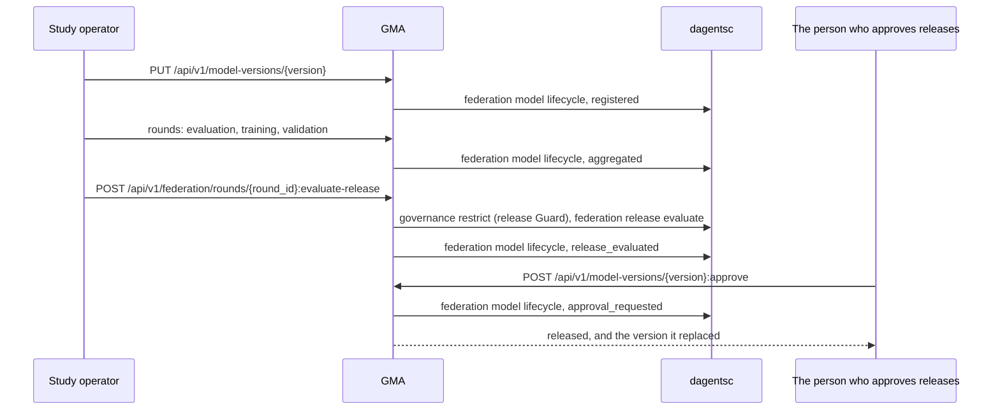

### List the model versions

```api-endpoint
GET /api/v1/model-versions
```

Returns the released version as `model_in_use` and the newest versions, newest
first, at most `limit` (1 to 200, default 20), without their parameters. Each
version carries its status and its latest release decision. It reads the
registry only and calls no planner command.

**Errors.** `422` when `limit` is outside 1 to 200. `401` and `403` for
tokens: it needs the `admin` token, as the examples without a token and with a
store's token show.

**Related.** [The ModelVersionList object](#the-modelversionlist-object),
[the ModelVersion object](#the-modelversion-object).

### Read the released version

```api-endpoint
GET /api/v1/model-versions:released
```

Returns the released version with its parameters, the model the sites use.
The model kind recomputes the digest before the answer, and the `ETag` header
is the digest, in quotes. A caller that sends the `ETag` back in
`If-None-Match` gets `304` with no body while the released version is
unchanged. An LMA calls it with its `site` token, as the example "Store north's
LMA asks whether the released version changed" shows, to read
[the model in use](#lma-get-api-v1-site-model). It reads the registry only.

**Errors.** `404` (`not_found`) when no version is released. `409` (`conflict`)
when the stored parameters do not match the stored digest.

**Related.** [The ModelVersion object](#the-modelversion-object),
[the model in use at a site](#lma-get-api-v1-site-model).

### Fetch one version

```api-endpoint
GET /api/v1/model-versions/{version}
```

Returns one version with its status and its latest release decision, without
its parameters. The example is the trained candidate after its release
evaluation: the decision holds the gate results, whether the Guard permitted
the release, the round, the baseline version and `metrics_source: rounds`. It
reads the registry only.

**Errors.** `404` (`not_found`) when no version has this name.

**Related.** [The ModelVersion object](#the-modelversion-object),
[the ModelReleaseDecision object](#the-modelreleasedecision-object).

### Register a version

```api-endpoint
PUT /api/v1/model-versions/{version}
```

Registers a version under a name the caller chooses (1 to 200 characters),
with its model kind and parameters. The model kind computes the digest and
refuses parameters it cannot run. The planner's lifecycle rule decides the
status: `released` only when the body asks for it and no version is released,
otherwise `candidate`. Registering the same content again changes nothing and
answers `200`, so an application can register its versions each time it
starts. The answer leaves out the parameters. The study registers its rule as
the model in use and the starting score as a candidate this way, before its
rounds.

**Errors.** `404` (`not_found`) when no extension contributes the model kind.
`409` (`conflict`) when the name holds different contents, when the model kind
refuses the parameters, or when the lifecycle rule refuses a release because
another version is released (`refusal: already_released`). `422`
(`invalid_request`) when the name is empty or too long, or the parameters are
not plain JSON; `422` without a `code`, with `detail` listing each field, for
a key the body does not define or a field of the wrong type.

**Related.** [The ModelVersionRegistration object](#the-modelversionregistration-object),
[the ModelVersion object](#the-modelversion-object).

### Approve a candidate

```api-endpoint
POST /api/v1/model-versions/{version}:approve
```

Releases a candidate, as the person who approves releases. The planner's
lifecycle rule checks the version's stored release decision, in this order,
and refuses with the first that fails:

| Check | `refusal` |
|---|---|
| The version has a release decision | `no_decision` |
| The gates decided `release` | `gates_decided` |
| The release Guard permitted it | `guard_denied` |
| Its metrics came from the study's rounds, not from a request | `metrics_not_from_rounds` |
| The version is a candidate | `not_candidate` |
| The version released now is the one the gates compared it with | `baseline_changed` |

When every check passes, the version becomes `released` and the version
released before becomes `superseded`, in one step of the store, and the answer
names both. Sites read the new version at
[`GET /api/v1/model-versions:released`](#gma-get-api-v1-model-versions-released).
Nothing is deployed.

**Errors.** `404` (`not_found`) when no version has this name. `409`
(`conflict`) with `refusal` when the lifecycle rule refuses, as the examples
show, and also when another approval changed the release meanwhile. `503`
(`planner_unavailable`) when the planner cannot be run.

**Related.** [The ApprovalResult object](#the-approvalresult-object),
[evaluate the release](#gma-post-api-v1-federation-rounds-round-id-evaluate-release).

## GMA extensions

```api-interface
service: gma
status: complete
code: dagents/gma/routes.py
classes:
- ExtensionRegistry (dagents/common/extensions/registry.py)
endpoints:
- GET /extensions
- GET /api/v1/extensions
```

The same summary as [the LMA's](#lma-extensions), read from the GMA's registry:
the one an application hands it, a registry of its own with the extensions
named in `GMA_EXTENSIONS`, or else the process-wide `default_registry`.

### List what extensions contribute to the GMA

```api-endpoint
GET /api/v1/extensions
```

Returns what the registered extensions contribute: the extensions, feature
contracts, data classifications, condition packs, pipeline steps, model
adapters, model kinds and site sources. It reads memory only. The GMA registers
no extension on its own, so a plain GMA returns empty lists, as in the example.
The release evaluation's round flow reads a condition pack's release gates,
classification and approved purposes, and the model registry and the HTTP
engine use the model kinds.

**Errors.** None of its own.

**Related.** [List the classifications](#gma-get-api-v1-governance-classifications),
[evaluate the release gates](#gma-post-api-v1-federation-rounds-round-id-evaluate-release),
[LMA extensions](#lma-extensions).

## Objects

The structures the agents' endpoints take and return. Their field descriptions
come from the classes each object names.

### The InlineSourceSpec object

```api-object
class: dagents.common.domain.sources.InlineSourceSpec
service: lma
example: lma register-inline-source /response/body
```

The simplest source: its records travel inside the definition. Use it for
tests, small reference tables, or records an application already holds. The
LMA, the GMA, the pipeline service and the model service accept the same four
source shapes at `POST /api/v1/sources`, and in `dataset.source`.

### The PostgresSourceSpec object

```api-object
class: dagents.common.domain.sources.PostgresSourceSpec
service: lma
example: lma get-source /response/body
```

A table, or a SQL query, in a PostgreSQL database. The adapter builds
`SELECT <columns> FROM <table> [WHERE ...] [ORDER BY ...] [LIMIT max_records]`
when `selection.sql` is empty, reads every row, then splits the rows into
batches. When the connection settings name a `role`, each query runs as that
role, inside one transaction that starts with `SET LOCAL ROLE`. See
[the LMA's sources](#lma-sources) for where the connection settings come from.

### The MongoSourceSpec object

```api-object
class: dagents.common.domain.sources.MongoSourceSpec
service: lma
```

A MongoDB collection. This version has no MongoDB client: reading the source
returns the documents in `options.documents`, or in the connection settings,
and fails when there are none.

### The ObjectStorageSourceSpec object

```api-object
class: dagents.common.domain.sources.ObjectStorageSourceSpec
service: lma
example: lma register-csv-source /response/body
```

A file of records. A relative path is read from the directory the service runs
in. A CSV file's values are strings, so a profile lists every CSV field as
categorical.

### The DatasetInput object

```api-object
class: dagents.common.domain.sources.DatasetInput
service: lma
example: lma profile-registered-source /request/json/dataset
```

The `dataset` field of a profile or model-run request. It names the records in
one of three ways. The first one set is used: `inline_records`, then `source`,
then `source_id`. An object with none of the three fails validation with `422`.

### The SourceValidationResult object

```api-object
class: dagents.common.domain.sources.SourceValidationResult
service: lma
example: lma validate-reserved-role /response/body
```

What `POST /api/v1/sources/{source_id}:validate` returns. The table in
[validate a source](#lma-post-api-v1-sources-source-id-validate) lists what
each kind of source checks.

### The DatasetProfile object

```api-object
class: dagents.common.domain.datasets.DatasetProfile
service: lma
example: lma profile-registered-source /response/body
```

Returned by the profile endpoints, and inside every model-run response as
`dataset_profile`. It describes the records' shape only: no values, minimums or
means.

### The ModelRunRecord object

```api-object
class: dagents.common.domain.datasets.ModelRunRecord
service: lma
example: lma run-model-job /response/body/run
```

The record a model run stores, returned as `run` in the model-run response and
listed by `GET /api/v1/model-jobs`. No model is trained in this version, so
`metrics` holds estimates and `artifact_uri` names a file that is not written.

### The BundleRecord object

```api-object
class: dagents.common.domain.control.BundleRecord
service: lma
example: lma list-bundles /response/body/0
```

A bundle as the LMA stores it after `POST /bundles/deploy`. The LMA keeps one
record per `bundle_id` and `bundle_version` pair.

### The RunRecord object

```api-object
class: dagents.common.domain.control.RunRecord
service: lma
example: lma run-bundle /response/body/run
```

A monitoring run as the LMA stores it after `POST /run`, and lists it at
`GET /runs`.

### The TelemetryEnvelope object

```api-object
class: dagents.common.domain.control.TelemetryEnvelope
service: lma
example: lma run-bundle /response/body/telemetry
```

What one monitoring run publishes. The LMA lists envelopes at `GET /telemetry`.
The GMA takes the same shape at its [telemetry endpoint](#agent-registry). The
LMA's stub runner always names the agent `lma-dev-1`.

### The DataClassification object

```api-object
class: dagents.common.domain.governance.DataClassification
service: lma
example: lma register-classification /response/body
```

A classification is policy, kept as data: changing a field's sensitivity
changes what the Guard returns without a code change. Every governance request
carries one in full, in `classification`; an LMA started for a site, and a GMA
with condition packs, refuse one that differs from the registered one. An
application contributes its classifications through an extension, or registers
them at runtime with `PUT /api/v1/governance/classifications/{classification_id}`,
which cannot replace an extension's.

### The RestrictionRequest object

```api-object
class: dagents.common.domain.governance.RestrictionRequest
service: lma
example: lma enforce-rows /request/json/request
```

The body of a plan request, and the `request` field of an enforce request. The
Ethical-Restriction Rails are the planner's governance rules
(`bindings/ocaml/lib/governance_compiler`). They read this object and return a
[RestrictionPlan](#the-restrictionplan-object). The `requester` is input to the
trust score, not proof of identity: the agent does not check it.

### The RestrictionPlan object

```api-object
class: dagents.common.domain.governance.RestrictionPlan
service: lma
example: lma plan-narrow /response/body
```

What the planner decided, before anything is applied. The plan endpoint returns
it, and the enforce endpoint returns it as `plan` inside the
[GuardDecision](#the-guarddecision-object). The same request always gets the
same plan.

### The GuardDecision object

```api-object
class: dagents.common.domain.governance.GuardDecision
service: lma
example: lma enforce-rows /response/body
```

What the enforce endpoint returns. Act on `permitted` and use only `payload`:
it holds the requested fields only, after each field's strategy.
`withheld_fields` and `transformed_fields` say which fields were removed or
changed, so a narrowed answer is not mistaken for a complete one.

### The AuditRecord object

```api-object
class: dagents.common.domain.governance.AuditRecord
service: lma
example: lma audit-log /response/body/records/1
```

One entry in the Guard's audit log, written for every enforcement, permitted or
denied. The example is the record of the clipped model update: it shows the
norm before (1.56) and after (1.0) clipping. Records are listed by
[read the audit log](#lma-get-api-v1-governance-audit).

### The GuardEnforcementRequest object

```api-object
class: dagents.lma.routes.GuardEnforcementRequest
service: lma
example: lma enforce-rows /request/json
```

What the enforce endpoints of both agents take: a
[RestrictionRequest](#the-restrictionrequest-object) and the records the
request would return. The Guard plans the request with the planner, applies
the plan to `payload` and returns a [GuardDecision](#the-guarddecision-object).
The GMA declares a class of the same name with the same fields.

### The ModelExecutionRequest object

```api-object
class: dagents.common.domain.datasets.ModelExecutionRequest
service: lma
example: lma run-model /request/json
```

What `POST /models/run` and `POST /api/v1/model-jobs` take on both agents. The
records come from `dataset` (a registered source) or from `records` in the
body. The agent profiles the records and records a run with estimated metrics.
It trains no model.

### The ModelExecutionResponse object

```api-object
class: dagents.common.domain.datasets.ModelExecutionResponse
service: lma
example: lma run-model /response/body
```

What a model run returns: the [DatasetProfile](#the-datasetprofile-object) of
the records it read and the [ModelRunRecord](#the-modelrunrecord-object) it
stored.

### The RegisterRequest object

```api-object
class: dagents.common.domain.control.RegisterRequest
service: gma
example: gma register /request/json
```

The body of a [registration](#gma-put-api-v1-agents-agent-id-registration).
The GMA keeps its four fields on the agent's record and copies `capabilities`
into the answer. On the versioned path, the id in the path replaces
`agent.agent_id`.

### The AgentSnapshot object

```api-object
class: dagents.common.domain.control.AgentSnapshot
service: gma
example: gma get-agent /response/body
```

It holds the identity and scope from the agent's registration, the state from
its last heartbeat, the id of its last telemetry envelope, and the bundle it
should run next to the bundle it last reported. The
[agent list and lookup](#agent-registry) return it. A field the agent never
reported is `null`, and an agent that a heartbeat or a deployment sync added
has the version `unknown`.

### The DeploymentPlan object

```api-object
class: dagents.common.domain.control.DeploymentPlan
service: gma
example: gma plan-deployment /response/body
```

The GMA keeps one per agent. A deployment tool reads `bundle_uri` and `config`, installs the bundle, and the agent then reports
it with a [deployment sync](#gma-post-api-v1-agents-agent-id-deployment-sync).
`plan_token` and `config_digest` change whenever the bundle, its address or its
config changes, so a tool can tell whether the plan it holds is current.

### The DeploymentSyncResponse object

```api-object
class: dagents.common.domain.control.DeploymentSyncResponse
service: gma
example: gma sync-behind /response/body
```

The answer to a deployment sync. `up_to_date: false` means the agent should
install the bundle the answer names.

### The DispatchedRun object

```api-object
class: dagents.common.domain.control.DispatchedRun
service: gma
example: gma list-dispatches /response/body/0
```

[Dispatch a run](#gma-post-runs-dispatch) stores it, and
[list the dispatches](#gma-get-runs-dispatch) returns it. Its status is
`QUEUED` and does not change in this version.

### The TelemetrySummary object

```api-object
class: dagents.common.domain.control.TelemetrySummary
service: gma
example: gma telemetry-summary /response/body/0
```

[`GET /telemetry/summary`](#gma-get-telemetry-summary) returns one per agent.
`metric_totals` adds every value of a key, whatever the metric means.

### The FleetOverview object

```api-object
class: dagents.common.domain.control.FleetOverview
service: gma
example: gma overview /response/body
```

The five counts [`GET /overview`](#gma-get-overview) returns.

### The SiteRegistration object

```api-object
class: dagents.common.domain.federation.SiteRegistration
service: gma
example: gma enrol-north /response/body
```

The site or an operator declares it at
[enrol a site](#gma-put-api-v1-federation-sites-site-id), or the GMA reads it
from each LMA's [registration](#lma-get-api-v1-federation-registration) in a
[site refresh](#gma-post-api-v1-federation-sites-refresh). The planner compares
it with each round's manifest: `enrolled`, `capabilities`,
`feature_contract_version`, `approved_conditions` and `cohort_size` are
eligibility checks, and `policy_version` is stored only.

### The SiteAddressState object

```api-object
class: dagents.common.domain.federation.SiteAddressState
service: gma
example: gma site-address-accepted /response/body
```

Where the GMA's address for one site's LMA came from: `GMA_SITE_ENDPOINTS` at
start (`configured`) or the study operator while the GMA runs (`joined`). It
never holds the address. It is the answer of
[give the GMA a site's address](#gma-put-api-v1-federation-sites-site-id-address).

### The SiteAddressList object

```api-object
class: dagents.common.domain.federation.SiteAddressList
service: gma
example: gma joined-site-addresses /response/body
```

The answer of [list the site addresses](#gma-get-api-v1-federation-site-addresses):
the sites that may join and every address the GMA holds, by source. Both lists
are empty on a GMA with no HTTP network.

### The RoundManifest object

```api-object
class: dagents.common.domain.federation.RoundManifest
service: gma
example: gma plan-round /request/json
```

It is the body of the plan and dispatch requests, and every site's job carries
it. The round digest covers every field, with
`required_capabilities`, `stop_conditions` and `invited_sites` sorted first, so
their order does not change the digest but any other change does. Only
`round_id`, `study_id`, `condition_id`, `model_version` and
`feature_contract_version` are required.

### The AggregationMethod object

```api-object
class: dagents.common.domain.federation.AggregationMethod
service: gma
example: gma plan-round /response/body/aggregation
```

The `aggregation` field of a manifest and a plan. In this version only
`secure_aggregation` changes what the planner decides. The plan shows the
method with the planner's defaults filled in: `mu` 0.01 for `fedprox` and
`optimizer` `adam` for `fedopt`. A `secure_aggregation` method needs its
`threshold`: without it the planner fails and the round endpoints answer `503`.

### The RoundPlan object

```api-object
class: dagents.common.domain.federation.RoundPlan
service: gma
example: gma plan-round /response/body
```

The planner's answer for one manifest: which sites may join, why the others may
not, and whether there are enough. [Plan a round](#gma-post-api-v1-federation-rounds-plan)
returns it, and a dispatched round stores it as `plan`.

### The SiteResult object

```api-object
class: dagents.common.domain.federation.SiteResult
service: gma
example: gma submit-north /request/json
```

It is the body of
[record a result](#gma-post-api-v1-federation-rounds-round-id-results), and
what an LMA's [execute](#lma-post-api-v1-federation-jobs-execute) returns. It
holds no subject identifier, no record and no model update. A site that trains
sends its clipped update to the GMA's [update store](#gma-update-store) and
reports only the update's norm and digest here, because results are shown to
the coordinator. A refused or failed job gives its reason in `refusal_reason`.
The readiness check decides whether a result counts; the
[round rules](#federated-rounds) list its checks.

### The AggregationReadiness object

```api-object
class: dagents.common.domain.federation.AggregationReadiness
service: gma
example: gma readiness /response/body
```

The planner makes it from the manifest, the stored results and the plan's
selected sites. [Check readiness](#gma-get-api-v1-federation-rounds-round-id-readiness)
returns it without saving it; aggregation runs it first and saves it in the
round as `readiness`.

### The CandidateModel object

```api-object
class: dagents.common.domain.federation.CandidateModel
service: gma
example: gma aggregate-training /response/body
```

[Aggregation](#gma-post-api-v1-federation-rounds-round-id-aggregate) produces
it and stores it on the round. It may be released later, after the release
gates and a person's approval; it is never a release itself. The example is the
candidate of a training round: the HTTP engine combined the stores' updates and
registered the result in the [model registry](#model-versions), so
`artifact_digest` is its digest. A candidate of an analytics or evaluation
round holds metrics only.

### The ReleaseGate object

```api-object
class: dagents.common.domain.federation.ReleaseGate
service: gma
example: gma evaluate-release /request/json/gates/1
```

A caller sends gates in the `gates` of a
[release evaluation](#gma-post-api-v1-federation-rounds-round-id-evaluate-release).
An application usually ships its gates in a condition pack. The example is not
blocking: if recall does not beat the baseline by 0.02, the planner asks for
another round instead of rejecting the candidate.

### The GateResult object

```api-object
class: dagents.common.domain.federation.GateResult
service: gma
example: gma evaluate-release-missing-metric /response/body/decision/gate_results/2
```

A [ReleaseDecision](#the-releasedecision-object) holds one per gate, in the
order of the request. The example is a gate on a metric the candidate does not report: it is not
evaluated, and because it is blocking, the candidate is rejected.

### The ReleaseDecision object

```api-object
class: dagents.common.domain.federation.ReleaseDecision
service: gma
example: gma evaluate-release-round-flow /response/body/decision
```

The planner makes it. The
[release evaluation](#gma-post-api-v1-federation-rounds-round-id-evaluate-release)
returns it as `decision` and saves it in the round. A `release` action is a recommendation to
the people who approve releases; nothing in Dagents deploys the candidate.

### The RoundRecord object

```api-object
class: dagents.common.domain.federation.RoundRecord
service: gma
example: gma get-training-round /response/body
```

The dispatch, result, fetch and list endpoints return it. It is everything the
GMA stores about one round, its lineage: the model version the round started
from, the plan, each site's answer to the offer, each site's result, the calls
the engine made, the readiness the aggregation acted on, the candidate, the
release decision and the reason a discard gave. It holds no site's records and
no update. The example is the training round of the study, after its
aggregation and discard.

### The ReleaseEvaluationRequest object

```api-object
class: dagents.common.domain.federation.ReleaseEvaluationRequest
service: gma
example: gma evaluate-release-round-flow /request/json
```

What [evaluate the release gates](#gma-post-api-v1-federation-rounds-round-id-evaluate-release)
takes. In the round flow, as in the example, it names the condition pack, the
round that measured the candidate, the round that measured the baseline and the
release requester; the gates and the metrics come from the GMA's own records.
In the bare flow it carries the gates, the candidate's metrics and, for a gate
that asks for an improvement, the current model's metrics. Either way a gate
whose metric is missing blocks the release.

### The SiteInfo object

```api-object
class: dagents.common.domain.site.SiteInfo
service: lma
example: lma site-info /response/body
```

What [describe the site](#lma-get-api-v1-site) returns: who the site is, what
its LMA serves and where its records come from. `source` names the source's
kind, its location and the role that reads it, never a host or a connection
string. `source_version` changes whenever the records change.

### The SiteSummary object

```api-object
class: dagents.common.domain.site.SiteSummary
service: lma
example: lma site-summary /response/body
```

What a site reports about its records: counts, and the label rate only when
the site's planner permits it. `label_rate_status` says why a rate is missing;
[the site's summary](#lma-get-api-v1-site-summary) lists each status. The GMA
reads it for its [site summaries](#gma-get-api-v1-federation-sites-summaries).

### The SourceState object

```api-object
class: dagents.common.domain.site.SourceState
service: lma
example: lma source-refresh /response/body
```

What [a refresh](#lma-post-api-v1-site-source-refresh) returns: the record
count and the source's version after the LMA asked the source again.

### The ModelInUse object

```api-object
class: dagents.common.domain.site.ModelInUse
service: lma
example: lma site-model /response/body
```

The released model as a site's LMA read it from the GMA, after the model kind
checked that the parameters match the digest. It holds the parameters, so only
the site's own staff may read it.

### The LocalEvaluation object

```api-object
class: dagents.common.domain.site.LocalEvaluation
service: lma
example: lma site-model-evaluate /response/body
```

The model in use measured on a site's own labelled records, inside the LMA.
Only the metrics leave the LMA.

### The ProbeRequest object

```api-object
class: dagents.common.domain.site.ProbeRequest
service: lma
example: lma probe-rows /request/json
```

What [the Guard probe](#lma-post-api-v1-governance-restrictions-probe) takes.
It has no classification and no approved purposes: the LMA adds the site's
own, so a caller cannot choose the policy it is checked against. An unknown
key is refused with `422`.

### The ProbeResponse object

```api-object
class: dagents.common.domain.site.ProbeResponse
service: lma
example: lma probe-rows /response/body
```

What the Guard would release: the decision, the plan, how many rows and which
field names, and which fields it withheld or changed. It never holds a row. The
decision is in the site's audit chain under `audit_id`.

### The AuditSummary object

```api-object
class: dagents.common.domain.site.AuditSummary
service: lma
example: lma audit-summary /response/body
```

An audit chain's state and length, without its records. An LMA returns its
site's at [`GET /api/v1/governance/audit:summary`](#lma-get-api-v1-governance-audit-summary),
and the GMA returns its own at
[`GET /api/v1/governance/audit:summary`](#gma-get-api-v1-governance-audit-summary).

### The JobLogEntry object

```api-object
class: dagents.common.domain.site.JobLogEntry
service: lma
example: lma job-log /response/body/1
```

One line of a site's [job log](#lma-get-api-v1-federation-jobs): a job the site
refused at the offer, or the result of a job it ran. It holds what the site
returned to the GMA, and the reason for a refusal; never a record or an update.

### The FederatedJob object

```api-object
class: dagents.common.domain.federation.FederatedJob
service: lma
example: lma offer-job /request/json
```

The job a GMA sends a site, to [run](#lma-post-api-v1-federation-jobs-run) it
in one call, or to [offer](#lma-post-api-v1-federation-jobs-offer) it and then
[execute](#lma-post-api-v1-federation-jobs-execute) it. It carries the round's
manifest, the round digest the planner computed for it, the task of the
round's phase and the round's starting model in `parameters.model`. The site
checks every part before it reads any data.

### The JobModel object

```api-object
class: dagents.common.domain.federation.JobModel
service: lma
example: lma offer-job /request/json/parameters/model
```

The model a job carries, read from the GMA's model registry: its version, its
model kind, its parameters and their digest. The site's model kind computes
the digest again and refuses a job whose parameters do not match.

### The JobAcceptance object

```api-object
class: dagents.common.domain.federation.JobAcceptance
service: lma
example: lma offer-job /response/body
```

A site's answer to a job offer. `accepted: false` is a refusal, with the
reason; the GMA stores each answer in the round's `acceptances`.

### The JobRun object

```api-object
class: dagents.common.domain.federation.JobRun
service: lma
example: lma run-job /response/body
```

A site's answer to [`jobs:run`](#lma-post-api-v1-federation-jobs-run): its
answer to the offer and, for a job it accepted, the result of running it.

### The SiteDirectoryEntry object

```api-object
class: dagents.common.domain.site.SiteDirectoryEntry
service: gma
example: gma site-summaries /response/body/0
```

What the GMA knows about one configured site from its LMA: whether the LMA
answered, the kind of its source, its [summary](#the-sitesummary-object) and,
when asked, its [audit summary](#the-auditsummary-object). It holds no row.

### The DispatchCall object

```api-object
class: dagents.common.domain.federation.DispatchCall
service: gma
example: gma dispatch-http /response/body/dispatch/0
```

One call the GMA made to a site's LMA during a dispatch: the site, the step
(`run` for the HTTP engine's one call per site; `offer` or `execute` for the
two-call form), the status the LMA answered with (null when no answer came),
how long it took and what it came to. A round's `dispatch` lists them in the
order the calls finished.

### The UpdateUpload object

```api-object
class: dagents.common.domain.federation.UpdateUpload
service: gma
example: gma upload-update /request/json
```

What a site's LMA sends the [update store](#gma-update-store): the round
digest from its job and the clipped update, by parameter name. Each value must
be a finite number, and an unknown key is refused with `422`.

### The UpdateReceipt object

```api-object
class: dagents.common.domain.federation.UpdateReceipt
service: gma
example: gma upload-update /response/body
```

The update store's answer: its digest of the stored update, computed by the
model kind. The site compares it with its own digest of what it sent.

### The DiscardRequest object

```api-object
class: dagents.gma.domain.models.DiscardRequest
service: gma
example: gma discard-training /request/json
```

Why a round is given up, in words. The round keeps the first reason in
`abandoned_reason`.

### The ModelVersion object

```api-object
class: dagents.common.domain.federation.ModelVersion
service: gma
example: gma released-model /response/body
```

One version in the GMA's [model registry](#model-versions): its name, model
kind, digest, status, parent version, when it was registered and its latest
release decision. `params` is filled only by
[`GET /api/v1/model-versions:released`](#gma-get-api-v1-model-versions-released),
as in the example; every other endpoint leaves it null.

### The ModelVersionRegistration object

```api-object
class: dagents.common.domain.federation.ModelVersionRegistration
service: gma
example: gma register-start /request/json
```

What [register a version](#gma-put-api-v1-model-versions-version) takes: the
model kind, the parameters and the status asked for. An unknown key is refused
with `422`.

### The ModelVersionList object

```api-object
class: dagents.common.domain.federation.ModelVersionList
service: gma
example: gma list-model-versions /response/body
```

The released version and the newest versions, without their parameters.

### The ModelReleaseDecision object

```api-object
class: dagents.common.domain.federation.ModelReleaseDecision
service: gma
example: gma get-model-version /response/body/release_decision
```

The release decision stored with a model version: what the gates decided,
whether the release Guard permitted it, each gate's result, the round, the
baseline version and where the metrics came from. [Approval](#gma-post-api-v1-model-versions-version-approve)
reads it, and refuses a version whose decision is missing, is not `release`,
was denied by the Guard, took its metrics from a request, or was compared with
a version that is no longer released.

### The ReleaseEvaluation object

```api-object
class: dagents.common.domain.federation.ReleaseEvaluation
service: gma
example: gma evaluate-release-round-flow /response/body
```

What [evaluate the release](#gma-post-api-v1-federation-rounds-round-id-evaluate-release)
returns: the planner's [decision](#the-releasedecision-object), the release
Guard's decision (null in the bare flow), the candidate's status in the
registry after the evaluation, where the metrics came from (`rounds` or
`request`) and the baseline version.

### The ReleaseGuardCheck object

```api-object
class: dagents.common.domain.federation.ReleaseGuardCheck
service: gma
example: gma evaluate-release-round-flow /response/body/guard
```

The release Guard's decision in a round-flow release evaluation: whether it
permitted the release, its plan, the id of its record in the GMA's audit chain
and its message. In the example the release committee is trusted, and the
plan narrows the model update with `clip_contribution:1`.

### The ApprovalResult object

```api-object
class: dagents.common.domain.federation.ApprovalResult
service: gma
example: gma approve /response/body
```

What an [approval](#gma-post-api-v1-model-versions-version-approve) changed:
the version now released, and the version it replaced, now `superseded`.
