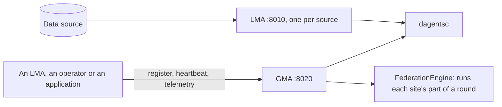
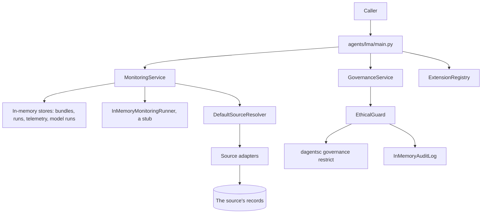
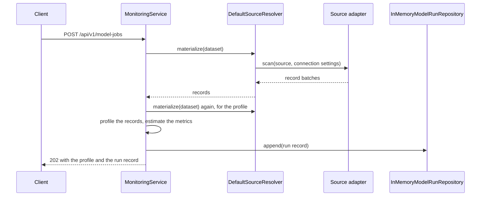
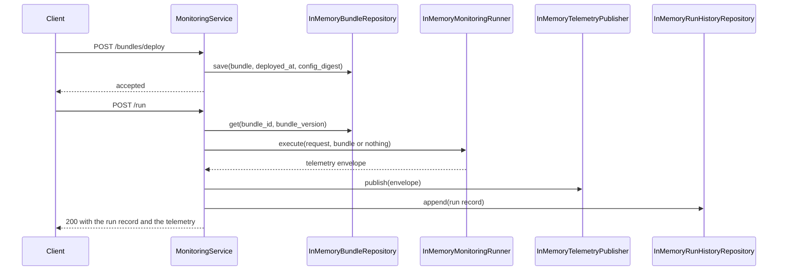
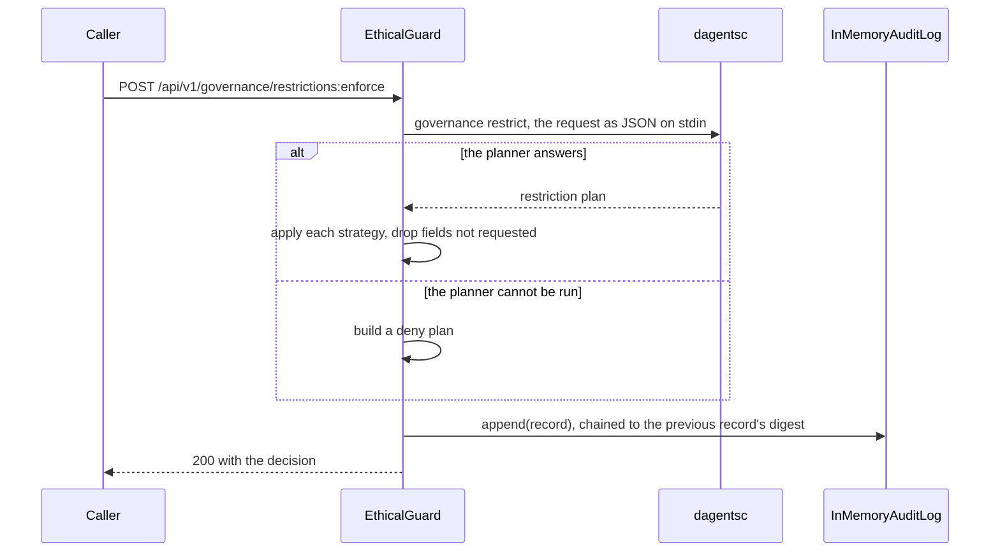
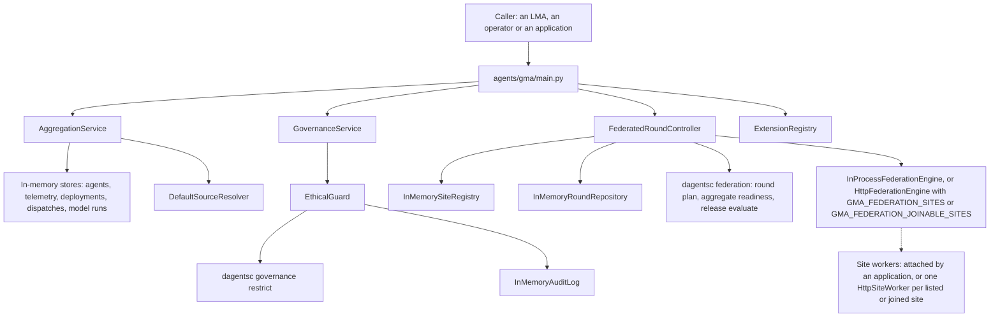
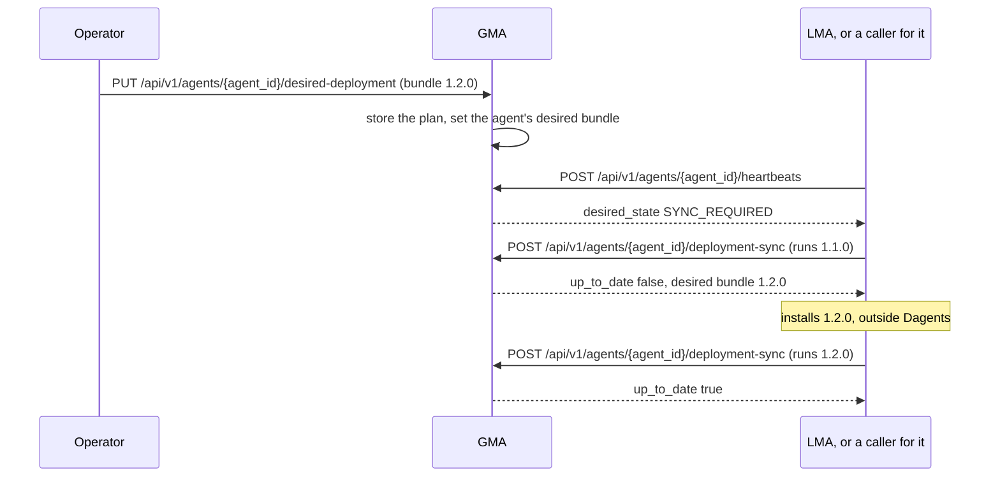
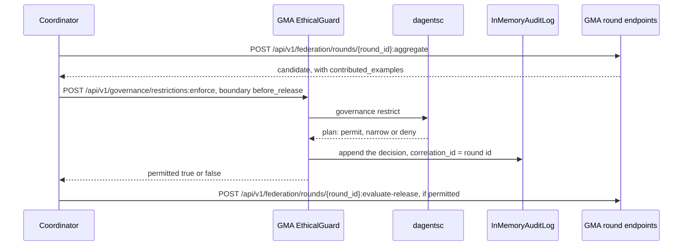
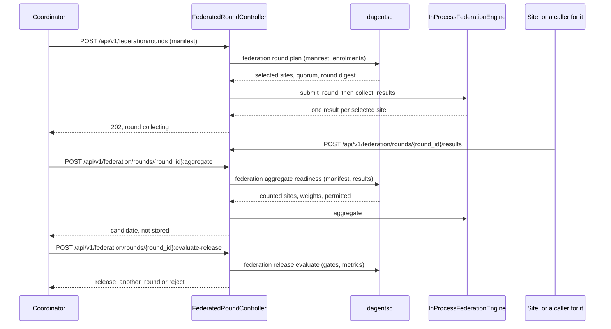

# Agents

Dagents runs two kinds of agent. Both are FastAPI apps.

| Agent | Code | Port | What it is for |
|---|---|---|---|
| LMA, the local monitoring agent | `agents/lma/` | 8010 | One per data source (a tenant, database, service, event stream or environment). It profiles the source's data, runs local models and monitoring bundles, publishes telemetry, and applies the Guard at three of the four boundaries: before data is read, before training and before anything is sent. |
| GMA, the global monitoring agent | `agents/gma/` | 8020 | The coordinator. It registers LMAs, keeps their telemetry and desired deployments, runs aggregate models, plans and records federated rounds, and decides releases. Its Guard stands at the fourth boundary, before a release. |

Both agents use the same layout: `domain/` for typed models with no I/O,
`application/` for the use cases, `adapters/` and `infrastructure/` for the
storage and delivery behind interfaces, and `main.py` for the routes. They keep
everything in memory in this version.

The governance and federation code is shared, in `agents/common/`:
`GovernanceService` and the `EthicalGuard` behind the governance endpoints of
both agents, and `FederatedRoundController` behind the GMA's federation
endpoints. Each asks the planner, `dagentsc`, for every decision
([dagentsc](dagentsc.md)), and the Guard denies a request when the planner
cannot be reached.

Each agent serves short paths (`/health`, `/models/run`) and versioned paths
(`/api/v1/health`, `/api/v1/model-jobs`). Most versioned paths run the same
handler as a short twin, and the page shows the pair on one card. Some paths
have no twin; the [overview](overview.md#versions-and-paths) lists them.



In this version a caller sends each request to the agent it is for. The GMA
runs the sites' part of a federated round through an engine. By default that is
`InProcessFederationEngine`, a simulator in the GMA's own process. When
`GMA_FEDERATION_SITES` lists the sites, it is `HttpFederationEngine`, which
sends each round's job to each site's service over HTTP. A deployment can
replace either with an adapter for a federated runtime.

The [Spring control service](spring-services.md) serves the GMA's agent
registry paths again for JVM applications. The healthcare demo runs the same
shared classes in its own process by default. In its split mode it calls this
GMA, which sends round jobs to one service per hospital
([Demo apps](demo-apps.md)).

## The local monitoring agent

The local monitoring agent (LMA) runs next to one data source, such as one
store's order database. It reads that source's records, profiles them, records
model runs over them, runs monitoring bundles, and answers governance requests
through the Ethical Guard. A deployment runs one LMA per source.

| | |
|---|---|
| Code | `agents/lma/`: the routes in `main.py`, the wiring in `di.py`, the use cases in `application/monitoring_service.py`, the stores in `infrastructure/` and the run stub in `adapters/runner.py` |
| Shared code it serves | `agents/common/`: sources (`infrastructure/sources.py`), profiles and model runs (`application/ml_orchestration.py`), governance (`application/governance_service.py`, `application/ethical_guard.py`) and extensions (`extensions/registry.py`) |
| Port | 8010 (`LMA_API_PORT` in `env/.env.lma`) |
| Settings | `env/.env.shared`, then `env/.env.lma`. A variable already set in the environment wins. |
| Planner | `dagentsc governance restrict`, called by the plan and enforce endpoints only |
| Start it | `PYTHONPATH=. .venv/bin/uvicorn agents.lma.main:app --port 8010`, from the repository root, with `DAGENTSC_BIN` set ([how](overview.md#run-a-service-to-try-the-examples)) |
| Its own docs | `http://127.0.0.1:8010/docs` and `/openapi.json` |

How the LMA relates to the other modules:

- **It calls no other service.** `LMA_GMA_ENDPOINT` is read when the LMA starts
  but is not used in this version. To make the GMA aware of an LMA, a caller
  registers it through the [agent registry](#agent-registry).
- **It calls the planner for governance only.** The plan and enforce endpoints
  run [`dagentsc governance restrict`](dagentsc.md#dagentsc-governance-restrict).
  The source, profile, model-run and bundle endpoints call no planner command.
- **The core service knows its address.** The core service lists the LMA in its
  [catalog](framework-services.md#core-service-get-api-v1-services), and its
  [workload compiler](framework-services.md#workload-compiler) can render the
  Kubernetes objects that run an LMA.
- **Applications can run its code in process.** The healthcare demo creates a
  `GovernanceService` and a `LocalFederatedWorker` for each hospital inside its
  own backend, without calling the LMA over HTTP ([Demo apps](demo-apps.md)).



### What the LMA stores

The LMA keeps everything in memory, so a restart clears it.

| What | Class | Written by | Read by |
|---|---|---|---|
| Deployed bundles, one per id and version | `InMemoryBundleRepository` | `POST /bundles/deploy` | `GET /bundles`, `POST /run`, the health check |
| Monitoring runs | `InMemoryRunHistoryRepository` | `POST /run` | `GET /runs`, the health check |
| Telemetry, one envelope per run | `InMemoryTelemetryPublisher` | `POST /run` | `GET /telemetry` |
| Model runs | `InMemoryModelRunRepository` | `POST /api/v1/model-jobs` | `GET /api/v1/model-jobs`, the health check |
| Source definitions | `InMemorySourceCatalog`, inside `DefaultSourceResolver` | `POST /api/v1/sources` | The source endpoints, and profiles and model runs that name a `source_id` |
| Data classifications added at runtime | `GovernanceService` | `PUT /api/v1/governance/classifications/{classification_id}` | `GET /api/v1/governance/classifications` |
| Guard decisions | `InMemoryAuditLog` | `POST /api/v1/governance/restrictions:enforce` | `GET /api/v1/governance/audit` |

### Limits of the LMA in this version

- The profile and model-run endpoints read records without the Guard. To give
  a reader only what the Guard permits, call
  [enforce](#lma-post-api-v1-governance-restrictions-enforce) first and send
  the `payload` it returns as `dataset.inline_records`.
- Model runs train no model. Their metrics are estimates computed from the
  record count and the model family.
- The monitoring runner is a stub. It does not fetch or run the bundle. It
  publishes two counts.

## LMA health

```api-interface
service: lma
status: complete
code: agents/lma/main.py
classes:
- MonitoringService (agents/lma/application/monitoring_service.py)
endpoints:
- GET /health
- GET /api/v1/health
```

The liveness check. `MonitoringService.health_payload` counts what the LMA
holds in memory and names the bundle deployed last.

### Check the agent's health

```api-endpoint
GET /api/v1/health
```

Returns `ok` with counts of the deployed bundles, the monitoring runs and the
model runs, and the bundle deployed last as `active_bundle`. It reads memory
only. It calls no other service and no planner command, so it answers whenever
the process runs, even without `dagentsc`. The Docker health check of the LMA
container calls `GET /health` every 30 seconds. Nothing is stored.

`active_bundle` is only the newest deploy. Each run names its own bundle, so a
run can use an older one. Sources, classifications and audit records are not
counted here.

**Errors.** None of its own.

**Related.** [Deploy a bundle](#lma-post-bundles-deploy),
[run a bundle](#lma-post-run), [list the model runs](#lma-get-api-v1-model-jobs).

## LMA sources

```api-interface
service: lma
status: complete
code: agents/lma/main.py
classes:
- MonitoringService (agents/lma/application/monitoring_service.py)
- DefaultSourceResolver (agents/common/infrastructure/sources.py)
endpoints:
- GET /api/v1/sources
- POST /api/v1/sources
- GET /api/v1/sources/{source_id}
- POST /api/v1/sources/{source_id}:validate
```

A **source definition** says where a set of records lives and how to read it.
The LMA stores definitions in memory, keyed by `source_id`, and reads a source
when a profile or a model run names it in `dataset.source_id`
([profiling and model runs](#lma-dataset-profiling-and-model-runs)).
Registering a source does not read it, and neither does validating it.

`DefaultSourceResolver` picks the adapter by the definition's `kind`:

- **`inline`** reads `selection.records`, sent inside the definition.
- **`postgres`** reads a table, or the SQL in `selection.sql`, through psycopg.
  `options.rows` returns fixed rows instead of querying.
  `connection_ref.options.role` runs each query as that role, with
  `SET LOCAL ROLE` in the same transaction.
- **`mongodb`** reads the documents in `options.documents`, or in the
  connection settings. There is no MongoDB client in this version: `filter`,
  `projection` and `sort` are stored but not applied.
- **`object_storage`** reads a local file: a path or a `file://` URI. `json`,
  `jsonl` and `csv` are read, and `parquet` fails. CSV values are strings, so a
  profile lists every CSV field as categorical.

Connection settings come from two places. The connection resolver
(`InMemoryConnectionResolver`) maps `connection_ref.connection_id` to settings,
and `connection_ref.options` is merged over them. The LMA's resolver starts
empty and no endpoint adds to it, so in practice a Postgres source's settings
come from `connection_ref.options`. Only `host`, `port`, `dbname` (or
`database`), `user` (or `username`), `password`, `sslmode` and
`connect_timeout` are passed to the driver. A setting left out falls back to
libpq's defaults and the `PG*` variables of the LMA's environment.

These endpoints have no authentication, like the rest of the LMA. A caller that
can reach port 8010 can register a Postgres source with its own host, login and
SQL. A later profile or model run that names the source makes the LMA connect
and run that SQL. Run the LMA on a private network.

### List the registered sources

```api-endpoint
GET /api/v1/sources
```

Returns every stored source definition, sorted by `source_id`. It reads memory
only and calls no adapter. With nothing registered it returns `[]`.

**Errors.** None of its own.

**Related.** [Register a source](#lma-post-api-v1-sources),
[fetch one source](#lma-get-api-v1-sources-source-id).

### Register a source

```api-endpoint
POST /api/v1/sources
```

Checks that the body is one of the four source definitions, stores it under its
`source_id` and returns it with every default filled in. A source with the same
id is replaced. Registration reads no records, opens no connection and calls no
planner command.

The handler takes the body as a plain JSON object and validates it itself, with
pydantic's `TypeAdapter`. So a JSON object that is not a valid definition, such
as one with an unknown `kind` or a Postgres source without `selection`, fails
with `500` and the plain-text body `Internal Server Error`, not with `422`.

**Errors.** `422` when the body is not a JSON object, for example a JSON list.
`500` when the object is not a valid source definition, as above.

**Related.** [The InlineSourceSpec object](#the-inlinesourcespec-object),
[the PostgresSourceSpec object](#the-postgressourcespec-object),
[the MongoSourceSpec object](#the-mongosourcespec-object),
[the ObjectStorageSourceSpec object](#the-objectstoragesourcespec-object),
[validate the source](#lma-post-api-v1-sources-source-id-validate),
[profile it](#lma-post-api-v1-datasets-profile).

### Fetch one source

```api-endpoint
GET /api/v1/sources/{source_id}
```

Returns the stored definition with this `source_id`. It reads memory only. When
no source has the id, the answer is `200` with the body `null`, not `404`.

**Errors.** None of its own.

**Related.** [List the sources](#lma-get-api-v1-sources),
[register a source](#lma-post-api-v1-sources).

### Validate a source

```api-endpoint
POST /api/v1/sources/{source_id}:validate
```

Runs the check of the source's adapter on the stored definition and returns
what it found. Nothing is stored, no records are read, no database connection
is opened and no planner command runs. An error makes `valid` false. A
warning does not. Each kind checks different things:

- **`inline`**: a warning when `selection.records` is empty.
- **`postgres`**: an error when `connection_ref.connection_id` is empty. An
  error when the role in the connection settings is not 1 to 63 lower-case
  letters, digits or underscores starting with a letter, or is reserved (such
  as `postgres`, `anon` or a name starting with `pg_`). A warning when there
  are no connection settings and no `options.rows`.
- **`mongodb`**: a warning when there are no connection settings and no
  `options.documents`.
- **`object_storage`**: a warning when the path is not a `file://` URI and no
  file exists there.

Validation does not prove that a database answers or that a login works. A
valid Postgres source can still fail when a profile reads it.

**Errors.** `500` with the plain-text body `Internal Server Error` when no
source has this id.

**Related.** [The SourceValidationResult object](#the-sourcevalidationresult-object),
[register a source](#lma-post-api-v1-sources).

## LMA dataset profiling and model runs

```api-interface
service: lma
status: complete
code: agents/lma/main.py
classes:
- MonitoringService (agents/lma/application/monitoring_service.py)
- DefaultSourceResolver (agents/common/infrastructure/sources.py)
- InMemoryModelRunRepository (agents/lma/infrastructure/state.py)
endpoints:
- POST /datasets/profile
- POST /api/v1/datasets:profile
- POST /models/run
- POST /api/v1/model-jobs
- GET /models/runs
- GET /api/v1/model-jobs
```

A **profile** counts a set of records, sorts their fields into numeric and
categorical, and suggests model families. A **model run** profiles the records
the same way, then records a run with estimated metrics. The functions are
`build_dataset_profile` and `execute_model_run` in
`agents/common/application/ml_orchestration.py`. The GMA uses the same ones.

Where the records come from, in this order:

1. `dataset.inline_records`, when it is not empty.
2. `dataset.source`: a source definition sent with the request, read once and
   not stored.
3. `dataset.source_id`: a [registered source](#lma-sources).
4. The top-level `records`, when the request has no `dataset`.

The LMA always records `scope_kind` as `source`, whatever the request says.
These endpoints do not call the Guard and do not call the planner.



### Profile a dataset

```api-endpoint
POST /api/v1/datasets:profile
```

Reads the records and returns their count, the feature fields split into
numeric and categorical, the number of partitions and two or three suggested
model families. Nothing is stored. A field is numeric when its first non-null
value is a number; a boolean or a string makes it categorical.

The suggestions come from fixed rules in `suggest_models`, checked in this
order:

| Condition | Suggested families |
|---|---|
| `extraction_strategy` is `text` | naive_bayes, gru, transformer |
| `extraction_strategy` is `time_series` | gru, lstm, autoencoder |
| `label_field` is set | random_forest, xgboost, naive_bayes |
| At least one feature field is numeric | autoencoder, variational_autoencoder, random_forest |
| Otherwise | transformer, custom |

**Errors.** `422` when a field fails validation, for example a `dataset` with
none of its three fields set, or a `batch_size` below 1. `500` with the
plain-text body `Internal Server Error` when the records cannot be read: the
`source_id` names no registered source, a file does not exist, a MongoDB source
has no documents, or a Postgres connection fails.

**Related.** [The DatasetProfile object](#the-datasetprofile-object),
[the DatasetInput object](#the-datasetinput-object),
[run a model](#lma-post-api-v1-model-jobs),
[register a source](#lma-post-api-v1-sources).

### Run a model on a dataset

```api-endpoint
POST /api/v1/model-jobs
```

Reads the records, profiles them and stores one model run. The versioned path
answers `202` and the short path `200`, but both finish the run before they
answer: there is no job to poll. No model is trained and no file is written.
`metrics` holds estimates, and `artifact_uri` is a name only (see
[the ModelRunRecord object](#the-modelrunrecord-object)).

The run id is `lma-<scope_id>-<start time in seconds>`, so two runs for one
scope in the same second get the same id. The two examples below show it. A
registered source is read twice, once for the run and once for its profile.
The `batch_size` hyperparameter (default 1000) sets both the run's
`batch_count` and the profile's `partition_count`.

**Errors.** `422` when a field fails validation, for example a `model_family`
or `task_type` that is not in the list. `500` with the plain-text body
`Internal Server Error` when the records cannot be read, as for a profile.

**Related.** [The ModelRunRecord object](#the-modelrunrecord-object),
[the DatasetProfile object](#the-datasetprofile-object),
[list the model runs](#lma-get-api-v1-model-jobs).

### List the model runs

```api-endpoint
GET /api/v1/model-jobs
```

Returns the stored model runs, newest first, at most `limit` of them. It reads
memory only. `limit` has no lower bound: `0` returns every run, and a negative
number leaves out that many of the oldest runs.

**Errors.** `422` when `limit` is not an integer.

**Related.** [Run a model](#lma-post-api-v1-model-jobs),
[the ModelRunRecord object](#the-modelrunrecord-object).

## LMA monitoring bundles and runs

```api-interface
service: lma
status: complete
code: agents/lma/main.py
classes:
- MonitoringService (agents/lma/application/monitoring_service.py)
- InMemoryBundleRepository (agents/lma/infrastructure/state.py)
- InMemoryRunHistoryRepository (agents/lma/infrastructure/state.py)
- InMemoryMonitoringRunner (agents/lma/adapters/runner.py)
- InMemoryTelemetryPublisher (agents/lma/infrastructure/messaging.py)
endpoints:
- GET /bundles
- POST /bundles/deploy
- POST /run
- GET /runs
- GET /telemetry
```

A **monitoring bundle** is a named, versioned set of checks for an LMA to run.
The LMA stores a bundle by reference (`bundle_uri`) and records each run of it.
A **telemetry envelope** is what one run publishes: the agent, the measured
values and pointers to the evidence. These are the agent's first endpoints and
have short paths only.

The runner is a stub in this version. `InMemoryMonitoringRunner` does not fetch
or run the bundle. Each run publishes two values: `local_checks_total`, the
number of `scope` entries with a minimum of 1, and `metadata_fields_total`, the
number of `metadata` entries. The telemetry always names the agent
`lma-dev-1`, with the workspace from `metadata.workspace_id` (default
`dagents-dev`).



### List the deployed bundles

```api-endpoint
GET /bundles
```

Returns every stored bundle, the most recently deployed first. A bundle
deployed again moves to the front. It reads memory only and takes no `limit`.

**Errors.** None of its own.

**Related.** [Deploy a bundle](#lma-post-bundles-deploy),
[the BundleRecord object](#the-bundlerecord-object).

### Deploy a bundle

```api-endpoint
POST /bundles/deploy
```

Stores the bundle under its `bundle_id` and `bundle_version`, with the current
time as `deployed_at` and the SHA-256 of
`<bundle_id>:<bundle_version>:<bundle_uri>` as `config_digest`. Deploying the
same id and version again replaces the stored bundle and makes it the newest,
so it becomes `active_bundle` in the health check. The bundle is not fetched
and its signature is not checked. `agent` is required but not stored, and the
LMA does not compare it with itself. The answer is always `accepted: true`.

**Errors.** `422` when a field fails validation, for example a missing
`bundle_version`.

**Related.** [List the bundles](#lma-get-bundles),
[run the bundle](#lma-post-run),
[the BundleRecord object](#the-bundlerecord-object).

### Run a bundle

```api-endpoint
POST /run
```

Runs one bundle with the stub runner, stores the run and publishes its
telemetry. The run is stored as `run-<correlation_id>`. The same correlation id
sent twice stores two runs with the same `run_id`. Neither replaces the other.
The bundle does not have to be deployed: the run goes ahead, and its
`bundle_uri` pointer is empty. No planner command runs and no Guard boundary is
passed.

**Errors.** `422` when a field fails validation, for example a missing
`correlation_id`.

**Related.** [The RunRecord object](#the-runrecord-object),
[the TelemetryEnvelope object](#the-telemetryenvelope-object),
[list the runs](#lma-get-runs), [list the telemetry](#lma-get-telemetry).

### List the runs

```api-endpoint
GET /runs
```

Returns the stored monitoring runs, newest first, at most `limit` of them. It
reads memory only. `limit` has no lower bound: `0` returns every run, and a
negative number leaves out that many of the oldest runs.

**Errors.** `422` when `limit` is not an integer, as the example shows.

**Related.** [Run a bundle](#lma-post-run),
[the RunRecord object](#the-runrecord-object).

### List the telemetry

```api-endpoint
GET /telemetry
```

Returns the published telemetry envelopes, newest first, at most `limit` of
them. Each run publishes one. It reads memory only. `limit` works as it does
for `GET /runs`. Nothing is sent to the GMA: an LMA that should report its
telemetry has a caller post it to the
[GMA's telemetry endpoint](#agent-registry).

**Errors.** `422` when `limit` is not an integer.

**Related.** [The TelemetryEnvelope object](#the-telemetryenvelope-object),
[run a bundle](#lma-post-run).

## LMA governance

```api-interface
service: lma
status: complete
code: agents/lma/main.py
classes:
- GovernanceService (agents/common/application/governance_service.py)
- EthicalGuard (agents/common/application/ethical_guard.py)
- DagentscRestrictionPlanner (agents/common/application/ethical_guard.py)
- InMemoryAuditLog (agents/common/application/ethical_guard.py)
endpoints:
- GET /governance/classifications
- GET /api/v1/governance/classifications
- PUT /governance/classifications/{classification_id}
- PUT /api/v1/governance/classifications/{classification_id}
- POST /governance/restrictions:plan
- POST /api/v1/governance/restrictions:plan
- POST /governance/restrictions:enforce
- POST /api/v1/governance/restrictions:enforce
- GET /governance/audit
- GET /api/v1/governance/audit
```

Governance decides what each reader may see, applies that decision to real
records, and records it. Three terms:

- A **data classification** gives each field a sensitivity (`low`, `medium` or
  `high`) and lists the regulations that cover the data.
- A **restriction plan** is the planner's decision for one request: a strategy
  for each requested field, and `permit`, `narrow` or `deny` for the request.
- The **Ethical Guard** applies the plan to the records, drops every field the
  request did not ask for, and writes an audit record.

The decision is made in the OCaml planner, so the same request always gets the
same plan. The planner first scores how far it trusts the requester, then
checks the request as a whole (the purpose, and the minimum group size), then
picks a strategy for each field from its sensitivity, the trust level and the
granularity of the request. [Privacy and data governance](../../learn/02-privacy-and-governance.md#how-dagents-decides)
explains the rules, and
[`dagentsc governance restrict`](dagentsc.md#dagentsc-governance-restrict)
is the command.

The plan and enforce endpoints do not read the stored classifications: each
request carries its classification in full. The classification endpoints keep a
list an application can read back to build those requests.

What the Guard does with each strategy:

| Strategy | What happens to the field |
|---|---|
| `allow_full` | The value is returned unchanged. |
| `generalize:<level>` | A number is rounded to the nearest 10 to the power `level` (level 1: the nearest 10). A text value longer than 4 − `level` characters (at least 1) is cut to that length and followed by `*`. |
| `clip_contribution:<bound>` | A number is limited to between −bound and bound. A list or map of numbers is scaled so its L2 norm is at most bound, keeping its direction. |
| `add_noise:<scale>` | Gaussian noise with standard deviation `scale` is added, from a generator seeded by the request id, the field and the record's position, so an auditor can reproduce it. |
| `aggregate_only:<minimum>` | The records are replaced by one summary row: `record_count`, a `<field>_mean` for numeric fields and a `<field>_distinct` count for others. A field that is `allow_full` also gets `<field>_min` and `<field>_max`. With fewer records than the minimum, nothing is returned. |
| `redact`, `refuse` | The field is removed. |

A field the Guard cannot protect in one record, such as text where
`clip_contribution` needs a number, is withheld from every record.



**The three boundaries at the LMA.** The Guard stands at four boundaries. The
first three are at the site. The boundary is a field of the request, chosen by
the caller. `LocalFederatedWorker` (`agents/common/application/federation_worker.py`)
makes these three calls in process during a federated round, and a caller of
the LMA's HTTP API makes the same calls through the enforce endpoint:

1. **`before_train`**, before a round's training is accepted. The `payload` is
   empty, because only a decision is asked for. The worker uses `table`
   granularity, with the site's cohort size.
2. **`before_read`**, before records reach the code that uses them. The
   `payload` is the records, and the worker uses `row` granularity.
3. **`before_send`**, before anything leaves the site. The `payload` is the
   model update, such as `[{"model_update": [0.6, 0.8, 1.2]}]`, at
   `model_update` granularity.

The fourth boundary, `before_release`, is at the GMA ([GMA governance](#gma-governance)).

### List the data classifications

```api-endpoint
GET /api/v1/governance/classifications
```

Returns every classification the LMA knows, sorted by id: those that registered
extensions contribute, and those added with `PUT`. When a classification added
with `PUT` has the same id as an extension's, the list shows the one added with
`PUT`. It reads memory only.

**Errors.** None of its own.

**Related.** [Register a classification](#lma-put-api-v1-governance-classifications-classification-id),
[the DataClassification object](#the-dataclassification-object),
[the extensions](#lma-get-api-v1-extensions).

### Register a data classification

```api-endpoint
PUT /api/v1/governance/classifications/{classification_id}
```

Stores the classification in memory under its id and returns it. A
classification added earlier with the same id is replaced. It calls no planner
command and writes no audit record. Changing a field's sensitivity this way
changes what later requests get, without any code change, but only for callers
that read the classification back and send it in their requests.

**Errors.** `400` when the id in the path differs from `classification_id` in
the body. `422` when a field fails validation, for example a sensitivity other
than `low`, `medium` or `high`, or a negative `minimum_cohort`.

**Related.** [List the classifications](#lma-get-api-v1-governance-classifications),
[the DataClassification object](#the-dataclassification-object).

### Plan a restriction

```api-endpoint
POST /api/v1/governance/restrictions:plan
```

Sends the request to the planner (`dagentsc governance restrict`) and returns
its restriction plan. Nothing is applied to data and nothing is recorded: the
audit log does not change. Use it to show what a request would get before it is
made.

A request-level problem, such as a group smaller than the classification's
`minimum_cohort`, is not an error: the plan's `decision` is `deny`, its
`violations` say why, and every field gets `refuse`.

**Errors.** `422` when a field fails validation, for example a `granularity`
that is not in the list. `500` with the plain-text body `Internal Server Error`
when the planner cannot be run or its answer cannot be read. Planning does not
fail closed the way enforcement does.

**Related.** [Enforce a restriction](#lma-post-api-v1-governance-restrictions-enforce),
[the RestrictionRequest object](#the-restrictionrequest-object),
[the RestrictionPlan object](#the-restrictionplan-object),
[`dagentsc governance restrict`](dagentsc.md#dagentsc-governance-restrict).

### Enforce a restriction

```api-endpoint
POST /api/v1/governance/restrictions:enforce
```

Plans the request with the planner (`dagentsc governance restrict`), applies
the plan to `payload`, writes one audit record and returns the Guard's
decision. The request's `boundary` says which boundary this call stands for.
The LMA serves `before_read`, `before_train` and `before_send` this way.

A denial is a normal answer: status `200` with `permitted: false`, an empty
`payload` and every requested field in `withheld_fields`. Check `permitted`,
not the status. When the planner cannot be run, the Guard fails closed: it
denies the request with the message "The planner could not be reached, so the
Guard denied the request.", records the denial, and still answers `200`.

**Errors.** `422` when a field fails validation, for example a body without
`request`.

**Related.** [Plan without enforcing](#lma-post-api-v1-governance-restrictions-plan),
[the GuardDecision object](#the-guarddecision-object),
[the RestrictionRequest object](#the-restrictionrequest-object),
[read the audit log](#lma-get-api-v1-governance-audit).

### Read the audit log

```api-endpoint
GET /api/v1/governance/audit
```

Returns the newest audit records, newest first, and whether the digest chain
verifies. The Guard writes one record per enforcement, permitted or not.
Planning writes none. Each record's `digest` is a SHA-256 hash of its other
fields, including `previous_digest`, the digest of the record before it.
Editing or removing a record changes the hashes from that record on, and
`chain_intact` becomes false. The log is in memory and not signed, so it shows
changes to records inside one running process only.

`limit` defaults to 50 and has no lower bound: `0` returns every record, and a
negative number leaves out that many of the oldest records.

**Errors.** `422` when `limit` is not an integer.

**Related.** [The AuditRecord object](#the-auditrecord-object),
[enforce a restriction](#lma-post-api-v1-governance-restrictions-enforce).

## LMA extensions

```api-interface
service: lma
status: complete
code: agents/lma/main.py
classes:
- ExtensionRegistry (agents/common/extensions/registry.py)
endpoints:
- GET /extensions
- GET /api/v1/extensions
```

An **extension** is how an application adds what it knows about its domain,
such as its fields and their sensitivity, without changing the framework. The
LMA reads the process-wide `default_registry`.

### List what extensions contribute

```api-endpoint
GET /api/v1/extensions
```

Returns what the registered extensions contribute: the extensions, feature
contracts, data classifications, condition packs, pipeline steps and model
adapters, each sorted. It reads memory only. The LMA registers no extension on
its own, so a plain LMA returns empty lists, as in the example. An application
that runs the LMA's code in its own process registers its extension with
`register_extension` before it serves requests. Classifications added with
`PUT /api/v1/governance/classifications/{classification_id}` are not listed
here.

**Errors.** None of its own.

**Related.** [List the classifications](#lma-get-api-v1-governance-classifications),
[GMA extensions](#gma-extensions).

## The global monitoring agent

The global monitoring agent (GMA) is the coordinator. It keeps a registry of the
LMAs, the telemetry they send and the bundle each should run. It plans
federated rounds, stores what each site returns, combines the accepted results
into a candidate model and evaluates the release gates. Its Guard answers
governance requests like the LMA's, and stands at the fourth boundary,
`before_release`. A deployment runs one GMA.

Terms used in this part of the page:

- A **site** is one data source that takes part in a study, such as one store.
  Its LMA does the site's work.
- A **federated round** is one pass of a study: each selected site computes on
  its own records and returns a result, never the records.
- A **round manifest** is the round's contract: the study, the model version,
  the feature contract (the agreed list of fields) and the rules for who may
  join.
- A **candidate** is the model a round produces. It is not a release: a release
  needs the release gates to pass and people to approve it.

| | |
|---|---|
| Code | `agents/gma/`: the routes in `main.py`, the wiring in `di.py`, the registry and deployment use cases in `application/aggregation_service.py`, and the stores in `infrastructure/persistence.py` |
| Shared code it serves | `agents/common/`: federated rounds (`application/federation.py`, `domain/federation.py`), governance (`application/governance_service.py`, `application/ethical_guard.py`), sources (`infrastructure/sources.py`), profiles and model runs (`application/ml_orchestration.py`) and extensions (`extensions/registry.py`) |
| Port | 8020 (`GMA_API_PORT` in `env/.env.gma`) |
| Settings | `env/.env.shared`, then `env/.env.gma`. A variable already set in the environment wins. |
| Planner | `dagentsc governance restrict` for governance; `dagentsc federation round plan`, `federation aggregate readiness` and `federation release evaluate` for rounds |
| Start it | `PYTHONPATH=. .venv/bin/uvicorn agents.gma.main:app --port 8020`, from the repository root, with `DAGENTSC_BIN` set ([how](overview.md#run-a-service-to-try-the-examples)) |
| Its own docs | `http://127.0.0.1:8020/docs` and `/openapi.json` |

How the GMA relates to the other modules:

- **It calls sites only to dispatch a round, and only when configured.** With
  `GMA_FEDERATION_SITES` set, [dispatching a round](#gma-post-api-v1-federation-rounds) sends
  the job to each selected site over HTTP. A site in
  `GMA_FEDERATION_JOINABLE_SITES` is reached the same way once its address has
  been [accepted](#gma-put-api-v1-federation-sites-site-id-address). No other endpoint calls another
  service. An LMA, an operator or an application sends every other request:
  registrations, heartbeats, telemetry and site results.
- **It calls the planner for every decision.** The governance plan and enforce
  endpoints run [`dagentsc governance restrict`](dagentsc.md#dagentsc-governance-restrict).
  Planning, dispatch, readiness, aggregation and release evaluation run
  [`dagentsc federation round plan`](dagentsc.md#dagentsc-federation-round-plan),
  [`federation aggregate readiness`](dagentsc.md#dagentsc-federation-aggregate-readiness)
  and [`federation release evaluate`](dagentsc.md#dagentsc-federation-release-evaluate).
  The other endpoints call no planner command.
- **Sites run their part through an engine.** `FederatedRoundController` hands
  a dispatched round to a `FederationEngine`. Without `GMA_FEDERATION_SITES`,
  the GMA builds `InProcessFederationEngine`, a simulator that runs site
  workers inside the GMA's process. A plain GMA attaches no worker, so a
  dispatched round records a `failed` result for each selected site until the
  site sends its own. With `GMA_FEDERATION_SITES`, the GMA builds
  `HttpFederationEngine`, the same simulator with one `HttpSiteWorker` per
  listed site (`agents/common/infrastructure/federation_http.py`). It builds
  the same engine with `GMA_FEDERATION_JOINABLE_SITES` alone, and adds a worker
  for each joinable site when its address arrives. A deployment
  replaces the engine with an adapter for a federated runtime, such as NVIDIA
  FLARE.
- **The Spring control service serves the registry again.**
  [spring-control-service](spring-services.md) serves the versioned agent
  registry and deployment paths for JVM applications, with its own store.
- **The core service knows its address.** The core service lists the GMA in its
  [catalog](framework-services.md#core-service-get-api-v1-services).
- **Applications can run its code in process.** By default the healthcare demo
  creates its own `FederatedRoundController` and `GovernanceService` inside its
  backend and does not call the GMA over HTTP ([Demo apps](demo-apps.md)). The
  [guide to federated rounds](../../guide/06-federated-rounds.md) does the same
  in a small example.



### What the GMA stores

The GMA keeps everything in memory, so a restart clears it. Nothing is removed
while it runs.

| What | Class | Written by | Read by |
|---|---|---|---|
| Agents, one record per agent id | `InMemoryAgentRegistryRepository` | Registrations, heartbeats and deployment syncs; telemetry and desired deployments update a known agent's record | The agent list and lookup, heartbeat answers, the overview |
| Telemetry envelopes | `InMemoryTelemetryRepository` | `POST /api/v1/agents/{agent_id}/telemetry` | `GET /telemetry/recent`, `GET /telemetry/summary`, the overview |
| Desired deployments, one per agent | `InMemoryControlPlaneRepository` | `PUT /api/v1/agents/{agent_id}/desired-deployment` | Deployment syncs, registration answers, `GET /deployments` |
| Run dispatches | `InMemoryControlPlaneRepository` | `POST /runs/dispatch` | `GET /runs/dispatch`, the overview |
| Aggregate model runs | `InMemoryModelRunRepository` | `POST /api/v1/model-jobs` | `GET /api/v1/model-jobs`, the overview |
| Source definitions | `InMemorySourceCatalog`, inside `DefaultSourceResolver` | `POST /api/v1/sources` | The source endpoints, and profiles and model runs that name a `source_id` |
| Data classifications added at runtime | `GovernanceService` | `PUT /api/v1/governance/classifications/{classification_id}` | `GET /api/v1/governance/classifications` |
| Guard decisions | `InMemoryAuditLog` | `POST /api/v1/governance/restrictions:enforce` | `GET /api/v1/governance/audit` |
| Site enrolments, one per site id | `InMemorySiteRegistry` | `PUT /api/v1/federation/sites/{site_id}` | The site list, round planning and dispatch |
| Site addresses accepted at run time, one per joinable site | `HttpFederationEngine` | `PUT /api/v1/federation/sites/{site_id}/address` | The address list and round dispatch |
| Rounds, one per round id | `InMemoryRoundRepository` | Dispatch, results, readiness, aggregation and release evaluation | The round list and lookup, and every round endpoint |

### Limits of the GMA in this version

- No endpoint checks who calls it ([Authentication](overview.md#authentication)).
  A result is accepted from any caller, and the GMA does not check that its
  `site_id` was selected for the round: a completed result from any site counts
  toward aggregation when it passes the readiness checks. Run the GMA where
  only the sites' LMAs and the operators can reach it.
- A run dispatch is recorded only. Nothing sends it to an LMA or runs it.
- Model runs train no model, and the in-process engine combines no model
  parameters. Their metrics are estimates or weighted means of what the sites
  reported.
- A manifest that asks for `secure_aggregation` without a `threshold` makes the
  planner fail, so the round endpoints answer `500`. Always set the threshold.

## GMA health and overview

```api-interface
service: gma
status: complete
code: agents/gma/main.py
classes:
- AggregationService (agents/gma/application/aggregation_service.py)
endpoints:
- GET /health
- GET /api/v1/health
- GET /overview
```

Two read-only endpoints. `AggregationService.health_payload` returns a fixed
answer, and `AggregationService.overview` counts what the stores hold.

### Check the GMA's health

```api-endpoint
GET /api/v1/health
```

Returns `{"status": "ok", "agent_type": "GMA"}`. It reads no stored state and
calls no other service and no planner command, so it answers whenever the
process runs, even without `dagentsc`. The Docker health check of the GMA
container calls `GET /health` every 30 seconds, and Docker Compose starts the
LMA only after that check passes. Nothing is stored.

**Errors.** None of its own.

**Related.** [Count what the GMA holds](#gma-get-overview).

### Count what the GMA holds

```api-endpoint
GET /overview
```

Returns five counts: the agents in the registry, the agents whose status is
`ACTIVE` or `SYNC_REQUIRED`, the telemetry envelopes received, the agents with
a pending deployment, and the run dispatches plus aggregate model runs. It
reads memory only and has no versioned twin. The telemetry, dispatch and
model-run counts stop at 100,000 each, because the method reads at most that
many entries of each. Nothing is stored.

An agent's status is what its last heartbeat said. The GMA answers a heartbeat
with `SYNC_REQUIRED` but never stores that value itself, so `active_agents`
counts only what the agents reported. An agent has a pending deployment when
its record holds a desired bundle that differs from the bundle it last reported
([deployments](#deployments-and-dispatch)).

**Errors.** None of its own.

**Related.** [The FleetOverview object](#the-fleetoverview-object),
[list the agents](#gma-get-api-v1-agents).

## Agent registry

```api-interface
service: gma
status: complete
code: agents/gma/main.py
classes:
- AggregationService (agents/gma/application/aggregation_service.py)
- InMemoryAgentRegistryRepository (agents/gma/infrastructure/persistence.py)
- InMemoryTelemetryRepository (agents/gma/infrastructure/persistence.py)
endpoints:
- POST /register
- PUT /api/v1/agents/{agent_id}/registration
- POST /heartbeat
- POST /api/v1/agents/{agent_id}/heartbeats
- POST /telemetry
- POST /api/v1/agents/{agent_id}/telemetry
- GET /agents
- GET /api/v1/agents
- GET /api/v1/agents/{agent_id}
- GET /telemetry/recent
- GET /telemetry/summary
```

An LMA tells the GMA that it exists by **registering**. It then sends
**heartbeats**, which say that it is alive and in what state, and **telemetry
envelopes**, which carry measured values. The GMA keeps one record per agent id,
an [AgentSnapshot](#the-agentsnapshot-object), and appends every envelope to
one list. In this version the LMA does not send these requests itself: a
caller, such as a deployment script or an application, sends them for it.

On the versioned paths the agent id is in the path. When `agent.agent_id` in
the body differs, the path id replaces it and the request goes ahead, as the
registration example "A body id that differs from the path id" shows. The
[Spring control service](spring-services.md) answers `422` instead.

### Register an agent

```api-endpoint
PUT /api/v1/agents/{agent_id}/registration
```

Stores the agent's identity, scope, version and capabilities under its id and
returns `accepted: true`. A new agent starts with the status `REGISTERED`.
Registering an id again replaces those four fields and keeps the rest of the
record: its status, heartbeat, ingestion and bundle fields. When a desired
deployment is already stored for the agent, `deployment_plan_id` in the answer
is its `plan_token`. Nothing is checked beyond the schema, `accepted` is always
true, and no planner command runs. The body holds no records from a data
source, so no Guard boundary is passed.

**Errors.** `422` when a field fails validation, for example a body without
`version`.

**Related.** [The RegisterRequest object](#the-registerrequest-object),
[the AgentSnapshot object](#the-agentsnapshot-object),
[send a heartbeat](#gma-post-api-v1-agents-agent-id-heartbeats),
[list the agents](#gma-get-api-v1-agents).

### Send a heartbeat

```api-endpoint
POST /api/v1/agents/{agent_id}/heartbeats
```

Stores the heartbeat's `status` as the agent's status and
`last_heartbeat_status`, and its `timestamp` as `last_seen_at`. The timestamp is
not compared with the clock. An agent that never registered is added, with
version `unknown` and an empty scope, as the example from store west shows.

The answer's `desired_state` is `SYNC_REQUIRED` when the agent's record holds a
desired bundle that differs from the bundle the agent last reported in a
[deployment sync](#gma-post-api-v1-agents-agent-id-deployment-sync), and
`ACTIVE` otherwise. The GMA answers with `SYNC_REQUIRED` but does not store it.
No planner command runs.

**Errors.** `422` when a field fails validation, for example a `timestamp` that
is not an integer.

**Related.** [Plan a deployment](#gma-put-api-v1-agents-agent-id-desired-deployment),
[the AgentSnapshot object](#the-agentsnapshot-object).

### Send telemetry

```api-endpoint
POST /api/v1/agents/{agent_id}/telemetry
```

Appends the envelope to the GMA's telemetry list and returns an ingestion id,
`telemetry-<n>`, where n counts the envelopes received since the GMA started.
When the agent is in the registry, its record keeps that id as
`last_ingestion_id`. An envelope from an unknown agent is still stored and
counted, but no agent record is created. The values are stored as sent: the
GMA does not check the keys, the units or `observed_at`. No planner command
runs.

**Errors.** `422` when a field fails validation, for example a metric `value`
that is not a number.

**Related.** [The TelemetryEnvelope object](#the-telemetryenvelope-object),
[list recent telemetry](#gma-get-telemetry-recent),
[add it up per agent](#gma-get-telemetry-summary).

### List the agents

```api-endpoint
GET /api/v1/agents
```

Returns every agent record, sorted by `agent_id`: registered agents, and agents
that a heartbeat or a deployment sync added. It reads memory only and takes no
`limit`.

**Errors.** None of its own.

**Related.** [The AgentSnapshot object](#the-agentsnapshot-object),
[fetch one agent](#gma-get-api-v1-agents-agent-id).

### Fetch one agent

```api-endpoint
GET /api/v1/agents/{agent_id}
```

Returns the record of one agent. It reads memory only. When no agent has the
id, the answer is `200` with the body `null`, not `404`. There is no short
path.

**Errors.** None of its own.

**Related.** [List the agents](#gma-get-api-v1-agents),
[the AgentSnapshot object](#the-agentsnapshot-object).

### List recent telemetry

```api-endpoint
GET /telemetry/recent
```

Returns the stored envelopes, newest first, at most `limit` of them. It reads
memory only. `limit` defaults to 20 and has no lower bound: `0` returns every
envelope, and a negative number leaves out that many of the oldest. There is no
versioned path.

**Errors.** `422` when `limit` is not an integer.

**Related.** [Send telemetry](#gma-post-api-v1-agents-agent-id-telemetry),
[the TelemetryEnvelope object](#the-telemetryenvelope-object).

### Add up the telemetry per agent

```api-endpoint
GET /telemetry/summary
```

Returns one summary per agent that sent telemetry, sorted by `agent_id`: how
many envelopes and values it sent, the latest `observed_at`, and the sum of the
values of each metric key. The sums are plain totals whatever the metric
means, so a rate or a gauge is added up too. It reads every stored envelope.
There is no versioned path.

**Errors.** None of its own.

**Related.** [The TelemetrySummary object](#the-telemetrysummary-object),
[list recent telemetry](#gma-get-telemetry-recent).

## Deployments and dispatch

```api-interface
service: gma
status: complete
code: agents/gma/main.py
classes:
- AggregationService (agents/gma/application/aggregation_service.py)
- InMemoryControlPlaneRepository (agents/gma/infrastructure/persistence.py)
- InMemoryAgentRegistryRepository (agents/gma/infrastructure/persistence.py)
endpoints:
- POST /deployments/plan
- PUT /api/v1/agents/{agent_id}/desired-deployment
- POST /deployments/sync
- POST /api/v1/agents/{agent_id}/deployment-sync
- GET /deployments
- POST /runs/dispatch
- GET /runs/dispatch
```

A **desired deployment** names the monitoring bundle (a versioned set of
checks, see [LMA monitoring bundles](#lma-monitoring-bundles-and-runs)) that one
agent should run. The GMA keeps one per agent. An agent reports what it runs
with a **deployment sync**, and the GMA answers whether that matches. A **run
dispatch** records that an agent should run a bundle. Nothing in this version
delivers a bundle or a run to an LMA: these endpoints keep the state that a
deployment tool reads and acts on.



### Plan a deployment

```api-endpoint
PUT /api/v1/agents/{agent_id}/desired-deployment
```

Stores the bundle the agent should run, replacing any earlier plan for that
agent, and returns the plan. `config_digest` is the SHA-256 of the agent id,
bundle id, version, URI and config joined by colons, and `plan_token` is
`plan-` followed by the digest's first 12 hex digits, so the same request
always gives the same token. `created_at` is the current time.

When the agent is in the registry, its record's desired bundle is set too.
When it is not, only the plan is stored: a later registration reports the
plan's token, but the agent's heartbeats answer `ACTIVE` until the plan is sent
again. The bundle is not fetched, and no planner command runs. On the versioned
path, the id in the path replaces `agent_id` in the body.

**Errors.** `422` when a field fails validation, for example a body without
`bundle_version`.

**Related.** [The DeploymentPlan object](#the-deploymentplan-object),
[report the running bundle](#gma-post-api-v1-agents-agent-id-deployment-sync),
[list the desired deployments](#gma-get-deployments).

### Report the running bundle

```api-endpoint
POST /api/v1/agents/{agent_id}/deployment-sync
```

Stores the reported bundle and version as the agent's current bundle, then
compares them with the agent's desired deployment. `up_to_date` is true when
both match. It is also true when no deployment is planned for the agent. The
token and the digest are then empty strings and the desired fields `null`, as
the store east example shows. An agent that never registered is added, with
version `unknown`. No planner command runs.

**Errors.** `422` when a field fails validation, for example a body without
`bundle_id`.

**Related.** [The DeploymentSyncResponse object](#the-deploymentsyncresponse-object),
[plan a deployment](#gma-put-api-v1-agents-agent-id-desired-deployment).

### List the desired deployments

```api-endpoint
GET /deployments
```

Returns every stored desired deployment, sorted by `agent_id`. It reads memory
only and takes no `limit`. There is no versioned path.

**Errors.** None of its own.

**Related.** [The DeploymentPlan object](#the-deploymentplan-object),
[plan a deployment](#gma-put-api-v1-agents-agent-id-desired-deployment).

### Dispatch a run

```api-endpoint
POST /runs/dispatch
```

When the agent is in the registry, stores a dispatch with the status `QUEUED`
and the current time, and answers `accepted: true` with the message
`Queued run <correlation_id> for agent <agent_id>`. When it is not, nothing is
stored and the answer is `accepted: false`, still with status `200`. Nothing
runs a dispatch or sends it to the agent, and its status never changes. The
correlation id is not checked for repeats: dispatching the same id twice stores
two entries. There is no versioned path.

**Errors.** `422` when a field fails validation, for example a body without
`correlation_id`.

**Related.** [The DispatchedRun object](#the-dispatchedrun-object),
[list the dispatches](#gma-get-runs-dispatch).

### List the dispatches

```api-endpoint
GET /runs/dispatch
```

Returns the stored dispatches, newest first, at most `limit` of them. It reads
memory only. `limit` defaults to 20 and has no lower bound: `0` returns every
dispatch, and a negative number leaves out that many of the oldest.

**Errors.** `422` when `limit` is not an integer.

**Related.** [Dispatch a run](#gma-post-runs-dispatch),
[the DispatchedRun object](#the-dispatchedrun-object).

## GMA sources

```api-interface
service: gma
status: complete
code: agents/gma/main.py
classes:
- AggregationService (agents/gma/application/aggregation_service.py)
- DefaultSourceResolver (agents/common/infrastructure/sources.py)
endpoints:
- GET /api/v1/sources
- POST /api/v1/sources
- GET /api/v1/sources/{source_id}
- POST /api/v1/sources/{source_id}:validate
```

The same source catalog as the LMA's, with its own store: a source registered
at the GMA is not known to any LMA, and the other way round.
[LMA sources](#lma-sources) describes the four kinds of source, where their
connection settings come from, and what validation checks. The GMA reads a
registered source without the Guard, as the LMA does, so register only records
the GMA may see: records that are already combined, or records the sites'
Guards have released. The warning there applies here too: a caller that can
reach port 8020 can register a Postgres source that makes the GMA connect to a
host of the caller's choice.

### List the GMA's sources

```api-endpoint
GET /api/v1/sources
```

Returns every stored source definition, sorted by `source_id`. It reads memory
only and calls no adapter. With nothing registered it returns `[]`.

**Errors.** None of its own.

**Related.** [Register a source](#gma-post-api-v1-sources),
[fetch one source](#gma-get-api-v1-sources-source-id).

### Register a source at the GMA

```api-endpoint
POST /api/v1/sources
```

Checks that the body is one of the four source definitions, stores it under its
`source_id` and returns it with every default filled in. A source with the same
id is replaced. Registration reads no records, opens no connection and calls no
planner command. As on the LMA, the handler validates the body itself, so a
JSON object that is not a valid definition fails with `500`, not `422`.

**Errors.** `422` when the body is not a JSON object, for example a JSON list.
`500` with the plain-text body `Internal Server Error` when the object is not a
valid source definition, for example one with an unknown `kind`.

**Related.** [The InlineSourceSpec object](#the-inlinesourcespec-object),
[the PostgresSourceSpec object](#the-postgressourcespec-object),
[profile the source](#gma-post-api-v1-datasets-profile).

### Fetch one source from the GMA

```api-endpoint
GET /api/v1/sources/{source_id}
```

Returns the stored definition with this `source_id`. It reads memory only. When
no source has the id, the answer is `200` with the body `null`, not `404`.

**Errors.** None of its own.

**Related.** [List the sources](#gma-get-api-v1-sources),
[register a source](#gma-post-api-v1-sources).

### Validate a source at the GMA

```api-endpoint
POST /api/v1/sources/{source_id}:validate
```

Runs the check of the source's adapter on the stored definition and returns
what it found. Nothing is stored, no records are read, no database connection
is opened and no planner command runs. The table in
[the LMA's validate endpoint](#lma-post-api-v1-sources-source-id-validate)
lists what each kind checks.

**Errors.** `500` with the plain-text body `Internal Server Error` when no
source has this id.

**Related.** [The SourceValidationResult object](#the-sourcevalidationresult-object),
[register a source](#gma-post-api-v1-sources).

## Aggregate profiling and model runs

```api-interface
service: gma
status: complete
code: agents/gma/main.py
classes:
- AggregationService (agents/gma/application/aggregation_service.py)
- DefaultSourceResolver (agents/common/infrastructure/sources.py)
- InMemoryModelRunRepository (agents/gma/infrastructure/persistence.py)
endpoints:
- POST /datasets/profile
- POST /api/v1/datasets:profile
- POST /models/run
- POST /api/v1/model-jobs
- GET /models/runs
- GET /api/v1/model-jobs
```

The GMA profiles and runs models on **assimilated** data: records combined from
several sources. It uses the same functions as the LMA, `build_dataset_profile`
and `execute_model_run` in `agents/common/application/ml_orchestration.py`, so
[LMA dataset profiling and model runs](#lma-dataset-profiling-and-model-runs)
describes where the records come from and how models are suggested. Three
things differ:

| | LMA | GMA |
|---|---|---|
| `scope_kind` in the answer, whatever the request says | `source` | `assimilated` |
| Run id and artifact path | `lma-<scope_id>-<seconds>`, `<prefix>/lma/...` | `gma-<scope_id>-<seconds>`, `<prefix>/gma/...` |
| Estimated `quality_score` | the base for the model family, plus the size term | the same, plus 0.04 |

These endpoints do not call the Guard and do not call the planner. Records
reach the GMA as sent: a profile or a run here is only as private as the
records the caller chose to send or register.

### Profile combined data

```api-endpoint
POST /api/v1/datasets:profile
```

Reads the records and returns their count, the feature fields split into
numeric and categorical, the number of partitions and two or three suggested
model families. `scope_kind` is always `assimilated`, as the example that asks
for `source` shows. Nothing is stored.

**Errors.** `422` when a field fails validation, for example a `batch_size`
below 1. `500` with the plain-text body `Internal Server Error` when the records
cannot be read, for example when `dataset.source_id` names no registered
source.

**Related.** [The DatasetProfile object](#the-datasetprofile-object),
[the DatasetInput object](#the-datasetinput-object),
[run an aggregate model](#gma-post-api-v1-model-jobs).

### Run an aggregate model

```api-endpoint
POST /api/v1/model-jobs
```

Reads the records, profiles them and stores one model run in the GMA's run
history. The versioned path answers `202` and the short path `200`, but both
finish the run before they answer: there is no job to poll. No model is trained
and no file is written. `metrics` holds estimates, and `artifact_uri` is a name
only (see [the ModelRunRecord object](#the-modelrunrecord-object)). The run id
is made from the clock in seconds, so two runs for one scope in the same second
get the same id.

**Errors.** `422` when a field fails validation, for example a `model_family`
that is not in the list. `500` with the plain-text body
`Internal Server Error` when the records cannot be read.

**Related.** [The ModelRunRecord object](#the-modelrunrecord-object),
[list the aggregate runs](#gma-get-api-v1-model-jobs).

### List the aggregate model runs

```api-endpoint
GET /api/v1/model-jobs
```

Returns the stored model runs, newest first, at most `limit` of them. It reads
memory only. `limit` defaults to 20 and has no lower bound: `0` returns every
run, and a negative number leaves out that many of the oldest.

**Errors.** `422` when `limit` is not an integer.

**Related.** [Run an aggregate model](#gma-post-api-v1-model-jobs),
[the ModelRunRecord object](#the-modelrunrecord-object).

## GMA governance

```api-interface
service: gma
status: complete
code: agents/gma/main.py
classes:
- GovernanceService (agents/common/application/governance_service.py)
- EthicalGuard (agents/common/application/ethical_guard.py)
- DagentscRestrictionPlanner (agents/common/application/ethical_guard.py)
- InMemoryAuditLog (agents/common/application/ethical_guard.py)
endpoints:
- GET /governance/classifications
- GET /api/v1/governance/classifications
- PUT /governance/classifications/{classification_id}
- PUT /api/v1/governance/classifications/{classification_id}
- POST /governance/restrictions:plan
- POST /api/v1/governance/restrictions:plan
- POST /governance/restrictions:enforce
- POST /api/v1/governance/restrictions:enforce
- GET /governance/audit
- GET /api/v1/governance/audit
```

The GMA has its own `GovernanceService`, `EthicalGuard` and audit log, built by
`build_governance_service` in `agents/gma/di.py`. The endpoints, the planner
command and the Guard's behaviour are the same as the LMA's.
[LMA governance](#lma-governance) explains classifications, restriction plans,
the strategies and the audit chain. What differs at the GMA:

- **Its own state.** The GMA's classifications and audit log are separate from
  every LMA's. A classification registered at the GMA is not known to the LMAs.
- **Its boundary.** The GMA's Guard is the one for `before_release`: may a
  candidate model be released. The boundary is a field of the request, so the
  GMA accepts and records the other three values too.
- **The round endpoints do not call it.** A coordinator that wants the
  `before_release` check sends an enforce request with
  `boundary: "before_release"`, `granularity: "model_update"`, the field
  `model_update`, and the candidate's example count as `cohort_size`, before it
  evaluates the release gates. The examples below make that request for round
  1. The healthcare demo's coordinator and the guide's example make the same
  request in process.



### List the GMA's data classifications

```api-endpoint
GET /api/v1/governance/classifications
```

Returns every classification the GMA knows, sorted by id: those that registered
extensions contribute, and those added with `PUT`. A plain GMA registers no
extension, so the list holds only what was added with `PUT`. It reads memory
only.

**Errors.** None of its own.

**Related.** [Register a classification](#gma-put-api-v1-governance-classifications-classification-id),
[the DataClassification object](#the-dataclassification-object).

### Register a classification at the GMA

```api-endpoint
PUT /api/v1/governance/classifications/{classification_id}
```

Stores the classification in the GMA's memory under its id and returns it. A
classification added earlier with the same id is replaced. It calls no planner
command and writes no audit record. The plan and enforce endpoints do not read
the stored list: each request carries its classification in full.

**Errors.** `400` when the id in the path differs from `classification_id` in
the body. `422` when a field fails validation, for example a negative
`minimum_cohort`.

**Related.** [List the classifications](#gma-get-api-v1-governance-classifications),
[the DataClassification object](#the-dataclassification-object).

### Plan a restriction at the GMA

```api-endpoint
POST /api/v1/governance/restrictions:plan
```

Sends the request to the planner (`dagentsc governance restrict`) and returns
its restriction plan. Nothing is applied and nothing is recorded. Use it to see
what a release check would decide before making it.

In the first example the release committee is trusted (score 0.97), and the
`model_update` field is highly sensitive, so the plan narrows it with
`clip_contribution:1`. In the second, the candidate rests on 12 examples, fewer
than the classification's minimum of 20, so the plan denies it and names the
violation.

**Errors.** `422` when a field fails validation, for example a `boundary` that
is not one of the four. `500` with the plain-text body `Internal Server Error`
when the planner cannot be run or its answer cannot be read. Planning does not
fail closed the way enforcement does.

**Related.** [Enforce a restriction](#gma-post-api-v1-governance-restrictions-enforce),
[the RestrictionRequest object](#the-restrictionrequest-object),
[the RestrictionPlan object](#the-restrictionplan-object).

### Enforce a restriction at the GMA

```api-endpoint
POST /api/v1/governance/restrictions:enforce
```

Plans the request with the planner (`dagentsc governance restrict`), applies
the plan to `payload`, writes one audit record and returns the Guard's
decision. For a release check, `payload` is empty: the call asks for a decision
only, and `correlation_id` ties the audit record to the round.

A denial is a normal answer: status `200` with `permitted: false` and every
requested field in `withheld_fields`, as the example with an unapproved purpose
shows. Check `permitted`, not the status. When the planner cannot be run, the
Guard fails closed: it denies the request, records the denial and still answers
`200`.

**Errors.** `422` when a field fails validation, for example a body without
`request`.

**Related.** [The GuardDecision object](#the-guarddecision-object),
[read the audit log](#gma-get-api-v1-governance-audit),
[evaluate the release gates](#gma-post-api-v1-federation-rounds-round-id-evaluate-release).

### Read the GMA's audit log

```api-endpoint
GET /api/v1/governance/audit
```

Returns the GMA's newest audit records, newest first, and whether the digest
chain verifies. The Guard writes one record per enforcement, permitted or not.
Planning writes none. `limit` defaults to 50 and has no lower bound: `0`
returns every record, and a negative number leaves out that many of the oldest.
The log is in memory and not signed.

**Errors.** `422` when `limit` is not an integer.

**Related.** [The AuditRecord object](#the-auditrecord-object),
[enforce a restriction](#gma-post-api-v1-governance-restrictions-enforce).

## Federated sites

```api-interface
service: gma
status: complete
code: agents/gma/main.py
classes:
- FederatedRoundController (agents/common/application/federation.py)
- InMemorySiteRegistry (agents/common/application/federation.py)
- HttpFederationEngine (agents/common/infrastructure/federation_http.py)
endpoints:
- PUT /federation/sites/{site_id}
- PUT /api/v1/federation/sites/{site_id}
- GET /federation/sites
- GET /api/v1/federation/sites
- PUT /federation/sites/{site_id}/address
- PUT /api/v1/federation/sites/{site_id}/address
- GET /federation/site-addresses
- GET /api/v1/federation/site-addresses
```

A **site enrolment** says that a site takes part in studies and what it offers:
its capabilities, the feature contract it has signed, the conditions (study
topics) it has approved and its cohort size, the number of subjects it holds.
The GMA stores one enrolment per site id in `InMemorySiteRegistry`, and the
planner reads all of them each time it plans a round. The GMA stores what the
caller sends: it does not ask the site or check the claims.

`enrolled` defaults to false, so a site has to say that it takes part. A site
stored with `enrolled: false` is listed and planned, but never selected, as
store west shows in the examples.

A **site address** is where the GMA sends a site's round jobs. The GMA reads
the addresses in `GMA_FEDERATION_SITES` at start-up. A site that starts later
can send its address while the GMA runs, if `GMA_FEDERATION_JOINABLE_SITES`
lists it with that exact address. An address and an enrolment are separate:
the planner selects a site only by its enrolment, and the engine reaches a
selected site only by its address. A site needs both to take part in a
dispatched round.

### Enrol a site

```api-endpoint
PUT /api/v1/federation/sites/{site_id}
```

Stores the enrolment under its `site_id` and returns it with the defaults
filled in: `policy_version` `unversioned`, `cohort_size` 0 and `enrolled` false.
Sending the same id again replaces the enrolment. A round already dispatched
keeps its stored plan. The change counts from the next plan. No planner command
runs and no Guard boundary is passed.

**Errors.** `400` when the id in the path differs from `site_id` in the body.
`422` when a field fails validation, for example a negative `cohort_size`.

**Related.** [The SiteRegistration object](#the-siteregistration-object),
[plan a round](#gma-post-api-v1-federation-rounds-plan).

### List the sites

```api-endpoint
GET /api/v1/federation/sites
```

Returns every stored enrolment, sorted by `site_id`, whether `enrolled` is true
or not. It reads memory only and takes no `limit`.

**Errors.** None of its own.

**Related.** [Enrol a site](#gma-put-api-v1-federation-sites-site-id),
[the SiteRegistration object](#the-siteregistration-object).

### Accept a site's address

```api-endpoint
PUT /api/v1/federation/sites/{site_id}/address
```

Accepts the address of a site that starts after the GMA, and from then on the
GMA sends the site's round jobs there. The GMA accepts only the exact address
listed for the site in `GMA_FEDERATION_JOINABLE_SITES`; a trailing `/` is
ignored. It answers with the address and its `source`, `joined`. A site in
`GMA_FEDERATION_SITES` sent with its own address answers `configured` and
changes nothing. Sending a joined site again changes nothing either. The
address is kept in memory, so after a restart the GMA needs it again. It does
not enrol the site: [enrol it](#gma-put-api-v1-federation-sites-site-id) as
well. No planner command runs and no Guard boundary is passed. There is no
route that removes an address.

**Errors.** `403` when this GMA runs rounds in its own process, so it accepts
no address at run time (the example); when the site is not in
`GMA_FEDERATION_JOINABLE_SITES`; and when the address differs from the site's
entry there. The answer never repeats the listed address. `409` when the site
is in `GMA_FEDERATION_SITES` with another address. `422` when `url` is missing,
empty or longer than 2048 characters.

**Related.** [List the site addresses](#gma-get-api-v1-federation-site-addresses),
[the SiteAddress object](#the-siteaddress-object).

### List the site addresses

```api-endpoint
GET /api/v1/federation/site-addresses
```

Returns the addresses the GMA uses, the configured ones first and then the
joined ones, each sorted by site id, and the ids of the sites that may join.
A GMA that runs rounds in its own process lists none (the example). It reads
memory only.

**Errors.** None of its own.

**Related.** [Accept a site's address](#gma-put-api-v1-federation-sites-site-id-address),
[the SiteAddressList object](#the-siteaddresslist-object).

## Federated rounds

```api-interface
service: gma
status: complete
code: agents/gma/main.py
classes:
- FederatedRoundController (agents/common/application/federation.py)
- InProcessFederationEngine (agents/common/application/federation.py)
- HttpFederationEngine (agents/common/infrastructure/federation_http.py)
- HttpSiteWorker (agents/common/infrastructure/federation_http.py)
- InMemoryRoundRepository (agents/common/application/federation.py)
- InMemorySiteRegistry (agents/common/application/federation.py)
endpoints:
- POST /federation/rounds:plan
- POST /api/v1/federation/rounds:plan
- POST /federation/rounds
- POST /api/v1/federation/rounds
- GET /federation/rounds
- GET /api/v1/federation/rounds
- GET /federation/rounds/{round_id}
- GET /api/v1/federation/rounds/{round_id}
- POST /federation/rounds/{round_id}/results
- POST /api/v1/federation/rounds/{round_id}/results
- GET /federation/rounds/{round_id}/readiness
- GET /api/v1/federation/rounds/{round_id}/readiness
- POST /federation/rounds/{round_id}:aggregate
- POST /api/v1/federation/rounds/{round_id}:aggregate
- POST /federation/rounds/{round_id}:evaluate-release
- POST /api/v1/federation/rounds/{round_id}:evaluate-release
```

A round goes through the steps below. The planner makes every decision.
`FederatedRoundController` stores the round and calls the engine. Aggregation
produces a candidate, never a release.

| Step | Endpoint | Planner command | What is stored |
|---|---|---|---|
| 1. See which sites may join | [Plan a round](#gma-post-api-v1-federation-rounds-plan) | `federation round plan` | Nothing |
| 2. Plan again and offer the job to the selected sites | [Dispatch a round](#gma-post-api-v1-federation-rounds) | `federation round plan` | The round, with one result per selected site |
| 3. Each site sends its result | [Record a result](#gma-post-api-v1-federation-rounds-round-id-results) | none | The result, replacing that site's earlier one |
| 4. Check which results count | [Check readiness](#gma-get-api-v1-federation-rounds-round-id-readiness) | `federation aggregate readiness` | The readiness answer |
| 5. Combine the results that count | [Aggregate](#gma-post-api-v1-federation-rounds-round-id-aggregate) | `federation aggregate readiness` | The status `aggregated`; the candidate is returned, not stored |
| 6. Ask the Guard about the release (the caller's choice) | [Enforce](#gma-post-api-v1-governance-restrictions-enforce) with `before_release` | `governance restrict` | An audit record |
| 7. Evaluate the release gates | [Evaluate the release](#gma-post-api-v1-federation-rounds-round-id-evaluate-release) | `federation release evaluate` | The decision; the round is `closed` |

The planner's rules, from `bindings/ocaml/lib/federation_compiler`:

- **Eligibility.** A stored site is selected when, checked in this order, it is
  enrolled, it is invited, it has approved the round's condition, its feature
  contract version equals the round's, it has every required capability, and
  its cohort size is at least `minimum_cohort_per_site`. The first failed check
  is the exclusion reason. An invited site with no enrolment is excluded with
  `invited site has no registration`.
- **Quorum.** The round needs `required_participants` selected sites:
  `minimum_participants`, or a `secure_aggregation` threshold when that is
  higher.
- **Which results count.** A result counts only when its `participation` is
  `completed`, its `round_id` and `job_digest` match the round,
  `code_verified` and `privacy_checks_passed` are true, and
  `contributed_examples` is at least `minimum_cohort_per_site`. Under
  `secure_aggregation`, its `update_norm` must also be set and at most 10.
- **Aggregation.** It is permitted when at least `required_participants`
  results count. Each counted site's weight is its share of the counted
  examples.
- **Release.** Each gate passes, fails, or is not evaluated when its metric is
  missing. A blocking gate that does not pass rejects the candidate. Any other
  gate that does not pass asks for another round. The action is `release` only
  when every gate passes, and even then it is a recommendation: nothing is
  deployed.

The **round digest** ties results to the manifest. The planner computes it from
the manifest's fields with FNV-1a, a short non-cryptographic hash, and each
site returns it as `job_digest`. A result with another digest does not count.
The digest detects a changed manifest. It does not prove who sent a result.



The status of a stored round, set by each endpoint:

| Endpoint | Status afterwards |
|---|---|
| Dispatch, quorum met | `collecting` |
| Dispatch, quorum not met | `closed` |
| Record a result | `collecting`, whatever it was before |
| Check readiness | unchanged |
| Aggregate, when permitted | `aggregated` |
| Evaluate the release | `closed` |

No endpoint checks the status before it acts. A result sent after a release
decision makes the round `collecting` again, and a release can be evaluated
for a round that was never aggregated.

### Plan a round

```api-endpoint
POST /api/v1/federation/rounds:plan
```

Sends the manifest and every stored enrolment to the planner
(`dagentsc federation round plan`) and returns the plan: the selected sites,
each excluded site with its reason, whether quorum is met, the participant
floor and the round digest. Nothing is stored and no site is contacted, so it
can be called any number of times. The planner reads no clock, so the same
manifest and enrolments always give the same plan, and the digest depends on
the manifest only.

In the first example five stores are invited and three are selected: store
west has not agreed to take part, and store central has no enrolment. The
second asks for five participants, so quorum is not met and `stop_reason` is
`quorum_not_met`.

**Errors.** `422` when a field fails validation, for example
`minimum_participants` below 1, or a `phase` or stop condition that is not in
the list. `500` with the plain-text body `Internal Server Error` when the
planner cannot be run or its answer cannot be read, and when the manifest asks
for `secure_aggregation` without a `threshold`, because the planner then fails.

**Related.** [The RoundManifest object](#the-roundmanifest-object),
[the RoundPlan object](#the-roundplan-object),
[enrol a site](#gma-put-api-v1-federation-sites-site-id),
[dispatch the round](#gma-post-api-v1-federation-rounds),
[`dagentsc federation round plan`](dagentsc.md#dagentsc-federation-round-plan).

### Dispatch a round

```api-endpoint
POST /api/v1/federation/rounds
```

Plans the round as above, stores it under its `round_id` and, when quorum is
met, offers the job to the selected sites through the engine. The answer is the
stored [RoundRecord](#the-roundrecord-object). Without quorum the round is
stored as `closed`, offered to no site and has no results. With quorum the
engine's results are stored and the round is `collecting`.

A plain GMA's engine has no site worker attached, so each selected site gets a
`failed` result with the evidence pointer
`unreachable://<site_id>#no worker is attached for this site`, as the example
shows. The sites then send their own results, which replace these. An
application that runs the controller in its own process attaches a worker per
site with `InProcessFederationEngine.register_worker`. A worker such as
`LocalFederatedWorker` checks the job's digest, may refuse the job, and returns
its result during the dispatch. A refusal is stored as a `rejected` result.

A GMA started with `GMA_FEDERATION_SITES` reaches each listed site over HTTP
instead. For each selected site it sends the job to
`POST {site}/api/v1/federation/jobs:offer`, and, if the site accepts, to
`POST {site}/api/v1/federation/jobs:execute`. The site answers with a
`JobAcceptance` and then a `SiteResult`. This request waits until every
selected site has answered or timed out (`GMA_FEDERATION_TIMEOUT_SECONDS` per
call, default 120). A site that does not answer, answers with an error status,
or answers for another site or round is recorded by the step that failed:

| Step that fails | Result |
|---|---|
| `jobs:offer`, as for a site that is down | A refusal: a `rejected` result with no evidence pointer. The round keeps no reason |
| `jobs:execute`, after the site accepted | A `failed` result whose evidence pointer is `unreachable://<site_id>#<reason>`. The reason never contains the site's address |

So a site that is down shows as `rejected`, like a site that declined the job.
A selected site that is not listed gets the same result as with no worker
attached. The Dagents LMA does not serve these two paths; a site
service that runs `LocalFederatedWorker` does, as the healthcare demo's
hospital services do in split mode.

Dispatching a manifest whose `round_id` is already stored replaces that round,
with its results, readiness and decision, and the round keeps its place in the
round list. The versioned path answers `202` and the short path `200`. Both
finish before they answer.

**Errors.** `422` when a field fails validation, for example a stop condition
that is not in the list. `500` as for planning.

**Related.** [Plan without dispatching](#gma-post-api-v1-federation-rounds-plan),
[record a result](#gma-post-api-v1-federation-rounds-round-id-results),
[the RoundRecord object](#the-roundrecord-object).

### List the rounds

```api-endpoint
GET /api/v1/federation/rounds
```

Returns the stored rounds, newest first by first dispatch, at most `limit` of
them. Each entry is a full round record, so the example is trimmed. `limit`
defaults to 20 and has no lower bound, but it counts differently from the other
lists on this page: `0` returns no rounds, and a negative number leaves out
that many of the oldest.

**Errors.** `422` when `limit` is not an integer.

**Related.** [Fetch a round](#gma-get-api-v1-federation-rounds-round-id),
[the RoundRecord object](#the-roundrecord-object).

### Fetch a round

```api-endpoint
GET /api/v1/federation/rounds/{round_id}
```

Returns the round's full record: the manifest, the plan, the results, the last
readiness answer, the release decision, the times and the status. The record
holds enough to trace a release back to the round and the sites that took part,
without any site's records. It reads memory only.

**Errors.** `404` with `unknown round: <round_id>` when no round has the id.

**Related.** [The RoundRecord object](#the-roundrecord-object),
[list the rounds](#gma-get-api-v1-federation-rounds).

### Record a site's result

```api-endpoint
POST /api/v1/federation/rounds/{round_id}/results
```

Stores the result in the round, replacing any earlier result from the same
`site_id`, sorts the results by site id, sets the status to `collecting` and
returns the round. Nothing else is checked here and no planner command runs: a
result with a wrong digest or a failed check is stored, and the readiness check
rejects it later, as the store east example shows.

The GMA does not check that `site_id` was selected for the round, or invited
to it, and no endpoint checks who sends a result. A completed result from any
site counts toward aggregation when it passes the readiness checks.

A result carries no records and no model update: only counts, metrics, digests
and the norm of the update (see [the SiteResult object](#the-siteresult-object)).
The `before_send` boundary belongs to the site: `LocalFederatedWorker` passes
the update through the site's Guard before it builds the result. The GMA runs
no Guard on a result. The versioned path answers `202` and the short path
`200`.

**Errors.** `400` when `round_id` in the body differs from the round in the
path. `404` when no round has the id. The message is in single quotes, such as
`'unknown round: returns-round-9'`, because it is the text of a Python
`KeyError`. `422` when a field fails validation, for example a `participation`
value that is not in the list.

**Related.** [The SiteResult object](#the-siteresult-object),
[check readiness](#gma-get-api-v1-federation-rounds-round-id-readiness).

### Check whether a round may be aggregated

```api-endpoint
GET /api/v1/federation/rounds/{round_id}/readiness
```

Sends the manifest and every stored result to the planner
(`dagentsc federation aggregate readiness`) and returns which results count,
why each other result does not, each counted site's weight, and whether
aggregation is permitted. Although it is a `GET`, it writes: the answer is saved
as the round's `readiness` and `updated_at` changes. The status does not
change.

In the first example stores north and south count, with weights 0.6 and 0.4
from their 60 and 40 examples, and store east is rejected because it did not
verify the code digest. The round without quorum has no results, so
aggregation is not permitted. `stop_reason` is `excessive_dropout` instead of
`quorum_not_met` when some sites reported `dropped` and the counted and dropped
sites together would have been enough.

**Errors.** `404` when no round has the id, with the message in single quotes
as above. `500` with the plain-text body `Internal Server Error` when the
planner cannot be run or its answer cannot be read.

**Related.** [The AggregationReadiness object](#the-aggregationreadiness-object),
[aggregate the round](#gma-post-api-v1-federation-rounds-round-id-aggregate),
[`dagentsc federation aggregate readiness`](dagentsc.md#dagentsc-federation-aggregate-readiness).

### Aggregate a round into a candidate

```api-endpoint
POST /api/v1/federation/rounds/{round_id}:aggregate
```

Runs the readiness check and saves it. Then, only when aggregation is
permitted, it asks the engine to combine the results that count into a
candidate model, sets the round's status to `aggregated` and returns the
candidate. The candidate is not stored. Keep it: the release evaluation takes
its version and metrics in the request.

The in-process engine trains nothing and combines no parameters. It names the
candidate `<model_version>+<round_id>`, gives the weighted mean of each metric
that every counted site reported, and leaves out a metric that only some sites
reported. Its `artifact_uri` is `memory://candidates/<round_id>`, which names
no file, and `artifact_digest` is empty. A federated runtime behind
`FederationEngine` produces real parameters.

**Errors.** `404` when no round has the id, with the message in single quotes
as above. `409` when aggregation is not permitted, with the message
`aggregation is not permitted for <round_id>: <stop reason>`. `500` with the
plain-text body `Internal Server Error` when the planner cannot be run or its
answer cannot be read.

**Related.** [The CandidateModel object](#the-candidatemodel-object),
[ask the Guard about the release](#gma-post-api-v1-governance-restrictions-enforce),
[evaluate the release gates](#gma-post-api-v1-federation-rounds-round-id-evaluate-release).

### Evaluate the release gates

```api-endpoint
POST /api/v1/federation/rounds/{round_id}:evaluate-release
```

Sends the gates, the candidate's metrics, the baseline metrics and the versions
to the planner (`dagentsc federation release evaluate`), saves the decision in
the round, closes the round and returns the decision. The action is `reject`
when a blocking gate does not pass, `another_round` when only non-blocking
gates do not pass, and `release` when every gate passes. A gate whose metric is
missing is `not_evaluated`, which counts as not passing, so a blocking gate on
a missing metric rejects the candidate, as the first example shows. With no
gates the action is `release`, so always send the gates. A condition pack's
`release_gates` are the usual source.

The GMA takes the metrics as sent. It does not check that `candidate_version`
is the one aggregation returned, that the round was aggregated, or that the
metrics came from the round. `rollback_version` defaults to the manifest's
`model_version`. A second evaluation replaces the stored decision.

This endpoint does not run the Guard. For the `before_release` boundary, call
[enforce](#gma-post-api-v1-governance-restrictions-enforce) first.

**Errors.** `404` with `unknown round: <round_id>` when no round has the id.
`422` when a field fails validation, for example a body without
`candidate_version`. `500` with the plain-text body `Internal Server Error`
when the planner cannot be run or its answer cannot be read.

**Related.** [The ReleaseGate object](#the-releasegate-object),
[the ReleaseDecision object](#the-releasedecision-object),
[aggregate the round](#gma-post-api-v1-federation-rounds-round-id-aggregate),
[`dagentsc federation release evaluate`](dagentsc.md#dagentsc-federation-release-evaluate).

## GMA extensions

```api-interface
service: gma
status: complete
code: agents/gma/main.py
classes:
- ExtensionRegistry (agents/common/extensions/registry.py)
endpoints:
- GET /extensions
- GET /api/v1/extensions
```

The same summary as [the LMA's](#lma-extensions), read from the process-wide
`default_registry` of the GMA's process.

### List what extensions contribute to the GMA

```api-endpoint
GET /api/v1/extensions
```

Returns what the registered extensions contribute: the extensions, feature
contracts, data classifications, condition packs, pipeline steps and model
adapters. It reads memory only. The GMA registers no extension on its own, so a
plain GMA returns empty lists, as in the example. The round endpoints do not
read the condition packs: a caller reads a pack's release gates from its own
extension and sends them to the release evaluation.

**Errors.** None of its own.

**Related.** [List the classifications](#gma-get-api-v1-governance-classifications),
[evaluate the release gates](#gma-post-api-v1-federation-rounds-round-id-evaluate-release),
[LMA extensions](#lma-extensions).

## Objects

The structures the agents' endpoints take and return. Their field descriptions
come from the classes each object names.

### The InlineSourceSpec object

```api-object
class: agents.common.domain.sources.InlineSourceSpec
service: lma
example: lma register-inline-source /response/body
```

The simplest source: its records travel inside the definition. Use it for
tests, small reference tables, or records an application already holds. The
LMA, the GMA, the pipeline service and the model service accept the same four
source shapes at `POST /api/v1/sources`, and in `dataset.source`.

### The PostgresSourceSpec object

```api-object
class: agents.common.domain.sources.PostgresSourceSpec
service: lma
example: lma get-source /response/body
```

A table, or a SQL query, in a PostgreSQL database. The adapter builds
`SELECT <columns> FROM <table> [WHERE ...] [ORDER BY ...] [LIMIT max_records]`
when `selection.sql` is empty, reads every row, then splits the rows into
batches. When the connection settings name a `role`, each query runs as that
role, inside one transaction that starts with `SET LOCAL ROLE`. See
[the LMA's sources](#lma-sources) for where the connection settings come from.

### The MongoSourceSpec object

```api-object
class: agents.common.domain.sources.MongoSourceSpec
service: lma
```

A MongoDB collection. This version has no MongoDB client: reading the source
returns the documents in `options.documents`, or in the connection settings,
and fails when there are none.

### The ObjectStorageSourceSpec object

```api-object
class: agents.common.domain.sources.ObjectStorageSourceSpec
service: lma
example: lma register-csv-source /response/body
```

A file of records. A relative path is read from the directory the service runs
in. A CSV file's values are strings, so a profile lists every CSV field as
categorical.

### The DatasetInput object

```api-object
class: agents.common.domain.sources.DatasetInput
service: lma
example: lma profile-registered-source /request/json/dataset
```

The `dataset` field of a profile or model-run request. It names the records in
one of three ways. The first one set is used: `inline_records`, then `source`,
then `source_id`. An object with none of the three fails validation with `422`.

### The SourceValidationResult object

```api-object
class: agents.common.domain.sources.SourceValidationResult
service: lma
example: lma validate-reserved-role /response/body
```

What `POST /api/v1/sources/{source_id}:validate` returns. The table in
[validate a source](#lma-post-api-v1-sources-source-id-validate) lists what
each kind of source checks.

### The DatasetProfile object

```api-object
class: agents.common.domain.datasets.DatasetProfile
service: lma
example: lma profile-registered-source /response/body
```

Returned by the profile endpoints, and inside every model-run response as
`dataset_profile`. It describes the records' shape only: no values, minimums or
means.

### The ModelRunRecord object

```api-object
class: agents.common.domain.datasets.ModelRunRecord
service: lma
example: lma run-model-job /response/body/run
```

The record a model run stores, returned as `run` in the model-run response and
listed by `GET /api/v1/model-jobs`. No model is trained in this version, so
`metrics` holds estimates and `artifact_uri` names a file that is not written.

### The BundleRecord object

```api-object
class: agents.common.domain.control.BundleRecord
service: lma
example: lma list-bundles /response/body/0
```

A bundle as the LMA stores it after `POST /bundles/deploy`. The LMA keeps one
record per `bundle_id` and `bundle_version` pair.

### The RunRecord object

```api-object
class: agents.common.domain.control.RunRecord
service: lma
example: lma run-bundle /response/body/run
```

A monitoring run as the LMA stores it after `POST /run`, and lists it at
`GET /runs`.

### The TelemetryEnvelope object

```api-object
class: agents.common.domain.control.TelemetryEnvelope
service: lma
example: lma run-bundle /response/body/telemetry
```

What one monitoring run publishes. The LMA lists envelopes at `GET /telemetry`.
The GMA takes the same shape at its [telemetry endpoint](#agent-registry). The
LMA's stub runner always names the agent `lma-dev-1`.

### The DataClassification object

```api-object
class: agents.common.domain.governance.DataClassification
service: lma
example: lma register-classification /response/body
```

A classification is policy, kept as data: changing a field's sensitivity
changes what the Guard returns without a code change. Every governance request
carries one in full, in `classification`. An application contributes its
classifications through an extension, or registers them at runtime with
`PUT /api/v1/governance/classifications/{classification_id}`.

### The RestrictionRequest object

```api-object
class: agents.common.domain.governance.RestrictionRequest
service: lma
example: lma enforce-rows /request/json/request
```

The body of a plan request, and the `request` field of an enforce request. The
Ethical-Restriction Rails are the planner's governance rules
(`bindings/ocaml/lib/governance_compiler`). They read this object and return a
[RestrictionPlan](#the-restrictionplan-object). The `requester` is input to the
trust score, not proof of identity: the agent does not check it.

### The RestrictionPlan object

```api-object
class: agents.common.domain.governance.RestrictionPlan
service: lma
example: lma plan-narrow /response/body
```

What the planner decided, before anything is applied. The plan endpoint returns
it, and the enforce endpoint returns it as `plan` inside the
[GuardDecision](#the-guarddecision-object). The same request always gets the
same plan.

### The GuardDecision object

```api-object
class: agents.common.domain.governance.GuardDecision
service: lma
example: lma enforce-rows /response/body
```

What the enforce endpoint returns. Act on `permitted` and use only `payload`:
it holds the requested fields only, after each field's strategy.
`withheld_fields` and `transformed_fields` say which fields were removed or
changed, so a narrowed answer is not mistaken for a complete one.

### The AuditRecord object

```api-object
class: agents.common.domain.governance.AuditRecord
service: lma
example: lma audit-log /response/body/records/1
```

One entry in the Guard's audit log, written for every enforcement, permitted or
denied. The example is the record of the clipped model update: it shows the
norm before (1.56) and after (1.0) clipping. Records are listed by
[read the audit log](#lma-get-api-v1-governance-audit).

### The GuardEnforcementRequest object

```api-object
class: agents.lma.main.GuardEnforcementRequest
service: lma
example: lma enforce-rows /request/json
```

What the enforce endpoints of both agents take: a
[RestrictionRequest](#the-restrictionrequest-object) and the records the
request would return. The Guard plans the request with the planner, applies
the plan to `payload` and returns a [GuardDecision](#the-guarddecision-object).
The GMA declares a class of the same name with the same fields.

### The ModelExecutionRequest object

```api-object
class: agents.common.domain.datasets.ModelExecutionRequest
service: lma
example: lma run-model /request/json
```

What `POST /models/run` and `POST /api/v1/model-jobs` take on both agents. The
records come from `dataset` (a registered source) or from `records` in the
body. The agent profiles the records and records a run with estimated metrics.
It trains no model.

### The ModelExecutionResponse object

```api-object
class: agents.common.domain.datasets.ModelExecutionResponse
service: lma
example: lma run-model /response/body
```

What a model run returns: the [DatasetProfile](#the-datasetprofile-object) of
the records it read and the [ModelRunRecord](#the-modelrunrecord-object) it
stored.

### The RegisterRequest object

```api-object
class: agents.common.domain.control.RegisterRequest
service: gma
example: gma register /request/json
```

The body of a [registration](#gma-put-api-v1-agents-agent-id-registration).
The GMA keeps its four fields on the agent's record and copies `capabilities`
into the answer. On the versioned path, the id in the path replaces
`agent.agent_id`.

### The AgentSnapshot object

```api-object
class: agents.common.domain.control.AgentSnapshot
service: gma
example: gma get-agent /response/body
```

It holds the identity and scope from the agent's registration, the state from
its last heartbeat, the id of its last telemetry envelope, and the bundle it
should run next to the bundle it last reported. The
[agent list and lookup](#agent-registry) return it. A field the agent never
reported is `null`, and an agent that a heartbeat or a deployment sync added
has the version `unknown`.

### The DeploymentPlan object

```api-object
class: agents.common.domain.control.DeploymentPlan
service: gma
example: gma plan-deployment /response/body
```

The GMA keeps one per agent. A deployment tool reads `bundle_uri` and `config`, installs the bundle, and the agent then reports
it with a [deployment sync](#gma-post-api-v1-agents-agent-id-deployment-sync).
`plan_token` and `config_digest` change whenever the bundle, its address or its
config changes, so a tool can tell whether the plan it holds is current.

### The DeploymentSyncResponse object

```api-object
class: agents.common.domain.control.DeploymentSyncResponse
service: gma
example: gma sync-behind /response/body
```

The answer to a deployment sync. `up_to_date: false` means the agent should
install the bundle the answer names.

### The DispatchedRun object

```api-object
class: agents.common.domain.control.DispatchedRun
service: gma
example: gma list-dispatches /response/body/0
```

[Dispatch a run](#gma-post-runs-dispatch) stores it, and
[list the dispatches](#gma-get-runs-dispatch) returns it. Its status is
`QUEUED` and does not change in this version.

### The TelemetrySummary object

```api-object
class: agents.common.domain.control.TelemetrySummary
service: gma
example: gma telemetry-summary /response/body/0
```

[`GET /telemetry/summary`](#gma-get-telemetry-summary) returns one per agent.
`metric_totals` adds every value of a key, whatever the metric means.

### The FleetOverview object

```api-object
class: agents.common.domain.control.FleetOverview
service: gma
example: gma overview /response/body
```

The five counts [`GET /overview`](#gma-get-overview) returns.

### The SiteRegistration object

```api-object
class: agents.common.domain.federation.SiteRegistration
service: gma
example: gma enrol-north /response/body
```

The site or an operator declares it at
[enrol a site](#gma-put-api-v1-federation-sites-site-id). The planner compares
it with each round's manifest: `enrolled`, `capabilities`,
`feature_contract_version`, `approved_conditions` and `cohort_size` are
eligibility checks, and `policy_version` is stored only.

### The SiteAddress object

```api-object
class: agents.common.domain.federation.SiteAddress
service: gma
```

Where the GMA sends one site's round jobs. It is returned by
[accept a site's address](#gma-put-api-v1-federation-sites-site-id-address)
and listed by [list the site addresses](#gma-get-api-v1-federation-site-addresses).
An address does not enrol a site.

### The SiteAddressList object

```api-object
class: agents.common.domain.federation.SiteAddressList
service: gma
example: gma list-site-addresses /response/body
```

The answer of [list the site addresses](#gma-get-api-v1-federation-site-addresses):
every address in use and the sites that may join. Both lists are empty on a
GMA that runs rounds in its own process.

### The RoundManifest object

```api-object
class: agents.common.domain.federation.RoundManifest
service: gma
example: gma plan-round /request/json
```

It is the body of the plan and dispatch requests, and every site's job carries
it. The round digest covers every field, with
`required_capabilities`, `stop_conditions` and `invited_sites` sorted first, so
their order does not change the digest but any other change does. Only
`round_id`, `study_id`, `condition_id`, `model_version` and
`feature_contract_version` are required.

### The AggregationMethod object

```api-object
class: agents.common.domain.federation.AggregationMethod
service: gma
example: gma plan-round /response/body/aggregation
```

The `aggregation` field of a manifest and a plan. In this version only
`secure_aggregation` changes what the planner decides. The plan shows the
method with the planner's defaults filled in: `mu` 0.01 for `fedprox` and
`optimizer` `adam` for `fedopt`. A `secure_aggregation` method needs its
`threshold`: without it the planner fails and the round endpoints answer `500`.

### The RoundPlan object

```api-object
class: agents.common.domain.federation.RoundPlan
service: gma
example: gma plan-round /response/body
```

The planner's answer for one manifest: which sites may join, why the others may
not, and whether there are enough. [Plan a round](#gma-post-api-v1-federation-rounds-plan)
returns it, and a dispatched round stores it as `plan`.

### The SiteResult object

```api-object
class: agents.common.domain.federation.SiteResult
service: gma
example: gma submit-north /request/json
```

It is the body of
[record a result](#gma-post-api-v1-federation-rounds-round-id-results). It
holds no subject identifier, no record and no model update. A site that trains
sends its clipped update through a separate update channel and reports only the
update's norm and digest here, because results are shown to the coordinator.
The readiness check decides whether a result counts; the
[round rules](#federated-rounds) list its checks.

### The AggregationReadiness object

```api-object
class: agents.common.domain.federation.AggregationReadiness
service: gma
example: gma readiness /response/body
```

The planner makes it from the manifest and the stored results.
[Check readiness](#gma-get-api-v1-federation-rounds-round-id-readiness)
returns it, aggregation runs it first, and both save it in the round as
`readiness`.

### The CandidateModel object

```api-object
class: agents.common.domain.federation.CandidateModel
service: gma
example: gma aggregate /response/body
```

[Aggregation](#gma-post-api-v1-federation-rounds-round-id-aggregate) produces
it. It may be released later, after the release gates and the people who
approve releases; it is never a release itself. The GMA returns it and does not
store it, so the caller keeps it for the release
evaluation.

### The ReleaseGate object

```api-object
class: agents.common.domain.federation.ReleaseGate
service: gma
example: gma evaluate-release /request/json/gates/1
```

A caller sends gates in the `gates` of a
[release evaluation](#gma-post-api-v1-federation-rounds-round-id-evaluate-release).
An application usually ships its gates in a condition pack. The example is not
blocking: if recall does not beat the baseline by 0.02, the planner asks for
another round instead of rejecting the candidate.

### The GateResult object

```api-object
class: agents.common.domain.federation.GateResult
service: gma
example: gma evaluate-release-missing-metric /response/body/gate_results/2
```

A [ReleaseDecision](#the-releasedecision-object) holds one per gate, in the
order of the request. The example is a gate on a metric the candidate does not report: it is not
evaluated, and because it is blocking, the candidate is rejected.

### The ReleaseDecision object

```api-object
class: agents.common.domain.federation.ReleaseDecision
service: gma
example: gma evaluate-release /response/body
```

The planner makes it. The
[release evaluation](#gma-post-api-v1-federation-rounds-round-id-evaluate-release)
returns it and saves it in the round as `decision`. A `release` action is a recommendation to
the people who approve releases; nothing in Dagents deploys the candidate.

### The RoundRecord object

```api-object
class: agents.common.domain.federation.RoundRecord
service: gma
example: gma get-round /response/body
```

The dispatch, result, fetch and list endpoints return it. It is everything the
GMA stores about one round, its lineage: the model version the
round started from, the plan, each site's result, the readiness answer and the
release decision. It holds no site's records. The candidate is not in it,
because aggregation does not store it.

### The ReleaseEvaluationRequest object

```api-object
class: agents.gma.main.ReleaseEvaluationRequest
service: gma
example: gma evaluate-release /request/json
```

What [evaluate the release gates](#gma-post-api-v1-federation-rounds-round-id-evaluate-release)
takes: the gates, the candidate's metrics and, for a gate that asks for an
improvement, the current model's metrics. The planner compares them and
returns a [ReleaseDecision](#the-releasedecision-object). A gate whose metric
is missing from `candidate_metrics` blocks the release.
