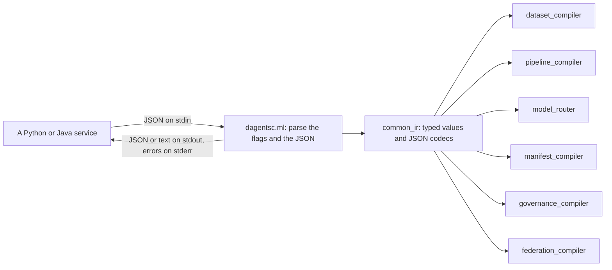
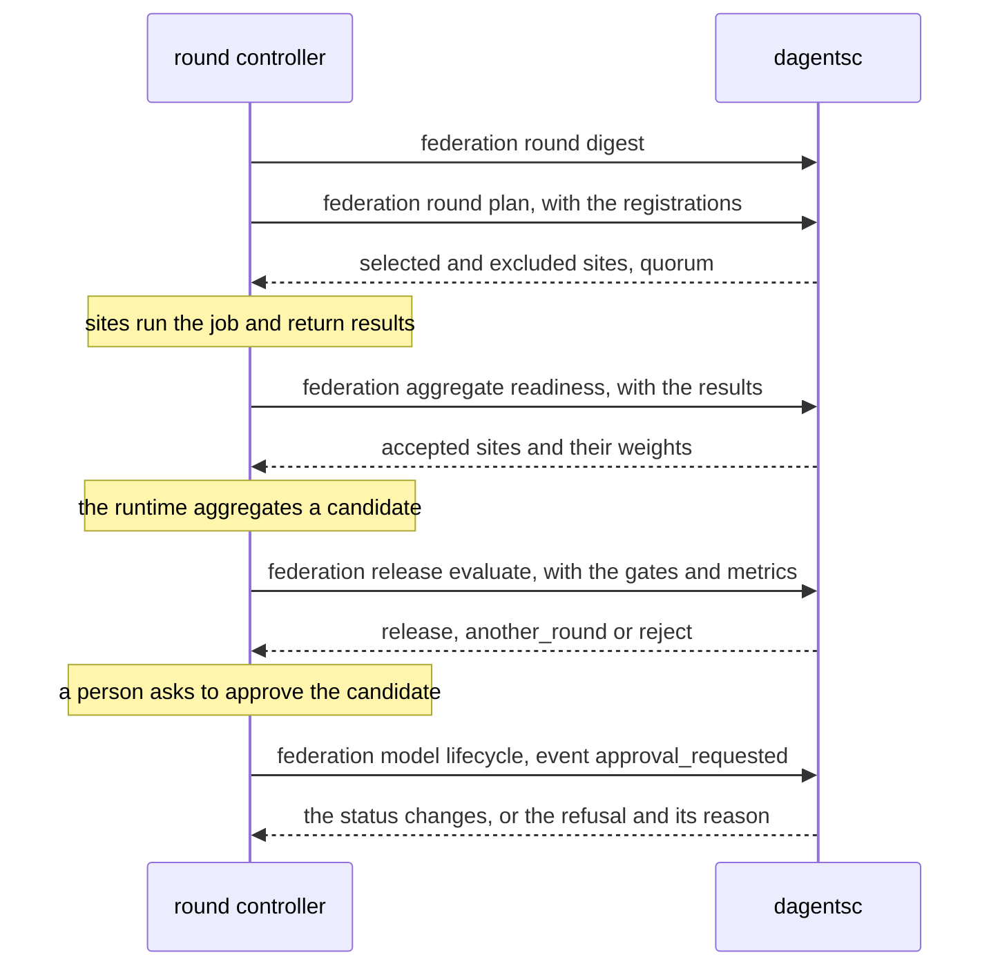

# dagentsc

`dagentsc` is the command-line program in front of the OCaml planners. Services
never link to OCaml; they run `dagentsc` with JSON on standard input and read
JSON from standard output. A separate process keeps a planner failure out of
the service, and lets either side be upgraded alone.

| | |
|---|---|
| Code | `bindings/ocaml/bin/dagentsc.ml`, with the planners in `bindings/ocaml/lib/` |
| Build | `cd bindings/ocaml && opam exec -- dune build ./bin/dagentsc.exe` |
| Test | `cd bindings/ocaml && opam exec -- dune test` |
| Binary | `bindings/ocaml/_build/default/bin/dagentsc.exe` locally, `dagentsc` on `PATH` in the containers |
| How services find it | `DAGENTSC_BIN`, then the planner bundled in a platform wheel of the `dagents` package (`dagents/_bin/dagentsc`), then `dagentsc` on `PATH`. `python -m dagents` prints which one it found, and an LMA or GMA that cannot start one logs a warning |
| Python wrapper | `dagents/common/infrastructure/dagents_runner.py` |
| Commands | 19, in six groups |

Every command is pure: it reads its input, decides, and prints the result. It
opens no database, no network connection and no file other than the ones its
flags name, and it reads no clock. The same input always gives the same output,
which is why the examples on this page never change between runs.



## How to call it

- **Running the examples.** The examples on this page run `dagentsc` and read
  files such as `docs/demo/inputs/...` by relative path. Put the built binary
  on your `PATH` (for example
  `ln -s "$PWD/bindings/ocaml/_build/default/bin/dagentsc.exe" ~/.local/bin/dagentsc`),
  or write its full path in place of `dagentsc`, and run them from the
  repository root.
- **Input.** Most commands read one JSON document from the file `--input`
  names, or from standard input when the value is `-` (the default). The
  dataset commands read two: `--records` and a second file (`--contract`,
  `--rules` or `--operations`). Each defaults to `-`, so give a file for at
  least one of them; standard input can be read only once.
- **Keys.** The planner reads and writes camelCase keys (`planId`,
  `containerPort`). `dagents_runner.py` converts a Python service's snake_case
  keys to camelCase on the way in, and back on the way out, except inside data
  records. So the objects on the other pages, such as
  [the RestrictionRequest object](agents.md#the-restrictionrequest-object), are
  the same objects with snake_case keys.
- **Output.** Pretty-printed JSON on standard output. `manifest compile` prints
  YAML, and `pipeline compile`, `model route` and `dataset profile` print text,
  unless `--output json` is given.
- **Exit codes.**

  | Code | When | Standard error |
  |---|---|---|
  | `0` | The command ran. A decision that refuses something, such as a `deny` plan, a source that is not valid or a Compose spec with issues in JSON output, is a normal result | empty |
  | `1` | The command words are not a known command | the usage text, which lists every command |
  | `2` | The input cannot be read or does not make a plan: JSON that does not parse, a missing required key, an unknown value such as a workload kind, or a pipeline with a cycle | `Fatal error: exception Invalid_argument("Missing JSON field: boundary")`, or a `Yojson` parse error |
  | `3` | `manifest compile` with YAML output found issues in a Compose spec, so it printed the issues as comments and no file | empty |

  `dagents_runner.py` turns a non-zero exit into `PlannerUnavailableError`.
  What a service does with it depends on the service: the Guard denies the
  request and records the denial, the core service renders Kubernetes YAML in
  Python instead and answers `500` for a Compose file, and the healthcare demo
  answers `503`. Services read JSON output, so they never see exit code `3`.
- **Limits.** `dagents_runner.py` stops a call that runs past
  `DAGENTSC_TIMEOUT_SECONDS` (default 10) or prints more than
  `DAGENTSC_MAX_OUTPUT_BYTES` (default 16777216), and refuses an input over
  `DAGENTSC_MAX_INPUT_BYTES` (default 16777216) before it starts the planner.
  Each is a `PlannerUnavailableError`, like a non-zero exit. The planner runs
  in a process group of its own, so stopping it also stops every process it
  started. A command that reads its input from files gets no standard input.
- **Which planner ran.** `dagentsc` prints no version. The Guard names the
  planner in each audit record by the `dagents` package version and the
  SHA-256 of the binary. When `DAGENTSC_SHA256` is set, the runner starts only
  a binary with that hash.
- **Unknown keys** in the input are ignored. Defaults are the cautious value:
  a site is not enrolled unless `enrolled` is true, a release gate is blocking
  unless `blocking` is false, and a field the classification does not list is
  `high` sensitivity unless the classification says otherwise.

Which services run which commands:

| Command | Run by |
|---|---|
| `manifest compile` | core-service, to render Kubernetes manifests and Docker Compose files ([workload compiler](framework-services.md#workload-compiler)) |
| `pipeline compile` | pipeline-service, when it registers or checks a pipeline; the NL2SQL and healthcare demos, in their traces |
| `model route` | the NL2SQL and healthcare demos, in their traces |
| `dataset source validate`, `source extract`, `schema validate`, `quality evaluate` | the NL2SQL demo for every question; the healthcare demo's trace (validate, schema, quality) |
| `governance restrict` | the Ethical Guard in the LMA, the GMA and each healthcare hospital, and every planning endpoint of the agents |
| `federation round digest`, `round plan`, `aggregate readiness`, `release evaluate` | the round controller in the GMA and in the healthcare demo |
| `federation model lifecycle` | the GMA's model registry, for every change of a model version's status |

The remaining commands (`dataset profile`, `source metadata`, `transform
compile`, `transform apply`, `governance assess`, `federation round recover`)
are not called by any service in this version. The demo scripts in
`docs/demo/` call `transform compile` and `transform apply`. `federation round
recover` is for a GMA that keeps its rounds across a restart, which is not
built yet. Each endpoint card on the other pages lists the commands its example
ran.

The planners' design is in `bindings/ocaml/README.md`.

## Workload manifests

```api-interface
service: dagentsc
status: complete
code: bindings/ocaml/bin/dagentsc.ml
classes:
- Dagents_manifest_compiler (bindings/ocaml/lib/manifest_compiler/dagents_manifest_compiler.ml)
- Json_codec (bindings/ocaml/lib/common_ir/json_codec.ml)
endpoints:
- dagentsc manifest compile
```

Render Kubernetes YAML or one Docker Compose file from a typed workload
specification. The core service's
[workload compiler](framework-services.md#workload-compiler) sends its requests
here; the fields are the same as
[the WorkloadComponent object](framework-services.md#the-workloadcomponent-object),
in camelCase.

### Render Kubernetes YAML or a Docker Compose file

```api-endpoint
dagentsc manifest compile
```

The input's `target` chooses what to render. For Kubernetes, the default, the
command renders a `Deployment`, `Job` or `CronJob` for each component, with a
`Service` when the component has ports and services are included, a
`ConfigMap` when config maps are included or `generatedResources` lists one,
and a `ServiceAccount` when `generatedResources` lists one. For Docker Compose,
it renders one Compose file with a service for each component, or lists the
issues that stop the spec from becoming one. It applies nothing and starts
nothing. The same input always gives the same output.

| Flag | Default | Meaning |
|---|---|---|
| `--input <file\|->` | none | The workload specification. Without this flag the command builds one component from the flags below |
| `--target kubernetes\|compose` | `kubernetes` | Used without `--input`. With `--input`, the input's `target` key chooses, and this flag is an error |
| `--output yaml\|json` | `yaml` | `yaml` prints the YAML: every Kubernetes object, separated by `---`, or the Compose file. `json` prints the plan |
| `--plan-id`, `--namespace` | `dagents-plan`, `dagents` | Used without `--input` |
| `--name`, `--image`, `--kind` | `component`, `ghcr.io/example/component:latest`, `Deployment` | Used without `--input`. The component gets one replica, an `http` port 8080, and for Kubernetes a Service and a ConfigMap. For Compose, the port is exposed on the network and not published |

#### The input

The input's keys are `planId` (default `dagents-plan`), `namespace` (default
`dagents`), `includeServices` (default true), `includeConfigMaps` (default
false), `target` and `components`. Each component takes `name` and `image`
(required), `kind`, `replicas` (1), `schedule`, `env` (`name`, `value`),
`ports`, `args`, `resources` (`cpuRequest` 250m, `cpuLimit` 1, `memoryRequest`
256Mi, `memoryLimit` 1Gi), `generatedResources`, `serviceAccountName`,
`serviceType` (`ClusterIP`), `configMapData`, `envFiles`, `healthCheck` and
`dependsOn`.

`target` takes one of these forms:

| Form | Meaning |
|---|---|
| absent, `null`, `"kubernetes"` or `{"kind": "kubernetes"}` | Kubernetes |
| `"compose"` | Compose, with every default below |
| `{"kind": "compose", ...}` | Compose, with these keys: `placement` (`"own"` or `"merge"`, default `"own"`), `network` (default `"default"`), `externalNetwork` (default false) and `existingServices` (default `[]`) |

- **`placement`.** `own` makes the file a whole project. `merge` makes a file
  that you pass with `-f` after the files of a project that already runs:
  `docker compose -p <project> -f <the project's file> -f <this file> up -d <service>`.
  Relative paths in the file resolve against the directory of the first file.
- **`network`.** Every service joins this one network. The file declares it,
  unless `externalNetwork` is true: then the network exists already, and
  `network` is its real Docker name, such as `healthcare-demo_default`.
- **`existingServices`.** The services the running project has. A new service
  may not reuse one of their names. It may depend on one of them only when
  `placement` is `merge`.

The Compose keys of a component and its ports:

| Key | Default | Meaning |
|---|---|---|
| `ports[].hostPort` | `null` | Publish the container port on this host port. Without it, the port is only reachable from services on the network (`expose`) |
| `ports[].hostIp` | `"127.0.0.1"` | The host address a published port binds to. Read only with `hostPort`. The default is loopback because an LMA or a GMA started without tokens answers every caller |
| `envFiles` | `[]` | Files of `NAME=value` lines that Compose reads into the container's environment. They keep secrets, such as a database URL, out of the rendered file |
| `healthCheck` | `null` | `null` keeps the image's own `HEALTHCHECK`. The object takes exactly one of `command` (a list, run without a shell) and `shell` (a string, run by the container's shell), and `intervalSeconds` (30), `timeoutSeconds` (5), `retries` (3) and `startPeriodSeconds` (10) |
| `dependsOn` | `[]` | Entries of `service` (required) and `condition`: `service_started` (the default), `service_healthy` or `service_completed_successfully` |

Which fields each target reads:

| Field | Kubernetes | Compose |
|---|---|---|
| `planId`, `name`, `image`, `kind`, `env`, `args`, `ports[].containerPort` | yes | yes. `args` becomes `command`, which replaces the image's `CMD` as Kubernetes `args` does |
| `replicas` | yes | only to report more than 1 as an issue |
| `namespace`, `includeServices`, `includeConfigMaps`, `schedule`, `resources`, `generatedResources`, `serviceAccountName`, `serviceType`, `configMapData`, `ports[].name` | yes | no |
| `ports[].hostPort`, `ports[].hostIp`, `envFiles`, `healthCheck`, `dependsOn` | no | yes |

#### The Compose file

A `Deployment` becomes a service with `restart: unless-stopped`, and a `Job` a
service with `restart: "no"`. Services are in request order, and so are their
environment variables, ports and dependencies. The file has no top-level
`name:`; the project name comes from `-p`. Every value a caller chose, such as
an image, an argument or an environment value, is written as a double-quoted
YAML string, and a `$` in it is written as `$$`, so Compose passes one `$` to
the container instead of reading a variable of the shell that runs it. Control
characters are escaped, including U+0085, U+2028 and U+2029, which YAML would
otherwise read as line breaks, and U+FFFE and U+FFFF, which Compose refuses
unescaped. Names
of services, networks and environment variables are checked, then written
double-quoted too: unquoted, YAML reads a name such as `134`, `null`, `true` or
`2024-01-01` as a number, null, a boolean or a date, and Compose refuses a key
that is not a string.

The Kubernetes JSON output has `planId`, `namespace`, `manifests` (per
component: `componentName`, `kind`, `deploymentYaml`, `serviceYaml`,
`configMapYaml`, `serviceAccountYaml`, each `null` when not rendered) and
`combinedYaml`. The Compose JSON output has `planId`, `services` (every
component name, in request order), `issues` (each with `service`, `code` and
`value`) and `composeYaml`, which is `null` exactly when `issues` is not empty.

#### Compose issues

A spec that cannot become a Compose file still gives a plan. With
`--output json`, the plan lists the issues, `composeYaml` is `null` and the
exit code is `0`. With `--output yaml`, the command prints one comment line per
issue instead of a file, with `spec` in place of the service for an issue with
the whole spec, and exits with code `3`:

```text
# No Compose file: the spec has issues.
# lma-hospital-d: dependency_outside_project gma
```

The exit code is what stops a script. `docker compose` refuses a file of
comments only when it is the sole `-f` file. Passed after a project's own file,
as `placement: merge` intends, it is merged as nothing: `up -d` without a
service name starts no new service and exits `0`. So run the two commands with
`&&`, or check `composeYaml` in the JSON output. The issues come in a fixed
order: the spec's own issues first, then
each component's, in request order. Within a component they follow the order
of this table, except that ports and dependencies are checked one at a time.

| Code | Service | Value | When |
|---|---|---|---|
| `no_services` | `null` | `null` | `components` is empty |
| `invalid_network_name` | `null` | the name | The network name does not match `[a-z0-9][a-z0-9_.-]*` |
| `invalid_service_name` | `null`, or the component | the name | An `existingServices` entry, or a component's name, does not match the same pattern |
| `duplicate_service_name` | the component | `null` | An earlier component has the same name |
| `service_name_in_use` | the component | `null` | `existingServices` lists the component's name |
| `empty_image` | the component | `null` | `image` is empty |
| `no_compose_equivalent` | the component | the kind | The kind is `CronJob`, `Service`, `ConfigMap` or `ServiceAccount` |
| `unsupported_replicas` | the component | the number | `replicas` is more than 1. The containers would publish the same host ports |
| `invalid_environment_name` | the component | the name | An `env` name does not match `[A-Za-z_][A-Za-z0-9_]*` |
| `duplicate_environment_name` | the component | the name | An `env` name appears earlier in the same component |
| `invalid_port` | the component | the port | A container port or a host port is not between 1 and 65535 |
| `invalid_host_ip` | the component | the address | `hostIp` is not four numbers from 0 to 255 without leading zeros, separated by dots. IPv6 addresses and host names are refused |
| `host_port_conflict` | the component | the port | An earlier published port in the spec uses the same host port, on any host address |
| `empty_health_check` | the component | `null` | `command` is `[]` or `shell` is `""` |
| `invalid_health_check_timing` | the component | `null` | `intervalSeconds`, `timeoutSeconds` or `retries` is below 1, `startPeriodSeconds` is below 0, or a duration is above 9223372036 seconds, the longest that Compose reads |
| `self_dependency` | the component | `null` | A component depends on itself |
| `duplicate_dependency` | the component | the service | A component names the same dependency twice |
| `dependency_outside_project` | the component | the service | `placement` is `own` and a dependency names a service in `existingServices` |
| `unknown_dependency` | the component | the service | A dependency names neither a component nor a service in `existingServices` |
| `dependency_cycle` | the component | `null` | The component depends on itself through other components. A component that only leads into a cycle is not reported |

The planner does not check facts it cannot see: that the image exists, that the
env files exist, that the health check's program is in the image, that an
external network exists, or that the running project or the host already uses a
host port.

**Errors.** Exit `2` for an unknown `kind` (`Unknown workload kind: StatefulSet`),
a component without `name` or `image`, a dependency without `service`
(`Missing JSON field: service`), an unknown target (`Unknown deployment target: helm`),
placement (`Unknown compose placement: stack`) or condition
(`Unknown dependency condition: started`), a health check with both or neither
of `command` and `shell`
(`Expected exactly one of healthCheck.command and healthCheck.shell`),
a Compose spec with a string that is not UTF-8, such as an escaped lone
surrogate (`Expected UTF-8 text in field: image`), a number outside the
planner's 63-bit integers (-2^62 to 2^62 - 1) in `replicas`, a port or a health
check field (`Failure("int_of_string")`),
`--target` together with `--input`
(`--target is read only without --input; set the input's target key`), or JSON
that does not parse.

**Related.** [Compile a workload plan on the core service](framework-services.md#core-service-post-api-v1-workloads-compile),
[render a Docker Compose file on the core service](framework-services.md#core-service-post-api-v1-manifests-compose),
[the WorkloadPlanResponse object](framework-services.md#the-workloadplanresponse-object).

## Pipelines

```api-interface
service: dagentsc
status: complete
code: bindings/ocaml/bin/dagentsc.ml
classes:
- Dagents_pipeline_compiler (bindings/ocaml/lib/pipeline_compiler/dagents_pipeline_compiler.ml)
endpoints:
- dagentsc pipeline compile
```

Check that a pipeline is a valid graph of steps and put the steps in the order
they run. The steps are the same as
[the PipelineStep object](framework-services.md#the-pipelinestep-object), in
camelCase.

### Order a pipeline's steps

```api-endpoint
dagentsc pipeline compile
```

Checks the pipeline and returns its steps in an order where every step comes
after the steps it depends on (a topological order). Each step gets an
`executionTarget`: `python_service` for `run_model_job`, `local_process` for
the other five kinds. A step's `config` is passed through unread.

| Flag | Default | Meaning |
|---|---|---|
| `--input <file\|->` | none | The pipeline: `pipelineId` and `steps` (`stepId`, `kind`, `dependsOn`, `config`). Without this flag the command reads the two flags below |
| `--pipeline-id` | `pipeline` | Used without `--input` |
| `--step <id:kind[:dep,dep]>` | none | One step, repeatable, used without `--input`. `score:run_model_job:load` is the step `score`, which depends on `load` |
| `--output text\|json` | `text` | `text` prints one `stepId:kind` line per step, in order |

The pipeline service runs this command when it registers or checks a pipeline,
but decides acceptance with its own Python check
([pipeline definitions](framework-services.md#pipeline-definitions)).

**Errors.** Exit `2` when two steps share a `stepId`, a step depends on a step
that does not exist, the steps form a cycle (`Cyclic dependency detected at a`),
or a `kind` is not one of the six.

**Related.** [Register a pipeline](framework-services.md#pipeline-service-post-api-v1-pipelines).

## Model routing

```api-interface
service: dagentsc
status: complete
code: bindings/ocaml/bin/dagentsc.ml
classes:
- Dagents_model_router (bindings/ocaml/lib/model_router/dagents_model_router.ml)
endpoints:
- dagentsc model route
```

Choose a model family and a way to run it for a task. The router can choose a
family that the model service cannot run; the
[model inventory](framework-services.md#model-service-get-api-v1-model-families)
says which ones it can.

### Route a task to a model family

```api-endpoint
dagentsc model route
```

Returns `candidates`, the families for the task in order of preference,
`selectedModel`, the first of them, and `packagingMode`:

| Task | Candidates | Packaging |
|---|---|---|
| `classification` | `random_forest`, `xgboost`, `naive_bayes` | `inline_service_call` |
| `regression` | `linear`, `random_forest`, `xgboost` | `inline_service_call`, or `kubernetes_job` above 10,000 records |
| `forecasting` | `gru`, `lstm`, `transformer` | `long_running_deployment` |
| `embedding` | `transformer`, `custom` | `inline_service_call` |
| `anomaly_detection` | the profile's suggested models, or `autoencoder`, `variational_autoencoder`, `random_forest` | as for regression |

| Flag | Default | Meaning |
|---|---|---|
| `--task` | `anomaly_detection` | One of the five tasks. Any other value is routed as `anomaly_detection` |
| `--scope-id` | `scope` | The id written into the built-in profile |
| `--output text\|json` | `text` | `text` prints the selected family only |

The command routes a built-in profile of one record with two numeric fields,
not a dataset of yours. The library function `route` takes any profile; the
agents call it on real profiles.

**Errors.** None: every value of `--task` gives a route.

**Related.** [The DatasetProfile object](agents.md#the-datasetprofile-object),
[profile a dataset](#dagentsc-dataset-profile).

## Datasets

```api-interface
service: dagentsc
status: complete
code: bindings/ocaml/bin/dagentsc.ml
classes:
- Dagents_dataset_compiler (bindings/ocaml/lib/dataset_compiler/dagents_dataset_compiler.ml)
- Json_codec (bindings/ocaml/lib/common_ir/json_codec.ml)
endpoints:
- dagentsc dataset profile
- dagentsc dataset source validate
- dagentsc dataset source metadata
- dagentsc dataset source extract
- dagentsc dataset schema validate
- dagentsc dataset quality evaluate
- dagentsc dataset transform compile
- dagentsc dataset transform apply
```

Validate a source definition, describe it and plan its extraction, check
records against a schema contract and quality rules, and plan or apply
transforms. The planner reads no source: a runtime adapter in Python does the
reading ([LMA sources](agents.md#lma-sources)).

The examples use the inputs in `docs/demo/inputs/`. Their outputs are the same
as the recorded outputs in `docs/demo/expected/`, except where a flag differs.

**A source definition** has `sourceId`, `kind` (`inline`, `postgres`,
`mongodb` or `object_storage`), `connectionRef` (`connectionId`, `options`),
`selection`, `format` (default `json`), `schemaHint` (a list of `name`,
`type`), `batching` (`batchSize`, default 1000, and `maxRecords`), `checkpoint`
and `options`. The `selection` depends on the kind:

| Kind | `selection` keys |
|---|---|
| `inline` | `records` |
| `postgres` | `sql` or `table`, `columns`, `where`, `orderBy` |
| `mongodb` | `database`, `collection`, `filter`, `projection`, `sort` |
| `object_storage` | `uri` or `prefix`, `glob`, `compression` |

These are the agents' source objects with camelCase keys; see
[the PostgresSourceSpec object](agents.md#the-postgressourcespec-object).

**Records** are a JSON list of flat objects. **A schema contract** has
`requiredFields` and `optionalFields` (each a list of `name` and `type`) and
`allowExtraFields` (default true). **A quality rule** has `ruleId`, `field`,
`severity` (`error`, the default, or `warning`) and `operator`: `non_null`,
`unique`, `{"kind": "min_value", "value": 0}`, `{"kind": "max_value", ...}`,
`{"kind": "regex_match", "pattern": ...}` or
`{"kind": "allowed_values", "values": [...]}`. **A transform operation** has a
`kind`: `select_fields` or `drop_fields` (`fields`), `rename_fields`
(`mappings`), `filter_non_null` (`fields`) or `cast_fields` (`casts`).

### Profile the built-in dataset

```api-endpoint
dagentsc dataset profile
```

Profiles a built-in dataset of two records with two numeric fields, `value` and
`score`, and returns the record count, the feature, numeric and categorical
fields, the partition count and the suggested model families. It shows what a
profile looks like; it reads no input. `--scope-id` (default `scope`) names the
profile, and `--output json` prints the profile instead of two
`records=`/`partitions=` lines. The agents build real profiles with the library
function `build_profile`.

**Errors.** None.

**Related.** [The DatasetProfile object](agents.md#the-datasetprofile-object),
[profile a dataset on the LMA](agents.md#lma-dataset-profiling-and-model-runs).

### Validate a source definition

```api-endpoint
dagentsc dataset source validate
```

Checks a source definition without reading it and returns `valid`, `errors`
and `warnings`. An error makes `valid` false; a warning does not. The checks: a
`sourceId` is present, `batchSize` is positive, an external source has a
`connectionRef`, the `selection` fits the kind (Postgres needs `sql` or `table`,
MongoDB a `database` and a `collection`, object storage a `uri` or `prefix`),
and a schema can be declared or inferred. A Postgres source with both `sql` and
`table` gets a warning that `sql` wins. It does not prove that a database
answers.

**Errors.** Exit `2` for an unknown `kind` or JSON that does not parse. A
source that is not valid exits `0`.

**Related.** [Validate a source on the LMA](agents.md#lma-sources).

### Describe a source

```api-endpoint
dagentsc dataset source metadata
```

Returns the source's id and kind, its schema as far as it is known without
reading it, and `estimatedRecords`: the number of inline records, or
`maxRecords` for an external source. The schema comes from:

| Kind | Schema |
|---|---|
| `inline` | Inferred from the records |
| `postgres` | The selected `columns`, with type `unknown` |
| `mongodb` | The fields the `projection` includes, with type `unknown` |
| `object_storage` | `schemaHint` |

**Errors.** As for validating a source.

**Related.** [Plan the extraction](#dagentsc-dataset-source-extract).

### Plan a source's extraction

```api-endpoint
dagentsc dataset source extract
```

Lowers a source definition into a plan a runtime adapter can follow: the
selected fields, the predicates (a Postgres `where`), the ordering, the batch
size, `maxRecords`, the checkpoint and a partition strategy. The strategy is
chosen from `options` in this order:

1. `time_window:<field>:<window>` when `timeField` and `timeWindow` are set.
2. `hash:<field>:<count>` when `partitionField` is set and `partitionCount` is
   above 1.
3. `fixed_size:<batchSize>` when `maxRecords` is set, and `single` otherwise.

**Errors.** As for validating a source.

**Related.** [Validate the source](#dagentsc-dataset-source-validate).

### Check records against a schema contract

```api-endpoint
dagentsc dataset schema validate
```

Infers the records' schema and compares it with the contract. It returns
`valid`, `missingFields` (required fields no record has), `typeMismatches`
(`field`, `expectedType`, `actualType`), `extraFields` (fields the contract
does not list, an error only when `allowExtraFields` is false) and `warnings`.
`--records` and `--contract` name the two inputs.

**Errors.** Exit `2` when an input does not parse, including when both flags
are left as `-` and the second read finds standard input empty
(`Blank input data`).

**Related.** [Apply quality rules](#dagentsc-dataset-quality-evaluate).

### Apply quality rules to records

```api-endpoint
dagentsc dataset quality evaluate
```

Evaluates each rule over the records and returns one result per rule (`ruleId`,
`severity`, `passed`, `violations`, `message`), the error and warning counts,
the total violations, and `blocking`: true when any `error` rule failed.
`--rules` names a list of rules, or one rule. In the example, a repeated
`order_id`, a missing `status` and a negative `amount` fail three rules, two of
them errors, so the report is blocking.

**Errors.** Exit `2` for an unknown operator or a rule without `ruleId` or
`field`.

**Related.** [Check against a schema contract](#dagentsc-dataset-schema-validate).

### Plan transforms

```api-endpoint
dagentsc dataset transform compile
```

Applies the operations, in order, to the records' inferred schema and returns
`planId` and the `outputSchema`, without changing any record. `--plan-id`
(default `transform-plan`) names the plan. In the example, `amount` is cast to
`float`, renamed `amount_usd`, and `status` is dropped.

**Errors.** Exit `2` for an unknown operation `kind`.

**Related.** [Apply the transforms](#dagentsc-dataset-transform-apply).

### Apply transforms to records

```api-endpoint
dagentsc dataset transform apply
```

Applies the same plan to the records and prints the transformed records. It is
for local runs and tests; a service with large data applies transforms in its
own runtime. A string that does not parse as the target `int` or `float`
becomes `null`; a value a cast does not cover is left as it was.

**Errors.** As for planning transforms.

**Related.** [Plan the transforms](#dagentsc-dataset-transform-compile).

## Governance

```api-interface
service: dagentsc
status: complete
code: bindings/ocaml/bin/dagentsc.ml
classes:
- Dagents_governance_compiler (bindings/ocaml/lib/governance_compiler/dagents_governance_compiler.ml)
endpoints:
- dagentsc governance restrict
- dagentsc governance assess
```

The Ethical-Restriction Rails: decide what protection a request needs, and how
far a requester can be trusted. Both commands decide and never enforce. The
Ethical Guard in the agents and in the healthcare demo applies the plan to real
data and writes the audit record
([LMA governance](agents.md#lma-governance)).

**Trust.** The Know-Your-User (KYU) score is 0.7 times the share of attribute
weight that is verified (an unverified attribute earns a quarter of its
weight), plus 0.3 times `complianceHistory`; it is 0 with no attributes. Below
0.4 trust is `low`, below 0.75 `moderate`, and `high` from 0.75.

**The strategy for each field** depends on the field's sensitivity, the trust
and the granularity. One exhaustive match in `select_strategy` covers every
combination:

| Sensitivity | Trust | cell or row | column | table | model_update |
|---|---|---|---|---|---|
| high | low | refuse | refuse | refuse | refuse |
| high | moderate | redact | aggregate_only | aggregate_only | add_noise:0.5 |
| high | high | generalize:1 | aggregate_only | aggregate_only | clip_contribution:1 |
| medium | low | redact | aggregate_only | refuse | refuse |
| medium | moderate | generalize:1 | aggregate_only | aggregate_only | clip_contribution:1 |
| medium | high | allow_full | generalize:1 | aggregate_only | clip_contribution:1 |
| low | low | allow_full | generalize:1 | aggregate_only | add_noise:0.5 |
| low | moderate | allow_full | allow_full | generalize:1 | clip_contribution:1 |
| low | high | allow_full | allow_full | allow_full | clip_contribution:1 |

`aggregate_only` carries the classification's minimum cohort. A model update is
never released unprotected.

**Request-level checks.** Before any field, the request is denied, and every
field set to `refuse`, when the classification lists approved purposes and the
declared purpose is missing or not one of them, or when a `column`, `table` or
`model_update` request has no `cohortSize`, or one below the minimum cohort.

### Plan the protection a request needs

```api-endpoint
dagentsc governance restrict
```

Reads a [RestrictionRequest](agents.md#the-restrictionrequest-object) in
camelCase and prints a [RestrictionPlan](agents.md#the-restrictionplan-object):
the trust assessment, one restriction per requested field with its reason, the
decision (`deny` when a request-level check fails or any field is `refuse`,
`permit` when every field is `allow_full`, `narrow` otherwise), the filtering
score (the mean weight of the strategies, from 0 for `allow_full` to 1 for
`refuse`), the obligations the Guard must meet, and the violations. A `deny` is
a normal result with exit code `0`. The classification is sent in full with
every request.

**Errors.** Exit `2` when a required key is missing (`requestId`, `boundary`,
`requester`, `classification`, `granularity`), or a boundary, granularity or
sensitivity is not a known value.

**Related.** [Plan a restriction on the LMA](agents.md#lma-governance),
[the Guard probe in the healthcare demo](demo-apps.md#healthcare-demo-backend-post-api-v1-governance-probe).

### Assess a requester's trust

```api-endpoint
dagentsc governance assess
```

Reads a requester (`requesterId`, `requesterKind`, `affiliation`,
`statedPurpose`, `attributes`, `complianceHistory`) and prints the KYU score,
the trust level and the rationale. `restrict` runs the same assessment as its
first step. The requester kind, affiliation and stated purpose are written into
the rationale and do not change the score.

**Errors.** Exit `2` when `requesterId` is missing.

**Related.** [The RestrictionPlan object](agents.md#the-restrictionplan-object).

## Federation

```api-interface
service: dagentsc
status: complete
code: bindings/ocaml/bin/dagentsc.ml
classes:
- Dagents_federation_compiler (bindings/ocaml/lib/federation_compiler/dagents_federation_compiler.ml)
endpoints:
- dagentsc federation round plan
- dagentsc federation round digest
- dagentsc federation round recover
- dagentsc federation aggregate readiness
- dagentsc federation release evaluate
- dagentsc federation model lifecycle
```

Govern a federated study without running one. Four commands (`round plan`,
`round digest`, `aggregate readiness` and `release evaluate`) make every
deterministic decision of a round; the round controller
(`dagents/common/application/federation.py`) holds the state and calls them.
`round recover` decides whether a round stored before a restart is kept or
closed. `model lifecycle` decides how each event changes a model version's
status, so a model registry applies its answer and keeps no status rule of its
own. The federated protocol itself belongs to a runtime behind
`FederationEngine`.

The examples follow one evaluation round of a retail study across five invited
stores, with the same manifest as [the GMA's examples](agents.md#federated-rounds).
The input objects are the GMA's, in camelCase:
[RoundManifest](agents.md#the-roundmanifest-object),
[SiteRegistration](agents.md#the-siteregistration-object),
[SiteResult](agents.md#the-siteresult-object) and
[ReleaseGate](agents.md#the-releasegate-object).

**How many sites a round needs.** The manifest's `minimumParticipants`
(default 3), raised to the threshold of a `secure_aggregation` profile when that
is higher, because the threshold is what keeps the coordinator from seeing one
site's update.



### Plan which sites join a round

```api-endpoint
dagentsc federation round plan
```

Reads `{"manifest": ..., "registrations": [...]}` and decides which registered
sites may join. A site is excluded, with the reason, when it is not enrolled,
was not invited, has not approved the round's condition, has a different
feature contract version, lacks a required capability, or its cohort is below
`minimumCohortPerSite`. An invited site with no registration is excluded too.
The plan has the selected and excluded sites, `quorumMet`,
`requiredParticipants`, the aggregation method, `stopReason`
(`quorum_not_met` when there are too few sites) and the round's digest.

**Errors.** Exit `2` when `manifest` is missing, a required manifest key
(`roundId`, `studyId`, `conditionId`, `modelVersion`,
`featureContractVersion`) is missing, or a phase, aggregation or stop condition
is not a known value.

**Related.** [Plan a round on the GMA](agents.md#federated-rounds),
[the RoundPlan object](agents.md#the-roundplan-object).

### Compute a round manifest's digest

```api-endpoint
dagentsc federation round digest
```

Reads `{"manifest": ...}` and prints `roundId` and `roundDigest`: `fnv1a:`
followed by a 64-bit FNV-1a hash of every manifest field, with the lists sorted
so their order does not matter. A site compares the digest of the job it is
offered with the digest it computes, and every result must carry it as its
`jobDigest`. The digest detects drift; it is not a signature.

**Errors.** As for planning a round.

**Related.** [Decide aggregation readiness](#dagentsc-federation-aggregate-readiness).

### Keep or close a round after a restart

```api-endpoint
dagentsc federation round recover
```

Reads what a GMA knows about one round it stored before a restart, and decides
whether the round stays open or is closed. A closed round is run again under a
new round id. The command reads no clock: the caller measures the age of the
oldest stored update and passes it in. `FederatedRoundController.recover`
(`dagents/common/application/federation.py`) calls it once for each unfinished
round, oldest first. The GMA does not call `recover` yet, and it keeps its
rounds in memory unless the application that builds it passes its own round
store.

Every key is required:

| Key | Value |
|---|---|
| `status` | The stored round's status: `planned`, `dispatched`, `collecting`, `aggregated` or `closed`, the five statuses of a round record |
| `phase` | `analytics`, `evaluation` or `training` |
| `readable` | Whether the stored record could be read |
| `updatesKept` | Whether the round's training updates survive a restart |
| `candidateRegistered` | Whether the round's candidate is already in the model registry |
| `oldestUpdateAgeSeconds` | The age of the oldest stored update in seconds, 0 or more, or `null` when no update is stored |
| `updateMaxAgeSeconds` | The age limit for stored updates in seconds, more than 0, or `null` for no limit |

The output has `verdict` (`keep` or `close`), `reason` (`null` for a kept
round) and `message`, one sentence. A close is a normal result, so the exit
code is 0. The rows are checked in order, and the first that matches decides:

| Status | Condition | Verdict | `reason` |
|---|---|---|---|
| `aggregated`, `closed` | any | `keep` | `null` |
| `planned`, `dispatched`, `collecting` | `readable` is false | `close` | `unreadable_record` |
| `planned`, `dispatched` | readable | `close` | `dispatch_interrupted`: a dispatch cannot resume after a restart |
| `collecting`, phase `analytics` or `evaluation` | readable | `keep` | `null`: the record holds the results |
| `collecting`, phase `training` | `candidateRegistered` is true | `keep` | `null`: a retried aggregate returns that candidate |
| `collecting`, phase `training` | `updatesKept` is false | `close` | `updates_not_kept` |
| `collecting`, phase `training` | both ages are numbers and the age is above the limit | `close` | `updates_expired` |
| `collecting`, phase `training` | any other | `keep` | `null` |

An age equal to the limit keeps the round.

**Errors.** Exit `2` for a missing key, an unknown status or phase, a value of
the wrong type, an age below 0, a limit of 0 or less, or an age or limit that
is not a finite number.

**Related.** [Decide a model version's status](#dagentsc-federation-model-lifecycle).

### Decide which results may be aggregated

```api-endpoint
dagentsc federation aggregate readiness
```

Reads `{"manifest": ..., "results": [...], "selectedSites": [...]}` and
decides which returned contributions may enter the aggregate.

`selectedSites` is optional. It is the `selectedSites` of the round plan. When
it is given, a result from any other site is rejected first, with the reason
"site was not selected for this round". That result counts toward neither the
quorum nor the weights, and an empty list accepts no result. Without the key
the selection is not checked, so inputs written before the key existed give
the same answer.

A result is also rejected, with the reason,
when the site did not complete the job, the result belongs to another round,
its `jobDigest` is not the manifest's digest, the site did not verify the code
or its privacy checks, it contributed fewer examples than
`minimumCohortPerSite`, or, under a `secure_aggregation` profile, its update
norm is missing or above 10. Aggregation is permitted when enough sites are
accepted. `siteWeights` are each accepted site's share of the accepted
examples, the FedAvg weights; they are reported, not applied.

**Errors.** As for planning a round, and exit `2` for a result without
`roundId`, `siteId` or `participation`, or a `selectedSites` that is not a list
of strings.

**Related.** [Readiness on the GMA](agents.md#federated-rounds),
[the AggregationReadiness object](agents.md#the-aggregationreadiness-object).

### Evaluate release gates

```api-endpoint
dagentsc federation release evaluate
```

Reads `gates`, `candidateMetrics`, `baselineMetrics`, `candidateVersion`
(default `candidate`), `rollbackVersion` and `roundId` (default
`unknown-round`), and checks each gate against the candidate's metrics. A gate
is `at_least` or `at_most` a value, or `improves_on_baseline` by a margin. A
gate whose metric the candidate did not report is `not_evaluated`, never
passed. The action is `reject` when a blocking gate did not pass,
`another_round` when only a non-blocking gate did not pass, and `release`
otherwise. `release` means the candidate may be released; a person still
approves it.

**Errors.** Exit `2` for an unknown comparison kind, a gate without
`comparison`, or a metric that is not a number.

**Related.** [Evaluate a release on the GMA](agents.md#federated-rounds),
[the ReleaseDecision object](agents.md#the-releasedecision-object),
[approve a candidate in the healthcare demo](demo-apps.md#healthcare-demo-backend-post-api-v1-models-version-approve).

### Decide a model version's status

```api-endpoint
dagentsc federation model lifecycle
```

Reads `{"version": ..., "event": {"kind": ...}}` and decides how one event
changes the status of model versions. A version is `candidate`, `released`,
`rejected` or `superseded`, and at most one version is released. The output
has `allowed`, `refusal` (`null` or a kind), `reason` (one sentence) and
`statusChanges`: each with `version`, `fromStatus` (`null` for a version the
event adds) and `toStatus`, sorted by version. A refusal changes nothing and
is a normal result, so the exit code is 0.

| Event `kind` | Keys | What happens | Refusals |
|---|---|---|---|
| `registered` | `requestedStatus` (`candidate`, the default, or `released`), `releasedVersion` | The version is added as a candidate, or as the release when it asks to be one and nothing is released | `already_released` |
| `aggregated` | `parentVersion`, `parentStatus` | The version a training round produced is added as a candidate. Its parent becomes `superseded` when the parent is a candidate, and keeps its status otherwise | none |
| `release_evaluated` | `status`, `action` (the gates' `release`, `another_round` or `reject`), `guardPermitted` (default false). To check a repeated decision, also `storedDecision`, `roundId`, `baselineVersion`, `metricsSource` and `gateResults` | The version stays a candidate when the gates decided `release` and the release Guard permitted it, and becomes `rejected` otherwise. A repeated decision for the same round changes nothing (see below) | `not_candidate`, `decision_differs` |
| `approval_requested` | `status`, `decision`, `releasedVersion` | The version becomes `released`, and `releasedVersion` becomes `superseded` | `no_decision`, `gates_decided`, `guard_denied`, `metrics_not_from_rounds`, `not_candidate`, `baseline_changed` |

`decision` is the release decision stored with the candidate: `action`,
`guardPermitted` (default false), `metricsSource` and `baselineVersion` (the
released version the gates compared the candidate with). `metricsSource` is
`rounds` when the gate metrics came from the stored aggregates of the study's
rounds, `request` when the caller sent them, and `unrecorded` when it is
missing. An approval checks, in this order, and refuses at the first check
that fails:

1. `no_decision`: the version has no stored decision.
2. `gates_decided`: the gates decided something other than `release`.
3. `guard_denied`: the release Guard did not permit the release.
4. `metrics_not_from_rounds`: `metricsSource` is not `rounds`.
5. `not_candidate`: the version is not a candidate.
6. `baseline_changed`: `baselineVersion` is not the version released now.

The reasons use the wording of the healthcare demo's approval, for example
"the release gates decided reject for VERSION".

**A repeated release evaluation.** A `release_evaluated` event may carry
`storedDecision`, the release decision the version already holds, so a retried
evaluation of the same round does not change the version again. It has six
keys, all required: `roundId`, `action`, `guardPermitted`, `baselineVersion`,
`metricsSource` and `gateResults`. Each gate result has `gateId`, `outcome`
(`passed`, `failed` or `not_evaluated`), `observed`, `threshold` and `detail`,
as in [the ReleaseDecision object](agents.md#the-releasedecision-object).
`baselineVersion`, `metricsSource`, `observed` and `threshold` may be `null`.
With `storedDecision`, the event must give the new decision's `roundId`,
`baselineVersion`, `metricsSource` and `gateResults`, and `guardPermitted` is
required. The planner compares the two decisions before it looks at the
version's status:

| Stored decision | Answer |
|---|---|
| Same `roundId`, and the other five fields equal | Allowed, with no status changes, on any status. The reason says the version already has the same decision for the round |
| Same `roundId`, and any field different | Refused as `decision_differs`. The reason names the fields that differ in snake_case, in the order above, for example "differs in action, baseline_version and gate_results" |
| Another `roundId`, or none | The rule in the table above |

Gate results are compared in order, field by field, and numbers exactly, so
`0.84` and the next larger floating-point number differ. An integer and the
same number written with a fraction, such as `1` and `1.0`, are equal, and so
are `-0.0` and `0.0`. The same decision is allowed on a `rejected` version
too, so a retry after a rejection is not refused as `not_candidate`. Without
`storedDecision`, the new decision's four keys are optional, but they must come
together, and they do not change the answer. The GMA's round-flow release
evaluation sends `storedDecision`, with the new decision's four keys, whenever
the version already holds a decision.

**Errors.** Exit `2` when `version` or `event` is missing or `version` is
empty, for an unknown event kind, status, action or metrics source, for a
registration that asks for `rejected` or `superseded`, for an aggregation
without `parentVersion`, and for an event that names one version twice: an
aggregation whose parent is the version itself, or an approval of a candidate
that is also given as `releasedVersion`. With `storedDecision`, also for a
missing key in either decision or in a gate result, an empty `roundId`, a
value of the wrong type and an unknown gate outcome. Without it, the new
decision's keys are checked the same way when they are given, and an event
that gives some of `roundId`, `baselineVersion`, `metricsSource` and
`gateResults` but not all four is refused.

**Related.** [Evaluate release gates](#dagentsc-federation-release-evaluate).
