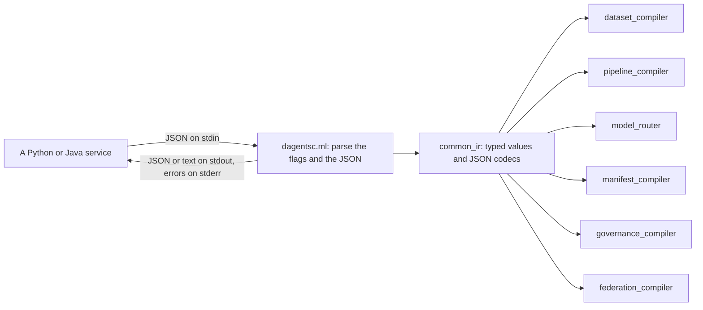
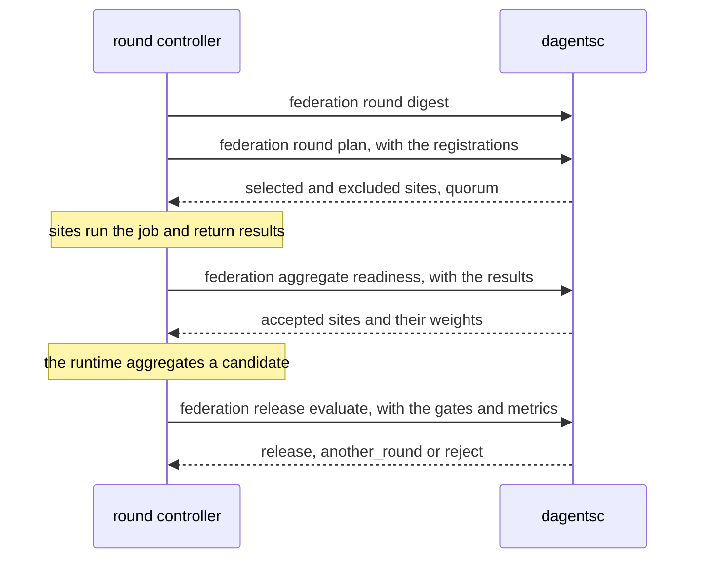

# dagentsc

`dagentsc` is the command-line program in front of the OCaml planners. Services
never link to OCaml; they run `dagentsc` with JSON on standard input and read
JSON from standard output. A separate process keeps a planner failure out of
the service, and lets either side be upgraded alone.

| | |
|---|---|
| Code | `bindings/ocaml/bin/dagentsc.ml`, with the planners in `bindings/ocaml/lib/` |
| Build | `cd bindings/ocaml && opam exec -- dune build ./bin/dagentsc.exe` |
| Test | `cd bindings/ocaml && opam exec -- dune test` |
| Binary | `bindings/ocaml/_build/default/bin/dagentsc.exe` locally, `dagentsc` on `PATH` in the containers |
| How services find it | `DAGENTSC_BIN`, or `dagentsc` on `PATH` |
| Python wrapper | `agents/common/infrastructure/dagents_runner.py` |
| Commands | 17, in six groups |

Every command is pure: it reads its input, decides, and prints the result. It
opens no database, no network connection and no file other than the ones its
flags name, and it reads no clock. The same input always gives the same output,
which is why the examples on this page never change between runs.



## How to call it

- **Running the examples.** The examples on this page run `dagentsc` and read
  files such as `docs/demo/inputs/...` by relative path. Put the built binary
  on your `PATH` (for example
  `ln -s "$PWD/bindings/ocaml/_build/default/bin/dagentsc.exe" ~/.local/bin/dagentsc`),
  or write its full path in place of `dagentsc`, and run them from the
  repository root.
- **Input.** Most commands read one JSON document from the file `--input`
  names, or from standard input when the value is `-` (the default). The
  dataset commands read two: `--records` and a second file (`--contract`,
  `--rules` or `--operations`). Each defaults to `-`, so give a file for at
  least one of them; standard input can be read only once.
- **Keys.** The planner reads and writes camelCase keys (`planId`,
  `containerPort`). `dagents_runner.py` converts a Python service's snake_case
  keys to camelCase on the way in, and back on the way out, except inside data
  records. So the objects on the other pages, such as
  [the RestrictionRequest object](agents.md#the-restrictionrequest-object), are
  the same objects with snake_case keys.
- **Output.** Pretty-printed JSON on standard output. `manifest compile` prints
  YAML, and `pipeline compile`, `model route` and `dataset profile` print text,
  unless `--output json` is given.
- **Exit codes.**

  | Code | When | Standard error |
  |---|---|---|
  | `0` | The command ran. A decision that refuses something, such as a `deny` plan or a source that is not valid, is a normal result | empty |
  | `1` | The command words are not a known command | the usage text, which lists every command |
  | `2` | The input cannot be read or does not make a plan: JSON that does not parse, a missing required key, or an unknown value such as a workload kind or a step kind | `Fatal error: exception Invalid_argument("Missing JSON field: boundary")`, or a `Yojson` parse error |
  | `3` | The input is well formed, but the planner rejects it. Only `pipeline compile` uses it, for a graph that is not valid. With `--output json`, standard output holds a report with `code`, `message` and `stepIds` | the message, with text output; empty with `--output json` |

  `dagents_runner.py` turns exit `3` into `PlannerRejectedError` (a
  `ValueError`), and every other non-zero exit into `PlannerUnavailableError`.
  What a service does with them depends on the service: the Guard denies the
  request and records the denial, the core service renders the YAML in Python
  instead, the pipeline service answers `422` for a rejected graph and `503`
  when the planner cannot be run, and the healthcare demo answers `503`.
- **Unknown keys** in the input are ignored. Defaults are the cautious value:
  a site is not enrolled unless `enrolled` is true, a release gate is blocking
  unless `blocking` is false, and a field the classification does not list is
  `high` sensitivity unless the classification says otherwise.

Which services run which commands:

| Command | Run by |
|---|---|
| `manifest compile` | core-service, to render workload YAML ([workload compiler](framework-services.md#workload-compiler)) |
| `pipeline compile` | pipeline-service, when it registers or checks a pipeline; the NL2SQL and healthcare demos, in their traces |
| `model route` | the NL2SQL and healthcare demos, in their traces |
| `dataset source validate`, `source extract`, `schema validate`, `quality evaluate` | the NL2SQL demo for every question; the healthcare demo's trace (validate, schema, quality) |
| `governance restrict` | the Ethical Guard in the LMA, the GMA and each healthcare hospital, and every planning endpoint of the agents |
| `federation round digest`, `round plan`, `aggregate readiness`, `release evaluate` | the round controller in the GMA and in the healthcare demo |

The remaining commands (`dataset profile`, `source metadata`, `transform
compile`, `transform apply`, `governance assess`) are not called by any
service in this version. The demo scripts in `docs/demo/` call them. Each
endpoint card on the other pages lists the commands its example ran.

The planners' design is in `bindings/ocaml/README.md`.

## Workload manifests

```api-interface
service: dagentsc
status: complete
code: bindings/ocaml/bin/dagentsc.ml
classes:
- Dagents_manifest_compiler (bindings/ocaml/lib/manifest_compiler/dagents_manifest_compiler.ml)
- Json_codec (bindings/ocaml/lib/common_ir/json_codec.ml)
endpoints:
- dagentsc manifest compile
```

Render Kubernetes YAML from a typed workload specification. The core service's
[workload compiler](framework-services.md#workload-compiler) sends its request
here; the fields are the same as
[the WorkloadComponent object](framework-services.md#the-workloadcomponent-object),
in camelCase.

### Render Kubernetes YAML

```api-endpoint
dagentsc manifest compile
```

Renders a `Deployment`, `Job` or `CronJob` for each component, with a `Service`
when the component has ports and services are included, a `ConfigMap` when
config maps are included or `generatedResources` lists one, and a
`ServiceAccount` when `generatedResources` lists one. The same input always
gives the same YAML.

| Flag | Default | Meaning |
|---|---|---|
| `--input <file\|->` | none | The workload specification. Without this flag the command builds one component from the flags below |
| `--output yaml\|json` | `yaml` | `yaml` prints every object, separated by `---`. `json` prints the plan |
| `--plan-id`, `--namespace` | `dagents-plan`, `dagents` | Used without `--input` |
| `--name`, `--image`, `--kind` | `component`, `ghcr.io/example/component:latest`, `Deployment` | Used without `--input`. The component gets one replica, an `http` port 8080, a Service and a ConfigMap |

The input's keys are `planId` (default `dagents-plan`), `namespace` (default
`dagents`), `includeServices` (default true), `includeConfigMaps` (default
false) and `components`. Each component takes `name` and `image` (required),
`kind`, `replicas` (1), `schedule`, `env` (`name`, `value`), `ports` (`name`,
`containerPort`), `args`, `resources` (`cpuRequest` 250m, `cpuLimit` 1,
`memoryRequest` 256Mi, `memoryLimit` 1Gi), `generatedResources`,
`serviceAccountName`, `serviceType` (`ClusterIP`) and `configMapData`.

The JSON output has `planId`, `namespace`, `manifests` (per component:
`componentName`, `kind`, `deploymentYaml`, `serviceYaml`, `configMapYaml`,
`serviceAccountYaml`, each `null` when not rendered) and `combinedYaml`.

**Errors.** Exit `2` for an unknown `kind` (`Unknown workload kind: StatefulSet`),
a component without `name` or `image`, or JSON that does not parse.

**Related.** [Compile a workload plan on the core service](framework-services.md#core-service-post-api-v1-workloads-compile),
[the WorkloadPlanResponse object](framework-services.md#the-workloadplanresponse-object).

## Pipelines

```api-interface
service: dagentsc
status: complete
code: bindings/ocaml/bin/dagentsc.ml
classes:
- Dagents_pipeline_compiler (bindings/ocaml/lib/pipeline_compiler/dagents_pipeline_compiler.ml)
endpoints:
- dagentsc pipeline compile
```

Check that a pipeline is a valid graph of steps and put the steps in the order
they run. The steps are the same as
[the PipelineStep object](framework-services.md#the-pipelinestep-object), in
camelCase.

### Order a pipeline's steps

```api-endpoint
dagentsc pipeline compile
```

Checks the pipeline and returns its steps in an order where every step comes
after the steps it depends on (a topological order). Each step gets an
`executionTarget`: `python_service` for `run_model_job`, `local_process` for
the other five kinds. A step's `config` is passed through unread.

| Flag | Default | Meaning |
|---|---|---|
| `--input <file\|->` | none | The pipeline: `pipelineId` and `steps` (`stepId`, `kind`, `dependsOn`, `config`). Without this flag the command reads the two flags below |
| `--pipeline-id` | `pipeline` | Used without `--input` |
| `--step <id:kind[:dep,dep]>` | none | One step, repeatable, used without `--input`. `score:run_model_job:load` is the step `score`, which depends on `load` |
| `--output text\|json` | `text` | `text` prints one `stepId:kind` line per step, in order |

The pipeline service runs this command when it registers or checks a pipeline
and before every run. Its answer decides whether the service accepts the
pipeline and the order the steps run in
([pipeline definitions](framework-services.md#pipeline-definitions)).

**Errors.** Exit `3` when the graph is not valid. With `--output json`,
standard output holds a report: `code` is `duplicate_step_id` (two steps share
a `stepId`), `unknown_dependency` (a step depends on a step that does not
exist) or `cyclic_dependency` (the steps form a cycle); `message` is one
sentence, such as `Cyclic dependency: a -> b -> a (each step depends on the
next)`; and `stepIds` lists the steps involved, for a cycle in dependency
order. With text output the message goes to standard error. The command reports
the first problem it finds. Exit `2` when a `kind` is not one of the six
(`Unknown step kind: sort`).

**Related.** [Register a pipeline](framework-services.md#pipeline-service-post-api-v1-pipelines).

## Model routing

```api-interface
service: dagentsc
status: complete
code: bindings/ocaml/bin/dagentsc.ml
classes:
- Dagents_model_router (bindings/ocaml/lib/model_router/dagents_model_router.ml)
endpoints:
- dagentsc model route
```

Choose a model family and a way to run it for a task. The router can choose a
family that the model service cannot run; the
[model inventory](framework-services.md#model-service-get-api-v1-model-families)
says which ones it can.

### Route a task to a model family

```api-endpoint
dagentsc model route
```

Returns `candidates`, the families for the task in order of preference,
`selectedModel`, the first of them, and `packagingMode`:

| Task | Candidates | Packaging |
|---|---|---|
| `classification` | `random_forest`, `xgboost`, `naive_bayes` | `inline_service_call` |
| `regression` | `linear`, `random_forest`, `xgboost` | `inline_service_call`, or `kubernetes_job` above 10,000 records |
| `forecasting` | `gru`, `lstm`, `transformer` | `long_running_deployment` |
| `embedding` | `transformer`, `custom` | `inline_service_call` |
| `anomaly_detection` | the profile's suggested models, or `autoencoder`, `variational_autoencoder`, `random_forest` | as for regression |

| Flag | Default | Meaning |
|---|---|---|
| `--task` | `anomaly_detection` | One of the five tasks. Any other value is routed as `anomaly_detection` |
| `--scope-id` | `scope` | The id written into the built-in profile |
| `--output text\|json` | `text` | `text` prints the selected family only |

The command routes a built-in profile of one record with two numeric fields,
not a dataset of yours. The library function `route` takes any profile; the
agents call it on real profiles.

**Errors.** None: every value of `--task` gives a route.

**Related.** [The DatasetProfile object](agents.md#the-datasetprofile-object),
[profile a dataset](#dagentsc-dataset-profile).

## Datasets

```api-interface
service: dagentsc
status: complete
code: bindings/ocaml/bin/dagentsc.ml
classes:
- Dagents_dataset_compiler (bindings/ocaml/lib/dataset_compiler/dagents_dataset_compiler.ml)
- Json_codec (bindings/ocaml/lib/common_ir/json_codec.ml)
endpoints:
- dagentsc dataset profile
- dagentsc dataset source validate
- dagentsc dataset source metadata
- dagentsc dataset source extract
- dagentsc dataset schema validate
- dagentsc dataset quality evaluate
- dagentsc dataset transform compile
- dagentsc dataset transform apply
```

Validate a source definition, describe it and plan its extraction, check
records against a schema contract and quality rules, and plan or apply
transforms. The planner reads no source: a runtime adapter in Python does the
reading ([LMA sources](agents.md#lma-sources)).

The examples use the inputs in `docs/demo/inputs/`. Their outputs are the same
as the recorded outputs in `docs/demo/expected/`, except where a flag differs.

**A source definition** has `sourceId`, `kind` (`inline`, `postgres`,
`mongodb` or `object_storage`), `connectionRef` (`connectionId`, `options`),
`selection`, `format` (default `json`), `schemaHint` (a list of `name`,
`type`), `batching` (`batchSize`, default 1000, and `maxRecords`), `checkpoint`
and `options`. The `selection` depends on the kind:

| Kind | `selection` keys |
|---|---|
| `inline` | `records` |
| `postgres` | `sql` or `table`, `columns`, `where`, `orderBy` |
| `mongodb` | `database`, `collection`, `filter`, `projection`, `sort` |
| `object_storage` | `uri` or `prefix`, `glob`, `compression` |

These are the agents' source objects with camelCase keys; see
[the PostgresSourceSpec object](agents.md#the-postgressourcespec-object).

**Records** are a JSON list of flat objects. **A schema contract** has
`requiredFields` and `optionalFields` (each a list of `name` and `type`) and
`allowExtraFields` (default true). **A quality rule** has `ruleId`, `field`,
`severity` (`error`, the default, or `warning`) and `operator`: `non_null`,
`unique`, `{"kind": "min_value", "value": 0}`, `{"kind": "max_value", ...}`,
`{"kind": "regex_match", "pattern": ...}` or
`{"kind": "allowed_values", "values": [...]}`. **A transform operation** has a
`kind`: `select_fields` or `drop_fields` (`fields`), `rename_fields`
(`mappings`), `filter_non_null` (`fields`) or `cast_fields` (`casts`).

### Profile the built-in dataset

```api-endpoint
dagentsc dataset profile
```

Profiles a built-in dataset of two records with two numeric fields, `value` and
`score`, and returns the record count, the feature, numeric and categorical
fields, the partition count and the suggested model families. It shows what a
profile looks like; it reads no input. `--scope-id` (default `scope`) names the
profile, and `--output json` prints the profile instead of two
`records=`/`partitions=` lines. The agents build real profiles with the library
function `build_profile`.

**Errors.** None.

**Related.** [The DatasetProfile object](agents.md#the-datasetprofile-object),
[profile a dataset on the LMA](agents.md#lma-dataset-profiling-and-model-runs).

### Validate a source definition

```api-endpoint
dagentsc dataset source validate
```

Checks a source definition without reading it and returns `valid`, `errors`
and `warnings`. An error makes `valid` false; a warning does not. The checks: a
`sourceId` is present, `batchSize` is positive, an external source has a
`connectionRef`, the `selection` fits the kind (Postgres needs `sql` or `table`,
MongoDB a `database` and a `collection`, object storage a `uri` or `prefix`),
and a schema can be declared or inferred. A Postgres source with both `sql` and
`table` gets a warning that `sql` wins. It does not prove that a database
answers.

**Errors.** Exit `2` for an unknown `kind` or JSON that does not parse. A
source that is not valid exits `0`.

**Related.** [Validate a source on the LMA](agents.md#lma-sources).

### Describe a source

```api-endpoint
dagentsc dataset source metadata
```

Returns the source's id and kind, its schema as far as it is known without
reading it, and `estimatedRecords`: the number of inline records, or
`maxRecords` for an external source. The schema comes from:

| Kind | Schema |
|---|---|
| `inline` | Inferred from the records |
| `postgres` | The selected `columns`, with type `unknown` |
| `mongodb` | The fields the `projection` includes, with type `unknown` |
| `object_storage` | `schemaHint` |

**Errors.** As for validating a source.

**Related.** [Plan the extraction](#dagentsc-dataset-source-extract).

### Plan a source's extraction

```api-endpoint
dagentsc dataset source extract
```

Lowers a source definition into a plan a runtime adapter can follow: the
selected fields, the predicates (a Postgres `where`), the ordering, the batch
size, `maxRecords`, the checkpoint and a partition strategy. The strategy is
chosen from `options` in this order:

1. `time_window:<field>:<window>` when `timeField` and `timeWindow` are set.
2. `hash:<field>:<count>` when `partitionField` is set and `partitionCount` is
   above 1.
3. `fixed_size:<batchSize>` when `maxRecords` is set, and `single` otherwise.

**Errors.** As for validating a source.

**Related.** [Validate the source](#dagentsc-dataset-source-validate).

### Check records against a schema contract

```api-endpoint
dagentsc dataset schema validate
```

Infers the records' schema and compares it with the contract. It returns
`valid`, `missingFields` (required fields no record has), `typeMismatches`
(`field`, `expectedType`, `actualType`), `extraFields` (fields the contract
does not list, an error only when `allowExtraFields` is false) and `warnings`.
`--records` and `--contract` name the two inputs.

**Errors.** Exit `2` when an input does not parse, including when both flags
are left as `-` and the second read finds standard input empty
(`Blank input data`).

**Related.** [Apply quality rules](#dagentsc-dataset-quality-evaluate).

### Apply quality rules to records

```api-endpoint
dagentsc dataset quality evaluate
```

Evaluates each rule over the records and returns one result per rule (`ruleId`,
`severity`, `passed`, `violations`, `message`), the error and warning counts,
the total violations, and `blocking`: true when any `error` rule failed.
`--rules` names a list of rules, or one rule. In the example, a repeated
`order_id`, a missing `status` and a negative `amount` fail three rules, two of
them errors, so the report is blocking.

**Errors.** Exit `2` for an unknown operator or a rule without `ruleId` or
`field`.

**Related.** [Check against a schema contract](#dagentsc-dataset-schema-validate).

### Plan transforms

```api-endpoint
dagentsc dataset transform compile
```

Applies the operations, in order, to the records' inferred schema and returns
`planId` and the `outputSchema`, without changing any record. `--plan-id`
(default `transform-plan`) names the plan. In the example, `amount` is cast to
`float`, renamed `amount_usd`, and `status` is dropped.

**Errors.** Exit `2` for an unknown operation `kind`.

**Related.** [Apply the transforms](#dagentsc-dataset-transform-apply).

### Apply transforms to records

```api-endpoint
dagentsc dataset transform apply
```

Applies the same plan to the records and prints the transformed records. It is
for local runs and tests; a service with large data applies transforms in its
own runtime. A string that does not parse as the target `int` or `float`
becomes `null`; a value a cast does not cover is left as it was.

**Errors.** As for planning transforms.

**Related.** [Plan the transforms](#dagentsc-dataset-transform-compile).

## Governance

```api-interface
service: dagentsc
status: complete
code: bindings/ocaml/bin/dagentsc.ml
classes:
- Dagents_governance_compiler (bindings/ocaml/lib/governance_compiler/dagents_governance_compiler.ml)
endpoints:
- dagentsc governance restrict
- dagentsc governance assess
```

The Ethical-Restriction Rails: decide what protection a request needs, and how
far a requester can be trusted. Both commands decide and never enforce. The
Ethical Guard in the agents and in the healthcare demo applies the plan to real
data and writes the audit record
([LMA governance](agents.md#lma-governance)).

**Trust.** The Know-Your-User (KYU) score is 0.7 times the share of attribute
weight that is verified (an unverified attribute earns a quarter of its
weight), plus 0.3 times `complianceHistory`; it is 0 with no attributes. Below
0.4 trust is `low`, below 0.75 `moderate`, and `high` from 0.75.

**The strategy for each field** depends on the field's sensitivity, the trust
and the granularity. One exhaustive match in `select_strategy` covers every
combination:

| Sensitivity | Trust | cell or row | column | table | model_update |
|---|---|---|---|---|---|
| high | low | refuse | refuse | refuse | refuse |
| high | moderate | redact | aggregate_only | aggregate_only | add_noise:0.5 |
| high | high | generalize:1 | aggregate_only | aggregate_only | clip_contribution:1 |
| medium | low | redact | aggregate_only | refuse | refuse |
| medium | moderate | generalize:1 | aggregate_only | aggregate_only | clip_contribution:1 |
| medium | high | allow_full | generalize:1 | aggregate_only | clip_contribution:1 |
| low | low | allow_full | generalize:1 | aggregate_only | add_noise:0.5 |
| low | moderate | allow_full | allow_full | generalize:1 | clip_contribution:1 |
| low | high | allow_full | allow_full | allow_full | clip_contribution:1 |

`aggregate_only` carries the classification's minimum cohort. A model update is
never released unprotected.

**Request-level checks.** Before any field, the request is denied, and every
field set to `refuse`, when the classification lists approved purposes and the
declared purpose is missing or not one of them, or when a `column`, `table` or
`model_update` request has no `cohortSize`, or one below the minimum cohort.

### Plan the protection a request needs

```api-endpoint
dagentsc governance restrict
```

Reads a [RestrictionRequest](agents.md#the-restrictionrequest-object) in
camelCase and prints a [RestrictionPlan](agents.md#the-restrictionplan-object):
the trust assessment, one restriction per requested field with its reason, the
decision (`deny` when a request-level check fails or any field is `refuse`,
`permit` when every field is `allow_full`, `narrow` otherwise), the filtering
score (the mean weight of the strategies, from 0 for `allow_full` to 1 for
`refuse`), the obligations the Guard must meet, and the violations. A `deny` is
a normal result with exit code `0`. The classification is sent in full with
every request.

**Errors.** Exit `2` when a required key is missing (`requestId`, `boundary`,
`requester`, `classification`, `granularity`), or a boundary, granularity or
sensitivity is not a known value.

**Related.** [Plan a restriction on the LMA](agents.md#lma-governance),
[the Guard probe in the healthcare demo](demo-apps.md#healthcare-demo-backend-post-api-v1-governance-probe).

### Assess a requester's trust

```api-endpoint
dagentsc governance assess
```

Reads a requester (`requesterId`, `requesterKind`, `affiliation`,
`statedPurpose`, `attributes`, `complianceHistory`) and prints the KYU score,
the trust level and the rationale. `restrict` runs the same assessment as its
first step. The requester kind, affiliation and stated purpose are written into
the rationale and do not change the score.

**Errors.** Exit `2` when `requesterId` is missing.

**Related.** [The RestrictionPlan object](agents.md#the-restrictionplan-object).

## Federation

```api-interface
service: dagentsc
status: complete
code: bindings/ocaml/bin/dagentsc.ml
classes:
- Dagents_federation_compiler (bindings/ocaml/lib/federation_compiler/dagents_federation_compiler.ml)
endpoints:
- dagentsc federation round plan
- dagentsc federation round digest
- dagentsc federation aggregate readiness
- dagentsc federation release evaluate
```

Govern a federated study without running one. The four commands make every
deterministic decision of a round; the round controller
(`agents/common/application/federation.py`) holds the state and calls them.
The federated protocol itself belongs to a runtime behind `FederationEngine`.

The examples follow one evaluation round of a retail study across five invited
stores, with the same manifest as [the GMA's examples](agents.md#federated-rounds).
The input objects are the GMA's, in camelCase:
[RoundManifest](agents.md#the-roundmanifest-object),
[SiteRegistration](agents.md#the-siteregistration-object),
[SiteResult](agents.md#the-siteresult-object) and
[ReleaseGate](agents.md#the-releasegate-object).

**How many sites a round needs.** The manifest's `minimumParticipants`
(default 3), raised to the threshold of a `secure_aggregation` profile when that
is higher, because the threshold is what keeps the coordinator from seeing one
site's update.



### Plan which sites join a round

```api-endpoint
dagentsc federation round plan
```

Reads `{"manifest": ..., "registrations": [...]}` and decides which registered
sites may join. A site is excluded, with the reason, when it is not enrolled,
was not invited, has not approved the round's condition, has a different
feature contract version, lacks a required capability, or its cohort is below
`minimumCohortPerSite`. An invited site with no registration is excluded too.
The plan has the selected and excluded sites, `quorumMet`,
`requiredParticipants`, the aggregation method, `stopReason`
(`quorum_not_met` when there are too few sites) and the round's digest.

**Errors.** Exit `2` when `manifest` is missing, a required manifest key
(`roundId`, `studyId`, `conditionId`, `modelVersion`,
`featureContractVersion`) is missing, or a phase, aggregation or stop condition
is not a known value.

**Related.** [Plan a round on the GMA](agents.md#federated-rounds),
[the RoundPlan object](agents.md#the-roundplan-object).

### Compute a round manifest's digest

```api-endpoint
dagentsc federation round digest
```

Reads `{"manifest": ...}` and prints `roundId` and `roundDigest`: `fnv1a:`
followed by a 64-bit FNV-1a hash of every manifest field, with the lists sorted
so their order does not matter. A site compares the digest of the job it is
offered with the digest it computes, and every result must carry it as its
`jobDigest`. The digest detects drift; it is not a signature.

**Errors.** As for planning a round.

**Related.** [Decide aggregation readiness](#dagentsc-federation-aggregate-readiness).

### Decide which results may be aggregated

```api-endpoint
dagentsc federation aggregate readiness
```

Reads `{"manifest": ..., "results": [...]}` and decides which returned
contributions may enter the aggregate. A result is rejected, with the reason,
when the site did not complete the job, the result belongs to another round,
its `jobDigest` is not the manifest's digest, the site did not verify the code
or its privacy checks, it contributed fewer examples than
`minimumCohortPerSite`, or, under a `secure_aggregation` profile, its update
norm is missing or above 10. Aggregation is permitted when enough sites are
accepted. `siteWeights` are each accepted site's share of the accepted
examples, the FedAvg weights; they are reported, not applied.

**Errors.** As for planning a round, and exit `2` for a result without
`roundId`, `siteId` or `participation`.

**Related.** [Readiness on the GMA](agents.md#federated-rounds),
[the AggregationReadiness object](agents.md#the-aggregationreadiness-object).

### Evaluate release gates

```api-endpoint
dagentsc federation release evaluate
```

Reads `gates`, `candidateMetrics`, `baselineMetrics`, `candidateVersion`
(default `candidate`), `rollbackVersion` and `roundId` (default
`unknown-round`), and checks each gate against the candidate's metrics. A gate
is `at_least` or `at_most` a value, or `improves_on_baseline` by a margin. A
gate whose metric the candidate did not report is `not_evaluated`, never
passed. The action is `reject` when a blocking gate did not pass,
`another_round` when only a non-blocking gate did not pass, and `release`
otherwise. `release` means the candidate may be released; a person still
approves it.

**Errors.** Exit `2` for an unknown comparison kind, a gate without
`comparison`, or a metric that is not a number.

**Related.** [Evaluate a release on the GMA](agents.md#federated-rounds),
[the ReleaseDecision object](agents.md#the-releasedecision-object),
[approve a candidate in the healthcare demo](demo-apps.md#healthcare-demo-backend-post-api-v1-models-version-approve).
