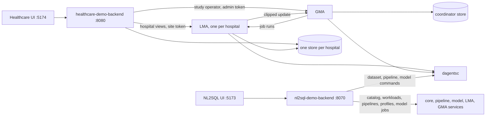
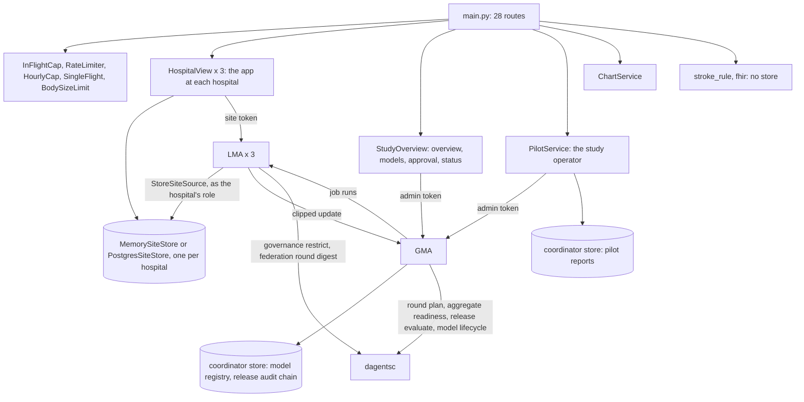
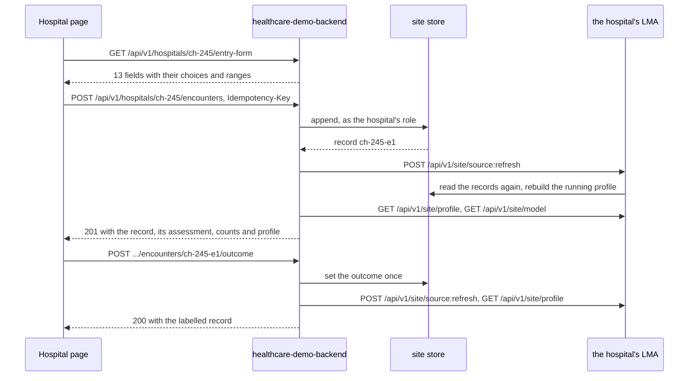
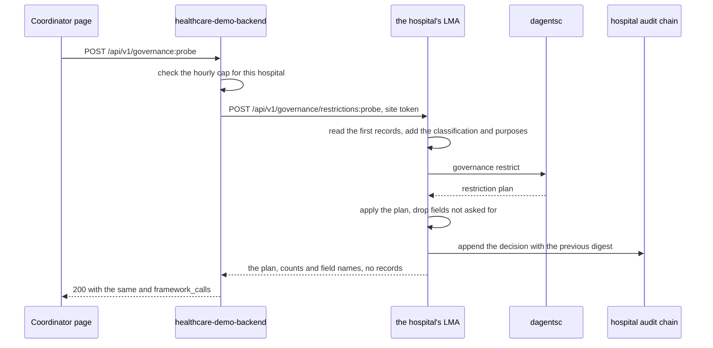
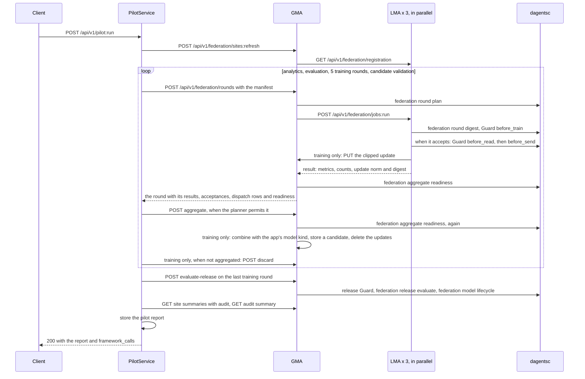
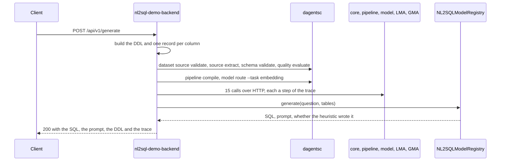

# Demo apps

Two applications in this repository are built on the framework. They show how
an application uses Dagents; they are not part of it. Each one owns its domain
code and calls the framework for planning, governance and federation.

| App | Code | Port | What it is for |
|---|---|---|---|
| healthcare-demo-backend | `apps/healthcare-demo/backend/` | 8080 | Stroke triage across three hospitals, on real, de-identified records from the International Stroke Trial (IST, 1991-1996). Each hospital keeps its records in its own store. The hospitals evaluate and train a model in federated rounds without sharing records. |
| nl2sql-demo-backend | `services/nl2sql-demo/backend/` | 8070 | Turns a question in plain English into SQL, and shows the framework steps behind the answer: source validation, planning, model routing and calls to the framework services. |

How each app uses the framework:

- **The healthcare demo calls the Dagents agents through their HTTP APIs.**
  Each hospital is served by an LMA (local monitoring agent), and the study by a
  GMA (global monitoring agent). The app calls them with the framework's agent
  client (`agents/common/infrastructure/agent_client.py`). By default the four
  agents run inside the demo's own process and are called through
  `httpx.ASGITransport`: each call goes through the agent's real routes, request
  checks and token checks, without a socket. With `HEALTHCARE_DEMO_AGENTS=network`
  they run as separate processes, and the same client calls them over HTTP. The
  agents ask the planner, `dagentsc`, for every decision; the app runs no
  planner command itself. The app contributes an extension
  (`apps/healthcare-demo/backend/app/extension.py`): the stroke feature
  contract, the data classification, the condition pack, two model kinds, a
  site source and two pipeline steps.
- **The NL2SQL backend calls the planner and the services.** It runs six planner
  commands on the schema of each question, then calls the core service, the
  pipeline service, the model service, the LMA and the GMA over HTTP
  (`services/nl2sql-demo/backend/app/services/dagents_orchestrator.py`). The SQL
  itself comes from the app's own models.



**Run them locally.** Both need the planner. Build it and set `DAGENTSC_BIN`
as the [overview](overview.md#run-a-service-to-try-the-examples) shows, then:

| App | Command | Data |
|---|---|---|
| healthcare-demo-backend | `apps/healthcare-demo/scripts/run_local_demo.sh`. The LMAs and the GMA run in the API's process. Add `--agents network` to start them as separate processes, on the ports in `apps/healthcare-demo/env/.env.healthcare-demo` | In memory, loaded from `apps/healthcare-demo/data/ist/`, unless `HEALTHCARE_DEMO_DATABASE_URL` is set. `--agents network` needs it |
| nl2sql-demo-backend | `services/nl2sql-demo/scripts/run_local_demo.sh`, or `PYTHONPATH=.:services/nl2sql-demo/backend .venv/bin/uvicorn app.main:app --port 8070` | None. Model zip files go in `NL2SQL_MODELS_DIR` |

The healthcare demo is public in its deployed form, so it has limits that the
other services do not: per-client rate limits, hourly caps, a 64 KB body limit,
a cap on requests in progress, an `Idempotency-Key` header for data entry and an
`X-Dagents-App` header on every response. The [overview](overview.md#rate-limits)
describes them. The cap on requests in progress lets 12 public requests run at
once (`HEALTHCARE_DEMO_MAX_IN_FLIGHT`). A request beyond it waits up to 20
seconds for a slot, then gets `503` with `Retry-After: 60` and "The demo server
is busy. Try again in a minute." The health routes are never held back. A
request takes its slot only after its whole body has arrived, so a slow upload
holds no slot. The
records carry the IST licence notice in `apps/healthcare-demo/data/ist/NOTICE.md`:
they contain information from the International Stroke Trial database
(version 2), made available under the ODC Attribution License, and were
collected by the IST Collaborative Group. Nothing either app returns is
clinical advice.

## The healthcare demo

The healthcare backend is one FastAPI app, `apps/healthcare-demo/backend/app/main.py`,
with 28 endpoints. It serves no LMA or GMA route: the agents are separate apps
that only the backend calls. Three hospitals take part at start:

| `site_id` | Name | Country | Records from the IST |
|---|---|---|---|
| `uk-134` | Hospital 134 | United Kingdom | 524 |
| `it-002` | Hospital 2 | Italy | 292 |
| `ch-245` | Hospital 245 | Switzerland | 198 |

Terms used in this part:

- **Site store.** Where one hospital keeps its records: its own Postgres schema,
  read and written only as that hospital's database role, or, without a
  database, its own in-memory store (`MemorySiteStore`). Both pass the same
  tests. The hospital's LMA reads the same store through `StoreSiteSource`
  (`app/services/site_source.py`), as the hospital's role.
- **LMA.** The hospital's Dagents local monitoring agent. It holds the
  hospital's Guard and audit chain, its running profile, its outcome-rate
  decision, the model in use and its job log. The app's hospital views call it
  with the LMA's `site` token.
- **GMA.** The study's Dagents global monitoring agent. It enrols the LMAs,
  sends each round's jobs to them, keeps their clipped updates until it combines
  them, keeps the model registry, and runs the release Guard and the release
  gates. The app's study operator calls it with the GMA's `admin` token. It
  never reads a hospital's records.
- **Seed rule.** `stroke-outcome-rule-v1`, a points score chosen by hand
  (`app/domain/stroke_rule.py`). It is the model in use until a federated
  candidate is approved. It is not a validated clinical model.
- **Outcome.** `poor_outcome_6m`: dead or dependent six months after the stroke.
  It is the label models are trained and measured on, and it never leaves a
  hospital.
- **Minimum cohort.** 20. The planner denies a column, table or model-update
  request that describes fewer patients.
- **`framework_calls`.** Every `2xx` answer whose body is a JSON object lists
  the agent calls behind it, in the order they finished. Each entry has
  `service` (`lma` or `gma`), `site_id`, `method`, `path` (the route template),
  `status`, `ms` and `via`. `via` is `app` for a call the app made and `gma` for
  a call the GMA made to an LMA while it dispatched a round. No entry holds a
  host, a token or a body. A JSON list (the hospital list), an error, an SVG and
  a `304` carry none. See [the FrameworkCall object](#the-frameworkcall-object).



### Which agent calls each endpoint makes

| Demo endpoint | Agent calls |
|---|---|
| `GET /api/v1/health`, `GET /api/v1/conditions`, the three scoring endpoints, `GET .../entry-form` | none |
| `GET /api/v1/overview` | GMA `GET /api/v1/federation/sites/summaries` and `GET /api/v1/model-versions`. The first time, also `GET /api/v1/health` for the engine's name, which the app then keeps |
| `GET /api/v1/extension` | GMA `GET /api/v1/extensions` |
| `GET /api/v1/hospitals`, `GET /api/v1/charts` | GMA `GET /api/v1/federation/sites/summaries`, which asks each LMA for `GET /api/v1/site/summary` |
| `GET /api/v1/hospitals/{site_id}` | that hospital's LMA: `GET /api/v1/site/summary`, `GET /api/v1/site/profile`, `POST /api/v1/site/model:evaluate`, `GET /api/v1/site/model`, `GET /api/v1/federation/jobs` |
| worklist, thresholds, the entered list, the hospital's charts | that hospital's LMA: `GET /api/v1/site/model` |
| `GET .../audit` | that hospital's LMA: `GET /api/v1/governance/audit` |
| `POST .../encounters` | that hospital's LMA: `POST /api/v1/site/source:refresh`, `GET /api/v1/site/profile`, `GET /api/v1/site/model` |
| `POST .../outcome` | that hospital's LMA: `POST /api/v1/site/source:refresh`, `GET /api/v1/site/profile` |
| `POST /api/v1/governance:probe` | that hospital's LMA: `POST /api/v1/governance/restrictions:probe` |
| `POST /api/v1/pilot:run` | the GMA only, as [the pilot](#the-federated-pilot-and-model-releases) lists; the GMA's calls to each LMA follow with `via: gma` |
| `GET /api/v1/models` | GMA `GET /api/v1/model-versions` |
| `POST /api/v1/models/{version}:approve` | GMA `POST /api/v1/model-versions/{version}:approve` |
| `GET /api/v1/framework/status` | GMA `GET /api/v1/federation/sites/summaries`, and each agent's `GET /api/v1/health`, whose results the app reuses for 15 seconds |
| `GET /api/v1/deployments` | in a network-mode run with the deployer on: GMA `GET /api/v1/federation/site-addresses`, at most once every 15 seconds, and `PUT /api/v1/federation/sites/{site_id}/address` for a joined hospital whose address the GMA no longer holds. Otherwise none |
| `POST /api/v1/deployments` | the new LMA's `GET /api/v1/health` and `GET /api/v1/site`, then GMA `PUT /api/v1/federation/sites/{site_id}/address`, `POST /api/v1/federation/sites:refresh` and `POST /api/v1/federation/rounds:plan`, as [adding a hospital](#adding-a-hospital-while-the-demo-runs) lists. A failed attempt adds the calls that undo it |

**Model versions are registered on first use.** The first request that needs a
model version (the overview, a hospital's view, worklist, thresholds, entered
list, charts or entry, the models, an approval or a pilot) first registers the
seed rule and the all-zero logistic regression with the GMA:
`PUT /api/v1/model-versions/{version}`, once for each. The GMA stores a version
sent again with the same content once. The status report, the hospital list,
the consortium charts, the audit chain and the Guard probe need no model
version, so they answer while the planner or the GMA's store is down.

**In process or over the network.** `GET /api/v1/framework/status` reports
which (`agents.mode`). In process, the app makes every token with
`secrets.token_urlsafe` when it first builds the agents (on the first request
that needs them) and logs none. Over the network, the addresses and
tokens come from the environment: `HEALTHCARE_DEMO_GMA_URL` and
`HEALTHCARE_DEMO_GMA_TOKEN`, and `HEALTHCARE_DEMO_LMA_<SITE>_URL` and
`HEALTHCARE_DEMO_LMA_<SITE>_TOKEN` for each hospital, where `<SITE>` is the
site id in upper case with `_` for `-` (`UK_134`). An agent's server error
(`5xx`), or an error the route does not expect, reaches the browser as the
app's own message, never the agent's: `503` for a planner, store or agent that
is not available, and `500` for anything else. Two refusals keep the GMA's
reason: a refused approval (`409`, "The model cannot be approved: ..."), and
a refused aggregation, which ends the pilot with the reason in `stop_reason`
and in the training round's `aggregation_error`.

## Healthcare health and descriptions

```api-interface
service: healthcare-demo-backend
status: complete
code: apps/healthcare-demo/backend/app/main.py
classes:
- Settings (apps/healthcare-demo/backend/app/core/config.py)
- HealthcareDemo (apps/healthcare-demo/backend/app/services/agents.py)
- StudyOverview (apps/healthcare-demo/backend/app/services/overview.py)
- ExtensionRegistry (agents/common/extensions/registry.py)
endpoints:
- GET /health
- GET /api/v1/health
- GET /api/v1/overview
- GET /api/v1/conditions
- GET /api/v1/extension
```

Liveness, the consortium overview, the condition the app implements, and what
its extension contributes. `Settings` reads `env/.env.shared`, then
`env/.env.healthcare-demo`, then `apps/healthcare-demo/env/.env.healthcare-demo`;
a variable already set in the environment wins. `HealthcareDemo` builds the
stores and the agents on first use, so starting the app reads no record, opens
no database connection and starts no agent.

### Check the app's health

```api-endpoint
GET /api/v1/health
```

Returns `ok` with the app's name, its environment and `data`, which names the
dataset (`ist-1-deidentified`). It reads no store, opens no database
connection and calls no agent, so it answers while the database is down. Use
it as the liveness check. `GET /health` runs the same code. The cap on requests
in progress never holds it back. To learn where the records are stored and
whether the stores can be read, call
[framework status](#healthcare-demo-backend-get-api-v1-framework-status).

**Errors.** None of its own.

**Related.** [Framework status](#healthcare-demo-backend-get-api-v1-framework-status).

### Read the consortium overview

```api-endpoint
GET /api/v1/overview
```

Returns everything the coordinator's page shows about the study, built from
what each hospital reports through the GMA. The app asks the GMA for the site
summaries. The GMA asks each hospital's LMA for its summary, and each LMA asks
its planner whether its outcome rate may leave the hospital
(`dagentsc governance restrict`, a `before_send` table request at the number of
labelled records). That question only plans: it writes no audit record, and
the LMA keeps the answer per labelled count. Each hospital's entered count
comes from its store, counted by the app at the hospital. The model in use
comes from the GMA's model registry. Nothing is stored, apart from the model
versions a first request registers.

| Field | What it holds |
|---|---|
| `study_id` | `stroke-triage-pilot` |
| `condition` | The condition's id, name, intended use and limitations |
| `dataset` | The IST citation, licence, source address, notice and credit |
| `feature_contract` | The contract's id, version and its 9 required fields |
| `field_labels` | Each record field's label, as the entry form shows it |
| `engine` | The GMA's round engine, from its health route: `http` |
| `secure_aggregation_threshold` | 3. It raises the number of hospitals a round needs to 3 |
| `minimum_cohort` | 20 |
| `current_model` | The version and kind of the model the GMA has released |
| `hospitals` | Each hospital's summary, as [the hospital list](#healthcare-demo-backend-get-api-v1-hospitals) returns it |
| `release_gates` | The five release gates a candidate must pass |
| `framework_calls` | The GMA calls behind the answer |

**Errors.** `503` when the planner cannot be run (the GMA checks each model
version with it), when an agent does not answer, or, with a database, when a
store cannot be read.

**Related.** [The hospital list](#healthcare-demo-backend-get-api-v1-hospitals),
[the condition](#healthcare-demo-backend-get-api-v1-conditions),
[the GMA's site summaries](agents.md#gma-get-api-v1-federation-sites-summaries).

### Read the condition, its contract and its classification

```api-endpoint
GET /api/v1/conditions
```

Returns the condition the app implements (`suspected_stroke`), the four
conditions it lists as planned but does not implement, the feature contract and
the data classification. All four come from `app/domain/conditions.py`; nothing
is read from a store, no agent is called and no planner command runs.

- The **condition** names its label field (`poor_outcome_6m`), its approved
  purposes and its release gates. The LMAs and the GMA read the same condition
  pack from the extension.
- The **feature contract** (`stroke-triage-features`, version
  `stroke-triage-features-v3`) lists the 14 fields every hospital produces, with
  their types and units.
- The **classification** (`stroke-triage-phi`) gives each field a sensitivity.
  `hours_since_onset`, `systolic_bp`, `atrial_fibrillation`, the outcome and
  `model_update` are `high`. The examination findings, `age_band`, `sex` and
  `stroke_subtype` are `medium`. `onset_on_waking` is `low`. The Guard plans
  every request against it. See [the DataClassification object](agents.md#the-dataclassification-object).
- The **release gates** on the condition are the five the pilot checks:
  AUC at least 0.70, an AUC at least 0.02 above the model in use, an AUC gap
  between women and men of at most 0.10, sensitivity at least 0.80 (all
  blocking), and at most 750 alerts per 1,000 patients (not blocking).

**Errors.** None of its own.

**Related.** [The extension](#healthcare-demo-backend-get-api-v1-extension),
[the ReleaseGate object](agents.md#the-releasegate-object).

### Read what the extension contributes

```api-endpoint
GET /api/v1/extension
```

Returns what the agents' extension registry holds, as the GMA describes it
(`GET /api/v1/extensions`): the extension id and version, the feature contract,
the classification, the condition pack, two model kinds (`points_rule` and
`logistic_regression`), the site source (`healthcare_site_store`) and two
named pipeline steps (`evaluate_stroke_rule`, `score_stroke_worklist`).
`boundary` lists in words what the framework owns and what the app owns.
Nothing is stored and no planner command runs.

In process, the app registers its extension in one registry that the three
LMAs and the GMA share. Started as separate processes, each agent loads it from
`LMA_EXTENSIONS` or `GMA_EXTENSIONS` (`app.extension:HealthcareStrokeExtension`).

**Errors.** `503` when the GMA does not answer.

**Related.** [GMA extensions](agents.md#gma-extensions), which this endpoint
reads, and [contribute a model kind](../../guide/02-describe-your-data.md#5-contribute-a-model-kind).

## Scoring without a store

```api-interface
service: healthcare-demo-backend
status: complete
code: apps/healthcare-demo/backend/app/main.py
classes:
- TriageRequest (apps/healthcare-demo/backend/app/models.py)
- WorklistRequest (apps/healthcare-demo/backend/app/models.py)
- FhirIngestRequest (apps/healthcare-demo/backend/app/models.py)
- StrokeAssessment (apps/healthcare-demo/backend/app/domain/stroke_rule.py)
- MappingResult (apps/healthcare-demo/backend/app/domain/fhir.py)
endpoints:
- POST /api/v1/triage:assess
- POST /api/v1/triage:worklist
- POST /api/v1/ingest:fhir
```

These three endpoints work only on the records sent in the request. They read
no store, store nothing, call no agent and no planner, and pass no Guard
boundary. They score with the seed rule, not with the model in use; the
hospital endpoints score with the model in use.

**How the seed rule scores a record.** It adds points: 0 to 5 for the age band
(one per decade from 50), 2 for `drowsy` and 4 for `unconscious`, 1 for each
deficit found (face, arm, leg, speech, visual field), 1 for atrial fibrillation
and 2 for a `TACS` subtype. The most is 17 points. A fixed logistic curve turns
the points into a risk from 0 to 1: 5 points is 0.5, and every 2 points add 1
to the log-odds. A risk below 0.5 is `routine`. A risk of 0.5 or more is an
alert and is banded `elevated`, and 0.8 or more is `urgent`. The rule uses no
blood pressure, time since onset or onset on waking. It reports unusual values
of them as warnings.

### Score one record

```api-endpoint
POST /api/v1/triage:assess
```

Scores one record with the seed rule and explains the score. The record is not
checked against the contract: a missing value adds no points and is named in
`data_quality_issues`. A record with no examination finding at all (conscious
level and the five deficits all missing) is not scored: `suppressed` is true
and `score` is 0.

| Field | What it holds |
|---|---|
| `model_version` | Always `stroke-outcome-rule-v1` |
| `score` | The risk from 0 to 1, rounded to 4 places |
| `priority` | `routine`, `elevated` or `urgent` |
| `points`, `max_points` | The points the record earned, out of 17 |
| `contributions` | The points each finding added |
| `basis` | The same points in words |
| `warnings` | Values a clinician should see, such as a systolic pressure of 220 mmHg or more |
| `data_quality_issues` | Inputs that were missing or not valid |
| `suppressed` | True when no examination finding was recorded |

**Errors.** `422` when `record` is not a JSON object. The body names the field:
`{"detail": "Some fields are not valid.", "errors": {"record": "..."}}`.

**Related.** [Rank records](#healthcare-demo-backend-post-api-v1-triage-worklist),
[a hospital's worklist](#healthcare-demo-backend-get-api-v1-hospitals-site-id-worklist).

### Rank records by risk

```api-endpoint
POST /api/v1/triage:worklist
```

Scores up to 500 records with the seed rule and returns them highest risk
first, each with its assessment under `assessment`. Nothing is removed from the
list: records that could not be scored go to the end, and records with the same
score keep their order. Keys that are not contract fields, such as `case_id` in
the example, are returned unchanged.

**Errors.** `422` when `records` is not a list, or has more than 500 items.

**Related.** [Score one record](#healthcare-demo-backend-post-api-v1-triage-assess).

### Map a FHIR bundle into the contract

```api-endpoint
POST /api/v1/ingest:fhir
```

Maps a FHIR-shaped bundle (FHIR is the HL7 standard for health records) into
records of the stroke feature contract, and reports what it could not map. It
is a demonstration mapper, not a FHIR client (`app/domain/fhir.py`):

- Each `Encounter` becomes one record. Its fields `age`, `gender`,
  `consciousLevel`, `strokeSubtype`, the seven yes/no findings and
  `hoursSinceOnset` or `minutesSinceOnset` become contract fields. The age band
  is derived from `age`.
- An `Observation` joins the encounter its `encounter.reference` names. Only
  LOINC code `8480-6` (systolic blood pressure) is mapped; a pressure in `kPa`
  is converted to mmHg (1 kPa = 7.50062 mmHg). Every other code is listed in
  `unmapped_codes`.
- A value out of its range or in an unknown unit is left out and named in
  `issues`. A required contract field that is missing is named too.

The answer holds `mapped` (one entry per encounter: `record`, `unmapped`,
`issues`), `unmapped_codes` (every unmapped code, sorted) and `record_count`.
Nothing is stored.

**Errors.** `422` when `bundle` is not a JSON object.

**Related.** [Enter a record](#healthcare-demo-backend-post-api-v1-hospitals-site-id-encounters),
which stores a record instead.

## Hospitals

```api-interface
service: healthcare-demo-backend
status: complete
code: apps/healthcare-demo/backend/app/main.py
classes:
- HospitalView (apps/healthcare-demo/backend/app/services/hospital_views.py)
- StudyOverview (apps/healthcare-demo/backend/app/services/overview.py)
- MemorySiteStore (apps/healthcare-demo/backend/app/services/site_store.py)
- PostgresSiteStore (apps/healthcare-demo/backend/app/services/site_store.py)
- LmaClient (agents/common/infrastructure/agent_client.py)
endpoints:
- GET /api/v1/hospitals
- GET /api/v1/hospitals/{site_id}
- GET /api/v1/hospitals/{site_id}/worklist
- GET /api/v1/hospitals/{site_id}/thresholds
- GET /api/v1/hospitals/{site_id}/audit
```

What each hospital reports, and one hospital's own view. Each hospital has two
parts:

- **Its LMA** holds the Guard and the audit chain, the running profile (the
  count, missing values and value counts or mean and variance of each field),
  the outcome-rate decision, the model in use and the job log. The LMA rebuilds
  the profile when the store's version changes.
- **The app at the hospital** (`HospitalView`) reads the hospital's records
  only through its site store, as the hospital's role, and scores them with the
  model the hospital's LMA reports in use. With Postgres every read runs in one
  transaction that starts with `SET LOCAL ROLE` to the hospital's role.

A hospital view calls only its own hospital's LMA, with that LMA's `site`
token, and holds no lock or store connection while it waits for the answer.
The hospital list is what the coordinator may see, and the app reads it through
the GMA. The other four endpoints are the hospital's own view, for its staff:
the demo shows them on a hospital's page, and the records they return stay at
that hospital in a real deployment. None of them writes anything.

### List what each hospital reports

```api-endpoint
GET /api/v1/hospitals
```

Returns one summary per hospital, in the order `uk-134`, `it-002`, `ch-245`.
The app asks the GMA for its site summaries
(`GET /api/v1/federation/sites/summaries`), and the GMA reads each LMA's
`GET /api/v1/site/summary`. Each summary has the hospital's id, name and
country, its record counts (`record_count` and `labelled_count` from the LMA,
`entered_count` counted by the app in the store), its store's kind and
`minimum_cohort`.

`outcome_rate` is the share of labelled records with a poor outcome, and it is
`null` unless the hospital's planner permits it to leave. `outcome_rate_status`
says why:

| Status | Meaning |
|---|---|
| `released` | The planner permits a table request for the outcome at this many labelled records |
| `below_minimum_cohort` | The planner denies it because fewer than 20 records have an outcome |
| `no_outcomes` | No record has an outcome, so there is no rate. The LMA calls this `no_labels` |
| `denied` | The planner denies it for another reason |
| `withheld` | The planner could not be run, so the Guard withholds the rate |

The question is `dagentsc governance restrict`, which each LMA asks once per
labelled count and does not write to the audit chain. The example ran after
[the overview](#healthcare-demo-backend-get-api-v1-overview) had asked it for
the same counts, so the example itself ran no planner command. The answer is a
JSON list, so it carries no `framework_calls`.

**Errors.** `503` when the GMA does not answer, when a hospital's LMA does not
answer the GMA or sends no summary, or, with a database, when a store cannot
be read.

**Related.** [One hospital's view](#healthcare-demo-backend-get-api-v1-hospitals-site-id),
[the overview](#healthcare-demo-backend-get-api-v1-overview),
[the LMA's summary](agents.md#lma-get-api-v1-site-summary).

### Read one hospital's view

```api-endpoint
GET /api/v1/hospitals/{site_id}
```

Returns what the hospital's page shows. From the hospital's LMA: the outcome
rate and its status (`GET /api/v1/site/summary`), the running profile
(`GET /api/v1/site/profile`), the model in use measured on the hospital's
labelled records (`POST /api/v1/site/model:evaluate`; `local_metrics`: AUC,
sensitivity, specificity, alerts per 1,000 and the AUC gap between women and
men), the model in use (`GET /api/v1/site/model`; `current_model`) and
`contributions`, the 20 newest entries of the LMA's job log
(`GET /api/v1/federation/jobs`), newest first. From the hospital's store: the
counts, where the records are, and `max_entered` (300). Before any pilot,
`contributions` is empty. Nothing is stored. The example's `framework_calls`
is trimmed to the first three of the five calls.

**Errors.** `404` when no hospital has this id. `503` when the planner cannot
be run, the LMA does not answer, or, with a database, the store cannot be read.

**Related.** [The hospital's worklist](#healthcare-demo-backend-get-api-v1-hospitals-site-id-worklist),
[its charts](#healthcare-demo-backend-get-api-v1-hospitals-site-id-charts),
[the DatasetProfile object](agents.md#the-datasetprofile-object),
[the LMA site endpoints](agents.md#lma-site).

### Read a hospital's worklist

```api-endpoint
GET /api/v1/hospitals/{site_id}/worklist
```

Returns the hospital's records ranked by the model in use, highest risk first,
`limit` of them (default 12). The app reads the records in the hospital's store
and asks the LMA for the model in use (`GET /api/v1/site/model`). Each record
has its fields and an `assessment` as in
[scoring one record](#healthcare-demo-backend-post-api-v1-triage-assess), plus
`model_kind`. Records the model cannot score go to the end. The model in use is
the seed rule until a candidate is approved; after that, the assessment of a
logistic regression lists the largest terms on the log-odds scale in `basis`.
Nothing is stored.

**Errors.** `404` when no hospital has this id. `422` when `limit` is outside 1
to 200. `503` when the planner cannot be run or the LMA does not answer.

**Related.** [Rank records sent in the request](#healthcare-demo-backend-post-api-v1-triage-worklist).

### Read a hospital's threshold sweep

```api-endpoint
GET /api/v1/hospitals/{site_id}/thresholds
```

Measures the model in use on the hospital's labelled records at 19 alert
thresholds, from 0.05 to 0.95 in steps of 0.05. Each row has `threshold`,
`alerts_per_1000`, `sensitivity` (the share of patients with a poor outcome who
get an alert) and `specificity` (the share of the others who do not). The alert
threshold the app uses is 0.5. A hospital with no labelled records returns an
empty `sweep`. The app reads the records in the store and the model from the
LMA. Nothing is stored.

**Errors.** `404` when no hospital has this id. `503` when the planner cannot be
run or the LMA does not answer.

**Related.** [One hospital's view](#healthcare-demo-backend-get-api-v1-hospitals-site-id).

### Read a hospital's audit chain

```api-endpoint
GET /api/v1/hospitals/{site_id}/audit
```

Returns the hospital's Guard decisions, newest first, `limit` of them (default
50), and `chain_intact`: whether every record's `previous_digest` equals the
digest of the record before it. The app reads them from the hospital's LMA
(`GET /api/v1/governance/audit`). The LMA writes a record for every Guard
decision at the hospital: each [Guard probe](#healthcare-demo-backend-post-api-v1-governance-probe),
and three per round job in a pilot (`before_train`, `before_read`,
`before_send`), so one pilot adds 24 records per hospital. Planning questions,
such as the outcome-rate check, write nothing. Reading the chain stores
nothing.

**Errors.** `404` when no hospital has this id. `422` when `limit` is outside 1
to 500. `503` when the LMA does not answer.

**Related.** [The AuditRecord object](agents.md#the-auditrecord-object),
[the Guard probe](#healthcare-demo-backend-post-api-v1-governance-probe).

## Data entry

```api-interface
service: healthcare-demo-backend
status: complete
code: apps/healthcare-demo/backend/app/main.py
classes:
- HospitalView (apps/healthcare-demo/backend/app/services/hospital_views.py)
- StoreSiteSource (apps/healthcare-demo/backend/app/services/site_source.py)
- EncounterEntry (apps/healthcare-demo/backend/app/models.py)
- OutcomeRequest (apps/healthcare-demo/backend/app/models.py)
- RateLimiter (apps/healthcare-demo/backend/app/api/limits.py)
endpoints:
- GET /api/v1/hospitals/{site_id}/entry-form
- POST /api/v1/hospitals/{site_id}/encounters
- GET /api/v1/hospitals/{site_id}/encounters
- POST /api/v1/hospitals/{site_id}/encounters/{encounter_id}/outcome
```

Entering a record at a hospital, and recording its six-month outcome later.
The demo has no accounts, so entries are typed: the body accepts the 13 fields
of [EncounterEntry](#the-encounterentry-object) and nothing else. Each field is
a choice from a list, a number in a range, or yes/no; no field takes free text
or an identifier. The entry body and the entry form are built from the same
field domains (`STROKE_FIELD_DOMAINS` in `app/domain/conditions.py`), so they
cannot disagree.

Each hospital accepts at most 300 entered records
(`HEALTHCARE_DEMO_MAX_ENTERED_PER_SITE`). Entering and recording outcomes share
a limit of 30 requests per minute per client. No planner command runs and no
Guard boundary is passed: the app writes to the hospital's store, as the
hospital. When the write has finished, the app asks the hospital's LMA to read
the store again (`POST /api/v1/site/source:refresh`), so the LMA's profile and
summary, the next probe and the next pilot include the record. No lock or store
connection is held during that call.



### Read the data-entry form

```api-endpoint
GET /api/v1/hospitals/{site_id}/entry-form
```

Returns the form the hospital's page renders: the 13 fields in order, each with
`name`, `label`, `type` (`integer`, `number`, `choice` or `boolean`),
`required`, `options`, `min`, `max`, `unit` and `help`. It also returns how many
records the hospital may still accept (`remaining`), the `Idempotency-Key`
rules, and a notice that every visitor can read what is entered. The page draws
the form from this answer and owns none of its rules. It calls no agent, and
nothing is stored.

**Errors.** `404` when no hospital has this id. `503` only with a database,
when the store cannot be read.

**Related.** [Enter a record](#healthcare-demo-backend-post-api-v1-hospitals-site-id-encounters),
[the EncounterEntry object](#the-encounterentry-object).

### Enter a record

```api-endpoint
POST /api/v1/hospitals/{site_id}/encounters
```

Stores a new record in the hospital's store, as the hospital, and answers
`201`. The store gives it the id `<site_id>-e<n>` (the first is `ch-245-e1`),
sets `origin` to `entered`, derives `age_band` from `age` and records
`recorded_at`. The exact age stays at the hospital; only the age band is a
contract field. The record has no outcome yet. Then the app asks the LMA to
read the store again, and the answer holds:

| Field | What it holds |
|---|---|
| `record` | The stored record. Missing values are left out |
| `assessment` | The record scored by the model in use, which the LMA reports |
| `counts` | The hospital's `total`, `entered` and `labelled` counts after the entry |
| `profile` | The hospital's running profile after the entry, from its LMA |
| `framework_calls` | The three calls to the hospital's LMA |

**Retries.** Send an `Idempotency-Key` with each new record. The same key with
the same fields returns `201` and the record stored the first time; nothing new
is stored. The same key with different fields returns `409`. A retry is
refused with `409` too once the hospital holds 300 entered records. If the LMA
does not answer after the write, the answer is `503` but the record is stored;
sending it again with the same key returns it.

**Errors.** `404` when no hospital has this id. `409` for a reused key or a full
hospital. `422` when a field is missing, out of its range, not one of its
choices, or not a field of the record, or when the `Idempotency-Key` has
characters other than letters, digits and `. _ : -`; `errors` names each one.
`429` beyond 30 requests per minute from one client. `413` for a body larger
than 64 KB. `503` when the planner cannot be run, the LMA does not answer, or,
with a database, the store cannot be reached. The app registers its model
versions with the GMA before the write, so a `503` from a missing planner
stores nothing.

**Related.** [The EncounterEntry object](#the-encounterentry-object),
[record the outcome](#healthcare-demo-backend-post-api-v1-hospitals-site-id-encounters-encounter-id-outcome),
[idempotency](overview.md#idempotency),
[the LMA's refresh](agents.md#lma-post-api-v1-site-source-refresh).

### List the records entered at a hospital

```api-endpoint
GET /api/v1/hospitals/{site_id}/encounters
```

Returns the records entered through the form at this hospital, newest first,
`limit` of them (default 20), each with `recorded_at`, `outcome_recorded_at`
once an outcome is set, and its assessment by the model in use. It also returns
the hospital's `counts` and `max_entered`. Records from the IST are not listed:
`origin` takes only `entered`. The app reads the records in the store and the
model from the LMA. Nothing is stored.

**Errors.** `404` when no hospital has this id. `422` when `limit` is outside 1
to 300, or `origin` is not `entered`. `503` when the planner cannot be run or
the LMA does not answer.

**Related.** [Enter a record](#healthcare-demo-backend-post-api-v1-hospitals-site-id-encounters).

### Record a six-month outcome

```api-endpoint
POST /api/v1/hospitals/{site_id}/encounters/{encounter_id}/outcome
```

Sets `poor_outcome_6m` on a record entered at this hospital and records
`outcome_recorded_at`. Then the app asks the LMA to read the store again, and
returns the record, the hospital's counts and its running profile from the
LMA. An outcome is recorded once: the same value again returns `200` with the
record unchanged, and a different value returns `409`. The demo has no
accounts, so allowing a change would let any visitor change another visitor's
training label. The next pilot trains and evaluates on the labelled record.

**Errors.** `404` when no hospital or no record has this id. `409` when the
record already has a different outcome. `422` when the record came from the
IST (only entered records take an outcome), or the body is not
`{"poor_outcome_6m": true|false}`. `429` beyond 30 requests per minute from one
client, counted together with entries. `503` when the LMA does not answer or,
with a database, the store cannot be reached.

**Related.** [Enter a record](#healthcare-demo-backend-post-api-v1-hospitals-site-id-encounters),
[run the pilot](#healthcare-demo-backend-post-api-v1-pilot-run).

## Charts

```api-interface
service: healthcare-demo-backend
status: complete
code: apps/healthcare-demo/backend/app/main.py, apps/healthcare-demo/backend/app/services/charts_service.py
classes:
- ChartService (apps/healthcare-demo/backend/app/services/charts_service.py)
- ChartSpec (apps/healthcare-demo/backend/app/services/charts_service.py)
endpoints:
- GET /api/v1/charts
- GET /api/v1/charts/{chart_id}.svg
- GET /api/v1/hospitals/{site_id}/charts
- GET /api/v1/hospitals/{site_id}/charts/{chart_id}.svg
```

The backend draws every chart as SVG, so the page and the API show the same
numbers. Each chart has a list entry and a drawing:

| List entry field | What it holds |
|---|---|
| `chart_id` | The id to put in the SVG path |
| `title`, `description`, `alt` | The chart's text. `alt` describes the chart for a screen reader |
| `available` | False when the data does not exist yet; `reason` says why |
| `table` | The chart's numbers as `columns` and `rows` |
| `notice` | The IST licence notice |
| `svg_path` | Where to fetch the drawing |
| `drawn_by` | Who drew the chart: the app, with the Dagents chart renderer |
| `data_from` | Where its numbers come from, in words |
| `version` | A digest of the entry, including the table. `drawn_by` and `data_from` are not part of it |

There are two sets:

| Set | Charts | Data |
|---|---|---|
| Consortium | `hospital-records`, `hospital-outcome-rates`, `site-auc`, `training-curve`, `release-gates` | What each hospital's LMA reports through the GMA, and the last pilot's report. The last three need a pilot. |
| Hospital | `outcome-by-age-band`, `presentation`, `systolic-bp`, `risk-scores` | That hospital's own records, read in its store as its role. The risk chart scores them with the model the hospital's LMA reports in use. |

Drawing uses the framework's chart renderer
(`agents/common/infrastructure/charts.py`, matplotlib) as a library call in the
app's process. A drawing has no date or random ids, so the same data gives the
same bytes, and up to 256 drawings are kept in memory. The colours mark which
hospital a series belongs to and never a decision.

**Conditional requests.** An SVG answer carries `ETag: "<version>-<theme>"` and
`Cache-Control: no-cache`. Send the ETag back in `If-None-Match`, and the answer
is `304` with no body while the chart has not changed. Entering a record or
running a pilot changes it.

### List the consortium charts

```api-endpoint
GET /api/v1/charts
```

Returns the five consortium charts in display order. The two record charts are
built from the site summaries the GMA collects from the LMAs, so a hospital
whose planner withholds its outcome rate shows a gap, and the table gives the
reason. The three pilot charts read the last pilot's report, which the
coordinator store keeps across restarts. Before any pilot they are listed with
`available: false`. It never answers `4xx`. Building the summaries can make
each LMA run `dagentsc governance restrict`, as
[the hospital list](#healthcare-demo-backend-get-api-v1-hospitals) does.
Nothing is stored.

**Errors.** `503` when the GMA or an LMA does not answer, or, with a database,
when a store cannot be read.

**Related.** [Draw a consortium chart](#healthcare-demo-backend-get-api-v1-charts-chart-id-svg).

### Draw a consortium chart

```api-endpoint
GET /api/v1/charts/{chart_id}.svg
```

Returns one consortium chart as an SVG document (`image/svg+xml`), in the
`light` or `dark` theme. The answer also carries
`Content-Security-Policy: default-src 'none'; style-src 'unsafe-inline'` and
`X-Content-Type-Options: nosniff`, so the SVG cannot run a script or load
anything. The examples are trimmed to the first 400 characters of the
document. An SVG carries no `framework_calls`. Nothing is stored.

**Errors.** `304` (not an error) when `If-None-Match` holds the current ETag.
`404` when no chart has this id, or when the chart needs a pilot that has not
run; the body gives the reason. `422` when `theme` is not `light` or `dark`.
`503` when matplotlib is not installed on the server, or an agent does not
answer.

**Related.** [List the consortium charts](#healthcare-demo-backend-get-api-v1-charts).

### List a hospital's charts

```api-endpoint
GET /api/v1/hospitals/{site_id}/charts
```

Returns the hospital's four charts, built from its own records: the share with
a poor outcome by age band, how often each examination finding was present,
systolic blood pressure in 20 mmHg bands from 60 to 300, and the model in use's
scores by recorded outcome. Over an empty store each chart is listed with
`available: false`. Nothing is stored.

**Errors.** `404` when no hospital has this id. `503` when the planner cannot
be run, the LMA does not answer, or, with a database, the store cannot be
read.

**Related.** [Draw a hospital chart](#healthcare-demo-backend-get-api-v1-hospitals-site-id-charts-chart-id-svg).

### Draw a hospital chart

```api-endpoint
GET /api/v1/hospitals/{site_id}/charts/{chart_id}.svg
```

Returns one of the hospital's charts as SVG, with the same headers and
conditional requests as a consortium chart. The hospital's series colour is the
same as on the consortium charts. Nothing is stored.

**Errors.** `404` when no hospital or no chart has this id, or the hospital's
store holds no records. `422` for a `theme` other than `light` or `dark`.
`503` when matplotlib is not installed, or the planner or the LMA is not
available.

**Related.** [List a hospital's charts](#healthcare-demo-backend-get-api-v1-hospitals-site-id-charts).

## The Guard probe

```api-interface
service: healthcare-demo-backend
status: complete
code: apps/healthcare-demo/backend/app/main.py
classes:
- HospitalView (apps/healthcare-demo/backend/app/services/hospital_views.py)
- ProbeRequest (agents/common/domain/site.py)
- GuardProbeRequest (apps/healthcare-demo/backend/app/models.py)
- GuardProbeResponse (apps/healthcare-demo/backend/app/models.py)
- HourlyCap (apps/healthcare-demo/backend/app/api/limits.py)
endpoints:
- POST /api/v1/governance:probe
```

A probe asks one hospital's Guard what it would release for a request, so a
reader can change the requester's trust, the boundary or the granularity and
see the decision change. The hospital's LMA runs the Guard
(`POST /api/v1/governance/restrictions:probe`) over the hospital's records,
with the hospital's classification and the condition pack's approved
purposes, and writes the decision to the hospital's audit chain.

The audit chain is shown to every visitor and cannot be edited without breaking
it, so the request takes no free text: the requester (`demo-operator`), its
affiliation and the purpose (`suspected_stroke`) are set by the server, and
`requested_fields` takes contract fields only. The answer counts the released
records and names their fields; it holds no record.



### Ask a hospital's Guard about a request

```api-endpoint
POST /api/v1/governance:probe
```

Builds a [ProbeRequest](agents.md#the-proberequest-object) from the body and
sends it to the hospital's LMA. The requester has two attributes,
`verified_identity` and `signed_dua`, both verified or both not as `verified`
says. The LMA gives the request the id `probe:<site_id>:<random hex>`. Its Guard
reads the hospital's first `record_limit` records (default 5), asks the planner
for a plan (`dagentsc governance restrict`), applies it and writes one audit
record. When `cohort_size` is not sent, it is the number of records read.

The answer is a [GuardProbeResponse](#the-guardproberesponse-object). In the
first example, the default levers give trust `high`, and the plan generalizes
`systolic_bp` (sensitivity `high`) and allows `age_band` and `onset_on_waking`:
5 records are released with those 3 fields. In the second, an unverified
requester asks for a table about 12 patients; the plan denies it because 12 is
below the minimum cohort of 20, and nothing is released.

The Guard fails closed. When the planner cannot be run, the answer is `200` with
`permitted: false`, a `deny` plan and the reason, and the LMA records the
denial.

**Errors.** `404` when `site_id` names no hospital. `422` for an unknown key, a
value outside its choices or range, or a requested field that is not a contract
field, such as the outcome `poor_outcome_6m`. `429` beyond 60 probes per minute
from one client, or 600 probes in any hour at one hospital from all clients
together; `Retry-After` gives the seconds to wait. `503` when the LMA does not
answer.

**Related.** [The GuardProbeRequest object](#the-guardproberequest-object),
[the RestrictionPlan object](agents.md#the-restrictionplan-object),
[the hospital's audit chain](#healthcare-demo-backend-get-api-v1-hospitals-site-id-audit),
[the LMA's probe](agents.md#lma-post-api-v1-governance-restrictions-probe),
[`dagentsc governance restrict`](dagentsc.md#dagentsc-governance-restrict).

## The federated pilot and model releases

```api-interface
service: healthcare-demo-backend
status: complete
code: apps/healthcare-demo/backend/app/main.py, apps/healthcare-demo/backend/app/services/pilot.py
classes:
- PilotService (apps/healthcare-demo/backend/app/services/pilot.py)
- StudyOverview (apps/healthcare-demo/backend/app/services/overview.py)
- GmaClient (agents/common/infrastructure/agent_client.py)
- LogisticRegressionKind (apps/healthcare-demo/backend/app/domain/model_kinds.py)
- SingleFlight (apps/healthcare-demo/backend/app/api/limits.py)
endpoints:
- POST /api/v1/pilot:run
- GET /api/v1/models
- POST /api/v1/models/{version}:approve
```

A **pilot** is one run of the study across the three hospitals. The app's study
operator (`PilotService`) runs it as calls to the GMA, with the GMA's `admin`
token. The GMA plans each round with the planner and sends the round's job to
each hospital's LMA over HTTP, in one `jobs:run` call: the LMA checks the job
and may refuse it, and runs it when it accepts. Each LMA decides for itself
whether to take part.

No record leaves a hospital. An LMA sends metrics, counts and, in a training
round, a parameter update clipped by its `before_send` Guard. The update goes
to the GMA's update store (`PUT /api/v1/federation/rounds/{round_id}/updates/{site_id}`),
never into the result. The GMA combines the updates with the app's model kind
(`LogisticRegressionKind.combine`) and deletes them.

The rounds, in order:

| Round | Each hospital's LMA | The GMA |
|---|---|---|
| analytics | Profiles its records: count, completeness, label coverage, and the outcome rate when its planner permits it | Plans the round and checks readiness |
| evaluation | Measures the model in use on its labelled records | Averages the metrics by size: the baseline a candidate must beat |
| training, 5 rounds | Trains the logistic regression from the last version for 30 epochs (learning rate 0.5, L2 0.01) and uploads the clipped update | Combines the updates with the planner's weights, using the app's model kind, and stores the next version as a candidate |
| candidate validation | Measures the final version | Averages the metrics |
| release | | Runs the release Guard (`before_release`), the planner's release gates and its model lifecycle rule |

Before it accepts a job, each LMA checks the round: the round digest
(`dagentsc federation round digest`), the model version from the GMA, that its
parameters match the digest the manifest names, and that the code digest is
the code its model kind runs. Each job passes the hospital's Guard three times
(`before_train`, `before_read`, `before_send`), so a pilot adds 24 records to
each hospital's audit chain and 1 to the GMA's.

The pilot as GMA calls:

1. `POST /api/v1/federation/sites:refresh`. The GMA reads each LMA's
   registration and enrols the hospitals with their current cohort sizes, once
   per pilot.
2. `GET /api/v1/model-versions:released` for the model in use, and
   `GET /api/v1/health` for the GMA's engine.
3. For each round, `POST /api/v1/federation/rounds` with the round manifest.
   The GMA dispatches the jobs and answers with the results, each LMA's
   acceptance, the dispatch rows and the planner's readiness. When the planner
   permits it, `POST .../rounds/{round_id}:aggregate` follows; the GMA asks the
   planner again before it aggregates. Before the first training round,
   `GET /api/v1/model-versions/{version}` reads the all-zero starting model.
   Aggregating a training round deletes its updates. A training round that is
   not aggregated ends with `POST .../rounds/{round_id}:discard`, so no update
   stays stored.
4. `POST .../rounds/{last training round}:evaluate-release`, with the
   validation round's metrics (`metrics_from_round`), the evaluation round as
   the baseline (`baseline_from_round`), the release committee as the requester
   and the condition id. The GMA runs the release Guard, the gates and the
   lifecycle rule, and stores the decision with the model version.
5. `GET /api/v1/federation/sites/summaries?include=audit` for each hospital's
   audit chain state, and `GET /api/v1/governance/audit:summary` for the GMA's.

Then the app puts the report together and stores it in the coordinator store.

**A candidate is never released by the pilot.** When the gates and the release
Guard allow it, it stays a `candidate` until a person approves it with
[`POST /api/v1/models/{version}:approve`](#healthcare-demo-backend-post-api-v1-models-version-approve).
A gate whose metric is missing blocks the release.



### Run the federated pilot

```api-endpoint
POST /api/v1/pilot:run
```

Runs every round above and returns the evidence. The pilot id is
`<round_prefix>-<UTC timestamp>-<6 random hex characters>`, so two pilots never
share a round id, and every round id starts with it. The app runs no planner
command itself. The agents run `federation round digest`,
`federation round plan`, `governance restrict`,
`federation aggregate readiness`, `federation release evaluate` and
`federation model lifecycle`.

It stores:

- at the GMA: one candidate model version per training round, each round's
  starting version marked `superseded`, the release decision with the final
  candidate, and one record in the GMA's audit chain;
- at each LMA: its job log entries and its audit records;
- in the coordinator store: the report itself, so the pilot charts survive a
  restart.

A candidate that the gates or the release Guard refuse becomes `rejected`. With
a database, every store operation is a round trip, so a pilot takes longer.

| Report field | What it holds |
|---|---|
| `pilot_id`, `study_id`, `condition`, `engine` | Which pilot, which study, and the GMA engine that ran it (`http`) |
| `model_in_use` | The model the GMA had released when the pilot started |
| `rounds` | `analytics`, `evaluation`, `training` (a list) and `candidate_validation`. Each has the round id, the model version and digests, the [round plan](agents.md#the-roundplan-object), each hospital's [result](agents.md#the-siteresult-object), the [readiness](agents.md#the-aggregationreadiness-object), a status, each LMA's [acceptance](agents.md#the-jobacceptance-object) and the [dispatch rows](agents.md#the-dispatchcall-object): the `jobs:run` call the GMA sent each LMA, with its status code and outcome. An analytics result reports the share of poor outcomes as `outcome_rate`, which the LMA calls `label_rate` |
| `training_curve` | Per training round: the loss before and after, each hospital's update norm, and the version it produced |
| `training_settings` | 5 rounds, 30 epochs, learning rate 0.5, L2 0.01, the initial version |
| `candidate` | The final [candidate](agents.md#the-candidatemodel-object), its validated metrics and its status |
| `release` | `guard`: the release Guard's decision. `gates`: the [release decision](agents.md#the-releasedecision-object). `metrics_source`: `rounds`, because the GMA collected the results itself. `baseline_version`: the model the gates compared against |
| `baseline_metrics` | The model in use, measured at every hospital and averaged by size |
| `stop_reason` | Why training stopped early, or `null` |
| `site_audits`, `coordinator_audit` | Whether each audit chain verifies and how many records it holds, as each LMA reports it through the GMA and as the GMA reports its own. No audit record is in the report |
| `notice`, `dataset_notice` | What the records are, and the IST licence notice |
| `framework_calls` | Every GMA call the app made, each followed by the GMA's calls to the LMAs for that round (`via: gma`) |

In the example, the candidate passes the AUC floor of 0.70 but not
`improves_on_current_release`, which needs the baseline's AUC plus 0.02. The
action is `reject`, so the candidate's status is `rejected`. The example is
trimmed to 3 items per list and 200 characters per string. The GMA calls the
hospitals in parallel, so the order and times of the dispatch rows change from
run to run.

**Errors.** `409` when a pilot is already running, or a hospital is being added; one of them runs at a time, and the body says which. `422`
for a `round_prefix` other than `ui` or `api`, or any other key. `429` beyond 3
pilots per minute from one client, or 20 pilots in any hour from all clients
together. `503` when the planner cannot be run, an agent does not answer, or,
with a database, a store cannot be reached. When the GMA refuses to aggregate a
training round, the pilot stops training and says why in `stop_reason`.

**Related.** [List the model versions](#healthcare-demo-backend-get-api-v1-models),
[the consortium charts](#healthcare-demo-backend-get-api-v1-charts),
[Federated rounds on the GMA](agents.md#federated-rounds) and
[the GMA update store](agents.md#gma-update-store), which the pilot uses.

### List the model versions

```api-endpoint
GET /api/v1/models
```

Returns `model_in_use` and `models`: the 20 newest versions in the GMA's model
registry (`GET /api/v1/model-versions`), oldest first. Each version has
`version`, `kind` (`points_rule` or `logistic_regression`), `digest` (a SHA-256
of its parameters), `status` (`released`, `candidate`, `superseded` or
`rejected`), `parent_version`, `created_at` and `release_decision`. A version's
parameters are not returned. Before any pilot, the seed rule and the all-zero
logistic regression are listed; each pilot adds up to 5 versions, one per
training round. Nothing is stored.

**Errors.** `503` when the planner cannot be run, the GMA does not answer, or,
with a database, the GMA's store cannot be read.

**Related.** [Run the pilot](#healthcare-demo-backend-post-api-v1-pilot-run),
[approve a candidate](#healthcare-demo-backend-post-api-v1-models-version-approve),
[the GMA's model versions](agents.md#model-versions).

### Approve a candidate for release

```api-endpoint
POST /api/v1/models/{version}:approve
```

Releases a candidate through the GMA
(`POST /api/v1/model-versions/{version}:approve`), as the person who approves
releases. The GMA's model lifecycle rule
([`dagentsc federation model lifecycle`](dagentsc.md#dagentsc-federation-model-lifecycle))
decides: the version's last release decision must be `release`, its release
Guard check permitted, its metrics taken from the rounds, the version still a
`candidate`, and the model its gates compared it with still the model in use.
The decision is read from the GMA's model registry, which a database keeps
across restarts. On success the version becomes `released`, the previous model
becomes `superseded`, and the hospital views score with the new model, which
each LMA reads from the GMA the next time it is asked for the model in use.
The answer is `{"released": <the version's summary>, "previous": "<the
previous version>"}`.

A candidate's version is `stroke-outcome-logreg+<round id>`, and a round id
holds a timestamp and a random suffix. So the examples cannot name a real
candidate, and show the errors only.

**Errors.** `404` when no version has this name. `409` when the version cannot
be approved; the body gives the GMA's reason. `429` beyond 10 approvals per
minute from one client. The examples ran with a limit of 2, so the third
request was refused with `Retry-After: 30`. `503` when the planner cannot be
run or the GMA does not answer.

**Related.** [List the model versions](#healthcare-demo-backend-get-api-v1-models),
[run the pilot](#healthcare-demo-backend-post-api-v1-pilot-run),
[approve a candidate at the GMA](agents.md#gma-post-api-v1-model-versions-version-approve).

## Adding a hospital while the demo runs

```api-interface
service: healthcare-demo-backend
status: complete
code: apps/healthcare-demo/backend/app/api/deploy_routes.py, apps/healthcare-demo/backend/app/services/deployment.py
classes:
- HospitalDeployer (apps/healthcare-demo/backend/app/services/deployment.py)
- CoreServiceClient (apps/healthcare-demo/backend/app/services/core_client.py)
- LmaProbe (apps/healthcare-demo/backend/app/services/agents.py)
- LocalProcessApplier (agents/common/infrastructure/compose_apply.py)
- DockerComposeApplier (agents/common/infrastructure/compose_apply.py)
endpoints:
- GET /api/v1/deployments
- POST /api/v1/deployments
```

Hospital 290 (`pl-290`, Poland, 263 IST records) is not in the consortium at
start. A network-mode run on your own machine, started with `--deploy`
(`scripts/run_local_demo.sh --agents network --deploy`, or
`docker-compose.deploy.yml`), can add it while the demo runs. Its records are
in its own Postgres schema, `site_pl_290`, seeded with the others. Every read
of them goes through the hospital's own store, acting as its own role: its LMA
reads them, and so does the app's view of that hospital. The coordinator's role
has no grant on the schema.

The deployer runs seven steps. The framework makes every decision and does
every side effect except the join:

| Step | What happens | Who does it |
|---|---|---|
| `plan` | The new LMA's Compose file is rendered from a workload spec, and checked against it | core-service (`POST /api/v1/manifests/compose`), the OCaml manifest compiler |
| `start` | The one service in that file starts, as a local process or a container | an applier from `agents/common/infrastructure/compose_apply.py` |
| `answer` | The new LMA answers its health check and reports site `pl-290`, read from its schema in Postgres | the new LMA |
| `attach` | The GMA accepts the LMA's address, only the one in its `GMA_JOINABLE_SITE_ENDPOINTS` | the GMA |
| `enrol` | The GMA enrols the site from the registration its LMA reports | the GMA |
| `join` | The app adds the hospital: its pages come from its LMA, and every later round invites it | the app |
| `check` | The planner plans the next round and says whether it selects the hospital | the GMA's planner |

A failure in steps 2 to 6 undoes what the attempt did, newest first: the
enrolment is withdrawn, the GMA drops the address, and a service the attempt
started is stopped. A failed `check` keeps the hospital and gives the
planner's reason. The new LMA reads its tokens, its database address and the
GMA's address from an env file the Compose file names, readable by its owner
only, so the file, the answers and the logs hold no secret. Any page can read
the view, so the answers show `<port>`, `<python>`, `<env folder>` and
`<deploy folder>` in place of the new LMA's port, the Python path and the
folders on the server, and name a log file by its name in the deploy folder.
After a join, four hospitals share three series colours, so no hospital keeps
a colour on any chart. A GMA that restarts forgets the address of a hospital
that joined; the app sends it again before each pilot, and before the
overview, the status report and the consortium charts when the GMA's report
leaves the hospital out.

Adding a hospital is off by default (`HEALTHCARE_DEMO_DEPLOYER=off`). The app
refuses to start with it on when `RENDER` is set, when the agents run in
process, without a database, core-service or the joining hospital's address
and token, or, in process mode, when `HEALTHCARE_DEMO_API_HOST` is not
127.0.0.1 or localhost.
The published demo runs the agents in process, so its view says why it cannot
add a hospital, and the POST is refused.

### Read whether this server can add a hospital

```api-endpoint
GET /api/v1/deployments
```

Returns `available`, the `reason` when it is not, the `applier` (`off`,
`process` or `compose`), every hospital that can join with its `records` (read
from the dataset module, never from the hospital's store), `in_consortium`
and whether its LMA runs (`service`), and the attempts since the app started,
newest first, at most 20, kept in memory. The reasons, first match wins:

1. The agents run in the API process.
2. The deployer is off.
3. core-service does not answer its health check.
4. The GMA does not answer `GET /api/v1/federation/site-addresses`.
5. The GMA does not list the hospital as joinable.

The checks of core-service and the GMA are reused for 15 seconds, and a POST
clears them. When the GMA no longer holds the address of a hospital that
joined, as after it restarted, the check sends it again. It reads no
hospital's records and has no `Origin` check.

**Errors.** None of its own.

**Related.** [Add a hospital](#healthcare-demo-backend-post-api-v1-deployments),
[the GMA's site addresses](agents.md#gma-get-api-v1-federation-site-addresses).

### Add a hospital

```api-endpoint
POST /api/v1/deployments
```

Runs the seven steps for the hospital in `site_id` and returns the attempt:
its `steps`, each with a `status` (`done`, `skipped`, `failed`, `undone` or
`not_run`), a plain `detail` and its `seconds`; the rendered `compose_yaml`;
any `issues` the planner gave; `next_round`; and the attempt's own
`framework_calls`. `status` is `joined` when every step up to `join` is done or
skipped, even if `check` failed, and `failed` otherwise. A failed attempt is
still a `200`: the body says which step failed and why.

The body names a hospital and nothing else: the address, port, image and
command come from the server's settings. A browser's `Origin` must be
`127.0.0.1`, `localhost` or `::1`; any other host, and `null`, get `403` before
the body is read, so a page on another site cannot make a browser start a
process. A request without `Origin`, such as one from curl, passes. In
process mode a request whose TCP client is not this machine gets `403` before
the body is read, whatever address the API listens on. In compose mode the API
sees Docker's proxy as the client, so `docker-compose.deploy.yml` publishes
the API on 127.0.0.1 only. A pilot and an addition share one flight, so they
never run at the same time.

The examples ran on a server with the agents in process, so they show the
refusals.

**Errors.** `403` from a page on another host, in process mode from a client
on another machine, or when adding a hospital is not available; the detail
says which. `409` while a pilot runs ("A pilot is
running. Add the hospital when it has finished."), while another hospital is
being added, or when the hospital is in the consortium and its LMA answers.
`422` for a body that is not `{"site_id": ...}` with a hospital that can join.

**Related.** [Read the view](#healthcare-demo-backend-get-api-v1-deployments),
[run the pilot](#healthcare-demo-backend-post-api-v1-pilot-run),
[render a Compose file](framework-services.md#core-service-post-api-v1-manifests-compose),
[accept a joinable site's address](agents.md#gma-put-api-v1-federation-sites-site-id-address).

## The framework

```api-interface
service: healthcare-demo-backend
status: complete
code: apps/healthcare-demo/backend/app/main.py, apps/healthcare-demo/backend/app/services/overview.py
classes:
- StudyOverview (apps/healthcare-demo/backend/app/services/overview.py)
- Agents (apps/healthcare-demo/backend/app/services/agents.py)
- AgentsStatus (apps/healthcare-demo/backend/app/models.py)
endpoints:
- GET /api/v1/framework/status
```

Where the records are stored and how the Dagents agents run. The demo page
reads the status to show where its data comes from: it shows the storage the
hospitals' LMAs report, never one guessed from an address.

### Read where the records are and how the agents run

```api-endpoint
GET /api/v1/framework/status
```

Returns:

| Field | What it holds |
|---|---|
| `cohort_source` | `postgres` or `in-memory`: the kind of store each hospital's LMA reports it reads. For an LMA that does not answer, the kind of the app's store for that hospital. A list when they differ |
| `store_layout` | `schema-per-site`, `in-memory-per-site`, or `mixed` |
| `dataset` | The IST citation, licence and notice |
| `ready` | True when every hospital's LMA reported its counts and each store holds at least one record |
| `hospitals` | Each hospital's `record_count` and `labelled_count`, as its LMA counts them, or `null` when one could not be read |
| `agents` | How the agents run: `mode` (`in-process` or `network`), the GMA's `engine`, and `lmas`, which says for each hospital whether its LMA answered the GMA and which kind of store it reads. `engine` and `lmas` are `null` when the GMA does not answer. See [the AgentsStatus object](#the-agentsstatus-object) |
| `services` | Each agent's health check: `name` (`gma` or `lma-<site_id>`), `status` (`ok` or `unavailable`) and `detail`. The addresses are not returned |
| `allowed_origins` | The CORS origins, after cleaning (`*` when none are set) |
| `rate_limit_client` | How the rate limits identify a client: the TCP peer, or an entry of `X-Forwarded-For` |

It never fails because a store or an agent does not answer; it reports
`ready: false` instead. The health checks run at the same time, each waits at
most `HEALTHCARE_DEMO_REQUEST_TIMEOUT_SECONDS` (2 seconds), and their results
are reused for 15 seconds. It registers no model version, so it answers while
the planner or the GMA's store is down. Reading the site summaries can make
each LMA run `dagentsc governance restrict` for a new labelled count, as
[the hospital list](#healthcare-demo-backend-get-api-v1-hospitals) does.
Nothing is stored. The health checks finish in any order, so the example's
calls after the first change order from run to run.

**Errors.** None of its own.

**Related.** [Health](#healthcare-demo-backend-get-api-v1-health),
[CORS and the X-Dagents-App header](overview.md#browsers-cors-and-the-x-dagents-app-header),
[tokens and calls between agents](agents.md#tokens-errors-and-calls-between-agents).

## NL2SQL status and catalog

```api-interface
service: nl2sql-demo-backend
status: complete
code: services/nl2sql-demo/backend/app/api/routes.py
classes:
- DagentsOrchestrator (services/nl2sql-demo/backend/app/services/dagents_orchestrator.py)
- NL2SQLModelRegistry (services/nl2sql-demo/backend/app/services/model_adapters.py)
- Settings (services/nl2sql-demo/backend/app/core/config.py)
endpoints:
- GET /api/v1/health
- GET /api/v1/samples
- GET /api/v1/models
- GET /api/v1/dagents/status
```

The NL2SQL backend is a FastAPI app (`services/nl2sql-demo/backend/app/main.py`)
with five endpoints under `/api/v1`. It allows requests from any origin.
`Settings` reads `env/.env.shared` and `env/.env.nl2sql-demo`; a variable
already set in the environment wins. The backend stores nothing. Its 422 body
is FastAPI's: one entry per problem in `detail`, as the
[overview](overview.md#errors) shows.

### Check the NL2SQL backend's health

```api-endpoint
GET /api/v1/health
```

Returns `ok` with the app's name, its environment and `transport: http`. It
calls no planner and no service.

**Errors.** None of its own.

**Related.** [Framework status](#nl2sql-demo-backend-get-api-v1-dagents-status).

### List the sample questions

```api-endpoint
GET /api/v1/samples
```

Returns the three sample questions the demo page offers, each with the tables
it is about: paid orders from one tenant, a count of open critical incidents,
and customers with invoices. They are fixed in
`services/nl2sql-demo/backend/app/services/samples.py`. Send a sample's
`question` and `tables` to [generate SQL](#nl2sql-demo-backend-post-api-v1-generate).

**Errors.** None of its own.

**Related.** [The SchemaTable object](#the-schematable-object).

### List the SQL models

```api-endpoint
GET /api/v1/models
```

Returns one entry per `.zip` file in `NL2SQL_MODELS_DIR` (default `models`,
relative to where the backend runs), with the default model
(`NL2SQL_DEFAULT_MODEL_ID`) first, then the heuristic, `heuristic_demo`, which
is always present. A zip whose name contains `codeqwen` is a LoRA adapter for
CodeQwen1.5-7B-Chat and needs a GPU; any other zip is a CodeT5+ or T5
checkpoint. Listing opens no zip file and loads no model. The example ran with
no zip files, so only the heuristic is listed.

**Errors.** None of its own.

**Related.** [The ModelDescriptor object](#the-modeldescriptor-object),
[generate SQL](#nl2sql-demo-backend-post-api-v1-generate).

### Check which framework services answer

```api-endpoint
GET /api/v1/dagents/status
```

Calls the health path of the core service, the pipeline service, the model
service, the LMA and the GMA, one after another, each with a timeout of
`NL2SQL_REQUEST_TIMEOUT_SECONDS` (2 seconds). A service is `ok` when it answers
with a `2xx` status; otherwise it is `unavailable`, and `detail` holds the
error. Unlike the healthcare demo, the answer includes each address, from the
`*_PUBLIC_URL` settings. Nothing is stored. In the example every address
points at port 9, where nothing listens, so each service is `unavailable`.

**Errors.** None of its own.

**Related.** [The DagentsServiceStatus object](#the-dagentsservicestatus-object).

## SQL generation

```api-interface
service: nl2sql-demo-backend
status: complete
code: services/nl2sql-demo/backend/app/api/routes.py
classes:
- NL2SQLModelRegistry (services/nl2sql-demo/backend/app/services/model_adapters.py)
- DagentsOrchestrator (services/nl2sql-demo/backend/app/services/dagents_orchestrator.py)
endpoints:
- POST /api/v1/generate
```

One endpoint turns a question and a schema into SQL. The app owns the SQL
models and the prompt; the framework validates the schema, plans and checks
the services. The SQL is generated, not run: the backend queries no database.




### Generate SQL for a question

```api-endpoint
POST /api/v1/generate
```

Turns the question into SQL with the selected model. The tables become
`CREATE TABLE` statements (`schema_ddl`), with names cleaned to letters, digits
and `_`, and the DDL goes into the prompt.

**The framework steps.** With `use_dagents_services` true (the default), the
backend first builds one record per column (`table_name`, `column_name`,
`dtype`) and runs 22 steps, reported in `dagents_trace` in order:

1. Six planner steps: validate the records as an inline source, plan their
   extraction, check them against a three-field schema contract, apply three
   quality rules, compile a three-step pipeline, and route an embedding task.
2. Fifteen calls to the framework services over HTTP. When the services run,
   these calls change what they store:
   - the core service compiles and stores a workload plan named `nl2sql-demo`;
   - the pipeline service registers and runs the pipeline
     `nl2sql-demo-schema-flow`;
   - the GMA registers an agent `nl2sql-lma`, takes a heartbeat, sets its
     desired deployment and dispatches a run;
   - the LMA and the GMA each register and validate the source
     `nl2sql-schema-source`, profile the records and run a model job.
3. The status of the five services.

A step that fails is a `warning` with the error in `detail`, and the answer is
still `200`. Each HTTP call waits at most `NL2SQL_REQUEST_TIMEOUT_SECONDS` (2
seconds). With `use_dagents_services` false, the trace is empty and no planner
command or service call is made.

**The SQL.** A model zip is extracted to `NL2SQL_MODEL_CACHE_DIR` and loaded on
first use, then kept in memory. When loading or generating fails and
`NL2SQL_ALLOW_FALLBACK` is true (the default), the heuristic writes the SQL and
`fallback_detail` says why. The heuristic selects the columns the question
names (or `COUNT(*)` for "how many" or "count"), joins further tables on a
shared column name, and adds a `WHERE` for words such as `paid`, `open`,
`critical` or `alpha`. An unknown `model_id` selects the first listed model.

**Errors.** `422` when a field fails validation: no `question` or `tables`, or
`max_new_tokens` outside 16 to 512. `500` with the plain-text body
`Internal Server Error` when a model fails and `NL2SQL_ALLOW_FALLBACK` is false.

**Related.** [The NL2SQLRequest object](#the-nl2sqlrequest-object),
[the NL2SQLResponse object](#the-nl2sqlresponse-object),
[list the models](#nl2sql-demo-backend-get-api-v1-models),
[`dagentsc dataset source validate`](dagentsc.md#dagentsc-dataset-source-validate),
[compile a workload plan](framework-services.md#core-service-post-api-v1-workloads-compile).

## Objects

The request and response models of the two apps, from
`apps/healthcare-demo/backend/app/models.py` and
`services/nl2sql-demo/backend/app/models.py`. The framework objects the
healthcare demo returns come from its LMAs and its GMA, and are on the agents
page:
[RestrictionPlan](agents.md#the-restrictionplan-object),
[AuditRecord](agents.md#the-auditrecord-object),
[RoundPlan](agents.md#the-roundplan-object),
[SiteResult](agents.md#the-siteresult-object),
[JobAcceptance](agents.md#the-jobacceptance-object),
[DispatchCall](agents.md#the-dispatchcall-object),
[AggregationReadiness](agents.md#the-aggregationreadiness-object),
[CandidateModel](agents.md#the-candidatemodel-object),
[ReleaseDecision](agents.md#the-releasedecision-object),
[ReleaseGuardCheck](agents.md#the-releaseguardcheck-object) and
[ModelVersion](agents.md#the-modelversion-object).

### The EncounterEntry object

```api-object
class: app.models.EncounterEntry
service: healthcare-demo-backend
example: healthcare-demo-backend enter /request/json
```

A new record, as the data-entry form sends it to
`POST /api/v1/hospitals/{site_id}/encounters`. `age`, `sex`, `conscious_level`,
`hours_since_onset` and `systolic_bp` are required; every IST record has them.
The examination findings may be `null` or left out when they could not be
assessed. Any other key is refused with `422`. The class is built from the
field domains when the app starts, so its fields always match the entry form.

### The GuardProbeRequest object

```api-object
class: app.models.GuardProbeRequest
service: healthcare-demo-backend
example: healthcare-demo-backend probe-small-table /request/json
```

The levers of a Guard probe. Every field has a default, so `{}` asks the first
hospital about a `before_read` row request for `systolic_bp`, `age_band` and
`onset_on_waking` from a verified person. Any other key is refused with `422`.

### The GuardProbeResponse object

```api-object
class: app.models.GuardProbeResponse
service: healthcare-demo-backend
example: healthcare-demo-backend probe /response/body
```

What a hospital's Guard would release for a probe, without the records. The
hospital's LMA computes it. The coordinator's page calls the probe, so the
answer counts the released records and names their fields; the values stay at
the hospital.

### The FrameworkCall object

```api-object
class: app.models.FrameworkCall
service: healthcare-demo-backend
example: healthcare-demo-backend probe /response/body/framework_calls/0
```

One call to a Dagents agent behind an answer. Every `2xx` answer whose body is
a JSON object lists them in `framework_calls`, in the order they finished. A
call the GMA made to an LMA while it dispatched a round has `via: gma` and
follows the GMA call that made it. An entry names the route template, never a
host, a token or a body. `ms` changes on every call, so the API examples'
replay check ignores it.

### The AgentsStatus object

```api-object
class: app.models.AgentsStatus
service: healthcare-demo-backend
example: healthcare-demo-backend status /response/body/agents
```

How the Dagents agents run behind the demo, as
[framework status](#healthcare-demo-backend-get-api-v1-framework-status)
reports it. The page's "Who does what" panel shows it.

### The DeploymentsView object

```api-object
class: app.models.DeploymentsView
service: healthcare-demo-backend
example: healthcare-demo-backend deployments /response/body
```

Whether this server can add a hospital, which hospitals can join, and the
attempts so far, as [the view](#healthcare-demo-backend-get-api-v1-deployments)
returns it.

### The Deployment object

```api-object
class: app.models.Deployment
service: healthcare-demo-backend
```

One attempt to add a hospital, as [the POST](#healthcare-demo-backend-post-api-v1-deployments)
returns it and the view lists it. A step's `detail` never holds an address or
a token. No example: the examples ran on a server that cannot add a hospital.

### The DeploymentRequest object

```api-object
class: app.models.DeploymentRequest
service: healthcare-demo-backend
example: healthcare-demo-backend deploy-in-process /request/json
```

The hospital to add. Any other key is refused with `422`.

### The PilotRequest object

```api-object
class: app.models.PilotRequest
service: healthcare-demo-backend
example: healthcare-demo-backend pilot /request/json
```

What `POST /api/v1/pilot:run` takes. It has one field, the start of the pilot
id and of every round id. Any other key is refused with `422`.

### The ErrorResponse object

```api-object
class: app.models.ErrorResponse
service: healthcare-demo-backend
example: healthcare-demo-backend hospital-unknown /response/body
```

The body of every error the healthcare demo sends itself, except a `422`. The
message is written for the person using the page. An error the app does not
handle is a `500` with `{"detail": "The server could not complete this
request."}`.

### The ValidationErrorResponse object

```api-object
class: app.models.ValidationErrorResponse
service: healthcare-demo-backend
example: healthcare-demo-backend enter-invalid /response/body
```

The body of a healthcare demo `422`. Each field that failed has one plain
reason, so a form can show it next to the field. It replaces FastAPI's default
list of errors.

### The NL2SQLRequest object

```api-object
class: app.models.NL2SQLRequest
service: nl2sql-demo-backend
example: nl2sql-demo-backend generate /request/json
```

A question to turn into SQL, with the tables it may use. Only `question` and
`tables` are required.

### The NL2SQLResponse object

```api-object
class: app.models.NL2SQLResponse
service: nl2sql-demo-backend
example: nl2sql-demo-backend generate-without-framework /response/body
```

The generated SQL, the prompt the model received, the DDL, and the framework
steps. In the example the heuristic wrote the SQL and the framework steps were
turned off.

### The DagentsTraceStep object

```api-object
class: app.models.DagentsTraceStep
service: nl2sql-demo-backend
example: nl2sql-demo-backend generate /response/body/dagents_trace/4
```

One framework step of a generation: a planner command or a call to a framework
service. The example is the pipeline planning step; its payload is the
planner's ordered pipeline.

### The SchemaTable object

```api-object
class: app.models.SchemaTable
service: nl2sql-demo-backend
example: nl2sql-demo-backend generate /request/json/tables/0
```

One table a question is about. Its columns become a `CREATE TABLE` statement
and one schema record each.

### The ModelDescriptor object

```api-object
class: app.models.ModelDescriptor
service: nl2sql-demo-backend
example: nl2sql-demo-backend models /response/body/0
```

A SQL model the backend can use. Send its `model_id` with a generation request.

### The DagentsServiceStatus object

```api-object
class: app.models.DagentsServiceStatus
service: nl2sql-demo-backend
example: nl2sql-demo-backend status /response/body/services/0
```

Whether one framework service answered its health check.
