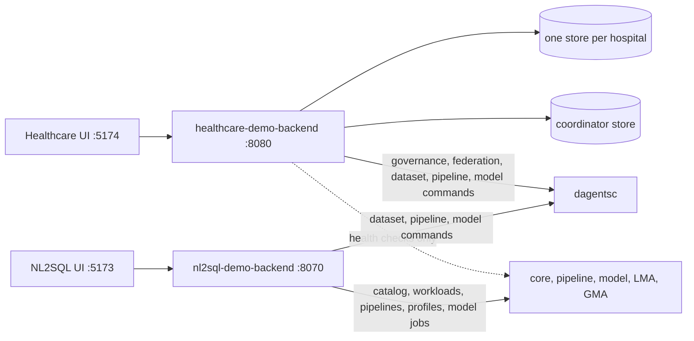
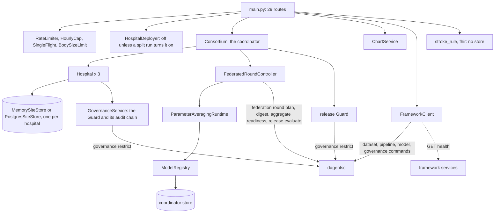
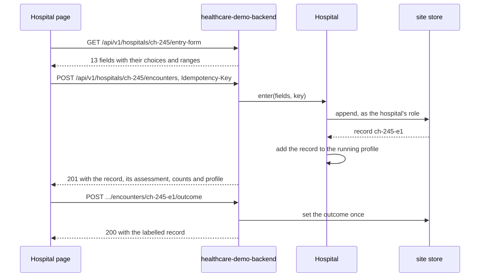
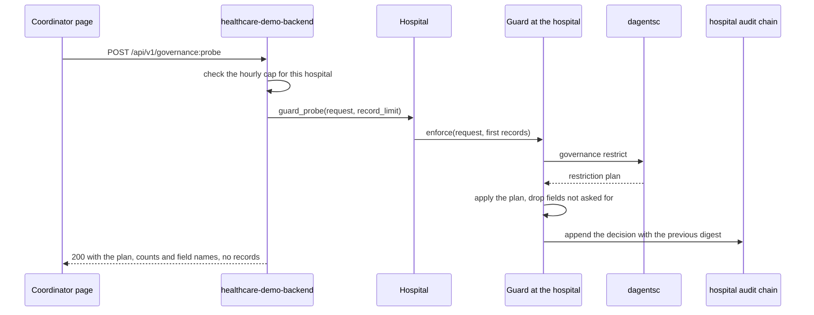
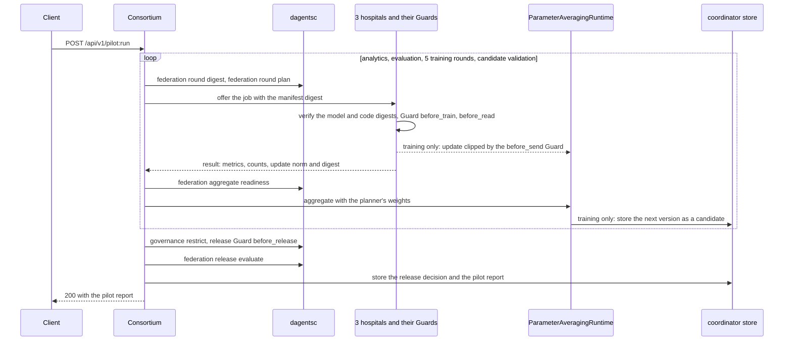
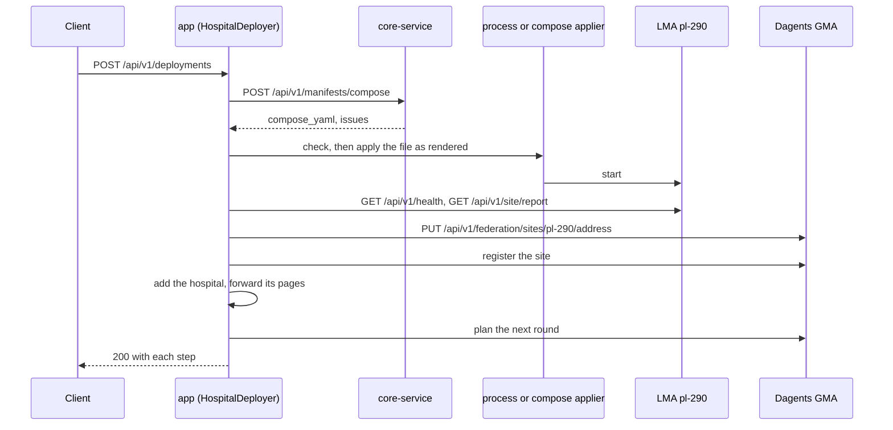
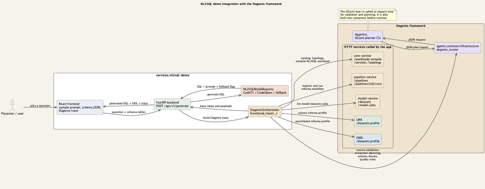
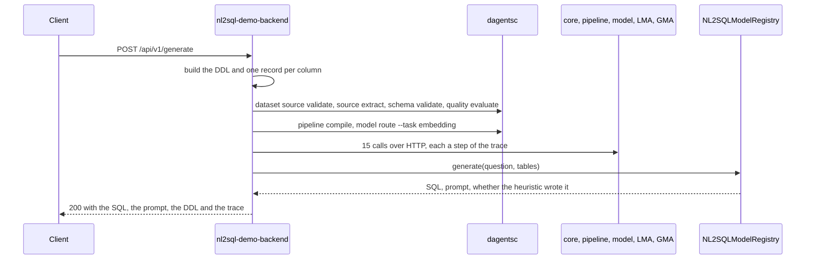

# Demo apps

Two applications in this repository are built on the framework. They show how
an application uses Dagents; they are not part of it. Each one owns its domain
code and calls the framework for planning, governance and federation.

| App | Code | Port | What it is for |
|---|---|---|---|
| healthcare-demo-backend | `apps/healthcare-demo/backend/` | 8080 | Stroke triage across three hospitals, on real, de-identified records from the International Stroke Trial (IST, 1991-1996). Each hospital keeps its records in its own store. The hospitals evaluate and train a model in federated rounds without sharing records. |
| nl2sql-demo-backend | `services/nl2sql-demo/backend/` | 8070 | Turns a question in plain English into SQL, and shows the framework steps behind the answer: source validation, planning, model routing and calls to the framework services. |

How each app uses the framework:

- **By default, the healthcare demo runs the framework's classes in its own process.** Each
  hospital has a `GovernanceService`, whose Ethical Guard (the Guard) applies the
  planner's decisions to that hospital's records and writes an audit chain. The
  coordinator runs `FederatedRoundController` for the rounds. Every decision is
  made by the planner, `dagentsc`. The app contributes an extension
  (`apps/healthcare-demo/backend/app/extension.py`): the stroke feature contract,
  the data classification, the condition pack, two pipeline steps and two model
  adapters. It calls no other Dagents service to do its work; it only checks
  whether they answer ([framework status](#healthcare-demo-backend-get-api-v1-framework-status)).
  In a split run (`apps/healthcare-demo/scripts/run_split_demo.sh`), each
  hospital is its own process on ports 8082 to 8084, the backend runs the
  rounds through the GMA service's API, and the GMA sends the jobs to the
  hospitals. The backend forwards each hospital's routes to that hospital, so
  the endpoints below take the same requests and return the same fields.
  Three things differ. `engine` in the overview and the pilot report is
  `dagents-gma`. The pilot report's `coordinator_audit` counts the release
  Guard's chain at the GMA, which keeps it in memory. An endpoint that needs a
  hospital or the GMA answers `503` when that process cannot be reached or does
  not answer in time, with a message that names the hospital or the GMA but not
  its address. The **Errors** lines below describe one process. The hospitals
  load models and send their updates on the backend's second port, 8081. Those routes are not in
  this reference, and port 8080 answers 404 for them. The demo's
  [README](../../../apps/healthcare-demo/README.md#one-process-per-hospital)
  describes the layout.
- **The NL2SQL backend calls the planner and the services.** It runs six planner
  commands on the schema of each question, then calls the core service, the
  pipeline service, the model service, the LMA and the GMA over HTTP
  (`services/nl2sql-demo/backend/app/services/dagents_orchestrator.py`). The SQL
  itself comes from the app's own models.



**Run them locally.** Both need the planner. Build it and set `DAGENTSC_BIN`
as the [overview](overview.md#run-a-service-to-try-the-examples) shows, then:

| App | Command | Data |
|---|---|---|
| healthcare-demo-backend | `apps/healthcare-demo/scripts/run_local_demo.sh` | In memory, loaded from `apps/healthcare-demo/data/ist/`, unless `HEALTHCARE_DEMO_DATABASE_URL` is set |
| nl2sql-demo-backend | `services/nl2sql-demo/scripts/run_local_demo.sh`, or `PYTHONPATH=.:services/nl2sql-demo/backend .venv/bin/uvicorn app.main:app --port 8070` | None. Model zip files go in `NL2SQL_MODELS_DIR` |

The healthcare demo is public in its deployed form, so it has limits that the
other services do not: per-client rate limits, hourly caps, a 64 KB body limit,
an `Idempotency-Key` header for data entry and an `X-Dagents-App` header on
every response. The [overview](overview.md#rate-limits) describes them. The
records carry the IST licence notice in `apps/healthcare-demo/data/ist/NOTICE.md`:
they contain information from the International Stroke Trial database
(version 2), made available under the ODC Attribution License, and were
collected by the IST Collaborative Group. Nothing either app returns is
clinical advice.

## The healthcare demo

The healthcare backend is one FastAPI app, `apps/healthcare-demo/backend/app/main.py`,
with 29 endpoints. Three hospitals take part:

| `site_id` | Name | Country | Records from the IST |
|---|---|---|---|
| `uk-134` | Hospital 134 | United Kingdom | 524 |
| `it-002` | Hospital 2 | Italy | 292 |
| `ch-245` | Hospital 245 | Switzerland | 198 |

A fourth, Hospital 290 (`pl-290`, Poland, 263 records), is not in the consortium
at start. A split run on your own machine can add it while it runs; see
[Adding a hospital](#adding-a-hospital).

Terms used in this part:

- **Site store.** Where one hospital keeps its records: its own Postgres schema,
  read and written only as that hospital's database role, or, without a
  database, its own in-memory store (`MemorySiteStore`). Both pass the same
  tests.
- **Coordinator.** The `Consortium` class. It plans rounds, stores model
  versions and release decisions in the coordinator store, and never reads a
  hospital's records. It sees what each hospital reports.
- **Seed rule.** `stroke-outcome-rule-v1`, a points score chosen by hand
  (`app/domain/stroke_rule.py`). It is the model in use until a federated
  candidate is approved. It is not a validated clinical model.
- **Outcome.** `poor_outcome_6m`: dead or dependent six months after the stroke.
  It is the label models are trained and measured on, and it never leaves a
  hospital.
- **Minimum cohort.** 20. The planner denies a column, table or model-update
  request that describes fewer patients.



## Healthcare health and descriptions

```api-interface
service: healthcare-demo-backend
status: complete
code: apps/healthcare-demo/backend/app/main.py
classes:
- Settings (apps/healthcare-demo/backend/app/core/config.py)
- Consortium (apps/healthcare-demo/backend/app/services/consortium.py)
- ExtensionRegistry (agents/common/extensions/registry.py)
endpoints:
- GET /health
- GET /api/v1/health
- GET /api/v1/overview
- GET /api/v1/conditions
- GET /api/v1/extension
```

Liveness, the consortium overview, the condition the app implements, and what
its extension contributes. `Settings` reads `env/.env.shared`, then
`env/.env.healthcare-demo`, then `apps/healthcare-demo/env/.env.healthcare-demo`;
a variable already set in the environment wins. None of these endpoints writes
anything.

### Check the app's health

```api-endpoint
GET /api/v1/health
```

Returns `ok` with the app's name, its environment and `data`, which names the
dataset (`ist-1-deidentified`). It reads no store, opens no database
connection and calls no planner, so it answers while the database is down. Use
it as the liveness check. `GET /health` runs the same code. To learn where the
records are stored and whether the stores can be read, call
[framework status](#healthcare-demo-backend-get-api-v1-framework-status).

**Errors.** None of its own.

**Related.** [Framework status](#healthcare-demo-backend-get-api-v1-framework-status).

### Read the consortium overview

```api-endpoint
GET /api/v1/overview
```

Returns everything the coordinator's page shows about the study, built from
what each hospital reports. It reads each hospital's counts from its store and
asks each hospital's planner whether its outcome rate may leave the hospital
(`dagentsc governance restrict`, a `before_send` table request at the number of
labelled records). That question only plans: it writes no audit record, and
the answer is kept per count. Nothing is stored.

| Field | What it holds |
|---|---|
| `study_id` | `stroke-triage-pilot` |
| `condition` | The condition's id, name, intended use and limitations |
| `dataset` | The IST citation, licence, source address, notice and credit |
| `feature_contract` | The contract's id, version and its 9 required fields |
| `field_labels` | Each record field's label, as the entry form shows it |
| `engine` | The federation engine: `in-process-parameter-averaging`, or `dagents-gma` in a split run |
| `secure_aggregation_threshold` | 3. It raises the number of hospitals a round needs to 3 |
| `minimum_cohort` | 20 |
| `current_model` | The version and kind of the model in use |
| `hospitals` | Each hospital's summary, as [the hospital list](#healthcare-demo-backend-get-api-v1-hospitals) returns it |
| `release_gates` | The five release gates a candidate must pass |

**Errors.** `503` only with a database, when a store cannot be read.

**Related.** [The hospital list](#healthcare-demo-backend-get-api-v1-hospitals),
[the condition](#healthcare-demo-backend-get-api-v1-conditions).

### Read the condition, its contract and its classification

```api-endpoint
GET /api/v1/conditions
```

Returns the condition the app implements (`suspected_stroke`), the four
conditions it lists as planned but does not implement, the feature contract and
the data classification. All four come from `app/domain/conditions.py`; nothing
is read from a store and no planner command runs.

- The **feature contract** (`stroke-triage-features`, version
  `stroke-triage-features-v3`) lists the 14 fields every hospital produces, with
  their types and units.
- The **classification** (`stroke-triage-phi`) gives each field a sensitivity.
  `hours_since_onset`, `systolic_bp`, `atrial_fibrillation`, the outcome and
  `model_update` are `high`. The examination findings, `age_band`, `sex` and
  `stroke_subtype` are `medium`. `onset_on_waking` is `low`. The Guard plans
  every request against it. See [the DataClassification object](agents.md#the-dataclassification-object).
- The **release gates** on the condition are the five the pilot checks:
  AUC at least 0.70, an AUC at least 0.02 above the model in use, an AUC gap
  between women and men of at most 0.10, sensitivity at least 0.80 (all
  blocking), and at most 750 alerts per 1,000 patients (not blocking).

**Errors.** None of its own.

**Related.** [The extension](#healthcare-demo-backend-get-api-v1-extension),
[the ReleaseGate object](agents.md#the-releasegate-object).

### Read what the extension contributes

```api-endpoint
GET /api/v1/extension
```

Returns what the app registered with the framework's extension registry
(`default_registry.describe()`): the extension id and version, the feature
contract, the classification, the condition pack, two named pipeline steps
(`evaluate_stroke_rule`, `score_stroke_worklist`) and two named model adapters
(`stroke_outcome_logreg_v1`, `stroke_outcome_rule_v1`). `boundary` lists in
words what the framework owns and what the app owns. Nothing is stored and no
planner command runs. The registry is filled once, when the app starts, unless
`HEALTHCARE_DEMO_REGISTER_EXTENSION` is false.

**Errors.** None of its own.

**Related.** [LMA extensions](agents.md#lma-extensions), which describe the same
registry from an agent.

## Scoring without a store

```api-interface
service: healthcare-demo-backend
status: complete
code: apps/healthcare-demo/backend/app/main.py
classes:
- TriageRequest (apps/healthcare-demo/backend/app/models.py)
- WorklistRequest (apps/healthcare-demo/backend/app/models.py)
- FhirIngestRequest (apps/healthcare-demo/backend/app/models.py)
- StrokeAssessment (apps/healthcare-demo/backend/app/domain/stroke_rule.py)
- MappingResult (apps/healthcare-demo/backend/app/domain/fhir.py)
endpoints:
- POST /api/v1/triage:assess
- POST /api/v1/triage:worklist
- POST /api/v1/ingest:fhir
```

These three endpoints work only on the records sent in the request. They read
no store, store nothing, call no planner and pass no Guard boundary. They score
with the seed rule, not with the model in use; the hospital endpoints score
with the model in use.

**How the seed rule scores a record.** It adds points: 0 to 5 for the age band
(one per decade from 50), 2 for `drowsy` and 4 for `unconscious`, 1 for each
deficit found (face, arm, leg, speech, visual field), 1 for atrial fibrillation
and 2 for a `TACS` subtype. The most is 17 points. A fixed logistic curve turns
the points into a risk from 0 to 1: 5 points is 0.5, and every 2 points add 1
to the log-odds. A risk below 0.5 is `routine`. A risk of 0.5 or more is an
alert and is banded `elevated`, and 0.8 or more is `urgent`. The rule uses no
blood pressure, time since onset or onset on waking. It reports unusual values
of them as warnings.

### Score one record

```api-endpoint
POST /api/v1/triage:assess
```

Scores one record with the seed rule and explains the score. The record is not
checked against the contract: a missing value adds no points and is named in
`data_quality_issues`. A record with no examination finding at all (conscious
level and the five deficits all missing) is not scored: `suppressed` is true
and `score` is 0.

| Field | What it holds |
|---|---|
| `model_version` | Always `stroke-outcome-rule-v1` |
| `score` | The risk from 0 to 1, rounded to 4 places |
| `priority` | `routine`, `elevated` or `urgent` |
| `points`, `max_points` | The points the record earned, out of 17 |
| `contributions` | The points each finding added |
| `basis` | The same points in words |
| `warnings` | Values a clinician should see, such as a systolic pressure of 220 mmHg or more |
| `data_quality_issues` | Inputs that were missing or not valid |
| `suppressed` | True when no examination finding was recorded |

**Errors.** `422` when `record` is not a JSON object. The body names the field:
`{"detail": "Some fields are not valid.", "errors": {"record": "..."}}`.

**Related.** [Rank records](#healthcare-demo-backend-post-api-v1-triage-worklist),
[a hospital's worklist](#healthcare-demo-backend-get-api-v1-hospitals-site-id-worklist).

### Rank records by risk

```api-endpoint
POST /api/v1/triage:worklist
```

Scores up to 500 records with the seed rule and returns them highest risk
first, each with its assessment under `assessment`. Nothing is removed from the
list: records that could not be scored go to the end, and records with the same
score keep their order. Keys that are not contract fields, such as `case_id` in
the example, are returned unchanged.

**Errors.** `422` when `records` is not a list, or has more than 500 items.

**Related.** [Score one record](#healthcare-demo-backend-post-api-v1-triage-assess).

### Map a FHIR bundle into the contract

```api-endpoint
POST /api/v1/ingest:fhir
```

Maps a FHIR-shaped bundle (FHIR is the HL7 standard for health records) into
records of the stroke feature contract, and reports what it could not map. It
is a demonstration mapper, not a FHIR client (`app/domain/fhir.py`):

- Each `Encounter` becomes one record. Its fields `age`, `gender`,
  `consciousLevel`, `strokeSubtype`, the seven yes/no findings and
  `hoursSinceOnset` or `minutesSinceOnset` become contract fields. The age band
  is derived from `age`.
- An `Observation` joins the encounter its `encounter.reference` names. Only
  LOINC code `8480-6` (systolic blood pressure) is mapped; a pressure in `kPa`
  is converted to mmHg (1 kPa = 7.50062 mmHg). Every other code is listed in
  `unmapped_codes`.
- A value out of its range or in an unknown unit is left out and named in
  `issues`. A required contract field that is missing is named too.

The answer holds `mapped` (one entry per encounter: `record`, `unmapped`,
`issues`), `unmapped_codes` (every unmapped code, sorted) and `record_count`.
Nothing is stored.

**Errors.** `422` when `bundle` is not a JSON object.

**Related.** [Enter a record](#healthcare-demo-backend-post-api-v1-hospitals-site-id-encounters),
which stores a record instead.

## Hospitals

```api-interface
service: healthcare-demo-backend
status: complete
code: apps/healthcare-demo/backend/app/main.py
classes:
- Hospital (apps/healthcare-demo/backend/app/services/hospital.py)
- MemorySiteStore (apps/healthcare-demo/backend/app/services/site_store.py)
- PostgresSiteStore (apps/healthcare-demo/backend/app/services/site_store.py)
- RunningProfile (agents/common/application/running_profile.py)
endpoints:
- GET /api/v1/hospitals
- GET /api/v1/hospitals/{site_id}
- GET /api/v1/hospitals/{site_id}/worklist
- GET /api/v1/hospitals/{site_id}/thresholds
- GET /api/v1/hospitals/{site_id}/audit
```

What each hospital reports, and one hospital's own view. A `Hospital` reads its
records only through its site store, and with Postgres every read runs in one
transaction that starts with `SET LOCAL ROLE` to the hospital's role. It keeps a
cached copy of its records, cleared on every write, and a running profile: the
count, missing values and value counts or mean and variance of each field,
updated one record at a time as records are entered.

The hospital list is what the coordinator may see. The other four endpoints
are the hospital's own view, for its staff: the demo shows them on a hospital's
page, and the records they return stay at that hospital in a real deployment.
None of them writes anything.

### List what each hospital reports

```api-endpoint
GET /api/v1/hospitals
```

Returns one summary per hospital, in the order `uk-134`, `it-002`, `ch-245`.
Each summary has the hospital's id, name and country, its record counts
(`record_count`, `entered_count`, `labelled_count`), its store's kind and
`minimum_cohort`.

`outcome_rate` is the share of labelled records with a poor outcome, and it is
`null` unless the hospital's planner permits it to leave. `outcome_rate_status`
says why:

| Status | Meaning |
|---|---|
| `released` | The planner permits a table request for the outcome at this many labelled records |
| `below_minimum_cohort` | The planner denies it because fewer than 20 records have an outcome |
| `no_outcomes` | No record has an outcome, so there is no rate |
| `denied` | The planner denies it for another reason |
| `withheld` | The planner could not be run, so the Guard withholds the rate |

The question is `dagentsc governance restrict`, asked once per labelled count
and not written to the audit chain. The example ran after
[the overview](#healthcare-demo-backend-get-api-v1-overview) had asked it for
the same counts, so the example itself ran no planner command.

**Errors.** `503` only with a database, when a store cannot be read.

**Related.** [One hospital's view](#healthcare-demo-backend-get-api-v1-hospitals-site-id),
[the overview](#healthcare-demo-backend-get-api-v1-overview).

### Read one hospital's view

```api-endpoint
GET /api/v1/hospitals/{site_id}
```

Returns what the hospital's page shows: its counts and outcome rate as in the
list, `max_entered` (300), the running profile of its records, the model in use
measured on its own labelled records (`local_metrics`: AUC, sensitivity,
specificity, alerts per 1,000 and the AUC gap between women and men), the model
in use (`current_model`), and `contributions`: what the hospital sent in its 20
most recent round jobs, newest first. Before any pilot, `contributions` is
empty. Nothing is stored.

**Errors.** `404` when no hospital has this id. `503` only with a database.

**Related.** [The hospital's worklist](#healthcare-demo-backend-get-api-v1-hospitals-site-id-worklist),
[its charts](#healthcare-demo-backend-get-api-v1-hospitals-site-id-charts),
[the DatasetProfile object](agents.md#the-datasetprofile-object).

### Read a hospital's worklist

```api-endpoint
GET /api/v1/hospitals/{site_id}/worklist
```

Returns the hospital's records ranked by the model in use, highest risk first,
`limit` of them (default 12). Each record has its fields and an `assessment` as
in [scoring one record](#healthcare-demo-backend-post-api-v1-triage-assess),
plus `model_kind`. Records the model cannot score go to the end. The model in
use is the seed rule until a candidate is approved; after that, the assessment
of a logistic regression lists the largest terms on the log-odds scale in
`basis`. Nothing is stored.

**Errors.** `404` when no hospital has this id. `422` when `limit` is outside 1
to 200.

**Related.** [Rank records sent in the request](#healthcare-demo-backend-post-api-v1-triage-worklist).

### Read a hospital's threshold sweep

```api-endpoint
GET /api/v1/hospitals/{site_id}/thresholds
```

Measures the model in use on the hospital's labelled records at 19 alert
thresholds, from 0.05 to 0.95 in steps of 0.05. Each row has `threshold`,
`alerts_per_1000`, `sensitivity` (the share of patients with a poor outcome who
get an alert) and `specificity` (the share of the others who do not). The alert
threshold the app uses is 0.5. A hospital with no labelled records returns an
empty `sweep`. Nothing is stored.

**Errors.** `404` when no hospital has this id.

**Related.** [One hospital's view](#healthcare-demo-backend-get-api-v1-hospitals-site-id).

### Read a hospital's audit chain

```api-endpoint
GET /api/v1/hospitals/{site_id}/audit
```

Returns the hospital's Guard decisions, newest first, `limit` of them (default
50), and `chain_intact`: whether every record's `previous_digest` equals the
digest of the record before it. A record is written for every Guard decision at
the hospital: each [Guard probe](#healthcare-demo-backend-post-api-v1-governance-probe),
and three per round job in a pilot (`before_train`, `before_read`,
`before_send`), so one pilot adds 24 records per hospital. Planning questions,
such as the outcome-rate check, write nothing. Reading the chain stores
nothing.

**Errors.** `404` when no hospital has this id. `422` when `limit` is outside 1
to 500.

**Related.** [The AuditRecord object](agents.md#the-auditrecord-object),
[the Guard probe](#healthcare-demo-backend-post-api-v1-governance-probe).

## Data entry

```api-interface
service: healthcare-demo-backend
status: complete
code: apps/healthcare-demo/backend/app/main.py
classes:
- Hospital (apps/healthcare-demo/backend/app/services/hospital.py)
- EncounterEntry (apps/healthcare-demo/backend/app/models.py)
- OutcomeRequest (apps/healthcare-demo/backend/app/models.py)
- RateLimiter (apps/healthcare-demo/backend/app/api/limits.py)
endpoints:
- GET /api/v1/hospitals/{site_id}/entry-form
- POST /api/v1/hospitals/{site_id}/encounters
- GET /api/v1/hospitals/{site_id}/encounters
- POST /api/v1/hospitals/{site_id}/encounters/{encounter_id}/outcome
```

Entering a record at a hospital, and recording its six-month outcome later.
The demo has no accounts, so entries are typed: the body accepts the 13 fields
of [EncounterEntry](#the-encounterentry-object) and nothing else. Each field is
a choice from a list, a number in a range, or yes/no; no field takes free text
or an identifier. The entry body and the entry form are built from the same
field domains (`STROKE_FIELD_DOMAINS` in `app/domain/conditions.py`), so they
cannot disagree.

Each hospital accepts at most 300 entered records
(`HEALTHCARE_DEMO_MAX_ENTERED_PER_SITE`). Entering and recording outcomes share
a limit of 30 requests per minute per client. No planner command runs and no
Guard boundary is passed: the hospital writes to its own store, as itself. The
next worklist, chart, probe and pilot at that hospital include the record.



### Read the data-entry form

```api-endpoint
GET /api/v1/hospitals/{site_id}/entry-form
```

Returns the form the hospital's page renders: the 13 fields in order, each with
`name`, `label`, `type` (`integer`, `number`, `choice` or `boolean`),
`required`, `options`, `min`, `max`, `unit` and `help`. It also returns how many
records the hospital may still accept (`remaining`), the `Idempotency-Key`
rules, and a notice that every visitor can read what is entered. The page draws
the form from this answer and owns none of its rules. Nothing is stored.

**Errors.** `404` when no hospital has this id.

**Related.** [Enter a record](#healthcare-demo-backend-post-api-v1-hospitals-site-id-encounters),
[the EncounterEntry object](#the-encounterentry-object).

### Enter a record

```api-endpoint
POST /api/v1/hospitals/{site_id}/encounters
```

Stores a new record in the hospital's store, as the hospital, and answers
`201`. The store gives it the id `<site_id>-e<n>` (the first is `ch-245-e1`),
sets `origin` to `entered`, derives `age_band` from `age` and records
`recorded_at`. The exact age stays at the hospital; only the age band is a
contract field. The record has no outcome yet. The answer holds:

| Field | What it holds |
|---|---|
| `record` | The stored record. Missing values are left out |
| `assessment` | The record scored by the model in use |
| `counts` | The hospital's `total`, `entered` and `labelled` counts after the entry |
| `profile` | The hospital's running profile after the entry |

**Retries.** Send an `Idempotency-Key` with each new record. The same key with
the same fields returns `201` and the record stored the first time; nothing new
is stored. The same key with different fields returns `409`. A retry is
refused with `409` too once the hospital holds 300 entered records.

**Errors.** `404` when no hospital has this id. `409` for a reused key or a full
hospital. `422` when a field is missing, out of its range, not one of its
choices, or not a field of the record, or when the `Idempotency-Key` has
characters other than letters, digits and `. _ : -`; `errors` names each one.
`429` beyond 30 requests per minute from one client. `413` for a body larger
than 64 KB. `503` only with a database.

**Related.** [The EncounterEntry object](#the-encounterentry-object),
[record the outcome](#healthcare-demo-backend-post-api-v1-hospitals-site-id-encounters-encounter-id-outcome),
[idempotency](overview.md#idempotency).

### List the records entered at a hospital

```api-endpoint
GET /api/v1/hospitals/{site_id}/encounters
```

Returns the records entered through the form at this hospital, newest first,
`limit` of them (default 20), each with `recorded_at`, `outcome_recorded_at`
once an outcome is set, and its assessment by the model in use. It also returns
the hospital's `counts` and `max_entered`. Records from the IST are not listed:
`origin` takes only `entered`. Nothing is stored.

**Errors.** `404` when no hospital has this id. `422` when `limit` is outside 1
to 300, or `origin` is not `entered`.

**Related.** [Enter a record](#healthcare-demo-backend-post-api-v1-hospitals-site-id-encounters).

### Record a six-month outcome

```api-endpoint
POST /api/v1/hospitals/{site_id}/encounters/{encounter_id}/outcome
```

Sets `poor_outcome_6m` on a record entered at this hospital and records
`outcome_recorded_at`. It returns the record, the hospital's counts and its
running profile. An outcome is recorded once: the same value again returns
`200` with the record unchanged, and a different value returns `409`. The demo
has no accounts, so allowing a change would let any visitor change another
visitor's training label. The next pilot trains and evaluates on the labelled
record.

**Errors.** `404` when no hospital or no record has this id. `409` when the
record already has a different outcome. `422` when the record came from the
IST (only entered records take an outcome), or the body is not
`{"poor_outcome_6m": true|false}`. `429` beyond 30 requests per minute from one
client, counted together with entries.

**Related.** [Enter a record](#healthcare-demo-backend-post-api-v1-hospitals-site-id-encounters),
[run the pilot](#healthcare-demo-backend-post-api-v1-pilot-run).

## Charts

```api-interface
service: healthcare-demo-backend
status: complete
code: apps/healthcare-demo/backend/app/main.py, apps/healthcare-demo/backend/app/services/charts_service.py
classes:
- ChartService (apps/healthcare-demo/backend/app/services/charts_service.py)
- ChartSpec (apps/healthcare-demo/backend/app/services/charts_service.py)
endpoints:
- GET /api/v1/charts
- GET /api/v1/charts/{chart_id}.svg
- GET /api/v1/hospitals/{site_id}/charts
- GET /api/v1/hospitals/{site_id}/charts/{chart_id}.svg
```

The backend draws every chart as SVG, so the page and the API show the same
numbers. Each chart has a list entry and a drawing:

| List entry field | What it holds |
|---|---|
| `chart_id` | The id to put in the SVG path |
| `title`, `description`, `alt` | The chart's text. `alt` describes the chart for a screen reader |
| `available` | False when the data does not exist yet; `reason` says why |
| `table` | The chart's numbers as `columns` and `rows` |
| `notice` | The IST licence notice |
| `svg_path` | Where to fetch the drawing |
| `version` | A digest of the whole entry, including the table |

There are two sets:

| Set | Charts | Data |
|---|---|---|
| Consortium | `hospital-records`, `hospital-outcome-rates`, `site-auc`, `training-curve`, `release-gates` | What hospitals report, and the last pilot. The last three need a pilot. |
| Hospital | `outcome-by-age-band`, `presentation`, `systolic-bp`, `risk-scores` | That hospital's own records |

Drawing uses the framework's chart renderer
(`agents/common/infrastructure/charts.py`, matplotlib). A drawing has no date
or random ids, so the same data gives the same bytes, and up to 256 drawings
are kept in memory. The colours mark which hospital a series belongs to and
never a decision. The design system has three series colours, so a chart that
compares more than three hospitals draws each in neutral ink and names it on
the axis.

**Conditional requests.** An SVG answer carries `ETag: "<version>-<theme>"` and
`Cache-Control: no-cache`. Send the ETag back in `If-None-Match`, and the answer
is `304` with no body while the chart has not changed. Entering a record or
running a pilot changes it.

### List the consortium charts

```api-endpoint
GET /api/v1/charts
```

Returns the five consortium charts in display order. The two record charts are
built from the hospitals' summaries, so a hospital whose planner withholds its
outcome rate shows a gap, and the table gives the reason. The three pilot
charts read the last pilot's report, which the coordinator store keeps across
restarts. Before any pilot they are listed with `available: false`. It never
answers `4xx`. Building the summaries runs `dagentsc governance restrict`, as
[the hospital list](#healthcare-demo-backend-get-api-v1-hospitals) does.
Nothing is stored.

**Errors.** `503` only with a database.

**Related.** [Draw a consortium chart](#healthcare-demo-backend-get-api-v1-charts-chart-id-svg).

### Draw a consortium chart

```api-endpoint
GET /api/v1/charts/{chart_id}.svg
```

Returns one consortium chart as an SVG document (`image/svg+xml`), in the
`light` or `dark` theme. The answer also carries
`Content-Security-Policy: default-src 'none'; style-src 'unsafe-inline'` and
`X-Content-Type-Options: nosniff`, so the SVG cannot run a script or load
anything. The examples are trimmed to the first 400 characters of the
document. Nothing is stored.

**Errors.** `304` (not an error) when `If-None-Match` holds the current ETag.
`404` when no chart has this id, or when the chart needs a pilot that has not
run; the body gives the reason. `422` when `theme` is not `light` or `dark`.
`503` when matplotlib is not installed on the server.

**Related.** [List the consortium charts](#healthcare-demo-backend-get-api-v1-charts).

### List a hospital's charts

```api-endpoint
GET /api/v1/hospitals/{site_id}/charts
```

Returns the hospital's four charts, built from its own records: the share with
a poor outcome by age band, how often each examination finding was present,
systolic blood pressure in 20 mmHg bands from 60 to 300, and the model in use's
scores by recorded outcome. Over an empty store each chart is listed with
`available: false`. Nothing is stored.

**Errors.** `404` when no hospital has this id. `503` only with a database.

**Related.** [Draw a hospital chart](#healthcare-demo-backend-get-api-v1-hospitals-site-id-charts-chart-id-svg).

### Draw a hospital chart

```api-endpoint
GET /api/v1/hospitals/{site_id}/charts/{chart_id}.svg
```

Returns one of the hospital's charts as SVG, with the same headers and
conditional requests as a consortium chart. While the consortium has three
hospitals, the hospital's series colour is the same as on the consortium
charts. The design system has three series colours, so a hospital without one,
such as a fourth hospital, is drawn in neutral ink.
Nothing is stored.

**Errors.** `404` when no hospital or no chart has this id, or the hospital's
store holds no records. `422` for a `theme` other than `light` or `dark`.
`503` when matplotlib is not installed.

**Related.** [List a hospital's charts](#healthcare-demo-backend-get-api-v1-hospitals-site-id-charts).

## The Guard probe

```api-interface
service: healthcare-demo-backend
status: complete
code: apps/healthcare-demo/backend/app/main.py
classes:
- Hospital (apps/healthcare-demo/backend/app/services/hospital.py)
- GovernanceService (agents/common/application/governance_service.py)
- GuardProbeRequest (apps/healthcare-demo/backend/app/models.py)
- GuardProbeResponse (apps/healthcare-demo/backend/app/models.py)
- HourlyCap (apps/healthcare-demo/backend/app/api/limits.py)
endpoints:
- POST /api/v1/governance:probe
```

A probe asks one hospital's Guard what it would release for a request, so a
reader can change the requester's trust, the boundary or the granularity and
see the decision change. The Guard runs at the hospital, over the hospital's
records, and writes the decision to the hospital's audit chain.

The audit chain is shown to every visitor and cannot be edited without breaking
it, so the request takes no free text: the requester (`demo-operator`), its
affiliation and the purpose (`suspected_stroke`) are set by the server, and
`requested_fields` takes contract fields only. The answer counts the released
records and names their fields; it holds no record.



### Ask a hospital's Guard about a request

```api-endpoint
POST /api/v1/governance:probe
```

Builds a [RestrictionRequest](agents.md#the-restrictionrequest-object) from the
body, with the request id `probe:<site_id>:<boundary>:<granularity>`. The
requester has two attributes, `verified_identity` and `signed_dua`, both
verified or both not as `verified` says. The Guard reads the hospital's first
`record_limit` records (default 5), asks the planner for a plan
(`dagentsc governance restrict`), applies it and writes one audit record. When
`cohort_size` is not sent, it is the number of records read.

The answer is a [GuardProbeResponse](#the-guardproberesponse-object). In the
first example, the default levers give trust `high`, and the plan generalizes
`systolic_bp` (sensitivity `high`) and allows `age_band` and `onset_on_waking`:
5 records are released with those 3 fields. In the second, an unverified
requester asks for a table about 12 patients; the plan denies it because 12 is
below the minimum cohort of 20, and nothing is released.

The Guard fails closed. When the planner cannot be run, the answer is `200` with
`permitted: false`, a `deny` plan and the reason, and the denial is recorded.

**Errors.** `404` when `site_id` names no hospital. `422` for an unknown key, a
value outside its choices or range, or a requested field that is not a contract
field, such as the outcome `poor_outcome_6m`. `429` beyond 60 probes per minute
from one client, or 600 probes in any hour at one hospital from all clients
together; `Retry-After` gives the seconds to wait.

**Related.** [The GuardProbeRequest object](#the-guardproberequest-object),
[the RestrictionPlan object](agents.md#the-restrictionplan-object),
[the hospital's audit chain](#healthcare-demo-backend-get-api-v1-hospitals-site-id-audit),
[`dagentsc governance restrict`](dagentsc.md#dagentsc-governance-restrict).

## The federated pilot and model releases

```api-interface
service: healthcare-demo-backend
status: complete
code: apps/healthcare-demo/backend/app/main.py, apps/healthcare-demo/backend/app/services/consortium.py
classes:
- Consortium (apps/healthcare-demo/backend/app/services/consortium.py)
- FederatedRoundController (agents/common/application/federation.py)
- ParameterAveragingRuntime (apps/healthcare-demo/backend/app/services/runtime.py)
- ModelRegistry (apps/healthcare-demo/backend/app/services/runtime.py)
- SingleFlight (apps/healthcare-demo/backend/app/api/limits.py)
endpoints:
- POST /api/v1/pilot:run
- GET /api/v1/models
- POST /api/v1/models/{version}:approve
```

A **pilot** is one run of the study across the three hospitals. The coordinator
plans each round with the planner, each hospital decides for itself whether to
take part, and the coordinator combines what the hospitals send. No record
leaves a hospital: a hospital sends metrics, counts and, in a training round, a
parameter update clipped by its `before_send` Guard. The runtime keeps only the
weighted sum of the updates.

The rounds, in order:

| Round | Each hospital | The coordinator |
|---|---|---|
| analytics | Profiles its records: count, completeness, label coverage, and the outcome rate when its planner permits it | Plans the round and checks readiness |
| evaluation | Measures the model in use on its labelled records | Averages the metrics by size: the baseline a candidate must beat |
| training, 5 rounds | Trains the logistic regression from the last version for 30 epochs (learning rate 0.5, L2 0.01) and sends the clipped update | Applies the planner's weights and stores the next version as a candidate |
| candidate validation | Measures the final version | Averages the metrics |
| release | | Runs the release Guard (`before_release`), then the planner's release gates |

Before it accepts a job, each hospital checks the round: the model version must
be in the registry, its parameters must match the digest the manifest names,
and the code digest must be the code it runs for that kind of model. Each job
passes the hospital's Guard three times (`before_train`, `before_read`,
`before_send`), so a pilot adds 24 records to each hospital's audit chain and 1
to the coordinator's.

**A candidate is never released by the pilot.** When the gates and the release
Guard allow it, it stays a `candidate` until a person approves it with
[`POST /api/v1/models/{version}:approve`](#healthcare-demo-backend-post-api-v1-models-version-approve).
A gate whose metric is missing blocks the release.



### Run the federated pilot

```api-endpoint
POST /api/v1/pilot:run
```

Runs every round above and returns the evidence. The pilot id is
`<round_prefix>-<UTC timestamp>-<6 random hex characters>`, so two pilots never
share a round id, and every round id starts with it. The request runs these
planner commands: `federation round digest`, `federation round plan`,
`governance restrict`, `federation aggregate readiness` and
`federation release evaluate`.

It stores:

- the model versions: the initial logistic regression the first time, then one
  candidate per training round. Each round's starting version becomes
  `superseded`;
- the release decision, with the final candidate;
- each hospital's contributions and audit records;
- the report itself, so the pilot charts survive a restart.

A candidate that the gates or the release Guard refuse becomes `rejected`. In
memory, the example pilot took under a second. With a database, every store
operation is a round trip, so a pilot takes longer.

| Report field | What it holds |
|---|---|
| `pilot_id`, `study_id`, `condition`, `engine` | Which pilot, which study, and how it ran |
| `model_in_use` | The model the hospitals used when the pilot started |
| `rounds` | `analytics`, `evaluation`, `training` (a list) and `candidate_validation`. Each has the round id, the model version and digests, the [round plan](agents.md#the-roundplan-object), each hospital's [result](agents.md#the-siteresult-object), the [readiness](agents.md#the-aggregationreadiness-object) and a status |
| `training_curve` | Per training round: the loss before and after, each hospital's update norm, and the version it produced |
| `training_settings` | 5 rounds, 30 epochs, learning rate 0.5, L2 0.01, the initial version |
| `candidate` | The final [candidate](agents.md#the-candidatemodel-object), its validated metrics and its status |
| `release` | `guard`: the release Guard's decision. `gates`: the [release decision](agents.md#the-releasedecision-object) |
| `baseline_metrics` | The model in use, measured at every hospital and averaged by size |
| `stop_reason` | Why training stopped early, or `null` |
| `site_audits`, `coordinator_audit` | Whether each audit chain verifies and how many records it holds. In a split run `coordinator_audit` is the release chain at the GMA. No audit record is in the report |
| `notice`, `dataset_notice` | What the records are, and the IST licence notice |

In the example, the candidate's AUC of 0.786 passes the AUC floor of 0.70 but
not `improves_on_current_release`, which needs the baseline's 0.777 plus 0.02.
The action is `reject`, so the candidate's status is `rejected`. The example is
trimmed to 3 items per list and 200 characters per string.

**Errors.** `409` when a pilot is already running, or a hospital is being
added; one of them runs at a time, and the message says which. `422`
for a `round_prefix` other than `ui` or `api`, or any other key. `429` beyond 3
pilots per minute from one client, or 20 pilots in any hour from all clients
together. `503` when the planner cannot be run.

**Related.** [List the model versions](#healthcare-demo-backend-get-api-v1-models),
[the consortium charts](#healthcare-demo-backend-get-api-v1-charts),
[Federated rounds on the GMA](agents.md#federated-rounds), which run the same
controller over HTTP.

### List the model versions

```api-endpoint
GET /api/v1/models
```

Returns `model_in_use` and `models`: the 20 newest registered versions, oldest
first. Each version has `version`, `kind` (`points_rule` or
`logistic_regression`), `digest` (a SHA-256 of its parameters), `status`
(`released`, `candidate`, `superseded` or `rejected`), `parent_version`,
`created_at` and `release_decision`. A version's parameters are not returned.
Before any pilot, only the seed rule is listed; each pilot adds up to 6
versions. Nothing is stored.

**Errors.** `503` only with a database.

**Related.** [Run the pilot](#healthcare-demo-backend-post-api-v1-pilot-run),
[approve a candidate](#healthcare-demo-backend-post-api-v1-models-version-approve).

### Approve a candidate for release

```api-endpoint
POST /api/v1/models/{version}:approve
```

Releases a candidate, as the person who approves releases. It is allowed only
when the version's last release decision was `release`, its release Guard check
was permitted, it is still a `candidate`, and the model its gates compared it
with is still the model in use. The decision is read from the coordinator
store, so an approval works after a restart. On success the version becomes
`released`, the previous model becomes `superseded`, and the hospitals score
with the new model. The answer is `{"released": <the version's summary>,
"previous": "<the previous version>"}`. No planner command runs.

A candidate's version is `stroke-outcome-logreg+<round id>`, and a round id
holds a timestamp and a random suffix. So the examples cannot name a real
candidate, and show the errors only.

**Errors.** `404` when no version has this name. `409` when the version cannot
be approved; the body says which condition failed. `429` beyond 10 approvals
per minute from one client. The examples ran with a limit of 2, so the third
request was refused with `Retry-After: 30`.

**Related.** [List the model versions](#healthcare-demo-backend-get-api-v1-models),
[run the pilot](#healthcare-demo-backend-post-api-v1-pilot-run).

## Adding a hospital

```api-interface
service: healthcare-demo-backend
status: complete
code: apps/healthcare-demo/backend/app/api/deploy_routes.py, apps/healthcare-demo/backend/app/services/deployment.py
classes:
- HospitalDeployer (apps/healthcare-demo/backend/app/services/deployment.py)
- CoreServiceClient (apps/healthcare-demo/backend/app/services/framework_client.py)
- GmaRoundClient (apps/healthcare-demo/backend/app/services/remote.py)
- Consortium (apps/healthcare-demo/backend/app/services/consortium.py)
- Forwarder (apps/healthcare-demo/backend/app/api/forward.py)
- LocalProcessApplier (agents/common/infrastructure/compose_apply.py)
- DockerComposeApplier (agents/common/infrastructure/compose_apply.py)
- SingleFlight (apps/healthcare-demo/backend/app/api/limits.py)
endpoints:
- GET /api/v1/deployments
- POST /api/v1/deployments
```

A split run on your own machine can add Hospital 290 (`pl-290`) to the running
consortium. The app starts the hospital's LMA from a Compose file that
core-service renders, and the Dagents GMA accepts the LMA's address and enrols
it. From the next round on, the GMA's planner decides whether to select it, as
for the other three. The app writes no Compose and makes no selection rule.

The action is off unless `HEALTHCARE_DEMO_DEPLOYER` is `process` (a local
process) or `compose` (a container, with `docker compose`), and the app refuses
to start with either value in any role but `app`, or when `RENDER` is set. The
hosted demo runs the combined role. So the examples below come from a server
that cannot add a hospital: the list gives the reason, and a request gets
`403`. A request from a page on another host also gets `403`, and a request for
a hospital that cannot join gets `422`. An LMA answers `404` for both routes.
[Adding a hospital is off on every host](../../../apps/healthcare-demo/docs/deployment.md#adding-a-hospital-is-off-on-every-host)
lists the settings.

| Step | What happens |
|---|---|
| `plan` | core-service renders the LMA's Compose file (`POST /api/v1/manifests/compose`, the planner's `manifest compile`). Issues fail the step. So does a file whose keys, image, command, environment, published ports, health check or network differ from the request the app sent |
| `start` | The applier starts that one service from the file as rendered. A port that already answers for something else fails the step. A service this app started earlier is kept (`adopted`) when it answers `/api/v1/health` within 2 seconds; when it runs and does not answer, the app stops it and starts it again. In compose mode `docker compose up` runs anyway, and recreates a container started from an older file or image (then `adopted` is `false`). A failed start shows the last line of the tool's output and, in process mode, the hospital's log file |
| `answer` | The new LMA answers `/api/v1/health` within `HEALTHCARE_DEMO_DEPLOY_TIMEOUT_SECONDS` and reports site `pl-290` |
| `attach` | The GMA accepts the LMA's address (`PUT /api/v1/federation/sites/pl-290/address`), only at the address in its `GMA_FEDERATION_JOINABLE_SITES` |
| `enrol` | The GMA enrols the site with the registration the LMA reports |
| `join` | The app adds the hospital to its consortium and forwards `/api/v1/hospitals/pl-290` to the LMA. `skipped` when it is already in |
| `check` | The GMA's planner plans the next analytics round, without running it, and says whether it selects the hospital |



### Read whether this server can add a hospital

```api-endpoint
GET /api/v1/deployments
```

Says whether `POST /api/v1/deployments` can add a hospital now, and if not,
why: the first of these that fails. The role must be `app`, the deployer must
be on, core-service must answer its health check, and the GMA must answer
`GET /api/v1/federation/site-addresses` and list every joining hospital as
`joinable`. The checks of core-service and the GMA are reused for 15 seconds.
It lists every hospital that can join, with the records it starts with, taken
from the dataset module and never read from the hospital, and the attempts
since the app started, newest first, at most 20, in memory. Nothing is stored,
and no planner command runs.

**Errors.** None of its own. An LMA answers `404`.

**Related.** [Add a hospital](#healthcare-demo-backend-post-api-v1-deployments),
[Read where the records are](#healthcare-demo-backend-get-api-v1-framework-status).

### Add a hospital

```api-endpoint
POST /api/v1/deployments
```

Runs the seven steps above and returns each one with its status, its detail
and its seconds, with the Compose file core-service rendered. `status` is
`joined` when `plan` to `join` are done or skipped, and `failed` otherwise;
steps after a failure are `not_run`. A failure in `start` to `join` undoes this
attempt's work, newest first: a done `enrol` is withdrawn (`undone`), and a
service this attempt started is stopped (`undone`). An address the GMA accepted
stays until the GMA restarts; no round uses it without an enrolment. A failed
`check` keeps the hospital: `status` stays `joined`, and `next_round` gives the
planner's reason. The request holds the pilot's flight, so no pilot runs while a
hospital is added. It runs the planner's `manifest compile` at core-service,
and `federation round plan` at the GMA.

**Errors.** `403` when the request carries an `Origin` header whose host is
not `127.0.0.1`, `localhost` or `::1` (including `Origin: null`); this is
checked first. `403` when adding a hospital is not available, with the reason
`GET /api/v1/deployments` gives. `409` while a pilot runs or a hospital is
being added, and when the hospital is already in the consortium and its LMA
answers its health check within 2 seconds. `422` for a `site_id` that is not
a hospital that can join, or any other key.

**Related.** [Read whether this server can add a hospital](#healthcare-demo-backend-get-api-v1-deployments),
[Run the federated pilot](#healthcare-demo-backend-post-api-v1-pilot-run),
[Render a Compose file](framework-services.md#core-service-post-api-v1-manifests-compose),
[Accept a site's address on the GMA](agents.md#gma-put-api-v1-federation-sites-site-id-address).

## The framework

```api-interface
service: healthcare-demo-backend
status: complete
code: apps/healthcare-demo/backend/app/main.py, apps/healthcare-demo/backend/app/services/framework_client.py
classes:
- FrameworkClient (apps/healthcare-demo/backend/app/services/framework_client.py)
- Consortium (apps/healthcare-demo/backend/app/services/consortium.py)
endpoints:
- GET /api/v1/framework/status
- GET /api/v1/framework/trace
```

Where the records are stored and which framework services answer, and a trace
of one hospital's records through the planners. The demo page reads the status
to show where its data comes from: it shows the storage the backend reports,
never one guessed from an address.

### Read where the records are and which services answer

```api-endpoint
GET /api/v1/framework/status
```

Returns:

| Field | What it holds |
|---|---|
| `cohort_source` | `postgres` or `in-memory`: where the hospitals' records are |
| `store_layout` | `schema-per-site` or `in-memory-per-site` |
| `dataset` | The IST citation, licence and notice |
| `ready` | True when every store could be read and holds at least one record |
| `hospitals` | Each hospital's `record_count` and `labelled_count`, or `null` when a store cannot be read |
| `services` | Each framework service's `name`, `status` (`ok` or `unavailable`) and `detail`. The addresses are not returned |
| `allowed_origins` | The CORS origins, after cleaning (`*` when none are set) |
| `rate_limit_client` | How the rate limits identify a client: the TCP peer, or an entry of `X-Forwarded-For` |

It never fails because a store cannot be read; it reports `ready: false`
instead. The service checks call each service's health path at the same time,
wait at most `HEALTHCARE_DEMO_REQUEST_TIMEOUT_SECONDS` (2 seconds), and are
reused for 15 seconds. No planner command runs and nothing is stored. In the
example no framework service was running.

**Errors.** None of its own.

**Related.** [Health](#healthcare-demo-backend-get-api-v1-health),
[CORS and the X-Dagents-App header](overview.md#browsers-cors-and-the-x-dagents-app-header).

### Trace a hospital's records through the planners

```api-endpoint
GET /api/v1/framework/trace
```

Runs the hospital's first `limit` records (default 50) through six framework
steps, at the hospital, and reports each one with `name`, `status` (`ok` or
`warning`), `detail` and the planner's answer in `payload`. A step that fails
is a `warning`, not an error. None of the steps knows what a stroke is; they
work from the contract and classification the extension declared.

| Step | Planner command |
|---|---|
| Source spec validation | `dataset source validate` |
| Feature contract validation | `dataset schema validate` |
| Clinical data-quality rules | `dataset quality evaluate`, with a presence rule per required field and a range rule per number |
| Pipeline DAG planning | `pipeline compile` |
| Model route planning | `model route --task classification` |
| Ethical-Restriction Rails (egress) | `governance restrict`, a `before_send` model-update request |

The governance step only plans: it applies nothing and writes no audit record.
Nothing is stored.

**Errors.** `404` when `site_id` names no hospital. `422` when `limit` is
outside 1 to 1,000 or `site_id` is longer than 64 characters.

**Related.** [dagentsc](dagentsc.md).

## NL2SQL status and catalog

```api-interface
service: nl2sql-demo-backend
status: complete
code: services/nl2sql-demo/backend/app/api/routes.py
classes:
- DagentsOrchestrator (services/nl2sql-demo/backend/app/services/dagents_orchestrator.py)
- NL2SQLModelRegistry (services/nl2sql-demo/backend/app/services/model_adapters.py)
- Settings (services/nl2sql-demo/backend/app/core/config.py)
endpoints:
- GET /api/v1/health
- GET /api/v1/samples
- GET /api/v1/models
- GET /api/v1/dagents/status
```

The NL2SQL backend is a FastAPI app (`services/nl2sql-demo/backend/app/main.py`)
with five endpoints under `/api/v1`. It allows requests from any origin.
`Settings` reads `env/.env.shared` and `env/.env.nl2sql-demo`; a variable
already set in the environment wins. The backend stores nothing. Its 422 body
is FastAPI's: one entry per problem in `detail`, as the
[overview](overview.md#errors) shows.

### Check the NL2SQL backend's health

```api-endpoint
GET /api/v1/health
```

Returns `ok` with the app's name, its environment and `transport: http`. It
calls no planner and no service.

**Errors.** None of its own.

**Related.** [Framework status](#nl2sql-demo-backend-get-api-v1-dagents-status).

### List the sample questions

```api-endpoint
GET /api/v1/samples
```

Returns the three sample questions the demo page offers, each with the tables
it is about: paid orders from one tenant, a count of open critical incidents,
and customers with invoices. They are fixed in
`services/nl2sql-demo/backend/app/services/samples.py`. Send a sample's
`question` and `tables` to [generate SQL](#nl2sql-demo-backend-post-api-v1-generate).

**Errors.** None of its own.

**Related.** [The SchemaTable object](#the-schematable-object).

### List the SQL models

```api-endpoint
GET /api/v1/models
```

Returns one entry per `.zip` file in `NL2SQL_MODELS_DIR` (default `models`,
relative to where the backend runs), with the default model
(`NL2SQL_DEFAULT_MODEL_ID`) first, then the heuristic, `heuristic_demo`, which
is always present. A zip whose name contains `codeqwen` is a LoRA adapter for
CodeQwen1.5-7B-Chat and needs a GPU; any other zip is a CodeT5+ or T5
checkpoint. Listing opens no zip file and loads no model. The example ran with
no zip files, so only the heuristic is listed.

**Errors.** None of its own.

**Related.** [The ModelDescriptor object](#the-modeldescriptor-object),
[generate SQL](#nl2sql-demo-backend-post-api-v1-generate).

### Check which framework services answer

```api-endpoint
GET /api/v1/dagents/status
```

Calls the health path of the core service, the pipeline service, the model
service, the LMA and the GMA, one after another, each with a timeout of
`NL2SQL_REQUEST_TIMEOUT_SECONDS` (2 seconds). A service is `ok` when it answers
with a `2xx` status; otherwise it is `unavailable`, and `detail` holds the
error. Unlike the healthcare demo, the answer includes each address, from the
`*_PUBLIC_URL` settings. Nothing is stored. In the example every address
points at port 9, where nothing listens, so each service is `unavailable`.

**Errors.** None of its own.

**Related.** [The DagentsServiceStatus object](#the-dagentsservicestatus-object).

## SQL generation

```api-interface
service: nl2sql-demo-backend
status: complete
code: services/nl2sql-demo/backend/app/api/routes.py
classes:
- NL2SQLModelRegistry (services/nl2sql-demo/backend/app/services/model_adapters.py)
- DagentsOrchestrator (services/nl2sql-demo/backend/app/services/dagents_orchestrator.py)
endpoints:
- POST /api/v1/generate
```

One endpoint turns a question and a schema into SQL. The app owns the SQL
models and the prompt; the framework validates the schema, plans and checks
the services. The SQL is generated, not run: the backend queries no database.





### Generate SQL for a question

```api-endpoint
POST /api/v1/generate
```

Turns the question into SQL with the selected model. The tables become
`CREATE TABLE` statements (`schema_ddl`), with names cleaned to letters, digits
and `_`, and the DDL goes into the prompt.

**The framework steps.** With `use_dagents_services` true (the default), the
backend first builds one record per column (`table_name`, `column_name`,
`dtype`) and runs 22 steps, reported in `dagents_trace` in order:

1. Six planner steps: validate the records as an inline source, plan their
   extraction, check them against a three-field schema contract, apply three
   quality rules, compile a three-step pipeline, and route an embedding task.
2. Fifteen calls to the framework services over HTTP. When the services run,
   these calls change what they store:
   - the core service compiles and stores a workload plan named `nl2sql-demo`;
   - the pipeline service registers and runs the pipeline
     `nl2sql-demo-schema-flow`;
   - the GMA registers an agent `nl2sql-lma`, takes a heartbeat, sets its
     desired deployment and dispatches a run;
   - the LMA and the GMA each register and validate the source
     `nl2sql-schema-source`, profile the records and run a model job.
3. The status of the five services.

A step that fails is a `warning` with the error in `detail`, and the answer is
still `200`. Each HTTP call waits at most `NL2SQL_REQUEST_TIMEOUT_SECONDS` (2
seconds). With `use_dagents_services` false, the trace is empty and no planner
command or service call is made.

**The SQL.** A model zip is extracted to `NL2SQL_MODEL_CACHE_DIR` and loaded on
first use, then kept in memory. When loading or generating fails and
`NL2SQL_ALLOW_FALLBACK` is true (the default), the heuristic writes the SQL and
`fallback_detail` says why. The heuristic selects the columns the question
names (or `COUNT(*)` for "how many" or "count"), joins further tables on a
shared column name, and adds a `WHERE` for words such as `paid`, `open`,
`critical` or `alpha`. An unknown `model_id` selects the first listed model.

**Errors.** `422` when a field fails validation: no `question` or `tables`, or
`max_new_tokens` outside 16 to 512. `500` with the plain-text body
`Internal Server Error` when a model fails and `NL2SQL_ALLOW_FALLBACK` is false.

**Related.** [The NL2SQLRequest object](#the-nl2sqlrequest-object),
[the NL2SQLResponse object](#the-nl2sqlresponse-object),
[list the models](#nl2sql-demo-backend-get-api-v1-models),
[`dagentsc dataset source validate`](dagentsc.md#dagentsc-dataset-source-validate),
[compile a workload plan](framework-services.md#core-service-post-api-v1-workloads-compile).

## Objects

The request and response models of the two apps, from
`apps/healthcare-demo/backend/app/models.py` and
`services/nl2sql-demo/backend/app/models.py`. The framework objects the
healthcare demo returns are on the agents page:
[RestrictionPlan](agents.md#the-restrictionplan-object),
[AuditRecord](agents.md#the-auditrecord-object),
[RoundPlan](agents.md#the-roundplan-object),
[SiteResult](agents.md#the-siteresult-object),
[AggregationReadiness](agents.md#the-aggregationreadiness-object),
[CandidateModel](agents.md#the-candidatemodel-object) and
[ReleaseDecision](agents.md#the-releasedecision-object).

### The EncounterEntry object

```api-object
class: app.models.EncounterEntry
service: healthcare-demo-backend
example: healthcare-demo-backend enter /request/json
```

A new record, as the data-entry form sends it to
`POST /api/v1/hospitals/{site_id}/encounters`. `age`, `sex`, `conscious_level`,
`hours_since_onset` and `systolic_bp` are required; every IST record has them.
The examination findings may be `null` or left out when they could not be
assessed. Any other key is refused with `422`. The class is built from the
field domains when the app starts, so its fields always match the entry form.

### The GuardProbeRequest object

```api-object
class: app.models.GuardProbeRequest
service: healthcare-demo-backend
example: healthcare-demo-backend probe-small-table /request/json
```

The levers of a Guard probe. Every field has a default, so `{}` asks the first
hospital about a `before_read` row request for `systolic_bp`, `age_band` and
`onset_on_waking` from a verified person. Any other key is refused with `422`.

### The GuardProbeResponse object

```api-object
class: app.models.GuardProbeResponse
service: healthcare-demo-backend
example: healthcare-demo-backend probe /response/body
```

What a hospital's Guard would release for a probe, without the records. The
coordinator's page calls the probe, so the answer counts the released records
and names their fields; the values stay at the hospital.

### The PilotRequest object

```api-object
class: app.models.PilotRequest
service: healthcare-demo-backend
example: healthcare-demo-backend pilot /request/json
```

What `POST /api/v1/pilot:run` takes. It has one field, the start of the pilot
id and of every round id. Any other key is refused with `422`.

### The DeploymentsView object

```api-object
class: app.models.DeploymentsView
service: healthcare-demo-backend
example: healthcare-demo-backend deployments /response/body
```

What `GET /api/v1/deployments` returns: whether this server can add a hospital,
the reason when it cannot, how it would start one, the hospitals that can join
and the attempts so far. The example is the combined process, which never adds
a hospital.

### The Deployment object

```api-object
class: app.models.Deployment
service: healthcare-demo-backend
```

One attempt to add a hospital, as `POST /api/v1/deployments` returns it. `steps`
always holds the seven steps in order. `compose_yaml` is the file exactly as
core-service rendered it, and `issues` holds core-service's reasons when it
rendered none. The examples come from the combined process, which refuses the
request, so none shows this object.

### The ErrorResponse object

```api-object
class: app.models.ErrorResponse
service: healthcare-demo-backend
example: healthcare-demo-backend hospital-unknown /response/body
```

The body of every error the healthcare demo sends itself, except a `422`. The
message is written for the person using the page. An error the app does not
handle is a `500` with `{"detail": "The server could not complete this
request."}`.

### The ValidationErrorResponse object

```api-object
class: app.models.ValidationErrorResponse
service: healthcare-demo-backend
example: healthcare-demo-backend enter-invalid /response/body
```

The body of a healthcare demo `422`. Each field that failed has one plain
reason, so a form can show it next to the field. It replaces FastAPI's default
list of errors.

### The NL2SQLRequest object

```api-object
class: app.models.NL2SQLRequest
service: nl2sql-demo-backend
example: nl2sql-demo-backend generate /request/json
```

A question to turn into SQL, with the tables it may use. Only `question` and
`tables` are required.

### The NL2SQLResponse object

```api-object
class: app.models.NL2SQLResponse
service: nl2sql-demo-backend
example: nl2sql-demo-backend generate-without-framework /response/body
```

The generated SQL, the prompt the model received, the DDL, and the framework
steps. In the example the heuristic wrote the SQL and the framework steps were
turned off.

### The DagentsTraceStep object

```api-object
class: app.models.DagentsTraceStep
service: nl2sql-demo-backend
example: nl2sql-demo-backend generate /response/body/dagents_trace/4
```

One framework step of a generation: a planner command or a call to a framework
service. The example is the pipeline planning step; its payload is the
planner's ordered pipeline.

### The SchemaTable object

```api-object
class: app.models.SchemaTable
service: nl2sql-demo-backend
example: nl2sql-demo-backend generate /request/json/tables/0
```

One table a question is about. Its columns become a `CREATE TABLE` statement
and one schema record each.

### The ModelDescriptor object

```api-object
class: app.models.ModelDescriptor
service: nl2sql-demo-backend
example: nl2sql-demo-backend models /response/body/0
```

A SQL model the backend can use. Send its `model_id` with a generation request.

### The DagentsServiceStatus object

```api-object
class: app.models.DagentsServiceStatus
service: nl2sql-demo-backend
example: nl2sql-demo-backend status /response/body/services/0
```

Whether one framework service answered its health check.
