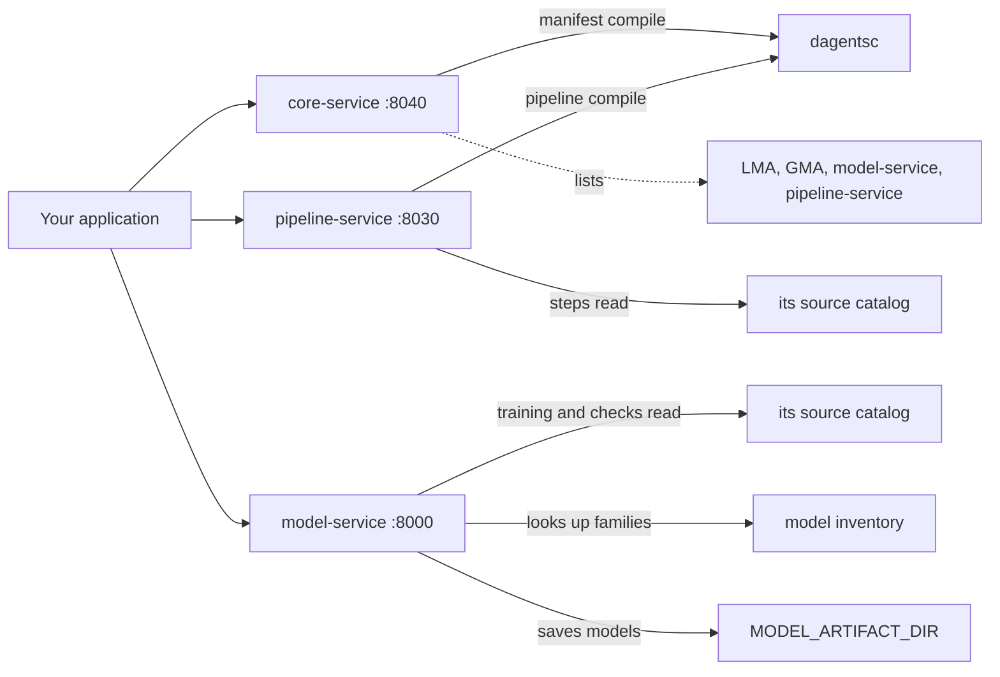
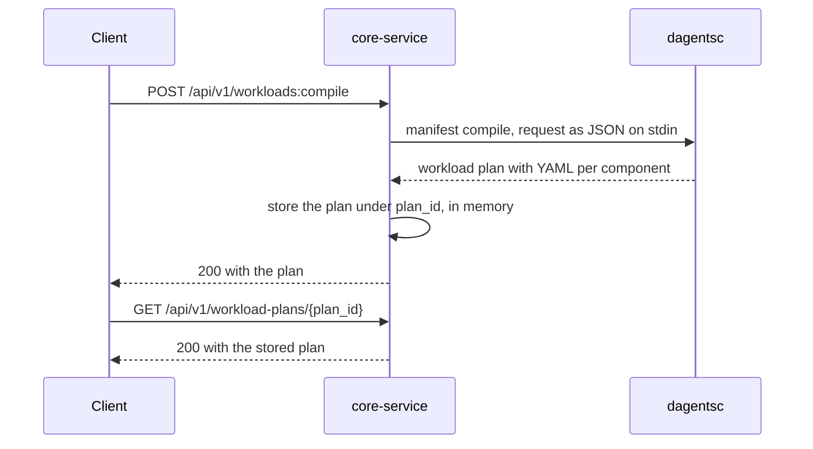
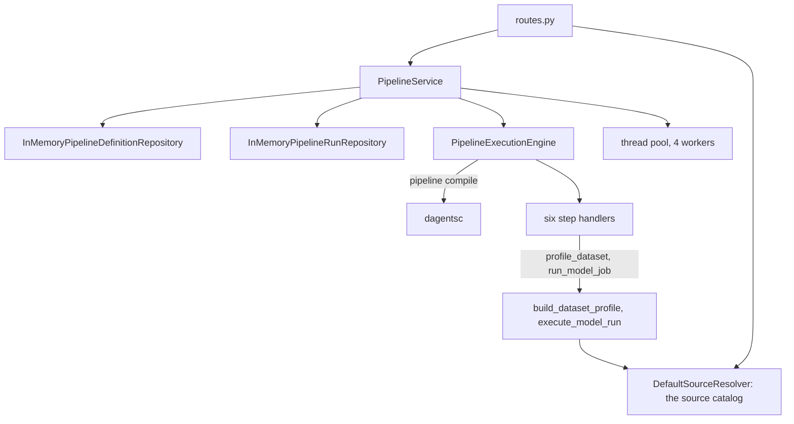
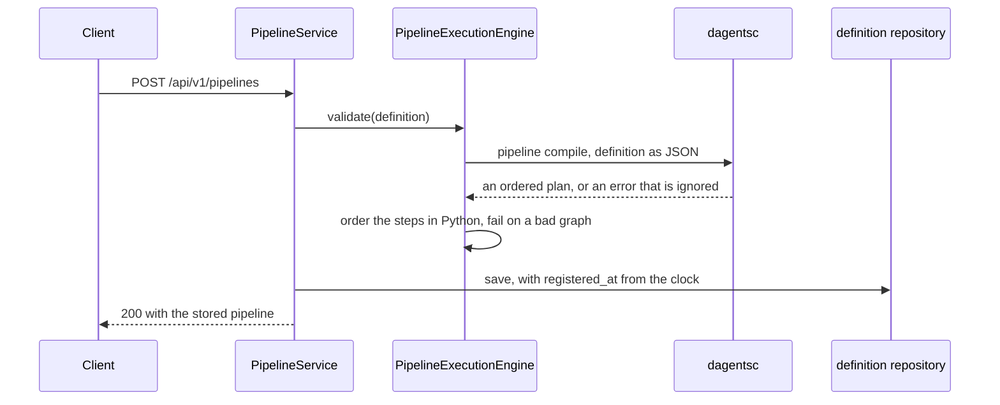
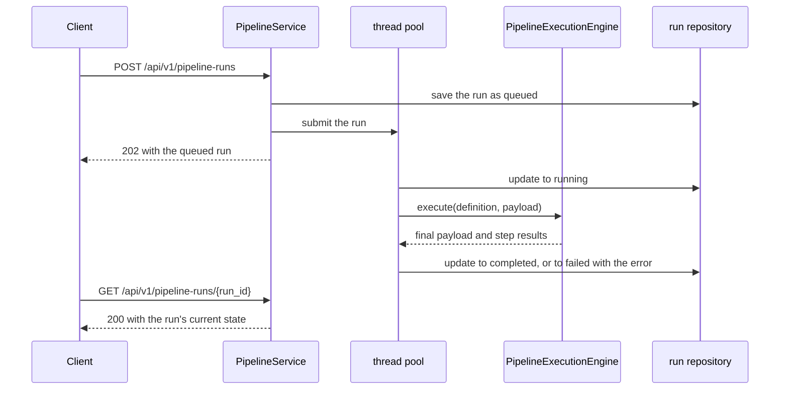
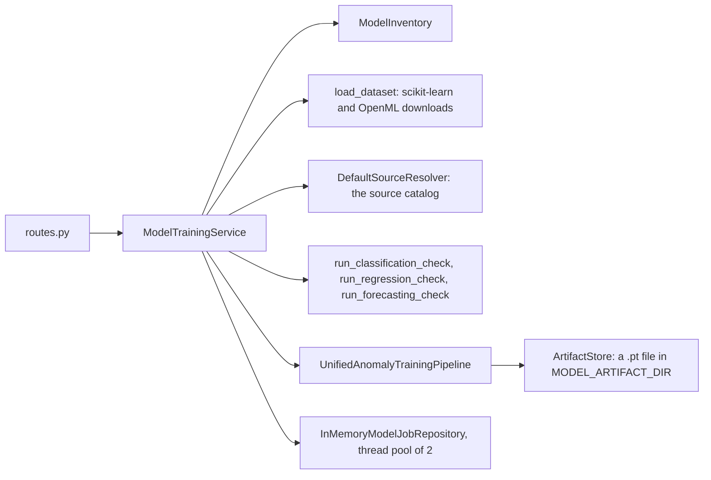
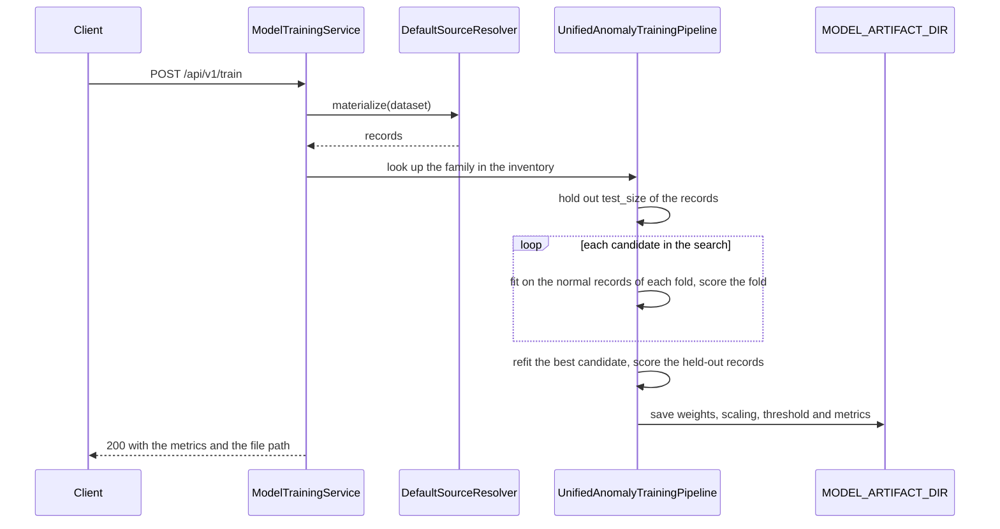
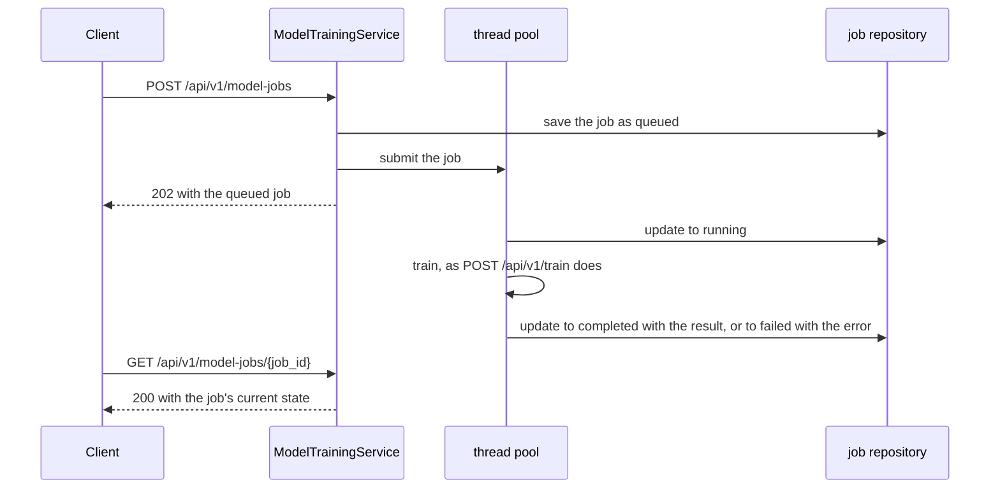

# Framework services

The framework services are the stable APIs an application calls instead of
rebuilding the work itself. There are three, each a FastAPI app with its own
port, and they use only versioned `/api/v1/...` paths.

| Service | Code | Port | What it is for |
|---|---|---|---|
| core-service | `services/core-service/` | 8040 | The catalog of framework services, and Kubernetes manifests and Docker Compose files compiled from a list of workloads |
| pipeline-service | `services/pipeline-service/` | 8030 | Pipeline definitions (a graph of named steps) and runs of them on JSON payloads |
| model-service | `services/model-service/` | 8000 | Model training, one-shot evaluation checks, background model jobs, and the model families this deployment can run |

How they relate to the rest of Dagents:

- The core service and the pipeline service call the planner, `dagentsc`: the
  core service to render manifests (`manifest compile`), the pipeline service
  when it registers or checks a pipeline (`pipeline compile`, whose answer it
  does not use; see [Pipeline definitions](#pipeline-definitions)). See
  [dagentsc](dagentsc.md). The model service does not call the planner.
- The pipeline service and the model service each keep their own catalog of
  data sources at `/api/v1/sources`. It takes the same source definitions and
  reads them with the same adapters as the agents' catalogs
  ([Agents](agents.md#lma-sources)).
- The pipeline service does not call the model service. Its `run_model_job`
  step records an estimated run in process, as an LMA does.
- None of the three passes the Guard. A pipeline step or a training request
  that reads a source reads it directly.
- [spring-core-service](spring-services.md) serves the core service's catalog
  and workload paths again for JVM applications.
- The NL2SQL demo reads the core service's catalog and topology and compiles a
  workload through it ([Demo apps](demo-apps.md)).



Each service keeps what it stores in memory, so a restart clears it.

## Core service health and catalog

```api-interface
service: core-service
status: complete
code: services/core-service/app/api/routes.py
classes:
- Settings (services/core-service/app/core/config.py)
endpoints:
- GET /api/v1/health
- GET /api/v1/services
- GET /api/v1/topology
```

These three endpoints read the core service's configuration and nothing else.
`Settings` loads `env/.env.shared` and `env/.env.core-service` when the service
starts; a variable already set in the environment wins. The function
`build_catalog` in `routes.py` turns the four service addresses in the settings
into the catalog that `/services` and `/topology` return.

### Check the service's health

```api-endpoint
GET /api/v1/health
```

Returns `ok` with the service's name and environment. It reads no stored state,
calls no other service and does not call the planner, so it answers whenever
the process is running. Use it as a liveness check.

**Errors.** None of its own.

**Related.** [The service catalog](#core-service-get-api-v1-services).

### List the configured services

```api-endpoint
GET /api/v1/services
```

Returns the four services the core service is configured with, always in the
order lma, gma, model-service, pipeline-service, and the address it has for
each. The addresses come from `LMA_URL`, `GMA_URL`, `MODEL_SERVICE_URL` and
`PIPELINE_SERVICE_URL`. In `env/.env.core-service` these are the Docker Compose
names, such as `http://lma:8010`, which is what the example shows. The core
service does not call the services, so an address is listed even when nothing
answers there. Nothing is stored.

**Errors.** None of its own.

**Related.** [The ServiceDescriptor object](#the-servicedescriptor-object),
[the topology](#core-service-get-api-v1-topology).

### Read the topology

```api-endpoint
GET /api/v1/topology
```

Returns the same service list as `GET /api/v1/services`, with
`"framework": "dagents"` beside it. The NL2SQL demo reads both endpoints to show
which framework services exist. Nothing is stored and no service is called.

**Errors.** None of its own.

**Related.** [The service catalog](#core-service-get-api-v1-services).

## Workload compiler

```api-interface
service: core-service
status: complete
code: services/core-service/app/api/routes.py
classes:
- ManifestService (services/core-service/app/services/manifest_service.py)
- InMemoryWorkloadPlanRepository (services/core-service/app/services/manifest_service.py)
- render_compose_plan (services/core-service/app/services/compose_renderer.py)
endpoints:
- POST /api/v1/workloads:compile
- GET /api/v1/workload-plans/{plan_id}
- POST /api/v1/manifests/pods
- POST /api/v1/manifests/compose
```

The workload compiler turns a list of workloads into Kubernetes YAML or into a
Docker Compose file. This section describes the Kubernetes endpoints; the
Compose endpoint is described in
[Render a Docker Compose file](#core-service-post-api-v1-manifests-compose).

A **workload component** names a container image and how it runs: a
`Deployment` (pods that keep running), a `Job` (runs once) or a `CronJob` (runs
on a schedule). For each component the compiler renders that object, plus the
companion objects the request asks for:

| Companion | Rendered when |
|---|---|
| Service | the component has `ports`, and `include_services` is true (the default) or `generated_resources` lists `Service` |
| ConfigMap | `include_config_maps` is true, or `generated_resources` lists `ConfigMap` |
| ServiceAccount | `generated_resources` lists `ServiceAccount` |

`ManifestService.compile` sends the request to the planner as JSON
(`dagentsc manifest compile --input - --output json`), checks the answer
against the `WorkloadPlanResponse` model and saves it in an
`InMemoryWorkloadPlanRepository`, keyed by `plan_id`. The YAML is therefore the
OCaml manifest compiler's output, and the same request always gives the same
YAML.

When the planner cannot be run, `ManifestService` renders the YAML itself, in
Python. The core-service tests run the same assertions against both renderers.
They differ in one known case: a component that sets `service_account_name`
without listing `ServiceAccount` in `generated_resources` gets a ServiceAccount
object from the Python renderer only.



### Compile a workload plan

```api-endpoint
POST /api/v1/workloads:compile
```

Renders the YAML for every component in the request and stores the result as a
plan you can fetch again. The service runs `dagentsc manifest compile` with the
request as JSON, then keeps the plan in memory under `plan_id`: the id you send,
or `workload-plan-<milliseconds since 1970>` made from the clock when you send
none. A second compile with the same `plan_id` replaces the stored plan, and a
restart clears every plan. The request holds no records from a data source, so
it passes no Guard boundary.

`combined_yaml` holds every object, separated by `---`, so it can be saved to a
file and applied with `kubectl apply -f`. `manifests` holds the same objects
per component.

**Errors.** `422` when a field fails validation, for example a `kind` other
than `Deployment`, `Job` or `CronJob`, or `replicas` below 1. Each problem is
one entry in `detail`.

**Related.** [Fetch the plan again](#core-service-get-api-v1-workload-plans-plan-id),
[render without a plan id](#core-service-post-api-v1-manifests-pods),
[the WorkloadComponent object](#the-workloadcomponent-object),
[the WorkloadPlanResponse object](#the-workloadplanresponse-object),
[`dagentsc manifest compile`](dagentsc.md#dagentsc-manifest-compile).

### Fetch a workload plan

```api-endpoint
GET /api/v1/workload-plans/{plan_id}
```

Returns a plan stored by `POST /api/v1/workloads:compile`, exactly as that call
returned it. It reads memory only and does not call the planner again.

**Errors.** `404` when no plan has this id. Plans compiled before the service
last restarted are gone, so their ids also return `404`.

**Related.** [Compile a workload plan](#core-service-post-api-v1-workloads-compile),
[the WorkloadPlanResponse object](#the-workloadplanresponse-object).

### Render manifests without a plan id

```api-endpoint
POST /api/v1/manifests/pods
```

Renders the same YAML as `POST /api/v1/workloads:compile` and returns it
without a `plan_id`. The request has no `plan_id` and no `include_config_maps`
field; a component can still ask for a ConfigMap through
`generated_resources`. It runs `dagentsc manifest compile` like the compile
endpoint. The service still saves the result in memory, under an id made from
the clock, but the response does not include the id, so the plan cannot be
fetched. `generate_manifests.py` at the repository root calls this endpoint.

**Errors.** `422` when a field fails validation, as for compile; for example a
`service_type` other than `ClusterIP`, `NodePort` or `LoadBalancer`.

**Related.** [Compile a workload plan](#core-service-post-api-v1-workloads-compile),
[the WorkloadManifest object](#the-workloadmanifest-object).

### Render a Docker Compose file

```api-endpoint
POST /api/v1/manifests/compose
```

Renders one Docker Compose file for a list of workloads, for example a new LMA
that joins a project Docker Compose already runs. The service sends the request
to `dagentsc manifest compile` with a Compose target and returns the planner's
answer. Nothing is stored. The request holds no records from a data source, so
it passes no Guard boundary.

`placement` says how the file is used. `<project>` is the Compose project name,
and `generated.yml` is the saved `compose_yaml`:

| `placement` | The file is | Apply it with | A dependency on a service in `existing_services` |
|---|---|---|---|
| `own` (the default) | a whole project | `docker compose -p <project> -f generated.yml up -d` | an issue, `dependency_outside_project` |
| `merge` | added to a project that runs `existing_services` | `docker compose -p <project> -f <the project's files> -f generated.yml up -d <service>` | allowed |

With `merge`, Docker Compose reads relative paths, such as `env_files`, from the
directory of the first file. To join a network that another project made, set
`external_network` to true and give the network's full Docker name, such as
`healthcare-demo_default`.

What the file contains:

- A port with `host_port` is published on `host_ip`, which is `127.0.0.1` by
  default, because an LMA or a GMA started without tokens answers every caller.
  A port without `host_port` is listed under `expose` and is not published on
  the host.
- Every value is quoted, each `$` is written as `$$`, and control characters
  are escaped, including the line breaks U+0085, U+2028 and U+2029. Docker
  Compose then passes the value to the container unchanged instead of reading
  a variable or folding a line.
  Names are quoted too, so that a service named `134` or an environment
  variable named `NULL` stays a string.
- `env_files` keeps secrets, such as a database address with a password, out of
  the file. The file is returned to the caller, which may show it.
- A `Deployment` gets `restart: unless-stopped` and a `Job` gets
  `restart: "no"`. A component without `health_check` keeps the image's own
  `HEALTHCHECK`.

The planner checks names, ports, host addresses, health checks and
dependencies. When a value breaks a rule, the answer is `200` with every issue
in `issues` and `compose_yaml` null. The codes are listed with
[`dagentsc manifest compile`](dagentsc.md#dagentsc-manifest-compile). The
planner does not check facts it cannot see: whether the image or the env files
exist, whether an external network exists, and whether a host port is already
in use.

When the planner cannot be started, the service renders the file with
`render_compose_plan`, a Python port of the planner's code. The core-service
tests check both against the same golden files in
`services/core-service/tests/fixtures/compose/`. When the planner starts and
then fails, the service does not use the port.

**Errors.**

- `422` when the request has the wrong shape: a wrong type, a `kind` other than
  `Deployment` or `Job`, an unknown `placement` or `condition`, a health check
  with both or neither of `command` and `shell`, or a field the request does
  not have, such as `replicas`. Each problem is one entry in `detail`.
- `500` when a number does not fit in the planner's 63-bit integers (-2^62 to
  2^62 - 1). The planner and its Python port both refuse such a number, so the
  answer is the same with or without the planner.
- `500` when a string holds a lone surrogate, such as the JSON escape
  `\ud800`, which is not UTF-8. The request models accept it; the planner and
  its Python port both refuse it.
- `500` when the planner starts and then fails for another reason. The request
  models refuse the other shapes the planner refuses, so this means the models
  and the planner disagree.

A value that breaks a planner rule is not an error: the answer is `200` with
`issues`.

**Related.** [The ComposeComponent object](#the-composecomponent-object),
[the ComposeIssue object](#the-composeissue-object),
[the ComposeManifestResponse object](#the-composemanifestresponse-object),
[`dagentsc manifest compile`](dagentsc.md#dagentsc-manifest-compile).

## Pipeline service health

```api-interface
service: pipeline-service
status: complete
code: services/pipeline-service/app/api/routes.py
classes:
- Settings (services/pipeline-service/app/core/config.py)
endpoints:
- GET /api/v1/health
```

The pipeline service's liveness check. `Settings` loads `env/.env.shared` and
`env/.env.pipeline-service` when the service starts; a variable already set in
the environment wins. `API_HOST` and `API_PORT` must be set by one of them, or
the service does not start.

### Check the pipeline service's health

```api-endpoint
GET /api/v1/health
```

Returns `ok` with the service's name and environment. It reads no stored state,
calls no other service and does not call the planner, so it answers whenever
the process is running.

**Errors.** None of its own.

**Related.** [List the pipelines](#pipeline-service-get-api-v1-pipelines).

## Pipeline definitions

```api-interface
service: pipeline-service
status: complete
code: services/pipeline-service/app/api/routes.py
classes:
- PipelineService (services/pipeline-service/app/services/pipeline_service.py)
- PipelineExecutionEngine (services/pipeline-service/app/pipeline/engine.py)
- InMemoryPipelineDefinitionRepository (services/pipeline-service/app/services/pipeline_service.py)
endpoints:
- GET /api/v1/pipelines
- POST /api/v1/pipelines
- GET /api/v1/pipeline-definitions
- POST /api/v1/pipeline-definitions
- GET /api/v1/pipeline-definitions/{pipeline_id}
- POST /api/v1/pipeline-definitions/{pipeline_id}:validate
```

A **pipeline** is a list of named steps. Each step has a `kind`, which picks
the code that runs it, a `config` object for that code, and `depends_on`, the
steps that must run before it. The steps and their dependencies form a graph
with no cycles (a DAG, directed acyclic graph). The six kinds, and the
`config` keys each one reads, are listed under
[the PipelineStep object](#the-pipelinestep-object).

`PipelineService` keeps pipelines in memory, in
`InMemoryPipelineDefinitionRepository`, keyed by `pipeline_id`. A restart
clears them. `/api/v1/pipelines` and `/api/v1/pipeline-definitions` are two
names for one collection: their `GET` handlers run the same code, and so do
their `POST` handlers. Fetching and checking one pipeline exist only under
`/api/v1/pipeline-definitions/{pipeline_id}`, and running one only under
`/api/v1/pipelines/{pipeline_id}/runs` ([Pipeline runs](#pipeline-runs)).

**How a graph is checked.** `PipelineExecutionEngine.validate` runs when a
pipeline is registered and when it is checked again:

1. It sends the pipeline to `dagentsc pipeline compile` as JSON. The service
   does not use the answer, and when the planner rejects the graph or cannot be
   run, the error is ignored.
2. It orders the steps in Python (`_resolve_step_order`). Two steps with one
   `step_id`, a `depends_on` entry that names no step, or a cycle raises an
   error, and the request fails with `500`.

So the Python check decides whether a pipeline is accepted, and the planner's
answer has no effect. Neither check reads a step's `config`: a wrong `config`
is found only when the pipeline runs.





### List the pipelines

```api-endpoint
GET /api/v1/pipelines
```

Returns every stored pipeline in `pipelines`, sorted by `pipeline_id`. It reads
memory only and does not call the planner. With nothing registered it returns
`{"pipelines": []}`.

**Errors.** None of its own.

**Related.** [Register a pipeline](#pipeline-service-post-api-v1-pipelines),
[the same list by the other path](#pipeline-service-get-api-v1-pipeline-definitions),
[the PipelineDefinition object](#the-pipelinedefinition-object).

### List the pipelines by the other path

```api-endpoint
GET /api/v1/pipeline-definitions
```

Runs the same handler as `GET /api/v1/pipelines` and returns the same body.

**Errors.** None of its own.

**Related.** [List the pipelines](#pipeline-service-get-api-v1-pipelines).

### Register a pipeline

```api-endpoint
POST /api/v1/pipelines
```

Checks the graph as described above, sets `registered_at` to the current time
in seconds and stores the pipeline under its `pipeline_id`. A pipeline with the
same id is replaced. It runs `dagentsc pipeline compile` once and returns the
stored pipeline with every default filled in. It reads no data source and
passes no Guard boundary.

**Errors.** `422` when a field fails validation, for example a `kind` that is
not one of the six. `500` with the plain-text body `Internal Server Error` when
the graph is not valid: two steps share a `step_id`, a step depends on a step
that does not exist, or the steps depend on each other in a cycle.

**Related.** [The PipelineDefinition object](#the-pipelinedefinition-object),
[the PipelineStep object](#the-pipelinestep-object),
[run the pipeline](#pipeline-service-post-api-v1-pipelines-pipeline-id-runs),
[`dagentsc pipeline compile`](dagentsc.md#dagentsc-pipeline-compile).

### Register a pipeline by the other path

```api-endpoint
POST /api/v1/pipeline-definitions
```

Runs the same handler as `POST /api/v1/pipelines`: it checks the graph, runs
`dagentsc pipeline compile`, stores the pipeline and returns it. The example
registers a pipeline whose steps read a source from
[the pipeline service's catalog](#pipeline-service-sources).

**Errors.** As for [registering a pipeline](#pipeline-service-post-api-v1-pipelines):
`422` for a field that fails validation, `500` for a graph that is not valid.

**Related.** [Register a pipeline](#pipeline-service-post-api-v1-pipelines),
[register a source](#pipeline-service-post-api-v1-sources).

### Fetch a pipeline

```api-endpoint
GET /api/v1/pipeline-definitions/{pipeline_id}
```

Returns the stored pipeline with this `pipeline_id`, as registering it
returned it. It reads memory only.

**Errors.** `404` when no pipeline has this id.

**Related.** [List the pipelines](#pipeline-service-get-api-v1-pipelines),
[the PipelineDefinition object](#the-pipelinedefinition-object).

### Check a stored pipeline again

```api-endpoint
POST /api/v1/pipeline-definitions/{pipeline_id}:validate
```

Runs the same check as registering on the stored pipeline, including
`dagentsc pipeline compile`, and returns the pipeline unchanged. Nothing is
stored and `registered_at` keeps its value. A stored pipeline passed this check
when it was registered, so the answer is `200` unless the checking code has
changed since.

**Errors.** `404` when no pipeline has this id.

**Related.** [Register a pipeline](#pipeline-service-post-api-v1-pipelines),
[`dagentsc pipeline compile`](dagentsc.md#dagentsc-pipeline-compile).

## Pipeline runs

```api-interface
service: pipeline-service
status: complete
code: services/pipeline-service/app/api/routes.py
classes:
- PipelineService (services/pipeline-service/app/services/pipeline_service.py)
- PipelineExecutionEngine (services/pipeline-service/app/pipeline/engine.py)
- InMemoryPipelineRunRepository (services/pipeline-service/app/services/pipeline_service.py)
endpoints:
- POST /api/v1/pipelines/{pipeline_id}/runs
- POST /api/v1/pipeline-runs
- GET /api/v1/pipeline-runs
- GET /api/v1/pipeline-runs/{run_id}
- GET /api/v1/runs
- GET /api/v1/runs/{run_id}
```

A **run** executes a stored pipeline's steps, one at a time, on a JSON object
called the **payload**. Each step reads from the payload and writes its result
back into it at a dotted path, such as `summary` or `context.batch`. The engine
works on a deep copy of the payload you send. A step runs after the steps it
depends on; steps that do not depend on each other run in the order they are
listed.

There are two ways to start a run:

| | `POST /api/v1/pipelines/{pipeline_id}/runs` | `POST /api/v1/pipeline-runs` |
|---|---|---|
| Answers | `200` when the run has finished | `202` at once, with `status` `queued` |
| Pipeline | the id in the path | `pipeline_id` in the body |
| A step fails | `404` or `500`, and nothing is stored | the run is stored as `failed`, with the message in `error` |
| Stored | the finished run | the queued run, updated as it runs |

`InMemoryPipelineRunRepository` keeps runs in memory, in the order they were
stored, and the lists return the newest first. `/api/v1/runs` and
`/api/v1/pipeline-runs` read the same runs. Background runs execute on a pool
of 4 threads in the service process, so a restart loses runs that are queued or
running.

A run's id is made from the clock: `<pipeline_id>-run-<milliseconds since 1970>`.
The examples on this page therefore cannot fetch a stored run by id. The fetch
examples show the `404` answer, and
[the list examples](#pipeline-service-get-api-v1-runs) show stored runs.

Steps pass no Guard boundary. A `profile_dataset` or `run_model_job` step with
a `dataset_input` reads its records through the service's source catalog
directly, with no governance check. Put the Guard in front of data that needs
it, as [the agents](agents.md#lma-governance) do.



### Run a pipeline and wait

```api-endpoint
POST /api/v1/pipelines/{pipeline_id}/runs
```

Runs every step of the stored pipeline on `payload`, stores the finished run
and returns it. A `pipeline_id` in the body is ignored. The returned `status`
is always `completed`, because a step that fails stops the run and nothing is
stored. No planner command runs; the graph was checked when the pipeline was
registered. The second example reads a registered source, so its payload is
empty.

**Errors.** `404` when no pipeline has this id. Also `404` when a step raises a
`ValueError`: its `config` is not valid (the last example has a sum with no
field), it names a source that is not registered, or a condition has an unknown
operator. The `detail` is the error's message. `500` with the plain-text body
`Internal Server Error` when a step raises another error, for example a
condition that compares a number with a string.

**Related.** [The PipelineRunResponse object](#the-pipelinerunresponse-object),
[the StepRunResult object](#the-steprunresult-object),
[queue a run instead](#pipeline-service-post-api-v1-pipeline-runs),
[list the runs](#pipeline-service-get-api-v1-runs).

### Queue a run

```api-endpoint
POST /api/v1/pipeline-runs
```

Stores the run as `queued`, with `completed_at` `0` and the payload as it was
sent, hands it to the thread pool and answers `202` without waiting. The run
then becomes `running`, and then `completed`, or `failed` with the error
message in `error`. A failed run keeps the payload as it was sent and has no
step results. Read its state with
[`GET /api/v1/pipeline-runs/{run_id}`](#pipeline-service-get-api-v1-pipeline-runs-run-id).

**Errors.** `404` when `pipeline_id` is missing (`pipeline_id is required`) or
names no pipeline. A missing `pipeline_id` is a `404`, not a `422`.

**Related.** [Run a pipeline and wait](#pipeline-service-post-api-v1-pipelines-pipeline-id-runs),
[the PipelineRunResponse object](#the-pipelinerunresponse-object).

### List the runs

```api-endpoint
GET /api/v1/runs
```

Returns the stored runs, newest first, at most `limit` of them (default 20).
It reads memory only. `limit` has no lower bound: `0` returns every run, and a
negative number leaves out that many of the oldest runs. The example lists the
two runs made by the examples above.

**Errors.** `422` when `limit` is not an integer.

**Related.** [Fetch one run](#pipeline-service-get-api-v1-runs-run-id),
[the same list by the other path](#pipeline-service-get-api-v1-pipeline-runs).

### List the runs by the other path

```api-endpoint
GET /api/v1/pipeline-runs
```

Runs the same handler as `GET /api/v1/runs`, with the same `limit`, and
returns the same body.

**Errors.** `422` when `limit` is not an integer.

**Related.** [List the runs](#pipeline-service-get-api-v1-runs).

### Fetch a run

```api-endpoint
GET /api/v1/runs/{run_id}
```

Returns the stored run with this `run_id` in its current state: a background
run can be `queued`, `running`, `completed` or `failed`. It reads memory only.
The first example fetches the run that the four-step pipeline example made.

**Errors.** `404` when no run has this id. Runs made before the service last
restarted are gone, so their ids also return `404`.

**Related.** [List the runs](#pipeline-service-get-api-v1-runs),
[the PipelineRunResponse object](#the-pipelinerunresponse-object).

### Fetch a run by the other path

```api-endpoint
GET /api/v1/pipeline-runs/{run_id}
```

Runs the same handler as `GET /api/v1/runs/{run_id}` and returns the same body.

**Errors.** `404` when no run has this id.

**Related.** [Fetch a run](#pipeline-service-get-api-v1-runs-run-id),
[queue a run](#pipeline-service-post-api-v1-pipeline-runs).

## Pipeline service sources

```api-interface
service: pipeline-service
status: complete
code: services/pipeline-service/app/api/routes.py
classes:
- DefaultSourceResolver (agents/common/infrastructure/sources.py)
endpoints:
- GET /api/v1/sources
- POST /api/v1/sources
- GET /api/v1/sources/{source_id}
- POST /api/v1/sources/{source_id}:validate
```

The pipeline service's own catalog of source definitions, kept in memory. It
takes the same four kinds of definition as the LMA (`inline`, `postgres`,
`mongodb`, `object_storage`) and reads them with the same adapters;
[LMA sources](agents.md#lma-sources) says what each adapter reads and checks.
The catalog is separate from every other service's: a source registered here
is unknown to the LMA and to the model service.

When a pipeline runs, a `profile_dataset` or `run_model_job` step whose
`config.dataset_input` has a `source_id` reads that source from this catalog.
Unlike the LMA, the service answers `404` for an unknown id, both when fetching
and when validating.

These endpoints have no authentication. A caller that can reach port 8030 can
register a Postgres source with its own host, login and SQL, and a later run
that reads the source makes the service connect and run that SQL. Run the
service on a private network.

### List the pipeline service's sources

```api-endpoint
GET /api/v1/sources
```

Returns every stored source definition, sorted by `source_id`. It reads memory
only and calls no adapter. With nothing registered it returns `[]`.

**Errors.** None of its own.

**Related.** [Register a source](#pipeline-service-post-api-v1-sources),
[fetch one source](#pipeline-service-get-api-v1-sources-source-id).

### Register a source with the pipeline service

```api-endpoint
POST /api/v1/sources
```

Checks that the body is one of the four source definitions, stores it under its
`source_id` and returns it with every default filled in. A source with the same
id is replaced. Registration reads no records, opens no connection and calls no
planner command.

The handler takes the body as a plain JSON object and validates it itself, with
pydantic's `TypeAdapter`. So a JSON object that is not a valid definition, such
as one with an unknown `kind` or a Postgres source without `selection`, fails
with `500` and the plain-text body `Internal Server Error`, not with `422`.

**Errors.** `422` when the body is not a JSON object, for example a JSON list.
`500` when the object is not a valid source definition, as above.

**Related.** [The InlineSourceSpec object](agents.md#the-inlinesourcespec-object),
[the PostgresSourceSpec object](agents.md#the-postgressourcespec-object),
[validate the source](#pipeline-service-post-api-v1-sources-source-id-validate),
[a pipeline that reads it](#pipeline-service-post-api-v1-pipeline-definitions).

### Fetch one of the pipeline service's sources

```api-endpoint
GET /api/v1/sources/{source_id}
```

Returns the stored definition with this `source_id`. It reads memory only.

**Errors.** `404` when no source has this id.

**Related.** [List the sources](#pipeline-service-get-api-v1-sources),
[register a source](#pipeline-service-post-api-v1-sources).

### Validate one of the pipeline service's sources

```api-endpoint
POST /api/v1/sources/{source_id}:validate
```

Runs the check of the source's adapter on the stored definition and returns
what it found. Nothing is stored, no records are read, no connection is opened
and no planner command runs. An error makes `valid` false; a warning does not.
The second example is a Postgres source with an empty `connection_id`, which
gives one error and one warning. Validation does not prove that a database
answers or that a login works.

**Errors.** `404` when no source has this id.

**Related.** [The SourceValidationResult object](agents.md#the-sourcevalidationresult-object),
[register a source](#pipeline-service-post-api-v1-sources).

## Model service health and catalog

```api-interface
service: model-service
status: complete
code: services/model-service/app/api/routes.py
classes:
- ModelTrainingService (services/model-service/app/services/training_service.py)
- ModelInventory (services/model-service/app/ml/inventory.py)
- Settings (services/model-service/app/core/config.py)
endpoints:
- GET /api/v1/health
- GET /api/v1/datasets
- GET /api/v1/model-families
```

The liveness check, the built-in benchmark datasets, and the model families
this deployment can run. `Settings` loads `env/.env.shared` and
`env/.env.model-service` when the service starts; a variable already set in the
environment wins. Besides `API_HOST` and `API_PORT`, which must be set, it
reads:

| Setting | Default | Used for |
|---|---|---|
| `MODEL_ARTIFACT_DIR` | `artifacts`, relative to the directory the service runs in | Where training saves model files |
| `MODEL_DEVICE` | `cpu` | Training uses `cuda` when this says `cuda` and a GPU is present. The checks always use the CPU. |
| `RANDOM_SEED` | `42` | Every data split, estimator and network starts from it, so a repeated request on the same machine gives the same numbers |

**The model inventory.** The OCaml model router can choose a model family that
this service cannot run. `ModelInventory`, in
`services/model-service/app/ml/inventory.py`, lists every `(family, task)`
pair the router can choose and says whether this service runs it
(`implemented`) or not yet (`planned`). Training and every check look the
family up there first, and answer `400` when it is not implemented for the
task. Listing the inventory imports no machine-learning library.

### Check the model service's health

```api-endpoint
GET /api/v1/health
```

Returns `ok` with the service's name and environment. It reads no stored state
and calls no other service, so it answers whenever the process is running.

**Errors.** None of its own.

**Related.** [List the model families](#model-service-get-api-v1-model-families).

### List the benchmark datasets

```api-endpoint
GET /api/v1/datasets
```

Returns the three benchmark datasets fixed in
`services/model-service/app/ml/datasets.py`, sorted by name. Nothing is
downloaded to answer, so `rows` and `features` are always null. To use one,
send its `name` as `dataset_name` to training or a check. The service then
downloads it through scikit-learn (`fetch_kddcup99` or `fetch_openml`), which
keeps a copy in its data folder, so the first use needs network access.

**Errors.** None of its own.

**Related.** [Train a model](#model-service-post-api-v1-train),
[check a classifier](#model-service-post-api-v1-checks-classification).

### List the model families

```api-endpoint
GET /api/v1/model-families
```

Returns the model inventory: every task, provider and family, the families
implemented for each task, every `(family, task)` entry, and the `planned`
entries again in `gaps`. Nothing is stored and no planner command runs. In this
version the implemented families are:

| Task | Families | Run by |
|---|---|---|
| `anomaly_detection` | `autoencoder`, `variational_autoencoder` | `POST /api/v1/train` and model jobs |
| `classification` | `linear`, `naive_bayes`, `random_forest` | `POST /api/v1/checks/classification` |
| `regression` | `linear`, `random_forest` | `POST /api/v1/checks/regression` |
| `forecasting` | `gru`, `lstm` | `POST /api/v1/checks/forecasting` |
| `embedding` | `transformer` (Hugging Face; needs `transformers` and a download) | no endpoint of this service |

The example is trimmed to 10 of its 19 entries.

**Errors.** None of its own.

**Related.** [The ModelInventoryResponse object](#the-modelinventoryresponse-object),
[the ModelCapabilityResponse object](#the-modelcapabilityresponse-object).

## Training and checks

```api-interface
service: model-service
status: complete
code: services/model-service/app/api/routes.py
classes:
- ModelTrainingService (services/model-service/app/services/training_service.py)
- UnifiedAnomalyTrainingPipeline (services/model-service/app/ml/pipeline.py)
- ArtifactStore (services/model-service/app/ml/artifacts.py)
endpoints:
- POST /api/v1/train
- POST /api/v1/checks/classification
- POST /api/v1/checks/regression
- POST /api/v1/checks/forecasting
```

Synchronous model work: each request reads its records, fits a model and
answers when it is done. The records come from one of two fields:

- `dataset_name`: a benchmark from
  [`GET /api/v1/datasets`](#model-service-get-api-v1-datasets), downloaded on
  first use.
- `dataset`: a [DatasetInput](agents.md#the-datasetinput-object), which holds
  records inline, a source definition, or the `source_id` of a source in
  [this service's catalog](#model-service-sources). `DefaultSourceResolver`
  reads the records. Feature values that are not numbers become 0.

| Endpoint | Task | Families | What runs | Stores |
|---|---|---|---|---|
| `POST /api/v1/train` | `anomaly_detection` | `autoencoder`, `variational_autoencoder` | A PyTorch network chosen by a hyperparameter search | A model file in `MODEL_ARTIFACT_DIR` |
| `POST /api/v1/checks/classification` | `classification` | `random_forest`, `naive_bayes`, `linear` | A scikit-learn classifier | Nothing |
| `POST /api/v1/checks/regression` | `regression` | `random_forest`, `linear` | A scikit-learn regressor | Nothing |
| `POST /api/v1/checks/forecasting` | `forecasting` | `gru`, `lstm` | A small PyTorch recurrent network | Nothing |

None of these call the planner, and none pass the Guard: the records are read
directly. The service keeps no record of a check, and training leaves only the
model file.





### Train an anomaly model

```api-endpoint
POST /api/v1/train
```

Trains an anomaly model and saves it to a file. The steps:

1. Read the records and hold out `test_size` of them, keeping the share of
   anomalies.
2. For each hyperparameter **candidate**, score it on the remaining records with
   `tuning_strategy`. In each fold the network fits only the normal records
   (label 0), after scaling and any PCA, and scores every record by how badly
   it rebuilds it. The fold's threshold is the score, among 30 quantiles
   between the 80th and the 99.5th percentile, that gives the best F1.
3. Keep the candidate with the best `target_metric`, refit it on all the
   remaining records, and score the held-out records with the mean threshold.
4. Save the weights, the scaling and PCA settings, the threshold and the
   metrics with `torch.save` to `MODEL_ARTIFACT_DIR/<artifact_name>`. A file
   with that name is replaced.

The default search has 8 candidates (2 layer sizes, 2 dropout rates, with and
without PCA), so with 3 folds it fits 25 networks; `search` narrows it, as in
the example. The answer holds the metrics and the file's path, not the model.
Nothing else is stored, no planner command runs and no Guard boundary is
passed.

**Errors.** `422` when a field fails validation: neither `dataset_name` nor
`dataset`, `max_rows` below 100, `test_size` not between 0.05 and 0.5, or
`n_splits` outside 2 to 10. `400` when `model_family` is not implemented for
anomaly detection; the body names the families that are, and for a `planned`
family what it would need. `500` with the plain-text body
`Internal Server Error` when the records cannot be read or used:
`dataset_name` is not a benchmark or cannot be downloaded, the `source_id` is
not registered, there are fewer than 2 anomalies, so the held-out part cannot
keep their share, or `tuning_strategy` or `target_metric` is not a known name.

**Related.** [The TrainRequest object](#the-trainrequest-object),
[the TrainResponse object](#the-trainresponse-object),
[train in the background](#model-service-post-api-v1-model-jobs),
[list the model families](#model-service-get-api-v1-model-families).

### Check a classifier

```api-endpoint
POST /api/v1/checks/classification
```

Fits a scikit-learn classifier on part of the records and scores it on the
rest. The split keeps the share of each class, and the metrics treat class 1 as
the positive class. The families are `random_forest` (100 trees),
`naive_bayes` (Gaussian) and `linear` (logistic regression). Nothing is stored
and no model file is written.

**Errors.** `422` when a field fails validation, for example a request with
neither `dataset_name` nor `dataset`. `400` when `model_family` is not
implemented for classification (the example asks for `xgboost`, which is
planned). `500` with the plain-text body `Internal Server Error` when the
records cannot be read, `label_field` is not in them, the label has fewer than
two classes or more than two, or a class has too few records to split.

**Related.** [The MLCheckRequest object](#the-mlcheckrequest-object),
[check a regressor](#model-service-post-api-v1-checks-regression).

### Check a regressor

```api-endpoint
POST /api/v1/checks/regression
```

Fits a scikit-learn regressor on a random part of the records and measures its
errors on the rest. The families are `random_forest` (100 trees) and `linear`
(least squares). Nothing is stored and no model file is written.

**Errors.** `422` when a field fails validation. `400` when `model_family` is
not implemented for regression (the example asks for `naive_bayes`, which
serves classification only). `500` with the plain-text body
`Internal Server Error` when the records cannot be read or `label_field` is
not in them.

**Related.** [The MLCheckRequest object](#the-mlcheckrequest-object),
[check a classifier](#model-service-post-api-v1-checks-classification).

### Check a forecasting model

```api-endpoint
POST /api/v1/checks/forecasting
```

Treats the records as a series, in the order they arrive. Each record after the
first `sequence_length` becomes one example: the features of the
`sequence_length` records before it, and its own label as the target. The last
`test_size` share of the examples is held out. A GRU or LSTM layer of 32 units
with a linear output is trained for 12 steps on all the training examples at
once, on values that are not scaled. Nothing is stored and no model file is
written.

Treat it as a check that the data and the family work together, not as a
measure of a good model. In the example, 20 days of order counts give an R²
of about -52: worse than predicting the mean, because 12 steps on unscaled
values cannot fit targets around 40.

**Errors.** `422` when a field fails validation. `400` when `model_family` is
not `gru` or `lstm`; the default, `random_forest`, gives `400`, so set it. `500`
with the plain-text body `Internal Server Error` when the records cannot be
read, `label_field` is not in them, or there are not more records than
`sequence_length`.

**Related.** [The MLCheckRequest object](#the-mlcheckrequest-object),
[list the model families](#model-service-get-api-v1-model-families).

## Model jobs

```api-interface
service: model-service
status: complete
code: services/model-service/app/api/routes.py
classes:
- ModelTrainingService (services/model-service/app/services/training_service.py)
- InMemoryModelJobRepository (services/model-service/app/services/training_service.py)
endpoints:
- POST /api/v1/model-jobs
- GET /api/v1/model-jobs
- GET /api/v1/model-jobs/{job_id}
```

Training in the background. `POST /api/v1/model-jobs` takes the same body as
[`POST /api/v1/train`](#model-service-post-api-v1-train), stores a `queued`
job in `InMemoryModelJobRepository` and runs the same training on a pool of 2
threads. A job goes from `queued` to `running` to `completed`, with the
training answer in `result`, or to `failed`, with the message in `error`.

Only the schema is checked before the answer. Everything else is checked in the
background, so a model family that is not implemented gives a `failed` job, not
a `400`. Jobs are kept in memory, so a restart loses them, running ones
included. A job's id is made from the clock, `model-job-<milliseconds since 1970>`,
so the examples cannot fetch a job by id; the fetch example shows the `404`
answer.



### Submit a training job

```api-endpoint
POST /api/v1/model-jobs
```

Stores a `queued` job, hands the training to the thread pool and answers `202`
without waiting. The training then writes its model file as
`POST /api/v1/train` would. No planner command runs and no Guard boundary is
passed.

**Errors.** `422` when a field fails validation, as for training. Any other
problem shows later as a `failed` job.

**Related.** [Train and wait](#model-service-post-api-v1-train),
[list the jobs](#model-service-get-api-v1-model-jobs),
[the ModelJobResponse object](#the-modeljobresponse-object).

### List the jobs

```api-endpoint
GET /api/v1/model-jobs
```

Returns the stored jobs, newest first, at most `limit` of them (default 20).
It reads memory only. `limit` has no lower bound: `0` returns every job, and a
negative number leaves out that many of the oldest jobs. In the example the job
submitted above is still running.

**Errors.** `422` when `limit` is not an integer.

**Related.** [Submit a training job](#model-service-post-api-v1-model-jobs),
[fetch one job](#model-service-get-api-v1-model-jobs-job-id).

### Fetch a job

```api-endpoint
GET /api/v1/model-jobs/{job_id}
```

Returns the stored job with this `job_id` in its current state. It reads memory
only. The example fetches the job the submit example started, while it is
still running, so `completed_at` and `result` are `null`.

**Errors.** `404` when no job has this id. Jobs submitted before the service
last restarted are gone, so their ids also return `404`.

**Related.** [List the jobs](#model-service-get-api-v1-model-jobs),
[the ModelJobResponse object](#the-modeljobresponse-object).

## Model service sources

```api-interface
service: model-service
status: complete
code: services/model-service/app/api/routes.py
classes:
- ModelTrainingService (services/model-service/app/services/training_service.py)
- DefaultSourceResolver (agents/common/infrastructure/sources.py)
endpoints:
- GET /api/v1/sources
- POST /api/v1/sources
- GET /api/v1/sources/{source_id}
- POST /api/v1/sources/{source_id}:validate
```

The model service's own catalog of source definitions, kept in memory. It takes
the same four kinds of definition as the LMA and reads them with the same
adapters ([LMA sources](agents.md#lma-sources) says what each one reads and
checks). Training, the checks and model jobs read a source from this catalog
when their `dataset.source_id` names it. The catalog is separate from the LMA's
and the pipeline service's, and the service answers `404` for an unknown id.

There is no authentication. A caller that can reach port 8000 can register a
Postgres source with its own host, login and SQL, and a later training request
that names it makes the service connect and run that SQL. Run the service on a
private network.

### List the model service's sources

```api-endpoint
GET /api/v1/sources
```

Returns every stored source definition, sorted by `source_id`. It reads memory
only and calls no adapter. With nothing registered it returns `[]`.

**Errors.** None of its own.

**Related.** [Register a source](#model-service-post-api-v1-sources),
[fetch one source](#model-service-get-api-v1-sources-source-id).

### Register a source with the model service

```api-endpoint
POST /api/v1/sources
```

Checks that the body is one of the four source definitions, stores it under its
`source_id` and returns it with every default filled in. A source with the same
id is replaced. Registration reads no records, opens no connection and calls no
planner command. The example registers the 20 orders that the training and
check examples read.

The handler validates the body itself, with pydantic's `TypeAdapter`, so a
JSON object that is not a valid definition fails with `500` and the plain-text
body `Internal Server Error`, not with `422`.

**Errors.** `422` when the body is not a JSON object, for example a JSON list.
`500` when the object is not a valid source definition.

**Related.** [The InlineSourceSpec object](agents.md#the-inlinesourcespec-object),
[validate the source](#model-service-post-api-v1-sources-source-id-validate),
[train on it](#model-service-post-api-v1-train).

### Fetch one of the model service's sources

```api-endpoint
GET /api/v1/sources/{source_id}
```

Returns the stored definition with this `source_id`. It reads memory only.

**Errors.** `404` when no source has this id.

**Related.** [List the sources](#model-service-get-api-v1-sources).

### Validate one of the model service's sources

```api-endpoint
POST /api/v1/sources/{source_id}:validate
```

Runs the check of the source's adapter on the stored definition and returns
what it found. Nothing is stored, no records are read, no connection is opened
and no planner command runs. An error makes `valid` false; a warning does not.

**Errors.** `404` when no source has this id.

**Related.** [The SourceValidationResult object](agents.md#the-sourcevalidationresult-object),
[register a source](#model-service-post-api-v1-sources).

## Objects

The request and response models of the three services. Their field
descriptions come from each service's `app/models.py`: the core service's
objects first, then the pipeline service's, then the model service's. The
source definitions that the pipeline and model services store are the agents'
objects: see [the InlineSourceSpec object](agents.md#the-inlinesourcespec-object)
and [the DatasetInput object](agents.md#the-datasetinput-object).

### The WorkloadComponent object

```api-object
class: app.models.WorkloadComponent
service: core-service
example: core-service compile-a-deployment /request/json/components/0
```

One workload to render: a container image and how Kubernetes should run it. A
compile or render request carries a list of them in `components`. Only `name`
and `image` are required; every other field has a default.

### The WorkloadManifest object

```api-object
class: app.models.WorkloadManifest
service: core-service
example: core-service compile-a-deployment /response/body/manifests/0
```

The YAML rendered for one component. A field is `null` when that companion
object was not rendered.

### The WorkloadPlanResponse object

```api-object
class: app.models.WorkloadPlanResponse
service: core-service
example: core-service get-plan /response/body
```

A compiled workload plan: what `POST /api/v1/workloads:compile` returns and
`GET /api/v1/workload-plans/{plan_id}` returns again.

### The ComposeComponent object

```api-object
class: app.models.ComposeComponent
service: core-service
example: core-service compose-an-lma /request/json/components/0
```

One service in a request to `POST /api/v1/manifests/compose`: a container
image, how it runs, its ports, its health check and the services it waits for.
Only `name` and `image` are required.

### The ComposeIssue object

```api-object
class: app.models.ComposeIssue
service: core-service
example: core-service compose-with-issues /response/body/issues/0
```

One reason the planner gives for not rendering a Compose file. `service` is null
for an issue with the whole request, such as `no_services` or
`invalid_network_name`.

### The ComposeManifestResponse object

```api-object
class: app.models.ComposeManifestResponse
service: core-service
example: core-service compose-an-lma /response/body
```

What `POST /api/v1/manifests/compose` returns. `compose_yaml` is set exactly
when `issues` is empty.

### The ServiceDescriptor object

```api-object
class: app.models.ServiceDescriptor
service: core-service
example: core-service services /response/body/services/0
```

One entry in the core service's catalog.

### The PipelineDefinition object

```api-object
class: app.models.PipelineDefinition
service: pipeline-service
example: pipeline-service register-pipeline /response/body
```

What `POST /api/v1/pipelines` takes and returns, and what the list and fetch
endpoints return. The example keeps paid orders of 100 or
more, adds a batch date, totals the orders and copies three values into a
report.

### The PipelineStep object

```api-object
class: app.models.PipelineStep
service: pipeline-service
example: pipeline-service register-pipeline /request/json/steps/2
```

`kind` picks the code that runs the step, and that code reads its settings
from `config`. A key that is not set takes the default in
brackets. Paths such as `items_field` are dotted paths into the payload.

| Kind | Reads from `config` | Writes into the payload | `output` in the step result |
|---|---|---|---|
| `enrich_context` | `target_field` (`context`), `values` (`{}`) | Merges `values` into the object at `target_field`, creating it. The run fails with `404` when that path holds something that is not an object. | `target_field`, `merged_keys` |
| `filter_items` | `items_field` (`items`), `conditions` (`[]`, a list of [PipelineCondition](#the-pipelinecondition-object)) | Keeps the items at `items_field` that pass every condition. A missing `items_field` is read as an empty list, and an empty list is written there. | `items_field`, `input_count`, `output_count` |
| `summarize_items` | `items_field` (`items`), `target_field` (`summary`), `aggregations` (`[]`, a list of [AggregationSpec](#the-aggregationspec-object)) | An object with one value per aggregation | `target_field`, `summary_keys` |
| `project_fields` | `target_field` (`projection`), `fields` (`[]`) | An object whose keys are the dotted paths as written, such as `"summary.total_amount"`, for the paths that exist | `target_field`, `projected_fields` |
| `profile_dataset` | `dataset_input` (a [DatasetInput](agents.md#the-datasetinput-object)), or else the items at `items_field` (`items`); `target_field` (`dataset_profile`), `scope_id` (the `items_field` value), `scope_kind` (`source`), `extraction_strategy` (`tabular`), `feature_fields` (`[]`), `label_field` (none), `batch_size` (1000) | A [DatasetProfile](agents.md#the-datasetprofile-object), made by the same code as an LMA profile | `target_field`, `record_count`, `feature_count` |
| `run_model_job` | The same as `profile_dataset`, plus `task_type` (`anomaly_detection`), `model_family` (`autoencoder`), `hyperparameters` (`{"batch_size": 1000}`), `artifact_prefix` (`artifacts`), `model_version` (`v1`); `target_field` (`model_run`) | A [ModelRunRecord](agents.md#the-modelrunrecord-object) with `agent_role` `SERVICE`, made by the same code as an LMA model run | `target_field`, `model_family`, `record_count` |

`run_model_job` trains nothing and does not call the model service: like an
LMA model run, it profiles the records and records estimated metrics.

### The PipelineCondition object

```api-object
class: app.models.PipelineCondition
service: pipeline-service
example: pipeline-service register-pipeline /request/json/steps/0/config/conditions/1
```

An item is kept only when it passes every condition in `conditions`. The step reads conditions when the pipeline runs, so a
condition that is not valid fails the run with `404`, not the registration.

### The AggregationSpec object

```api-object
class: app.models.AggregationSpec
service: pipeline-service
example: pipeline-service register-pipeline /request/json/steps/2/config/aggregations/1
```

The result is stored in the step's `target_field` object under `alias`.
`count` needs no `field`; `sum`, `avg`, `min` and `max` fail the run with `404`
without one.

### The PipelineRunResponse object

```api-object
class: app.models.PipelineRunResponse
service: pipeline-service
example: pipeline-service run-pipeline /response/body
```

What the run endpoints return and the run lists hold. `final_payload` is the payload after every step, and `step_results` says what
each step did. In the example the filter kept 3 of 6 orders, so the summary
counts 3 orders with a total of 615.25.

### The StepRunResult object

```api-object
class: app.models.StepRunResult
service: pipeline-service
example: pipeline-service run-pipeline /response/body/step_results/0
```

`output` is a short summary; the step's result itself is in the run's
`final_payload`.

### The TrainRequest object

```api-object
class: app.models.TrainRequest
service: model-service
example: model-service train /request/json
```

What `POST /api/v1/train` and `POST /api/v1/model-jobs` take. Every field
except the data has a default. The example trains on a registered source and
narrows the search to one candidate.

### The TrainResponse object

```api-object
class: app.models.TrainResponse
service: model-service
example: model-service train /response/body
```

Where the model file is, the hyperparameters that won, and how the model
scored. A completed model job holds the same object in `result`.

### The MetricSummary object

```api-object
class: app.models.MetricSummary
service: model-service
example: model-service train /response/body/metrics
```

The anomaly label is the positive class. In the example the 4 held-out orders hold 1 fraud, and
the model flags it and nothing else, so every metric is 1.0.

### The MLCheckRequest object

```api-object
class: app.models.MLCheckRequest
service: model-service
example: model-service classification-check /request/json
```

What the three check endpoints take. `label_field` is required.
`sequence_length` matters only for forecasting.

### The ModelJobResponse object

```api-object
class: app.models.ModelJobResponse
service: model-service
example: model-service submit-job /response/body
```

The example is the answer to a submission, so the job is still `queued` and
`result` is null.

### The ModelInventoryResponse object

```api-object
class: app.models.ModelInventoryResponse
service: model-service
example: model-service model-families /response/body
```

It comes from `services/model-service/app/ml/inventory.py`. An application
can read `implemented` instead of keeping its own list of model families. The
example is trimmed.

### The ModelCapabilityResponse object

```api-object
class: app.models.ModelCapabilityResponse
service: model-service
example: model-service model-families /response/body/capabilities/0
```

The example is the first entry: the PyTorch autoencoder for anomaly
detection.
