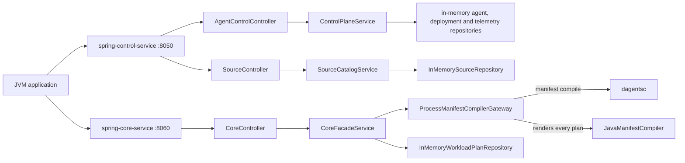
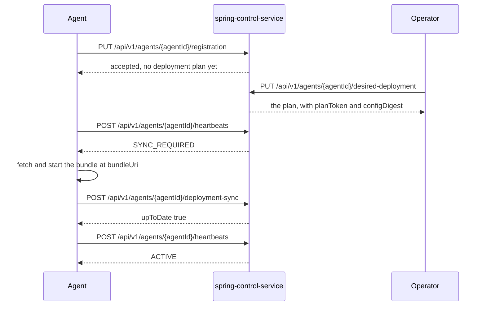
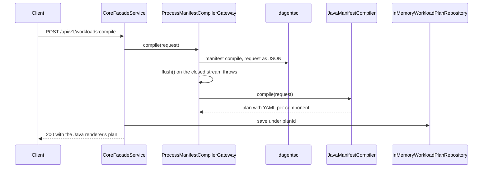

# Spring Boot services

Two Spring Boot services offer parts of the framework's APIs to applications
on the JVM (the Java virtual machine). They serve the same paths as the Python
services they mirror, but they are separate implementations, and the
differences below matter when you switch between them.

| Service | Code | Port | Mirrors |
|---|---|---|---|
| spring-control-service | `services/spring-services/spring-control-service/` | 8050 | The GMA's agent registry (`/api/v1/agents/...`) and a source catalog (`/api/v1/sources`) |
| spring-core-service | `services/spring-services/spring-core-service/` | 8060 | The core service's catalog and workload compiler (`/api/v1/services`, `/api/v1/topology`, `/api/v1/workloads:compile`, `/api/v1/workload-plans/{planId}`) |

The request and response records both services use are in
`services/spring-services/dagents-spring-common/`, and each record's Javadoc
describes its fields. Both services keep their state in memory, so a restart
clears it, and neither checks who is calling. `tests/test_service_inventory.py`
checks that every path they serve exists on the Python service they mirror.
spring-core-service runs the planner, `dagentsc`, but in this version does not
use its answer ([Core facade](#core-facade)); spring-control-service calls no
other service.

**spring-core-service builds and passes its tests, but it does not start.** Spring finds two `InMemoryWorkloadPlanRepository` beans: the class is
a `@Repository`, and `CoreConfiguration` also declares one with `@Bean`. So the
[Core facade](#core-facade) endpoints below are described from the code, and
have no captured examples.

## How they differ from the Python services

| | Python services | Spring services |
|---|---|---|
| JSON keys | snake_case: `agent_id`, `plan_id` | camelCase, the Java record names: `agentId`, `planId`. A snake_case key is ignored, so a body written for a Python service fails validation or loses fields. |
| Fetching an unknown id | `404` (core service, pipeline service, model service) | `200` with an empty body |
| A field that fails validation | `422`, `{"detail": [...]}` with one entry per problem | `422`, `{"code": "validation_error", "message": "..."}`. For a blank field the message is Spring's own description of the failed check, several hundred characters long. |
| A body that is not JSON, or a value of the wrong type | `422` | `400` with Spring's error body: `timestamp`, `status`, `error`, `path` |
| An error the code does not handle | `500` with the text `Internal Server Error` | `500` with Spring's error body |
| Source definitions | four kinds, each read and checked by an adapter; `connection_ref` is an object | any `kind`; `connectionRef` is a name; nothing reads the source |
| The core catalog | four services | five: spring-control-service as well |
| Workload compile defaults | `include_services` is `true` | `includeServices` is `false` |



To run them, build the jars and start each one with its settings from `env/`.
The examples on this page call spring-control-service on its local port, 8050:

```bash
mvn -B -f services/spring-services/pom.xml package -DskipTests
set -a; . env/.env.spring-control-service; set +a
java -jar services/spring-services/spring-control-service/target/spring-control-service-0.1.0-SNAPSHOT.jar
```

Without `SERVER_PORT` the service does not start. Without
`DAGENTS_CONTROL_APP_NAME` and `DAGENTS_CONTROL_ENVIRONMENT` it starts, but its
health check reports the unfilled text `${DAGENTS_CONTROL_APP_NAME}` as its
name. spring-core-service reads `SERVER_PORT`, `DAGENTS_CORE_APP_NAME`,
`DAGENTS_CORE_ENVIRONMENT`, the five `DAGENTS_CORE_*_URL` addresses, and the
planner's path from `DAGENTS_OCAML_MANIFEST_CLI`.

## Control service health

```api-interface
service: spring-control-service
status: complete
code: services/spring-services/spring-control-service/src/main/java/io/dagents/spring/control/api/HealthController.java
classes:
- HealthController (services/spring-services/spring-control-service/src/main/java/io/dagents/spring/control/api/HealthController.java)
- ControlServiceProperties (services/spring-services/spring-control-service/src/main/java/io/dagents/spring/control/config/ControlServiceProperties.java)
endpoints:
- GET /api/v1/health
```

The control service's liveness check. `ControlServiceProperties` holds the
name and environment it reports, from `DAGENTS_CONTROL_APP_NAME` and
`DAGENTS_CONTROL_ENVIRONMENT`.

### Check the control service's health

```api-endpoint
GET /api/v1/health
```

Returns `ok` with the service's name and environment. It reads no stored state
and calls no other service, so it answers whenever the process is running.

**Errors.** None of its own.

**Related.** [List the agents](#spring-control-service-get-api-v1-agents).

## Agent control

```api-interface
service: spring-control-service
status: complete
code: services/spring-services/spring-control-service/src/main/java/io/dagents/spring/control/api/AgentControlController.java
classes:
- AgentControlController (services/spring-services/spring-control-service/src/main/java/io/dagents/spring/control/api/AgentControlController.java)
- ControlPlaneService (services/spring-services/spring-control-service/src/main/java/io/dagents/spring/control/application/ControlPlaneService.java)
- InMemoryAgentRegistryRepository (services/spring-services/spring-control-service/src/main/java/io/dagents/spring/control/infrastructure/InMemoryAgentRegistryRepository.java)
- InMemoryDeploymentRepository (services/spring-services/spring-control-service/src/main/java/io/dagents/spring/control/infrastructure/InMemoryDeploymentRepository.java)
- InMemoryTelemetryRepository (services/spring-services/spring-control-service/src/main/java/io/dagents/spring/control/infrastructure/InMemoryTelemetryRepository.java)
endpoints:
- PUT /api/v1/agents/{agentId}/registration
- POST /api/v1/agents/{agentId}/heartbeats
- POST /api/v1/agents/{agentId}/telemetry
- PUT /api/v1/agents/{agentId}/desired-deployment
- POST /api/v1/agents/{agentId}/deployment-sync
- GET /api/v1/agents
- GET /api/v1/agents/{agentId}
```

An agent registry for the JVM, on the paths of the GMA's registry
([Agent registry](agents.md#agent-registry)). `ControlPlaneService` keeps three
things in memory:

- an **agent snapshot** per agent id: what the agent registered, its last
  heartbeat, its last telemetry batch, and the bundle it should run and the one
  it runs (`AgentSnapshot`);
- a **deployment plan** per agent id: the bundle the agent should run, with a
  token and a digest made from the request (`DeploymentPlan`);
- every **telemetry batch** received, in order. No endpoint returns them.

A **bundle** is the code an agent runs, named by `bundleId` and
`bundleVersion`. The control service decides nothing about bundles itself: it
stores the desired bundle, tells the agent in each heartbeat answer whether it
runs it, and records what the agent reports.

Every write takes the agent id twice, in the path and in the body, and answers
`422` with `{"code": "validation_error", ...}` when they differ. Registration,
heartbeats and telemetry also check the body's `@NotBlank` fields; the desired
deployment and the deployment report do not. A registration, heartbeat,
telemetry batch or deployment report without `agent` fails with `500`, because
the controller reads `agent.agentId` and nothing checks first that `agent` is
there.



### Register an agent

```api-endpoint
PUT /api/v1/agents/{agentId}/registration
```

Stores the agent's identity, scope, version and capabilities. A new agent gets
status `REGISTERED`. Registering again replaces those four fields and keeps
the rest: status, last heartbeat, telemetry id and bundles. The answer's
`deploymentPlanId` is the `planToken` of a desired deployment already stored
for the agent, or null.

**Errors.** `422` when the path id differs from `agent.agentId`, and when a
field of `agent`, or `version`, is blank (the third example; its message is
cut). `400` when the body is not JSON. `500` with Spring's error body when the
body has no `agent` (the fourth example).

**Related.** [Send a heartbeat](#spring-control-service-post-api-v1-agents-agentid-heartbeats),
[fetch the agent](#spring-control-service-get-api-v1-agents-agentid),
[the GMA's registration](agents.md#agent-registry).

### Send a heartbeat

```api-endpoint
POST /api/v1/agents/{agentId}/heartbeats
```

Records the heartbeat's `status` as the agent's status and last heartbeat
status, and its `timestamp` as `lastSeenAt`. The timestamp is stored as sent
and not checked. The answer's `desiredState` is `SYNC_REQUIRED` when a desired
bundle is set and the agent last reported another bundle id or version, and
`ACTIVE` otherwise. A heartbeat from an agent that never registered stores it,
with version `unknown`.

**Errors.** `422` when the path id differs from `agent.agentId`, or when
`status` or a field of `agent` is blank. `400` when the body is not JSON or
`timestamp` is not a number. `500` with Spring's error body when the body has
no `agent`.

**Related.** [Set the desired bundle](#spring-control-service-put-api-v1-agents-agentid-desired-deployment),
[report the running bundle](#spring-control-service-post-api-v1-agents-agentid-deployment-sync).

### Send telemetry

```api-endpoint
POST /api/v1/agents/{agentId}/telemetry
```

Appends the batch to the telemetry kept in memory and answers with an
`ingestionId` of `telemetry-<n>`, where n counts every batch received since the
service started, from all agents. A registered agent's `lastIngestionId` is
set to it. No endpoint returns the batches, and a restart loses them.

**Errors.** `422` when the path id differs from `agent.agentId`, or when a
field of `agent` is blank. `400` when the body is not JSON. `500` with Spring's
error body when the body has no `agent`.

**Related.** [Fetch the agent](#spring-control-service-get-api-v1-agents-agentid).

### Set the bundle an agent should run

```api-endpoint
PUT /api/v1/agents/{agentId}/desired-deployment
```

Stores a deployment plan for the agent, replacing any earlier one, and returns
it. `configDigest` is the SHA-256 of the agent id, bundle id, version, URI and
config, so the same request always gives the same digest and `planToken`;
`createdAt` is the time in seconds. A registered agent's desired bundle is
updated, so its next heartbeat answers `SYNC_REQUIRED` until it reports the new
bundle. The plan is kept for an agent that has not registered too. The service
does not fetch or check `bundleUri`.

**Errors.** `422` when the path id differs from `agentId` in the body. The
other fields are not checked. `400` when the body is not JSON.

**Related.** [Report the running bundle](#spring-control-service-post-api-v1-agents-agentid-deployment-sync),
[send a heartbeat](#spring-control-service-post-api-v1-agents-agentid-heartbeats).

### Report the running bundle

```api-endpoint
POST /api/v1/agents/{agentId}/deployment-sync
```

Records the bundle id and version the agent reports as its current bundle,
then compares them with the agent's deployment plan. `upToDate` is true when
both match the plan, or when there is no plan; without a plan the token and
digest are empty strings and the desired fields are null (the third example).
A report from an agent that never registered stores it, with version
`unknown`.

**Errors.** `422` when the path id differs from `agent.agentId`. The fields
are not checked for blanks. `400` when the body is not JSON. `500` with
Spring's error body when the body has no `agent`.

**Related.** [Set the desired bundle](#spring-control-service-put-api-v1-agents-agentid-desired-deployment),
[list the agents](#spring-control-service-get-api-v1-agents).

### List the agents

```api-endpoint
GET /api/v1/agents
```

Returns every agent snapshot, sorted by agent id. It reads memory only. In the
example, `lma-store-east` is known only from its deployment report, so its
scope is empty and its version is `unknown`.

**Errors.** None of its own.

**Related.** [Fetch one agent](#spring-control-service-get-api-v1-agents-agentid),
[register an agent](#spring-control-service-put-api-v1-agents-agentid-registration).

### Fetch one agent

```api-endpoint
GET /api/v1/agents/{agentId}
```

Returns the snapshot of one agent. It reads memory only. An unknown id answers
`200` with an empty body, not `404` (the second example).

**Errors.** None of its own.

**Related.** [List the agents](#spring-control-service-get-api-v1-agents).

## Control service sources

```api-interface
service: spring-control-service
status: complete
code: services/spring-services/spring-control-service/src/main/java/io/dagents/spring/control/api/SourceController.java
classes:
- SourceController (services/spring-services/spring-control-service/src/main/java/io/dagents/spring/control/api/SourceController.java)
- SourceCatalogService (services/spring-services/spring-control-service/src/main/java/io/dagents/spring/control/application/SourceCatalogService.java)
- InMemorySourceRepository (services/spring-services/spring-control-service/src/main/java/io/dagents/spring/control/infrastructure/InMemorySourceRepository.java)
endpoints:
- GET /api/v1/sources
- POST /api/v1/sources
- GET /api/v1/sources/{sourceId}
- POST /api/v1/sources/{sourceId}:validate
```

A catalog of source definitions, on the same paths as the Python services'
catalogs. It stores definitions and returns them; nothing in the service reads
a source. The definition is simpler than the Python one
([the agents' source objects](agents.md#the-inlinesourcespec-object)):
`connectionRef` is a name rather than an object, `kind` can be any text, and
the other fields are stored as sent without being checked.

### List the control service's sources

```api-endpoint
GET /api/v1/sources
```

Returns every stored source definition, sorted by `sourceId`. It reads memory
only. With nothing registered it returns `[]`.

**Errors.** None of its own.

**Related.** [Register a source](#spring-control-service-post-api-v1-sources).

### Register a source with the control service

```api-endpoint
POST /api/v1/sources
```

Stores the definition under its `sourceId`, replacing one with the same id,
and returns it with every field, null where it was not sent. Only `sourceId`
and `kind` are checked, and only for blanks: a `kind` such as `postgres` with no
connection is accepted (the second example), and validation finds the problem.

**Errors.** `422` when `sourceId` or `kind` is blank or missing, with Spring's
long message (the third example). `400` when the body is not JSON.

**Related.** [Validate the source](#spring-control-service-post-api-v1-sources-sourceid-validate),
[list the sources](#spring-control-service-get-api-v1-sources).

### Fetch one of the control service's sources

```api-endpoint
GET /api/v1/sources/{sourceId}
```

Returns the stored definition. It reads memory only. An unknown id answers
`200` with an empty body, not `404`.

**Errors.** None of its own.

**Related.** [List the sources](#spring-control-service-get-api-v1-sources).

### Validate one of the control service's sources

```api-endpoint
POST /api/v1/sources/{sourceId}:validate
```

Checks one rule: a source whose `kind` is not `inline` must have a
`connectionRef`. The answer's `valid` is false with one error otherwise, and
`warnings` is always empty. No connection is opened and nothing is stored.
This is much less than the Python services check
([Validate a source](agents.md#lma-post-api-v1-sources-source-id-validate)).

**Errors.** `422` with `{"code": "validation_error", "message": "Unknown source: <id>"}`
when no source has this id.

**Related.** [Register a source](#spring-control-service-post-api-v1-sources).

## Core facade

```api-interface
service: spring-core-service
code: services/spring-services/spring-core-service/src/main/java/io/dagents/spring/core/api/CoreController.java
classes:
- CoreController (services/spring-services/spring-core-service/src/main/java/io/dagents/spring/core/api/CoreController.java)
- CoreFacadeService (services/spring-services/spring-core-service/src/main/java/io/dagents/spring/core/application/CoreFacadeService.java)
- ProcessManifestCompilerGateway (services/spring-services/spring-core-service/src/main/java/io/dagents/spring/core/compiler/ProcessManifestCompilerGateway.java)
- JavaManifestCompiler (services/spring-services/spring-core-service/src/main/java/io/dagents/spring/core/compiler/JavaManifestCompiler.java)
- InMemoryWorkloadPlanRepository (services/spring-services/spring-core-service/src/main/java/io/dagents/spring/core/application/InMemoryWorkloadPlanRepository.java)
endpoints:
- GET /api/v1/health
- GET /api/v1/services
- GET /api/v1/topology
- POST /api/v1/workloads:compile
- GET /api/v1/workload-plans/{planId}
```

The core service's catalog, topology and workload compiler, for the JVM. See
the [workload compiler](framework-services.md#workload-compiler) for what the
Python service does on the same paths. This service does not start at this
commit (see the top of the page), so these sections describe the code, and no
example could be captured.

`CoreFacadeService` builds the catalog from `CoreServiceProperties` and stores
compiled plans in `InMemoryWorkloadPlanRepository`, keyed by `planId`.
`ProcessManifestCompilerGateway` is meant to render the YAML with the planner:

1. When `DAGENTS_OCAML_MANIFEST_CLI` is empty, it uses the Java renderer,
   `JavaManifestCompiler`.
2. Otherwise it runs `<DAGENTS_OCAML_MANIFEST_CLI> manifest compile --input - --output json`
   with the request as camelCase JSON, and reads the planner's answer.
3. When that fails, it uses the Java renderer instead. The response does not
   say which renderer answered.

**In this version step 2 always ends in step 3.** The gateway writes the
request with Jackson's `ObjectMapper.writeValue`, which closes the stream, and
then calls `flush()` on the closed stream. That throws, the exception is
caught, and the Java renderer answers, after the planner has already run and
printed a valid plan. So every plan comes from `JavaManifestCompiler`.
`ProcessManifestCompilerGatewayTest` does not catch it, because it checks only
what both renderers produce.

What the Java renderer does differently from the planner:

| | Java renderer | Planner, as in the Python core service |
|---|---|---|
| No `planId` | `spring-workload-plan-<milliseconds since 1970>` | `dagents-plan` |
| No `namespace` | the YAML says `namespace: null` | `dagents` |
| Service | when `includeServices` is true and the component has ports; no `type` line | the same, with `type: ClusterIP` |
| ConfigMap | `<name>-config`, with `component-kind` and `image` | the same entries |
| ServiceAccount | never | when the request asks for one; the Spring request cannot |



### Check the core service's health

```api-endpoint
GET /api/v1/health
```

Returns `ok` with the name and environment from `DAGENTS_CORE_APP_NAME` and
`DAGENTS_CORE_ENVIRONMENT`. It reads no stored state and calls no other
service.

**Errors.** None of its own.

**Related.** [List the configured services](#spring-core-service-get-api-v1-services).

### List the configured services

```api-endpoint
GET /api/v1/services
```

Returns five services, always in the order spring-control-service, lma, gma,
model-service, pipeline-service, with the address of each from the matching
`DAGENTS_CORE_*_URL` setting. The service does not call them, so an address is
listed even when nothing answers there. The Python core service lists four:
it has no spring-control-service entry.

**Errors.** None of its own.

**Related.** [The Python core service's catalog](framework-services.md#core-service-get-api-v1-services).

### Read the topology

```api-endpoint
GET /api/v1/topology
```

Returns the same five services with `"framework": "dagents"` beside them.
Nothing is stored and no service is called.

**Errors.** None of its own.

**Related.** [List the configured services](#spring-core-service-get-api-v1-services).

### Compile a workload plan on the JVM

```api-endpoint
POST /api/v1/workloads:compile
```

Renders the YAML for every component, stores the plan under its `planId` and
returns it. In this version the YAML always comes from the Java renderer, as
described above. A second compile with the same `planId`
replaces the stored plan. The request has no `generatedResources`,
`serviceAccountName`, `serviceType` or `configMapData`, so it cannot ask for a
ServiceAccount or for ConfigMap entries of its own, and the response has no
`serviceAccountYaml`. `includeServices` and `includeConfigMaps` are `false`
when left out.

**Errors.** `400` when the body is not JSON. No field is validated.

**Related.** [Fetch the plan](#spring-core-service-get-api-v1-workload-plans-planid),
[the Python workload compiler](framework-services.md#core-service-post-api-v1-workloads-compile),
[`dagentsc manifest compile`](dagentsc.md#dagentsc-manifest-compile).

### Fetch a workload plan on the JVM

```api-endpoint
GET /api/v1/workload-plans/{planId}
```

Returns a plan stored by a compile. It reads memory only. An unknown id
answers `200` with an empty body, where the Python service answers `404`.

**Errors.** None of its own.

**Related.** [Compile a workload plan](#spring-core-service-post-api-v1-workloads-compile).

## Objects

Records that both Spring services read and write, from
`services/spring-services/dagents-spring-common/`. Their field descriptions
come from each record's Javadoc, and keys are camelCase. The other records,
such as `AgentSnapshot` and `DeploymentPlan`, appear with their fields on the
endpoint cards above; their names are taken on this site by the agents'
objects of the same name, which have different fields.

### The AgentIdentity object

```api-object
class: io.dagents.spring.common.contracts.AgentIdentity
service: spring-control-service
example: spring-control-service register /request/json/agent
```

Who an agent is. Every agent control request except the desired deployment
carries one in `agent`, and its `agentId` must equal the id in the path.
Registration, heartbeats and telemetry refuse a blank field with `422`.

### The AgentRegistrationRequest object

```api-object
class: io.dagents.spring.common.contracts.AgentRegistrationRequest
service: spring-control-service
example: spring-control-service register /request/json
```

What `PUT /api/v1/agents/{agentId}/registration` takes. `version` must not be
blank. `scope` and `capabilities` are stored and returned as sent.

### The SourceSpec object

```api-object
class: io.dagents.spring.common.contracts.SourceSpec
service: spring-control-service
example: spring-control-service register-inline-source /request/json
```

A source definition in the control service's catalog. Unlike the Python
services' definitions, it is one record for every kind, and `connectionRef` is
a name, not an object.

### The WorkloadCompileRequest object

```api-object
class: io.dagents.spring.common.contracts.WorkloadCompileRequest
service: spring-core-service
```

What spring-core-service's `POST /api/v1/workloads:compile` takes. It has fewer
fields than the Python service's request: a component has no
`generatedResources`, `serviceAccountName`, `serviceType` or `configMapData`,
and `includeServices` is `false` when left out.
